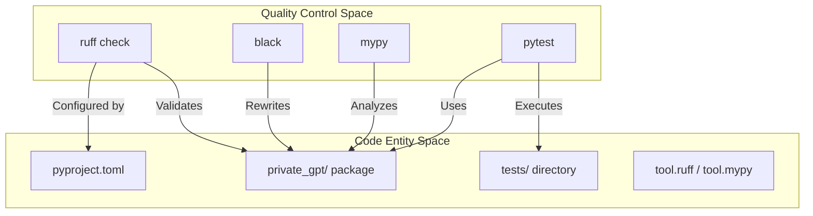
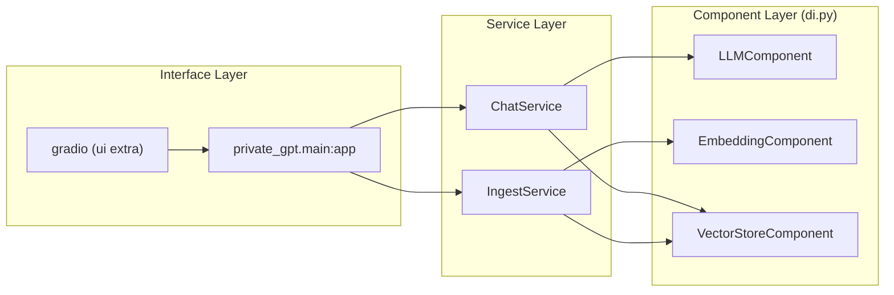

<!-- source: DeepWiki mcp.deepwiki.com · repo zylon-ai/private-gpt · page 6 Development Guide · fetched 2026-10-26 -->

# Development Guide

<details>
<summary>Relevant source files</summary>

The following files were used as context for generating this wiki page:

- [.gitignore](.gitignore)
- [LICENSE](LICENSE)
- [Makefile](Makefile)
- [fern/docs/pages/api-reference/api-reference.mdx](fern/docs/pages/api-reference/api-reference.mdx)
- [pyproject.toml](pyproject.toml)
- [scripts/utils.py](scripts/utils.py)

</details>


This guide is intended for developers working on or extending the PrivateGPT codebase. It covers the high-level development environment, the modular component architecture, and the workflows for maintaining code quality. For specific details on internals, see [Project Structure](#6.1), [Release Management](#6.2), and [Documentation System](#6.3).

## Development Environment Setup

### Python Requirements
PrivateGPT requires Python 3.11. This version is strictly enforced in the package configuration.
[pyproject.toml:8]()

### Dependency Management
The project uses Poetry for dependency management and packaging.
[pyproject.toml:1-5]()

1. **Install Dependencies**:
   ```bash
   poetry install
   ```
2. **Install Optional Extras**:
   PrivateGPT uses an "extras" system to keep the base installation lean. Developers should install extras relevant to their work:
   ```bash
   # Example: Install UI and Qdrant support
   poetry install -E ui -E vector-stores-qdrant
   ```
   [pyproject.toml:63-85]()

### Makefile Commands
A `Makefile` is provided to standardize common development tasks.
[Makefile:1-79]()

| Command | Action |
| :--- | :--- |
| `make setup` | Runs the setup script for the application [Makefile:60-61]() |
| `make dev` | Runs the FastAPI app via `uvicorn` with hot-reload enabled [Makefile:41-42]() |
| `make check` | Runs both `format` and `mypy` for a full quality check [Makefile:27-30]() |
| `make test` | Executes the test suite using `pytest` [Makefile:8-9]() |
| `make wipe` | Clears local data/databases based on current settings [Makefile:57-58]() |

## Development Workflow

The following diagram illustrates the relationship between development tools and the code lifecycle.

### Code Quality & Entity Mapping
This diagram maps the development commands to the underlying code entities they validate.


Sources: [pyproject.toml:114-197](), [Makefile:8-30]()

## Architecture Overview

PrivateGPT is built with a modular architecture that separates the API interface from the underlying RAG logic.

### Component Interaction Diagram
This diagram bridges the Natural Language concepts (Chat, Ingest) to the specific Python classes and modules.


Sources: [pyproject.toml:10-12](), [pyproject.toml:64](), [Makefile:39-43]()

## Extending PrivateGPT

The project is designed to be extensible through the following mechanisms:

1.  **Dependency Injection**: Managed via the `injector` library. Components are wired together in `di.py` (see [Project Structure](#6.1) for details). [pyproject.toml:12]()
2.  **LlamaIndex Integration**: Most core components (LLM, Embedding, VectorStore) are wrappers around LlamaIndex abstractions, making it easy to swap providers. [pyproject.toml:19-40]()
3.  **Utility Scripts**: Developers can use `scripts/utils.py` to manage database states during development, such as wiping or viewing stats for `Postgres`, `Qdrant`, or `Chroma`. [scripts/utils.py:148-177]()

### Database Maintenance
The `scripts/utils.py` script provides a `Command` class that dispatches maintenance tasks to specific database handlers like `Postgres`, `Qdrant`, or `Chroma`.
[scripts/utils.py:148-154]()

```python
# To wipe all data during development:
make wipe
```
Sources: [Makefile:57-58](), [scripts/utils.py:174-177]()

## Sub-Pages
- **[Project Structure](#6.1)**: Deep dive into the `private_gpt` package, dependency injection, and module organization.
- **[Release Management](#6.2)**: Information on versioning, `release-please`, and CI/CD pipelines.
- **[Documentation System](#6.3)**: How to manage the Fern-based documentation and SDK generation.

---

