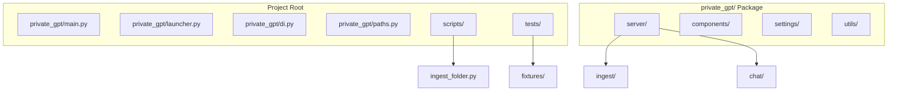
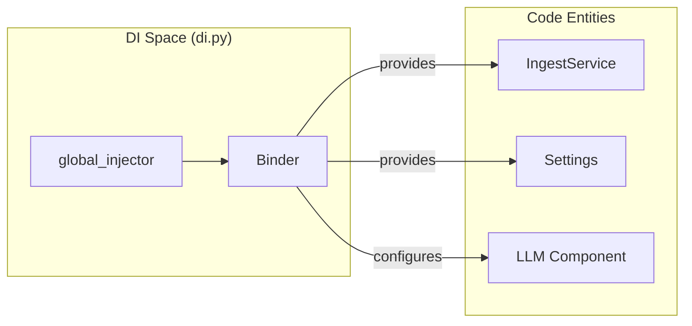
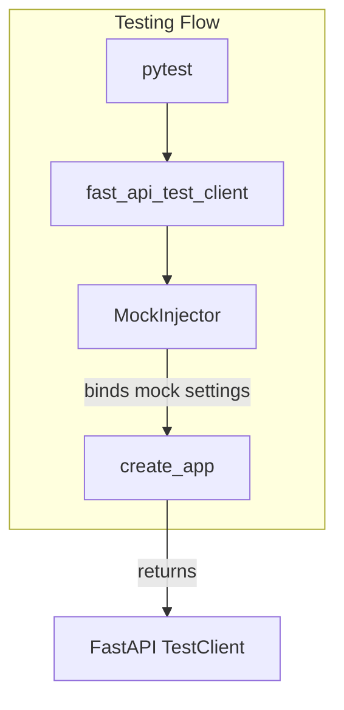

<!-- source: DeepWiki mcp.deepwiki.com · repo zylon-ai/private-gpt · page 6.1 Project Structure · fetched 2026-10-26 -->

# Project Structure

Relevant source files

The following files were used as context for generating this wiki page:

- [.dockerignore](.dockerignore)
- [.github/workflows/tests.yml](.github/workflows/tests.yml)
- [.pre-commit-config.yaml](.pre-commit-config.yaml)
- [private_gpt/__main__.py](private_gpt/__main__.py)
- [private_gpt/di.py](private_gpt/di.py)
- [private_gpt/main.py](private_gpt/main.py)
- [private_gpt/paths.py](private_gpt/paths.py)
- [private_gpt/settings/settings_loader.py](private_gpt/settings/settings_loader.py)
- [private_gpt/utils/eta.py](private_gpt/utils/eta.py)
- [private_gpt/utils/ollama.py](private_gpt/utils/ollama.py)
- [private_gpt/utils/retry.py](private_gpt/utils/retry.py)
- [private_gpt/utils/typing.py](private_gpt/utils/typing.py)
- [scripts/ingest_folder.py](scripts/ingest_folder.py)
- [tests/fixtures/fast_api_test_client.py](tests/fixtures/fast_api_test_client.py)
- [tests/fixtures/ingest_helper.py](tests/fixtures/ingest_helper.py)
- [tests/fixtures/mock_injector.py](tests/fixtures/mock_injector.py)

This document provides a technical overview of the PrivateGPT repository organization, code architecture, and key modules. Understanding this structure is essential for developers who want to extend or modify PrivateGPT functionality.

## Repository Organization

PrivateGPT follows a modular architecture with clear separation between API endpoints, services, and component implementations. The `private_gpt` package contains the core logic, while scripts and configuration reside at the root.

Sources: [private_gpt/main.py:1-7](), [private_gpt/launcher.py:1-10](), [scripts/ingest_folder.py:1-15]()

## Entry Points and Launcher

The application has two primary entry points depending on how it is invoked:

1.  **Direct Execution**: Running `python -m private_gpt` triggers `private_gpt/__main__.py`, which uses `uvicorn` to run the FastAPI app on the configured port [private_gpt/__main__.py:1-11]().
2.  **Module Import**: `private_gpt/main.py` initializes the FastAPI `app` instance by calling the launcher's `create_app` function [private_gpt/main.py:3-6]().

The `launcher.py` (referenced in [private_gpt/main.py:4]()) is responsible for assembling the FastAPI application, including mounting routers and configuring middleware.

Sources: [private_gpt/__main__.py:1-11](), [private_gpt/main.py:1-7]()

## Dependency Injection (DI)

PrivateGPT uses the `injector` library to manage component lifecycles and wiring. This is centralized in `private_gpt/di.py`.

*   **`global_injector`**: A singleton instance of the application's DI container [private_gpt/di.py:1-10]().
*   **Binding Logic**: The DI system binds abstract service classes (like `IngestService`) to their concrete implementations based on the active `Settings` [scripts/ingest_folder.py:119-121]().

Sources: [private_gpt/di.py:1-10](), [scripts/ingest_folder.py:7-9](), [tests/fixtures/mock_injector.py:8-16]()

## Configuration and Settings Loading

The settings system is responsible for merging YAML profiles and environment variables.

*   **Profiles**: Active profiles are determined by the `PGPT_PROFILES` environment variable. The `default` profile is always loaded, followed by specific profiles (e.g., `local`, `ollama`) and a `test` profile if running in a test environment [private_gpt/settings/settings_loader.py:19-29]().
*   **Merging**: Settings are merged using `deep_update` to allow specific profiles to override default values [private_gpt/settings/settings_loader.py:32-33]().
*   **`PROJECT_ROOT_PATH`**: Defined in constants/paths to resolve relative file paths for local storage and model files [private_gpt/settings/settings_loader.py:11-16]().

Sources: [private_gpt/settings/settings_loader.py:11-58]()

## Utility Modules

The `private_gpt/utils` directory contains helper logic used across the project:

| Module | Purpose | Key Functions/Classes |
| :--- | :--- | :--- |
| `retry.py` | Provides a decorator for retrying operations with jitter and backoff [private_gpt/utils/retry.py:10-31](). | `@retry` |
| `ollama.py` | Helpers for interacting with Ollama, including connection checks and model pulling with progress bars [private_gpt/utils/ollama.py:31-96](). | `check_connection`, `pull_model` |
| `eta.py` | Logic for calculating and reporting Estimated Time of Arrival for long-running tasks like bulk ingestion [private_gpt/utils/eta.py:50-122](). | `ETA` class, `eta` iterator |
| `typing.py` | Common type definitions and generics used for type hinting [private_gpt/utils/typing.py:1-5](). | `T` generic |

Sources: [private_gpt/utils/retry.py:10-31](), [private_gpt/utils/ollama.py:31-96](), [private_gpt/utils/eta.py:50-122]()

## Scripts and External Tools

The `scripts/` directory contains standalone utilities for administrative tasks.

*   **`ingest_folder.py`**: A CLI tool to ingest an entire directory into the system. It can operate in a one-time mode or a `--watch` mode using `IngestWatcher` to detect file changes in real-time [scripts/ingest_folder.py:80-135]().
*   **`LocalIngestWorker`**: Encapsulates the logic for validating folders against the `local_ingestion` settings and calling `IngestService.bulk_ingest` [scripts/ingest_folder.py:15-62]().

Sources: [scripts/ingest_folder.py:15-135]()

## Testing Infrastructure

The `tests/` directory is organized to support both unit and integration testing.

*   **Fixtures**: Located in `tests/fixtures/`, these provide reusable components for tests.
    *   `MockInjector`: Allows tests to override specific DI bindings or settings [tests/fixtures/mock_injector.py:14-34]().
    *   `fast_api_test_client.py`: Provides a `TestClient` instance configured with a mock injector for API testing [tests/fixtures/fast_api_test_client.py:8-14]().
    *   `ingest_helper.py`: A helper class for programmatically ingesting files during tests via the `/v1/ingest/file` endpoint [tests/fixtures/ingest_helper.py:9-24]().
*   **CI/CD Integration**: Tests are executed via `make test` or `make test-coverage` as defined in the GitHub Actions workflow [ .github/workflows/tests.yml:36-44]().

Sources: [tests/fixtures/mock_injector.py:1-43](), [tests/fixtures/fast_api_test_client.py:1-15](), [.github/workflows/tests.yml:36-44]()

---

