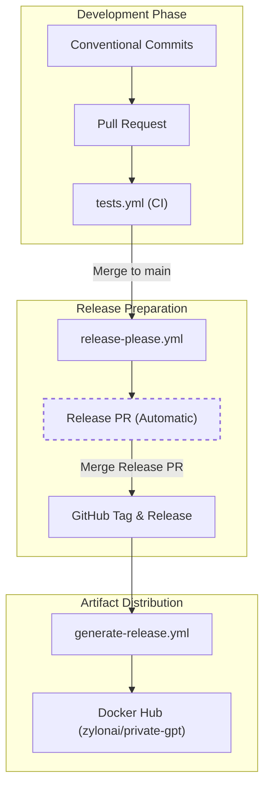

<!-- source: DeepWiki mcp.deepwiki.com · repo zylon-ai/private-gpt · page 6.2 Release Management · fetched 2026-10-26 -->

# Release Management

<details>
<summary>Relevant source files</summary>

The following files were used as context for generating this wiki page:

- [.dockerignore](.dockerignore)
- [.github/release_please/.release-please-config.json](.github/release_please/.release-please-config.json)
- [.github/release_please/.release-please-manifest.json](.github/release_please/.release-please-manifest.json)
- [.github/workflows/generate-release.yml](.github/workflows/generate-release.yml)
- [.github/workflows/release-please.yml](.github/workflows/release-please.yml)
- [.github/workflows/tests.yml](.github/workflows/tests.yml)
- [.pre-commit-config.yaml](.pre-commit-config.yaml)
- [CHANGELOG.md](CHANGELOG.md)
- [Dockerfile.llamacpp-cpu](Dockerfile.llamacpp-cpu)
- [Dockerfile.ollama](Dockerfile.ollama)
- [version.txt](version.txt)

</details>


This document outlines the release management process for PrivateGPT, detailing the versioning strategy, the automated release-please workflow, and the CI/CD pipelines used to publish Docker artifacts.

## Versioning Strategy

PrivateGPT follows semantic versioning (SemVer) with a `MAJOR.MINOR.PATCH` format. Version information is synchronized across several files to ensure consistency:

*   `version.txt`: The single source of truth for the current version string [version.txt:1-1]().
*   `pyproject.toml`: Updated via the `release-please` configuration [ .github/release_please/.release-please-config.json:8-9]().
*   `.github/release_please/.release-please-manifest.json`: Tracks the current version for the automation engine [ .github/release_please/.release-please-manifest.json:2-2]().

Sources: [version.txt](), [.github/release_please/.release-please-manifest.json](), [.github/release_please/.release-please-config.json]()

## Release Workflow

The PrivateGPT release process is heavily automated using GitHub Actions and the `release-please` action.

### Release Automation Flow
The following diagram illustrates how code changes move from development to a published release.


Sources: [.github/workflows/release-please.yml](), [.github/workflows/generate-release.yml](), [.github/workflows/tests.yml]()

### Release Please Implementation
The `release-please` action [ .github/workflows/release-please.yml:16-21]() uses a configuration file [ .github/release_please/.release-please-config.json]() to manage version bumps. It is configured as a `simple` release type [ .github/release_please/.release-please-config.json:3-3]() and is instructed to update:
*   `version.txt` [ .github/release_please/.release-please-config.json:4-4]()
*   `pyproject.toml` (specifically `$.tool.poetry.version`) [ .github/release_please/.release-please-config.json:8-9]()
*   `docker-compose.yaml` [ .github/release_please/.release-please-config.json:13-14]()

Sources: [.github/workflows/release-please.yml](), [.github/release_please/.release-please-config.json]()

## Code Quality and CI Pipelines

Before a release can occur, code must pass a series of quality gates defined in `.github/workflows/tests.yml`.

### CI Quality Gates
The `tests.yml` workflow runs on every push to `main` and every pull request [ .github/workflows/tests.yml:4-8](). It consists of three main stages:

1.  **Setup**: Installs dependencies.
2.  **Checks**: A matrix job [ .github/workflows/tests.yml:25-29]() running:
    *   `black`: Formatting check.
    *   `ruff`: Linting.
    *   `mypy`: Static type checking.
3.  **Test**: Runs the full test suite via `make test-coverage` [ .github/workflows/tests.yml:44-44]().

### Pre-commit Configuration
Local development is guarded by `.pre-commit-config.yaml`, which mirrors the CI checks to ensure developers catch issues before pushing [ .pre-commit-config.yaml:16-43]().

| Hook ID | Tool | Stage | Command |
| :--- | :--- | :--- | :--- |
| `black` | Black | commit | `black` |
| `ruff` | Ruff | commit | `ruff` |
| `mypy` | Mypy | commit | `make mypy` |
| `test` | Pytest | push | `make test` |

Sources: [.github/workflows/tests.yml](), [.pre-commit-config.yaml]()

## Docker Image Management

The release process culminates in the `generate-release` workflow, which builds and pushes multi-platform Docker images.

### Build Strategy
The workflow `generate-release.yml` triggers upon a release being published [ .github/workflows/generate-release.yml:4-5](). It utilizes a build matrix to generate different flavors of PrivateGPT [ .github/workflows/generate-release.yml:19-20]():
*   `llamacpp-cpu`: Based on `Dockerfile.llamacpp-cpu`.
*   `ollama`: Based on `Dockerfile.ollama`.

### Image Tagging Logic
The `docker/metadata-action` [ .github/workflows/generate-release.yml:58-67]() handles semantic version tagging. 
*   **Default Type**: `ollama` is the default image type [ .github/workflows/generate-release.yml:12-12]().
*   **Tags**:
    *   The default type gets tags like `latest`, `0.6.2`, and `0.6`.
    *   Specific types get suffixed tags like `0.6.2-llamacpp-cpu` [ .github/workflows/generate-release.yml:63-63]().

### Docker Build Context to Code Mapping
This diagram shows how the Docker build process maps system components to specific Dockerfiles and dependencies.

```mermaid
graph LR
    subgraph "Docker Artifacts"
        OLL["zylonai/private-gpt:ollama"]
        CPP["zylonai/private-gpt:llamacpp-cpu"]
    end

    subgraph "Build Definitions"
        DFO["Dockerfile.ollama"]
        DFC["Dockerfile.llamacpp-cpu"]
    end

    subgraph "Poetry Extras"
        EXO["llms-ollama, embeddings-ollama"]
        EXC["llms-llama-cpp, embeddings-huggingface"]
    end

    DFO -->| "Builds" | OLL
    DFC -->| "Builds" | CPP
    EXO -.->| "POETRY_EXTRAS" | DFO
    EXC -.->| "POETRY_EXTRAS" | DFC
```
Sources: [Dockerfile.ollama:17-18](), [Dockerfile.llamacpp-cpu:27-28](), [.github/workflows/generate-release.yml:75-75]()

## Changelog Maintenance

The `CHANGELOG.md` is automatically updated by `release-please`. It categorizes changes based on Conventional Commit prefixes:
*   **Features**: `feat:` commits [CHANGELOG.md:26-41]().
*   **Bug Fixes**: `fix:` commits [CHANGELOG.md:6-11]().

Each entry in the changelog links to the specific PR and the commit SHA for full auditability [CHANGELOG.md:8-11]().

Sources: [CHANGELOG.md]()

---

