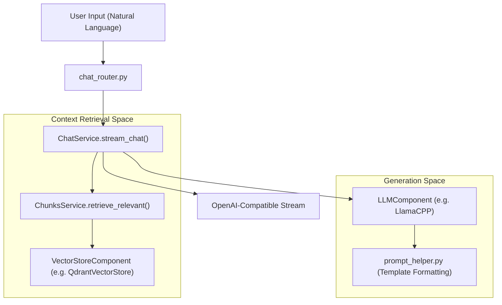
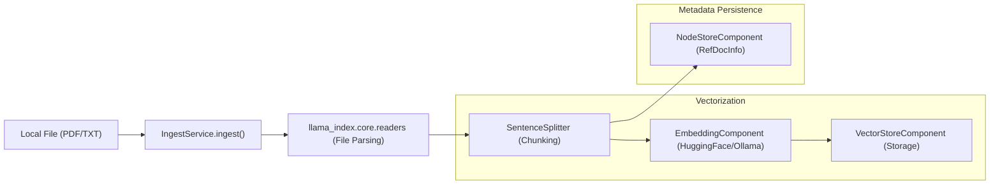

<!-- source: DeepWiki mcp.deepwiki.com · repo zylon-ai/private-gpt · page 7 Glossary · fetched 2026-10-26 -->

# Glossary

Relevant source files

The following files were used as context for generating this wiki page:

- [README.md](README.md)
- [fern/docs/assets/ui.png](fern/docs/assets/ui.png)
- [fern/docs/pages/installation/concepts.mdx](fern/docs/pages/installation/concepts.mdx)
- [fern/docs/pages/manual/llms.mdx](fern/docs/pages/manual/llms.mdx)
- [fern/docs/pages/manual/vectordb.mdx](fern/docs/pages/manual/vectordb.mdx)
- [private_gpt/components/llm/llm_component.py](private_gpt/components/llm/llm_component.py)
- [private_gpt/components/vector_store/vector_store_component.py](private_gpt/components/vector_store/vector_store_component.py)
- [private_gpt/server/recipes/summarize/summarize_service.py](private_gpt/server/recipes/summarize/summarize_service.py)
- [private_gpt/settings/settings.py](private_gpt/settings/settings.py)
- [private_gpt/ui/ui.py](private_gpt/ui/ui.py)
- [pyproject.toml](pyproject.toml)
- [settings.yaml](settings.yaml)

This glossary defines technical terms, domain concepts, and abbreviations specific to the PrivateGPT codebase. It is designed to assist onboarding engineers in navigating the system's architecture and understanding its underlying RAG (Retrieval Augmented Generation) logic.

## Core Concepts

### RAG (Retrieval Augmented Generation)
The primary architectural pattern of PrivateGPT. It combines a retrieval system (finding relevant document chunks) with a generative LLM to provide context-aware answers. The implementation is split into high-level APIs (abstracting the pipeline) and low-level APIs (exposing primitives like embeddings and chunks) [README.md:27-37]().

### Dependency Injection (DI)
PrivateGPT uses the `injector` library to decouple component definitions from their usage. This allows for pluggable backends (e.g., swapping OpenAI for LlamaCPP) without modifying service logic [README.md:89-91](). The global injector is managed in the `di` module [private_gpt/di.py]().

### Profiles
Configuration sets defined by the `PGPT_PROFILES` environment variable. Profiles allow the system to load specific YAML configurations (e.g., `settings-ollama.yaml`) on top of the base `settings.yaml` [fern/docs/pages/installation/concepts.mdx:34-44]().

---

## Technical Terms & Jargon

### Context Filter
A mechanism to restrict RAG operations (chat, search, summarization) to a specific subset of ingested documents.
* **Code Entity**: `ContextFilter` [private_gpt/open_ai/extensions/context_filter.py]()
* **Usage**: Passed to `ChatService` or `SummarizeService` to filter nodes by `doc_id` [private_gpt/server/chat/chat_service.py](), [private_gpt/server/recipes/summarize/summarize_service.py:75]().

### Node / Chunk
The smallest unit of text used in the system. During ingestion, documents are parsed and split into "Nodes" (LlamaIndex terminology) or "Chunks".
* **Code Entity**: `Chunk` [private_gpt/server/chunks/chunks_service.py:23]()
* **Data Flow**: `IngestService` -> `SentenceSplitter` -> `Nodes` -> `VectorStore` [private_gpt/server/ingest/ingest_service.py]().

### Prompt Style
Defines the formatting template used to wrap user messages for specific LLMs (e.g., Llama3, Mistral, ChatML).
* **Configuration**: `llm.prompt_style` [private_gpt/settings/settings.py:139-152]()
* **Implementation**: `get_prompt_style` in [private_gpt/components/llm/prompt_helper.py]().

---

## Component Definitions

| Term | Description | Code Pointer |
| :--- | :--- | :--- |
| **LLMComponent** | Wrapper for the Large Language Model provider (Ollama, OpenAI, LlamaCPP, etc.) | [private_gpt/components/llm/llm_component.py:19]() |
| **EmbeddingComponent** | Handles text-to-vector transformations using HuggingFace, OpenAI, or Ollama | [private_gpt/components/embedding/embedding_component.py]() |
| **VectorStoreComponent** | Interface for the vector database (Qdrant, Chroma, Milvus, Postgres) | [private_gpt/components/vector_store/vector_store_component.py:33]() |
| **NodeStoreComponent** | Manages the storage of document metadata and relationships (Postgres or Simple) | [private_gpt/components/node_store/node_store_component.py]() |

---

## System Data Flow: Natural Language to Code Entity

The following diagrams illustrate how high-level concepts map to specific code entities and how data flows through the system during a RAG operation.

### Chat Request Flow (RAG Mode)
This diagram bridges the user's natural language query to the internal service calls.

**Sources**: [private_gpt/server/chat/chat_service.py](), [private_gpt/components/llm/llm_component.py](), [private_gpt/components/vector_store/vector_store_component.py]().

### Ingestion Flow
This diagram maps the process of converting a file into searchable vector data.

**Sources**: [private_gpt/server/ingest/ingest_service.py](), [private_gpt/components/embedding/embedding_component.py](), [private_gpt/server/recipes/summarize/summarize_service.py:113-117]().

---

## Glossary Table of Abbreviations

| Abbreviation | Full Term | Context in PrivateGPT |
| :--- | :--- | :--- |
| **GGUF** | GPT-Generated Unified Format | Binary format for loading models in `llamacpp` mode [private_gpt/settings/settings.py:165](). |
| **HF** | Hugging Face | Refers to models or tokenizers pulled from Hugging Face Hub [private_gpt/components/llm/llm_component.py:25](). |
| **CORS** | Cross-Origin Resource Sharing | Configuration for API access from different domains [private_gpt/settings/settings.py:8-43](). |
| **TFS** | Tail Free Sampling | A parameter for `llamacpp` and `ollama` to reduce impact of low-probability tokens [private_gpt/settings/settings.py:166](). |

---

## UI Modes
The Gradio UI [private_gpt/ui/ui.py]() supports four distinct interaction modes defined in the `Modes` Enum [private_gpt/ui/ui.py:40-44]():
1.  **RAG**: Uses ingested documents as context for the LLM.
2.  **Search**: Returns relevant chunks from documents without LLM generation.
3.  **Basic**: Standard LLM chat without document context.
4.  **Summarize**: Generates a summary of specific documents or text using `SummarizeService` [private_gpt/server/recipes/summarize/summarize_service.py]().

**Sources**: [private_gpt/ui/ui.py:40-52](), [private_gpt/settings/settings.py](), [README.md](), [fern/docs/pages/installation/concepts.mdx]().