# Page: Overview

# Overview

<details>
<summary>Relevant source files</summary>

The following files were used as context for generating this wiki page:

- [.github/release_please/.release-please-manifest.json](.github/release_please/.release-please-manifest.json)
- [CHANGELOG.md](CHANGELOG.md)
- [README.md](README.md)
- [fern/docs/assets/ui.png](fern/docs/assets/ui.png)
- [private_gpt/__init__.py](private_gpt/__init__.py)
- [tiktoken_cache/.gitignore](tiktoken_cache/.gitignore)
- [version.txt](version.txt)

</details>


PrivateGPT is a production-ready AI system that enables users to ask questions about their documents using the power of Large Language Models (LLMs), with complete privacy. All processing happens locally, ensuring that no data leaves the execution environment at any point [README.md:12-14]().

The project provides an API offering all the primitives required to build private, context-aware AI applications, following and extending the OpenAI API standard [README.md:21-23]().

## Purpose and Key Features

PrivateGPT addresses a critical concern in AI adoption: **privacy**. It allows organizations and individuals to leverage advanced AI capabilities while maintaining complete control over their data [README.md:48-51]().

Key features include:

| Feature | Description |
|---------|-------------|
| Document Ingestion | Internally managing document parsing, splitting, metadata extraction, embedding generation, and storage [README.md:29-30](). |
| Context-Aware Responses | Generate responses based on document content, abstracting retrieval and prompt engineering [README.md:31-32](). |
| Customizable LLM Support | Use local models (LlamaCPP, Ollama) or connect to cloud providers (OpenAI, Azure, Gemini, SageMaker) [README.md:104-106](), [CHANGELOG.md:35-37](). |
| Flexible Vector Stores | Support for Qdrant, Chroma, Milvus, Postgres/pgvector, and ClickHouse [CHANGELOG.md:39-40](). |
| Privacy-First Design | 100% private; no data leaves the execution environment [README.md:13-14](). |
| API-First Architecture | Built using FastAPI, following OpenAI's API scheme [README.md:83-84](). |
| User Interface | A working Gradio UI client is provided for testing [README.md:38-39](). |

For details, see [Key Features](#1.1).

Sources: [README.md:12-51](), [CHANGELOG.md:35-40]()

## System Architecture

PrivateGPT is an API that wraps a Retrieval Augmented Generation (RAG) pipeline based on **LlamaIndex** [README.md:81-85](). It utilizes a modular design with Dependency Injection to decouple components [README.md:89]().

### High-Level Architecture

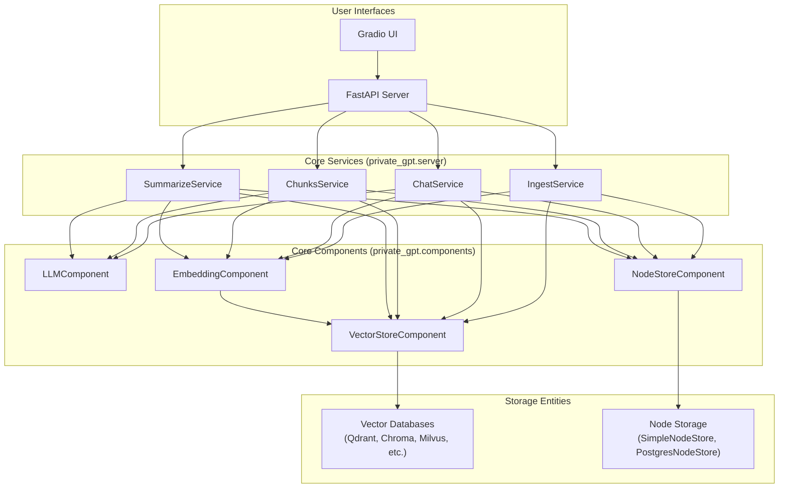

Sources: [README.md:81-107](), [CHANGELOG.md:38-40]()

The architecture separates the API layer (routers and services) from the implementation layer (components):
- **Services**: Found in `private_gpt.server.<api>`, these use LlamaIndex base abstractions rather than specific implementations [README.md:97-101]().
- **Components**: Found in `private_gpt.components.<component>`, these provide the actual implementations (e.g., `LlamaCPP` for the `LLM` abstraction) [README.md:102-106]().

For details, see [System Architecture](#1.2).

## API and Service Structure

The system exposes both high-level and low-level APIs to cater to different integration needs.

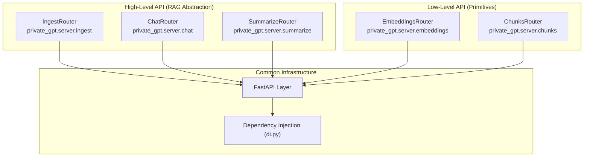

- **High-level API**: Abstracts the complexity of the RAG pipeline, including ingestion and context-aware chat [README.md:27-32]().
- **Low-level API**: Allows implementation of custom pipelines by exposing embedding generation and contextual chunk retrieval [README.md:34-37]().

Sources: [README.md:25-38](), [README.md:97-101]()

## RAG Pipeline Logic

The core functionality follows the standard RAG lifecycle, managed through `LlamaIndex` abstractions:

1.  **Ingestion**: Documents are parsed, split into chunks, and transformed into embeddings via the `EmbeddingComponent`. These are stored in the `VectorStoreComponent` [README.md:29-30]().
2.  **Retrieval**: During chat or completion, the `ChunksService` retrieves the most relevant text chunks based on the query [README.md:36-37]().
3.  **Generation**: The `ChatService` uses the retrieved context and the `LLMComponent` to generate a response [README.md:31-32]().
4.  **Summarization**: A specialized `SummarizeService` utilizes `SummaryIndex` and `TREE_SUMMARIZE` modes to process documents [CHANGELOG.md:38]().

Sources: [README.md:27-37](), [README.md:85-91](), [CHANGELOG.md:38]()

## Configuration and Deployment

PrivateGPT is designed to be portable and highly configurable. It supports multiple LLM backends and vector stores through a YAML-based configuration system.

- **Environment Control**: Uses `PGPT_PROFILES` to load specific settings (e.g., `settings-ollama.yaml`, `settings-azopenai.yaml`) [CHANGELOG.md:35-37]().
- **Deployment**: Supports Docker via `docker-compose.yaml` with profiles for CPU (Ollama/LlamaCPP) and GPU (CUDA) [CHANGELOG.md:20-21]().
- **Offline Readiness**: Includes a `tiktoken_cache` within the repository to support environments without internet access [private_gpt/__init__.py:26-27]().

Sources: [private_gpt/__init__.py:26-27](), [CHANGELOG.md:20-21](), [CHANGELOG.md:35-37]()

---

# Page: Key Features

# Key Features

<details>
<summary>Relevant source files</summary>

The following files were used as context for generating this wiki page:

- [.github/release_please/.release-please-manifest.json](.github/release_please/.release-please-manifest.json)
- [CHANGELOG.md](CHANGELOG.md)
- [README.md](README.md)
- [fern/README.md](fern/README.md)
- [fern/docs/assets/ui.png](fern/docs/assets/ui.png)
- [fern/docs/pages/manual/ingestion.mdx](fern/docs/pages/manual/ingestion.mdx)
- [fern/docs/pages/overview/welcome.mdx](fern/docs/pages/overview/welcome.mdx)
- [settings-mock.yaml](settings-mock.yaml)
- [version.txt](version.txt)

</details>


This page details the main features and capabilities of PrivateGPT, a production-ready AI project that enables users to ask questions about their documents using Large Language Models (LLMs) while maintaining complete data privacy. It focuses on the technical aspects of what makes PrivateGPT unique and how these features work together.

For information about the overall system architecture, see [System Architecture](1.2).

## Privacy-First Design

PrivateGPT's primary feature is its ability to provide AI capabilities while ensuring complete data privacy:

- **100% private operation**: By default, no data leaves your execution environment at any point [README.md:12-14]().
- **Fully local execution**: Support for running LLMs and embedding models entirely offline, addressing privacy concerns in sensitive domains like healthcare or legal [README.md:47-52]().
- **Execution Environment**: Data remains under the user's control, making it suitable for regulated industries [README.md:17-19]().

Sources: [README.md:11-14](), [README.md:47-52]()

## API Structure

PrivateGPT provides a comprehensive API that follows and extends the OpenAI API standard [README.md:21-23](). The API is divided into high-level and low-level building blocks:

### API Architecture

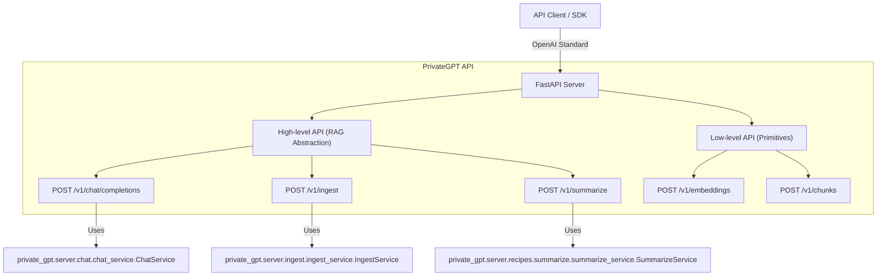

Sources: [README.md:21-37](), [README.md:81-85](), [README.md:97-101]()

### High-Level API
The high-level API abstracts the complexity of a RAG (Retrieval Augmented Generation) pipeline [README.md:27-28]():
- **Ingestion of documents**: Manages document parsing, splitting, metadata extraction, embedding generation, and storage [README.md:29-30]().
- **Chat & Completions**: Abstracting retrieval of context, prompt engineering, and response generation [README.md:31-32]().

### Low-Level API
Allows advanced users to implement complex custom pipelines [README.md:34]():
- **Embeddings generation**: Based on a piece of text [README.md:35]().
- **Contextual chunks retrieval**: Returns the most relevant chunks of text from ingested documents given a query [README.md:36-37]().

## RAG Pipeline

PrivateGPT implements a sophisticated RAG pipeline based on `LlamaIndex` [README.md:85]().

### RAG Data Flow (Natural Language to Code Entities)

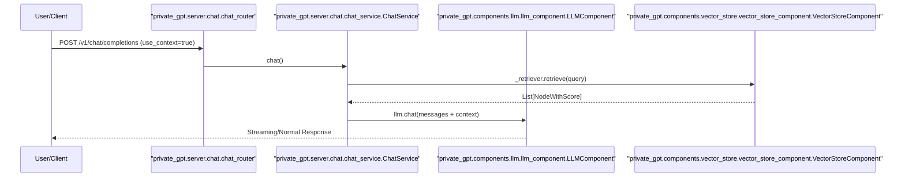

Sources: [README.md:81-95](), [README.md:97-101]()

## Model and Backend Flexibility

The architecture uses **Dependency Injection** to decouple the API from specific implementations [README.md:89]().

### Supported Backends

| Component | Supported Providers / Implementations |
|-----------|--------------------------------------|
| **LLM** | `llamacpp`, `ollama`, `openai`, `azopenai`, `sagemaker`, `gemini`, `mock` [README.md:105-106](), [CHANGELOG.md:19-35]() |
| **Embedding** | `huggingface`, `openai`, `ollama`, `mistralai`, `sagemaker`, `gemini` [CHANGELOG.md:35-59]() |
| **Vector Store** | `Qdrant`, `Chroma`, `Milvus`, `Postgres (pgvector)`, `ClickHouse` [CHANGELOG.md:39-40]() |

Sources: [README.md:102-106](), [CHANGELOG.md:19-40]()

## Document Processing & Ingestion

PrivateGPT supports a wide range of file formats and ingestion modes.

### Supported File Formats
Supports plain text (`.txt`, `.html`) and specialized formats:
- **Documents**: `.pdf`, `.docx`, `.pptx`, `.md`, `.epub`, `.json`, `.ipynb` [fern/docs/pages/manual/ingestion.mdx:107-125]()
- **Media (Transcription)**: `.mp3`, `.mp4`, `.jpg`, `.png` [fern/docs/pages/manual/ingestion.mdx:114-118]()

### Ingestion Modes
Configurable via `embedding.ingest_mode` [fern/docs/pages/manual/ingestion.mdx:74]():
- `simple`: Sequential ingestion [fern/docs/pages/manual/ingestion.mdx:70]().
- `batch`: Batched reading, parsing, and embedding [fern/docs/pages/manual/ingestion.mdx:71]().
- `parallel`: Parallelized processing (fastest for local setup) [fern/docs/pages/manual/ingestion.mdx:72]().
- `pipeline`: Alternative parallelized implementation [fern/docs/pages/manual/ingestion.mdx:73]().

Sources: [fern/docs/pages/manual/ingestion.mdx:69-74](), [fern/docs/pages/manual/ingestion.mdx:107-125]()

## Summarization Recipe

A specialized "Recipe" for document summarization is available via `POST /v1/summarize` [CHANGELOG.md:38]().
- **Implementation**: Uses `SummarizeService` and `SummaryIndex` [Wiki TOC:4.3]().
- **Modes**: Supports `TREE_SUMMARIZE` response mode for large documents [Wiki TOC:4.3]().

Sources: [CHANGELOG.md:38](), [Wiki TOC:4.3]()

## User Interface

PrivateGPT includes a built-in **Gradio UI** for testing and interaction [README.md:38-40]().
- **Features**: Chat interface, document upload, and context toggle [README.md:39-41]().
- **Light Mode**: Supported UI theme [CHANGELOG.md:50]().

Sources: [README.md:38-41](), [CHANGELOG.md:50](), [fern/docs/assets/ui.png:1-15]()

## Feature Summary

| Feature | Technical Implementation |
|---------|--------------------------|
| **Privacy** | Local LLM/Embedding execution (LlamaCPP/Ollama) |
| **RAG** | LlamaIndex integration with pluggable Vector Stores |
| **Compatibility** | OpenAI-compatible REST API (FastAPI) |
| **Ingestion** | Multi-modal support (Text, PDF, Audio, Images) |
| **Scaling** | Parallel ingestion workers & Batch processing |
| **Recipes** | Built-in Summarization service |

Sources: [README.md:11-41](), [fern/docs/pages/manual/ingestion.mdx:64-90]()

---

# Page: System Architecture

# System Architecture

<details>
<summary>Relevant source files</summary>

The following files were used as context for generating this wiki page:

- [.github/workflows/actions/install_dependencies/action.yml](.github/workflows/actions/install_dependencies/action.yml)
- [README.md](README.md)
- [fern/docs/assets/ui.png](fern/docs/assets/ui.png)
- [private_gpt/__main__.py](private_gpt/__main__.py)
- [private_gpt/di.py](private_gpt/di.py)
- [private_gpt/launcher.py](private_gpt/launcher.py)
- [private_gpt/main.py](private_gpt/main.py)
- [private_gpt/paths.py](private_gpt/paths.py)
- [private_gpt/settings/settings_loader.py](private_gpt/settings/settings_loader.py)
- [scripts/ingest_folder.py](scripts/ingest_folder.py)
- [settings-ollama.yaml](settings-ollama.yaml)

</details>


This document provides a comprehensive overview of PrivateGPT's system architecture, explaining how its core components interact to provide privacy-focused, retrieval-augmented generation capabilities. It details the implementation of the FastAPI server, the dependency injection pattern, and the integration with LlamaIndex.

## Overview

PrivateGPT is designed as a modular, extensible system that allows users to query their documents using Large Language Models (LLMs) while ensuring data privacy. The architecture follows these key principles:

- **Modularity**: Components are decoupled using dependency injection via the `injector` library [private_gpt/di.py:1-9]().
- **Extensibility**: Usage of LlamaIndex base abstractions like `LLM`, `BaseEmbedding`, and `VectorStore` allows for immediate implementation swaps [README.md:89-91]().
- **Privacy**: 100% private execution environment where no data leaves the system [README.md:12-14]().
- **Compatibility**: The API follows and extends the OpenAI API standard [README.md:21-23]().

The system is divided into two logical blocks: a **High-level API** for RAG pipelines (ingestion, chat, completions) and a **Low-level API** for primitives (embeddings, contextual chunks retrieval) [README.md:25-37]().

## High-Level Architecture

The system is organized into three distinct layers: the **Server Layer** (FastAPI routers), the **Service Layer** (Business logic), and the **Component Layer** (LlamaIndex implementations).

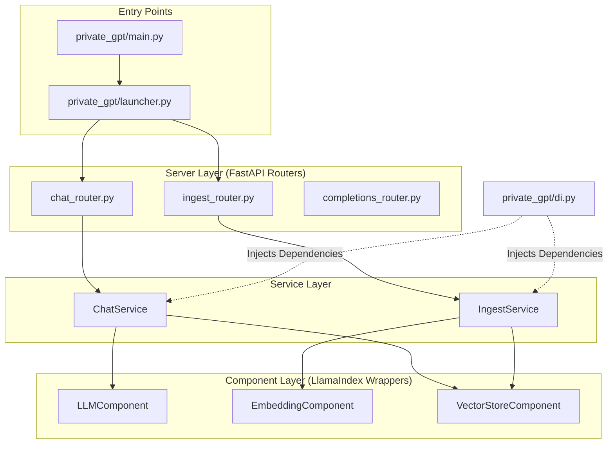
Sources: [README.md:96-107](), [private_gpt/launcher.py:24-69](), [private_gpt/main.py:1-6]()

## Dependency Injection Pattern

PrivateGPT uses the `injector` library to manage component lifecycles and decoupling. A `global_injector` is initialized in `private_gpt/di.py` [private_gpt/di.py:19]().

- **Binding**: The `Settings` class is bound to the `unsafe_typed_settings` loaded from YAML files [private_gpt/di.py:6-9]().
- **Request Lifecycle**: In `launcher.py`, the injector is bound to the FastAPI request state, allowing routers to access services via `request.state.injector` [private_gpt/launcher.py:27-30]().
- **Service Access**: Services and components are retrieved from the injector rather than being instantiated directly, facilitating testing and configuration-based swaps [private_gpt/di.py:12-18]().

Sources: [private_gpt/di.py:1-20](), [private_gpt/launcher.py:24-30]()

## Component Interactions

### FastAPI Server and Routers
The application is created in `private_gpt/launcher.py` using `create_app(root_injector)`. It includes several specialized routers:
- `chat_router`: Handles conversational AI interactions [private_gpt/launcher.py:12]().
- `ingest_router`: Manages document uploads and processing [private_gpt/launcher.py:17]().
- `completions_router`: OpenAI-compatible text completion [private_gpt/launcher.py:14]().
- `summarize_router`: Document summarization recipes [private_gpt/launcher.py:18]().

### Service vs. Component Packages
- **Services** (`private_gpt/server/<api>/<api>_service.py`): Contain the core business logic. They use LlamaIndex base abstractions to remain decoupled from specific provider implementations [README.md:97-101]().
- **Components** (`private_gpt/components/<component>/`): Responsible for providing the actual implementation of LlamaIndex abstractions (e.g., `LLMComponent` providing `LlamaCPP` or `Ollama`) [README.md:102-106]().

## Data Flow: Document Ingestion

The ingestion process moves data from the "Natural Language Space" (raw files) into the "Code Entity Space" (Vector Store Nodes).

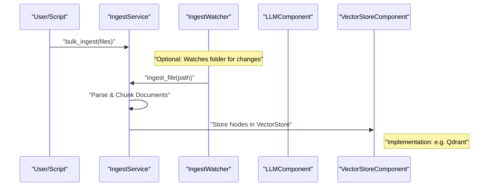
Sources: [scripts/ingest_folder.py:15-78](), [scripts/ingest_folder.py:119-135](), [README.md:29-30]()

## Configuration and Environment Profiles

The architecture is highly configurable through YAML files and environment variables.

| Entity | Description | Source |
| :--- | :--- | :--- |
| `PGPT_PROFILES` | Environment variable to select active profiles (e.g., `ollama`, `local`) | [private_gpt/settings/settings_loader.py:25]() |
| `Settings` | Pydantic-based settings model injected into components | [private_gpt/di.py:8]() |
| `settings-*.yaml` | Profile-specific configurations (e.g., `settings-ollama.yaml`) | [settings-ollama.yaml:1-31]() |

The `settings_loader.py` merges the `default` profile with any active profiles specified in `PGPT_PROFILES` [private_gpt/settings/settings_loader.py:50-57]().

## Implementation Details

### Server Entry Point
The server is typically started via `uvicorn`, running the `app` instance defined in `private_gpt/main.py` [private_gpt/__main__.py:5-11]().

### LlamaIndex Integration
PrivateGPT leverages LlamaIndex for its RAG pipeline. Key integrations include:
- **Callback Manager**: Configured in the launcher for observability [private_gpt/launcher.py:41-44]().
- **Storage Context**: Components like `VectorStoreComponent` manage the underlying LlamaIndex `StorageContext` to persist embeddings and document nodes.

### Local Ingestion Worker
For CLI-based ingestion, `scripts/ingest_folder.py` provides a `LocalIngestWorker` that interacts with the `IngestService` to process local directories [scripts/ingest_folder.py:15-21](). It includes a validation step to ensure folders are within allowed paths [scripts/ingest_folder.py:27-41]().

Sources: [private_gpt/launcher.py:41-44](), [scripts/ingest_folder.py:15-62](), [private_gpt/__main__.py:1-11]()

---

# Page: Installation and Setup

# Installation and Setup

<details>
<summary>Relevant source files</summary>

The following files were used as context for generating this wiki page:

- [fern/docs/pages/installation/installation.mdx](fern/docs/pages/installation/installation.mdx)
- [fern/docs/pages/installation/troubleshooting.mdx](fern/docs/pages/installation/troubleshooting.mdx)
- [poetry.lock](poetry.lock)
- [pyproject.toml](pyproject.toml)

</details>


This document provides a comprehensive guide for installing and configuring PrivateGPT. It covers everything from basic requirements to running a fully functional system with your desired components. This page serves as a high-level overview; for detailed configuration logic, see [Configuration System](#2.1), and for containerized or production setups, see [Deployment Options](#2.2).

## System Requirements

Before installing PrivateGPT, ensure your system meets these requirements:

| Requirement | Specification |
|-------------|---------------|
| **Python Version** | 3.11 (earlier or later versions are not supported) [pyproject.toml:8]() |
| **Operating Systems** | Linux, macOS (Intel/Apple Silicon), Windows [fern/docs/pages/installation/installation.mdx:14-25]() |
| **Dependency Manager** | Poetry 1.8.3 (recommended) [fern/docs/pages/installation/installation.mdx:33]() |

Sources: [pyproject.toml:8](), [fern/docs/pages/installation/installation.mdx:12-34]()

## Installation Flow

PrivateGPT's installation involves several key steps, from repository setup to running the system with the appropriate components.

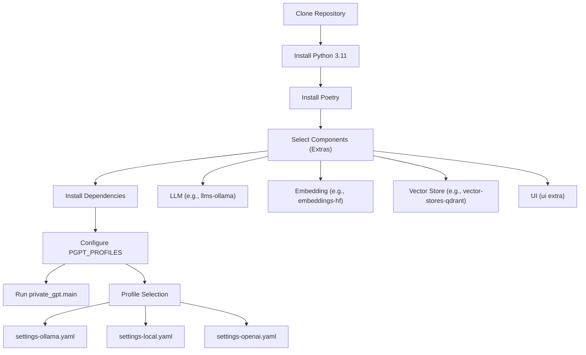

Sources: [fern/docs/pages/installation/installation.mdx:4-56](), [pyproject.toml:63-85]()

## Installation Steps

### 1. Clone the Repository
```bash
git clone https://github.com/zylon-ai/private-gpt
cd private-gpt
```

### 2. Install Python 3.11
It is recommended to use `pyenv` or `pyenv-win` to ensure the correct version is used [fern/docs/pages/installation/installation.mdx:12-25]().

### 3. Install Poetry
PrivateGPT uses Poetry for dependency management [pyproject.toml:1](). Ensure you are using version 1.8.3 to avoid known bugs in earlier versions [fern/docs/pages/installation/installation.mdx:33]().

### 4. Component Selection and Installation
PrivateGPT is modular. Use Poetry's `--extras` flag to install only the dependencies required for your chosen backend. Available extras are defined in `pyproject.toml` [pyproject.toml:63-85]().

```bash
# Example for a local Ollama setup with UI
poetry install --extras "ui llms-ollama embeddings-ollama vector-stores-qdrant"
```

Sources: [fern/docs/pages/installation/installation.mdx:5-56](), [pyproject.toml:63-85]()

## Component Selection

The system supports various providers for LLMs, Embeddings, and Vector Stores. These are mapped to specific `llama-index` integration libraries [pyproject.toml:21-40]().

### Available Modules

| Category | Options (Extras) |
|----------|------------------|
| **LLM** | `llms-ollama`, `llms-llama-cpp`, `llms-openai`, `llms-azopenai`, `llms-sagemaker`, `llms-gemini` |
| **Embeddings** | `embeddings-ollama`, `embeddings-huggingface`, `embeddings-openai`, `embeddings-sagemaker`, `embeddings-azopenai` |
| **Vector Store** | `vector-stores-qdrant`, `vector-stores-milvus`, `vector-stores-chroma`, `vector-stores-postgres`, `vector-stores-clickhouse` |
| **UI** | `ui` (Gradio-based) |

Sources: [pyproject.toml:63-85](), [fern/docs/pages/installation/installation.mdx:62-100]()

## System Architecture Bridge

The following diagram maps high-level installation choices to the internal `private_gpt` code entities and configuration files.

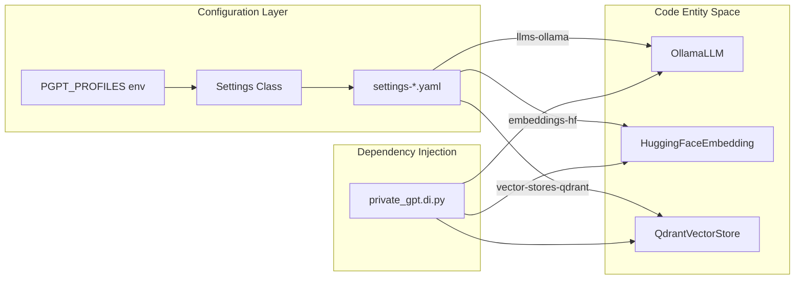

Sources: [pyproject.toml:21-40](), [fern/docs/pages/installation/installation.mdx:111-126]()

## Recommended Setups

### Local Setup with Ollama (Recommended)
This setup uses the Ollama service for both LLM and Embeddings, abstracting GPU complexity [fern/docs/pages/installation/installation.mdx:130-132]().

1. Install and run Ollama (`ollama serve`).
2. Pull models: `ollama pull llama3.1` and `ollama pull nomic-embed-text` [fern/docs/pages/installation/installation.mdx:150-151]().
3. Run PrivateGPT:
   ```bash
   PGPT_PROFILES=ollama make run
   ```

### Local Setup with LlamaCPP
Uses `llama-cpp-python` for direct GGUF model execution [pyproject.toml:22]().
1. Install extras: `poetry install --extras "ui llms-llama-cpp embeddings-huggingface vector-stores-qdrant"`.
2. Run setup script to download models: `poetry run python scripts/setup`.
3. Run: `PGPT_PROFILES=local make run`.

Sources: [fern/docs/pages/installation/installation.mdx:130-236](), [pyproject.toml:22-29]()

## Troubleshooting

### Embedding Dimensions Mismatch
This occurs when the `embedding.embed_dim` in settings does not match the output of the selected model [fern/docs/pages/installation/troubleshooting.mdx:34-38](). For example, `nomic-embed-text` requires 768 dimensions [fern/docs/pages/installation/troubleshooting.mdx:37]().

### Gated Models
For models like Llama 3.1 on HuggingFace, you must provide an `access_token` in `settings.yaml` or via the `HF_TOKEN` environment variable [fern/docs/pages/installation/troubleshooting.mdx:8-17]().

### GPU Support for LlamaCPP
On Windows or Linux with NVIDIA GPUs, you may need to force a reinstall of `llama-cpp-python` with CUDA flags:
```bash
CMAKE_ARGS="-DLLAMA_CUBLAS=on" poetry run pip install --force-reinstall --no-cache-dir llama-cpp-python
```

Sources: [fern/docs/pages/installation/troubleshooting.mdx:1-64](), [fern/docs/pages/installation/installation.mdx:272-300]()

## Next Steps

For a deeper dive into how PrivateGPT manages these configurations and deployments, refer to the child pages:
- For YAML structure and Pydantic models, see [Configuration System](#2.1).
- For Docker and production deployment details, see [Deployment Options](#2.2).

---

# Page: Configuration System

# Configuration System

<details>
<summary>Relevant source files</summary>

The following files were used as context for generating this wiki page:

- [.github/workflows/actions/install_dependencies/action.yml](.github/workflows/actions/install_dependencies/action.yml)
- [private_gpt/__main__.py](private_gpt/__main__.py)
- [private_gpt/di.py](private_gpt/di.py)
- [private_gpt/launcher.py](private_gpt/launcher.py)
- [private_gpt/paths.py](private_gpt/paths.py)
- [private_gpt/settings/settings.py](private_gpt/settings/settings.py)
- [private_gpt/settings/settings_loader.py](private_gpt/settings/settings_loader.py)
- [private_gpt/settings/yaml.py](private_gpt/settings/yaml.py)
- [settings-azopenai.yaml](settings-azopenai.yaml)
- [settings-docker.yaml](settings-docker.yaml)
- [settings-gemini.yaml](settings-gemini.yaml)
- [settings-local.yaml](settings-local.yaml)
- [settings-ollama-pg.yaml](settings-ollama-pg.yaml)
- [settings-ollama.yaml](settings-ollama.yaml)
- [settings-openai.yaml](settings-openai.yaml)
- [settings-vllm.yaml](settings-vllm.yaml)
- [settings.yaml](settings.yaml)
- [tests/settings/test_settings_loader.py](tests/settings/test_settings_loader.py)

</details>


The configuration system in PrivateGPT is a robust, YAML-based framework built on Pydantic models. It manages the application's behavior, including LLM and embedding provider selection, vector store connectivity, and server parameters. It supports hierarchical profile merging and environment variable expansion.

## 1. Configuration Architecture and Data Flow

PrivateGPT uses a multi-layered approach to load settings. The system starts with a base configuration and layers profile-specific overrides and environment variables on top.

### 1.1 Settings Loading Process
The loading logic resides in `private_gpt/settings/settings_loader.py`. It identifies active profiles from the `PGPT_PROFILES` environment variable and merges their corresponding YAML files.

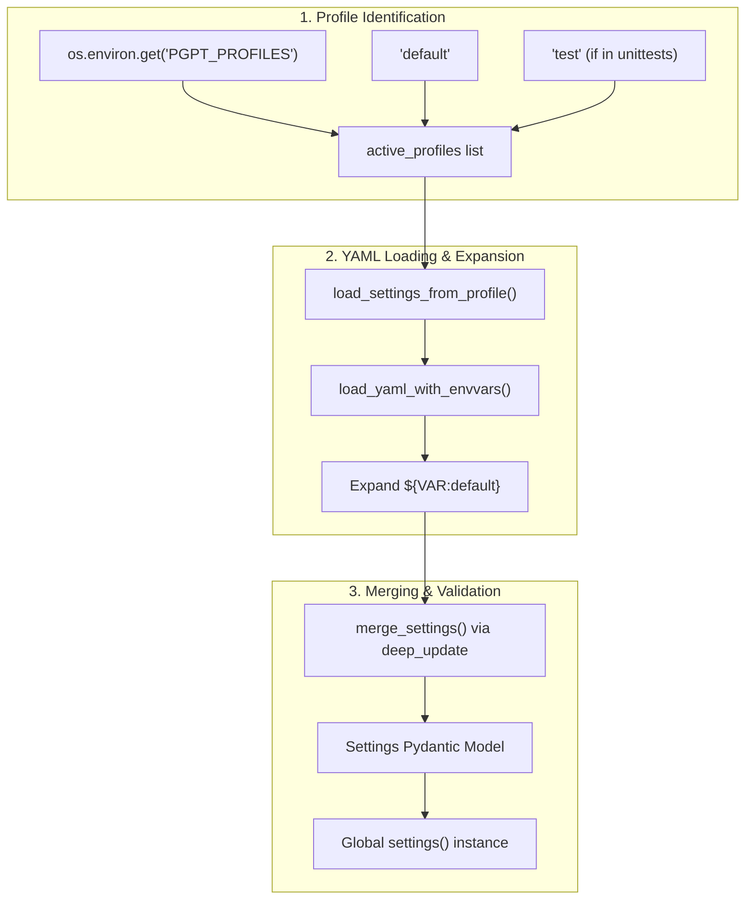
Sources:
- [private_gpt/settings/settings_loader.py:16-57]()
- [private_gpt/settings/yaml.py:1-45]()

## 2. Core Configuration Components

The system is defined by a root `Settings` class that aggregates several specialized Pydantic models. This ensures type safety and validation across the entire application.

### 2.1 Key Settings Models

| Model Class | Role | Key Attributes |
|:---|:---|:---|
| `ServerSettings` | FastAPI server config | `port`, `cors`, `auth` |
| `LLMSettings` | LLM behavior | `mode`, `max_new_tokens`, `prompt_style` |
| `EmbeddingSettings` | Embedding behavior | `mode`, `ingest_mode`, `embed_dim` |
| `VectorstoreSettings`| Vector DB selection | `database` (chroma, qdrant, etc.) |
| `DataSettings` | Storage paths | `local_data_folder` |

Sources:
- [private_gpt/settings/settings.py:83-157]()
- [private_gpt/settings/settings.py:97-106]()

### 2.2 Natural Language to Code Entity Mapping
The following diagram bridges the configuration concepts (YAML keys) to the internal Python classes and the LlamaIndex entities they initialize.

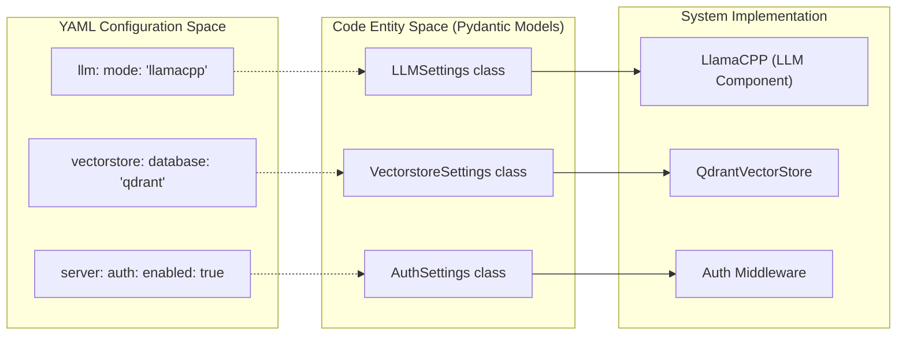
Sources:
- [private_gpt/settings/settings.py:108-118]()
- [private_gpt/settings/settings.py:155-157]()
- [private_gpt/settings/settings.py:45-60]()

## 3. Profile Management

Profiles allow environment-specific overrides (e.g., `local`, `docker`, `ollama`).

### 3.1 Profile Precedence
Settings are merged in the order they appear in the `PGPT_PROFILES` variable. The `default` profile (`settings.yaml`) is always loaded first.

1.  **`settings.yaml`**: Base defaults. [settings.yaml:1-153]()
2.  **`settings-{profile}.yaml`**: Overrides specific to the profile. [private_gpt/settings/settings_loader.py:36-47]()
3.  **Environment Variables**: Variables defined within YAML using `${VAR}` syntax. [private_gpt/settings/yaml.py:17-30]()

### 3.2 Common Profiles

| Profile | File | Use Case |
|:---|:---|:---|
| `local` | `settings-local.yaml` | Default local development with LlamaCPP. [settings-local.yaml:1-28]() |
| `docker` | `settings-docker.yaml` | Optimized for containerized environments. [settings-docker.yaml:1-38]() |
| `ollama` | `settings-ollama.yaml` | Configuration for Ollama-managed models. [settings-ollama.yaml:1-31]() |
| `vllm` | `settings-vllm.yaml` | OpenAI-like integration for vLLM backends. [settings-vllm.yaml:1-21]() |

## 4. Injection and Usage

The configuration is integrated into the application using a Dependency Injection (DI) pattern via the `injector` library.

### 4.1 Dependency Injection Flow
The `root_injector` provides the `Settings` singleton to services and routers.

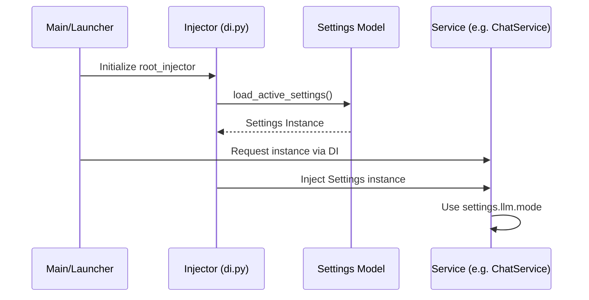
Sources:
- [private_gpt/launcher.py:24-45]()
- [private_gpt/main.py:1-11]()
- [private_gpt/__main__.py:11-11]()

### 4.2 Application Integration
In `private_gpt/launcher.py`, settings are used to conditionally enable features like CORS and the Gradio UI:

*   **CORS**: Configured in `create_app` using `settings.server.cors`. [private_gpt/launcher.py:46-55]()
*   **UI**: Mounted if `settings.ui.enabled` is true. [private_gpt/launcher.py:57-67]()

## 5. Environment Variable Expansion

The system supports dynamic value substitution in YAML files using a custom loader in `private_gpt/settings/yaml.py`.

*   **Syntax**: `${ENV_VAR_NAME:default_value}`
*   **Implementation**: Uses a regex `pattern = re.compile(r"\$\{(\w+)(?::([^}]*))?\}")` to find and replace tokens with values from `os.environ`. [private_gpt/settings/yaml.py:17-30]()

Example from `settings.yaml`:
```yaml
server:
  env_name: ${APP_ENV:prod}
  port: ${PORT:8001}
```
Sources:
- [settings.yaml:5-6]()
- [private_gpt/settings/yaml.py:12-45]()

---

# Page: Deployment Options

# Deployment Options

<details>
<summary>Relevant source files</summary>

The following files were used as context for generating this wiki page:

- [.docker/router.yml](.docker/router.yml)
- [.github/workflows/generate-release.yml](.github/workflows/generate-release.yml)
- [Dockerfile.llamacpp-cpu](Dockerfile.llamacpp-cpu)
- [Dockerfile.ollama](Dockerfile.ollama)
- [Makefile](Makefile)
- [docker-compose.yaml](docker-compose.yaml)
- [fern/docs/pages/api-reference/api-reference.mdx](fern/docs/pages/api-reference/api-reference.mdx)
- [fern/docs/pages/quickstart/quickstart.mdx](fern/docs/pages/quickstart/quickstart.mdx)
- [scripts/setup](scripts/setup)
- [scripts/utils.py](scripts/utils.py)

</details>


This document details the various deployment methods available for PrivateGPT, explaining how to set up and run the system in different environments. For information about configuring PrivateGPT once deployed, see [Configuration System](2.1).

## Deployment Methods Overview

PrivateGPT offers two primary deployment methods:

1.  **Local Python Installation** - Running directly on your machine using Python and Poetry.
2.  **Docker-based Deployment** - Running in containers using Docker and Docker Compose with specific hardware profiles.

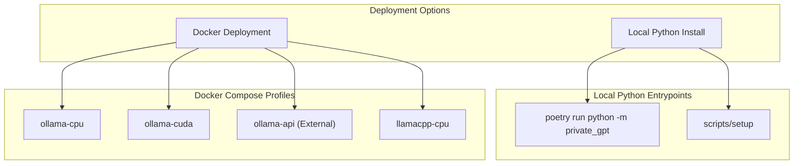

Sources: [docker-compose.yaml:1-116](), [fern/docs/pages/quickstart/quickstart.mdx:1-84]()

## Local Python Installation

The local Python installation provides the most flexibility for development and customization.

### Prerequisites

*   Python 3.11+
*   Poetry 1.8.3+
*   Sufficient hardware resources for your chosen LLM and embedding models.

### Installation and Setup

1.  Clone the PrivateGPT repository.
2.  Install dependencies with extras based on your needs:
    ```bash
    poetry install --extras "ui llms-llama-cpp vector-stores-qdrant embeddings-huggingface"
    ```
3.  **Model Setup**: Run the setup script to download required models from Hugging Face:
    ```bash
    make setup
    ```
    This executes `scripts/setup`, which uses `hf_hub_download` and `snapshot_download` to populate the `models/` directory [scripts/setup:20-53]().

### Running Locally

After installation, run PrivateGPT with:
```bash
make run
```
Or for development with hot-reload:
```bash
make dev
```
The `dev` command sets `PGPT_PROFILES=local` and uses `uvicorn` to launch the application [Makefile:35-43]().

Sources: [Makefile:35-79](), [scripts/setup:1-53](), [fern/docs/pages/quickstart/quickstart.mdx:6-15]()

## Docker Deployment

Docker deployment simplifies setup and ensures consistent environments. It utilizes Docker Compose profiles to manage different hardware backends.

### Docker Compose Profiles

The `docker-compose.yaml` defines several profiles [docker-compose.yaml:26-30]():

| Profile | Description | Hardware | Image/Dockerfile |
| :--- | :--- | :--- | :--- |
| `ollama-cpu` | Ollama backend on CPU | CPU | `Dockerfile.ollama` |
| `ollama-cuda` | Ollama backend with GPU | NVIDIA GPU | `Dockerfile.ollama` |
| `ollama-api` | Uses Ollama on host (MacOS) | CPU/Metal | `Dockerfile.ollama` |
| `llamacpp-cpu` | Local LlamaCPP on CPU | CPU | `Dockerfile.llamacpp-cpu` |

### Traefik Router Setup

For Ollama-based profiles, PrivateGPT uses a Traefik reverse proxy to route requests between different Ollama instances (CPU, CUDA, or Host) [docker-compose.yaml:62-81]().

**Traefik Configuration (`.docker/router.yml`):**
The router defines a load balancer that checks health and routes to the appropriate Ollama service [ .docker/router.yml:1-16]().

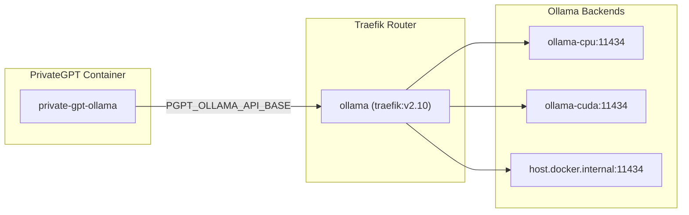

Sources: [docker-compose.yaml:60-89](), [.docker/router.yml:1-16]()

## Docker Architecture and Data Flow

### Ollama-based Deployment
The `private-gpt-ollama` service is configured via environment variables to communicate with the Ollama API [docker-compose.yaml:19-24]().

*   **Dockerfile**: `Dockerfile.ollama` installs `llms-ollama` and `embeddings-ollama` extras [Dockerfile.ollama:17-18]().
*   **Data Persistence**: Local data is mounted to `/home/worker/app/local_data` [docker-compose.yaml:15-16]().

### LlamaCPP-based Deployment
The `private-gpt-llamacpp-cpu` service runs everything locally within the container.

*   **Dockerfile**: `Dockerfile.llamacpp-cpu` includes build essentials for `llama-cpp-python` [Dockerfile.llamacpp-cpu:12-18]().
*   **Entrypoint**: It runs `scripts/setup` followed by the `private_gpt` module [docker-compose.yaml:46]().
*   **Volumes**: Mounts both `./local_data` and `./models` [docker-compose.yaml:43-45]().

### Data Persistence and Management

PrivateGPT provides utility scripts to manage persisted data, accessible via `Makefile`:

*   **Wipe Data**: `make wipe` calls `scripts/utils.py` to clear the vector store and node store [Makefile:57-58]().
*   **Storage Stats**: `make stats` provides row counts and sizes for the configured database (Postgres, Qdrant, Chroma, or Simple) [scripts/utils.py:148-176]().

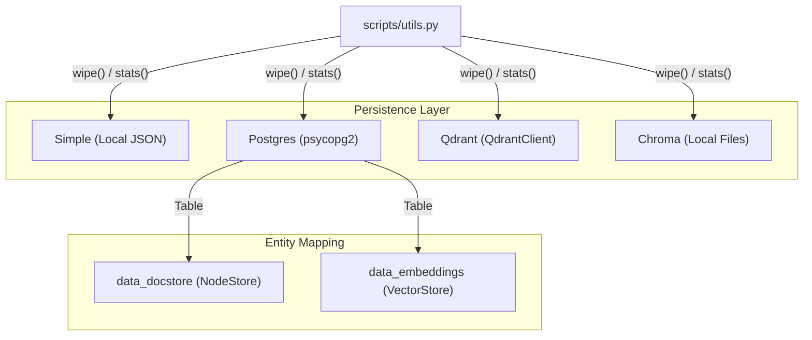

Sources: [scripts/utils.py:39-176](), [Makefile:51-61]()

## CI/CD and Release Management

Docker images are automatically built and pushed to Docker Hub via GitHub Actions when a release is published [ .github/workflows/generate-release.yml:1-5]().

*   **Matrix Strategy**: Builds both `llamacpp-cpu` and `ollama` types [ .github/workflows/generate-release.yml:18-20]().
*   **Tagging**: Images are tagged with semantic versions (e.g., `0.6.2-ollama`) and `latest` for the default type [ .github/workflows/generate-release.yml:56-80]().

Sources: [.github/workflows/generate-release.yml:1-83]()

---

# Page: Core Components

# Core Components

<details>
<summary>Relevant source files</summary>

The following files were used as context for generating this wiki page:

- [README.md](README.md)
- [fern/docs/assets/ui.png](fern/docs/assets/ui.png)
- [private_gpt/components/__init__.py](private_gpt/components/__init__.py)

</details>


This page provides an overview of the core components that make up PrivateGPT's architecture. These components are the fundamental building blocks that enable the RAG (Retrieval Augmented Generation) pipeline and other essential services within the system.

For information about how these components are configured, see [Configuration System](#2.1). For details on how these components are used by various services, see [Services](#4).

## Overview of Component Architecture

PrivateGPT is built using a modular architecture with several core components that work together to provide powerful AI capabilities. The system follows a dependency injection pattern, where components are abstracted behind interfaces, allowing for flexible implementation swapping based on configuration.

### Component Relationship Diagram

The following diagram bridges the high-level services to the underlying component implementations.

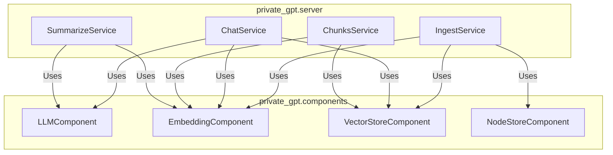

Sources: [README.md:81-107](), [private_gpt/components/__init__.py:1-1]()

The core components are instantiated based on configuration settings and made available to services through dependency injection. This architecture enables flexibility, allowing users to choose the specific implementations that best suit their needs.

## LLM Component

The LLM (Large Language Model) Component is responsible for text generation based on prompts. It abstracts the details of various LLM implementations behind a consistent interface, allowing the rest of the system to interact with different language models using the same API.

### Supported LLM Backends

The LLM Component supports multiple backends for both local and cloud-based inference:

| Backend | Description |
|---------|-------------|
| `llamacpp` | Local inference using Llama.cpp for GGUF models |
| `ollama` | Local inference via an Ollama server instance |
| `openai` | Cloud inference using OpenAI's API |
| `azopenai` | Cloud inference using Azure OpenAI Service |
| `sagemaker` | Cloud inference using AWS SageMaker endpoints |
| `gemini` | Cloud inference using Google Gemini API |
| `mock` | Mock backend for testing purposes |

For details, see [LLM Component](#3.1).

Sources: [private_gpt/settings/settings.py:108-152](), [private_gpt/settings/settings.py:163-335]()

## Embedding Component

The Embedding Component generates vector embeddings from text, which are crucial for semantic search in the RAG pipeline. Like the LLM Component, it provides a common interface that abstracts different embedding model implementations.

### Supported Embedding Backends

The Embedding Component supports various backends:

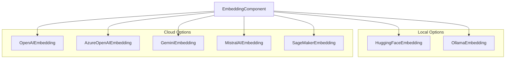

For details, see [Embedding Component](#3.2).

Sources: [private_gpt/settings/settings.py:198-238](), [private_gpt/settings/settings.py:184-196]()

## Vector Store Component

The Vector Store Component stores and retrieves vector embeddings, providing the database functionality needed for semantic search in the RAG pipeline. It supports multiple vector database backends to meet different scaling and deployment needs.

### Supported Vector Store Backends

PrivateGPT supports the following vector stores as defined in the configuration:

| Database | Settings Class |
|----------|----------------|
| `qdrant` | `QdrantSettings` |
| `chroma` | `ChromaSettings` |
| `postgres` | `PostgresSettings` |
| `milvus` | `MilvusSettings` |
| `clickhouse` | `ClickHouseSettings` |

For details, see [Vector Store Component](#3.3).

Sources: [private_gpt/settings/settings.py:155-156](), [private_gpt/settings/settings.py:515-587]()

## Node Store Component

The Node Store Component stores metadata and original text for document chunks (nodes). While vector stores handle the embeddings for semantic search, the node store preserves the actual content needed to build the context for the LLM.

### Supported Node Store Backends

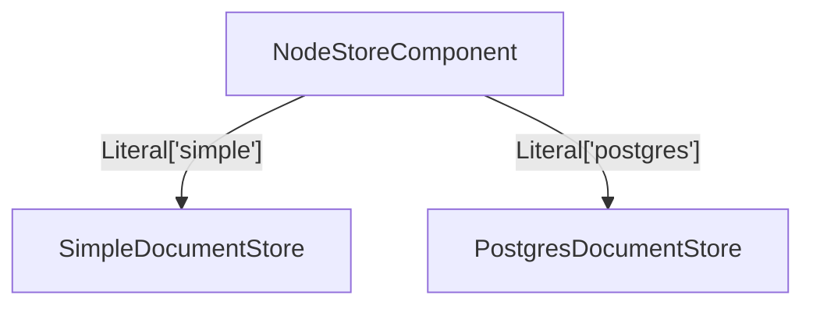

Sources: [private_gpt/settings/settings.py:159-160](), [private_gpt/settings/settings.py:489-513]()

## Component Interactions in the RAG Pipeline

The core components work together in the RAG pipeline. The interaction between the "Code Entity Space" and the functional "Natural Language Space" is visualized below.

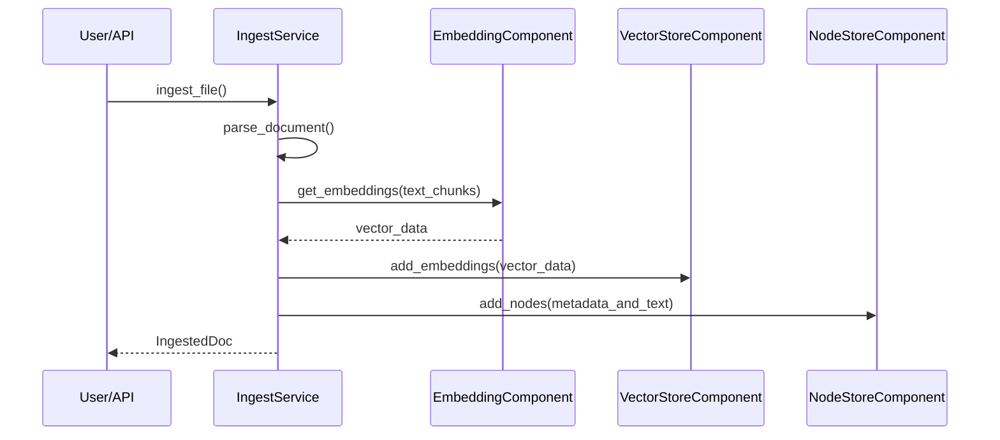

Sources: [README.md:81-107](), [private_gpt/settings/settings.py:184-196]()

This design allows for easy swapping of component implementations without changing the rest of the codebase, making PrivateGPT highly adaptable to different deployment environments and requirements.

---

# Page: LLM Component

# LLM Component

<details>
<summary>Relevant source files</summary>

The following files were used as context for generating this wiki page:

- [fern/docs/pages/manual/llms.mdx](fern/docs/pages/manual/llms.mdx)
- [private_gpt/components/embedding/custom/__init__.py](private_gpt/components/embedding/custom/__init__.py)
- [private_gpt/components/embedding/custom/sagemaker.py](private_gpt/components/embedding/custom/sagemaker.py)
- [private_gpt/components/llm/custom/sagemaker.py](private_gpt/components/llm/custom/sagemaker.py)
- [private_gpt/components/llm/llm_component.py](private_gpt/components/llm/llm_component.py)
- [private_gpt/components/llm/prompt_helper.py](private_gpt/components/llm/prompt_helper.py)
- [private_gpt/utils/ollama.py](private_gpt/utils/ollama.py)
- [private_gpt/utils/retry.py](private_gpt/utils/retry.py)
- [settings-sagemaker.yaml](settings-sagemaker.yaml)
- [tests/test_prompt_helper.py](tests/test_prompt_helper.py)

</details>


The LLM Component is a core subsystem of PrivateGPT responsible for initializing, configuring, and interacting with various Language Model providers. It abstracts the differences between local and cloud-based LLM implementations, providing a unified interface for the rest of the system. This component supports multiple LLM backends including local models (Llama.cpp, Ollama) and cloud services (OpenAI, Azure OpenAI, Google Gemini, AWS Sagemaker).

Sources: [private_gpt/components/llm/llm_component.py:18-22]()

## Component Architecture

The LLM Component is implemented as a singleton class that initializes the appropriate LLM implementation based on configuration settings. It leverages the `injector` library for dependency management.

### LLM Implementation Hierarchy
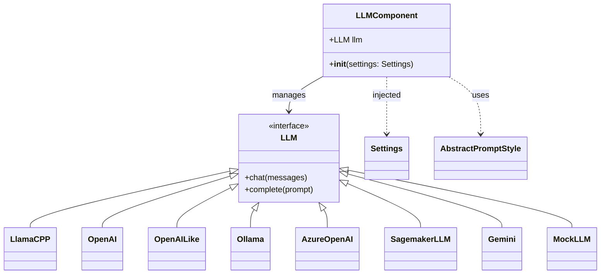

The component uses dependency injection to receive the application `Settings` and initializes the appropriate LLM implementation. It also handles global tokenizer setup and prompt formatting logic.

Sources: [private_gpt/components/llm/llm_component.py:18-44](), [private_gpt/components/llm/llm_component.py:22-23]()

## Initialization Process

The initialization process for the `LLMComponent` follows these steps:

1. **Tokenizer Setup**: If a tokenizer is specified in `settings.llm.tokenizer`, it attempts to load it via `transformers.AutoTokenizer`. This is set globally using `set_global_tokenizer` for more accurate token counting across the LlamaIndex pipeline.
2. **Mode Selection**: It evaluates `settings.llm.mode` to branch into specific provider logic.
3. **Provider Configuration**: Each mode (e.g., `llamacpp`, `ollama`) imports its respective LlamaIndex LLM class and passes parameters like `temperature`, `max_new_tokens`, and `context_window`.
4. **Prompt Style Injection**: For models that require manual prompt templating (like local models), it fetches a `prompt_style` and maps its `messages_to_prompt` and `completion_to_prompt` methods to the LLM instance.

### Data Flow Diagram
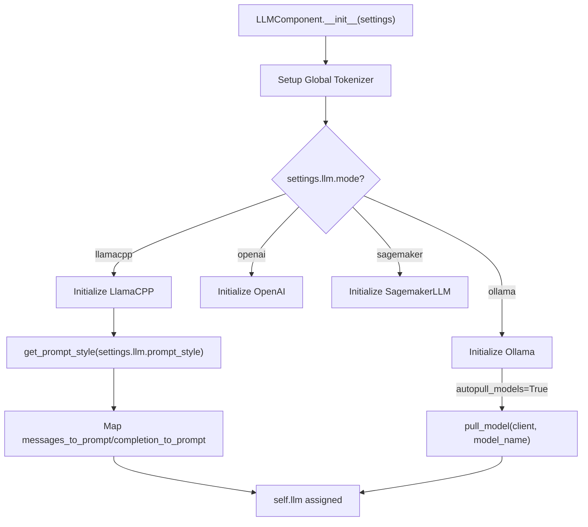

Sources: [private_gpt/components/llm/llm_component.py:24-44](), [private_gpt/components/llm/llm_component.py:45-76](), [private_gpt/components/llm/llm_component.py:129-191]()

## Supported LLM Modes

The LLM Component supports multiple LLM backends through different modes:

| Mode | Provider Class | Key Features |
|------|----------------|--------------|
| `llamacpp` | `LlamaCPP` | Full local execution, GGUF support, GPU acceleration |
| `ollama` | `Ollama` | External service interaction, automatic model pulling |
| `openai` | `OpenAI` | Standard OpenAI API integration |
| `openailike` | `OpenAILike` | Compatible with LocalAI, vLLM, or other OpenAI-spec servers |
| `azopenai` | `AzureOpenAI` | Enterprise Azure OpenAI service |
| `sagemaker` | `SagemakerLLM` | Custom implementation for AWS SageMaker endpoints |
| `gemini` | `Gemini` | Google's Generative AI models |
| `mock` | `MockLLM` | Deterministic responses for testing |

Sources: [private_gpt/components/llm/llm_component.py:45-225]()

### Local Models and GPU Offloading

#### Llama.cpp
For `llamacpp`, PrivateGPT defaults to full GPU offloading. It sets `n_gpu_layers` to `-1` and `offload_kqv` to `True` within the `settings_kwargs` passed to the `LlamaCPP` constructor. It loads the model from `models_path / settings.llamacpp.llm_hf_model_file`.

Sources: [private_gpt/components/llm/llm_component.py:60-64]()

#### Ollama
The `ollama` mode supports automatic model pulling via `pull_model` if `ollama_settings.autopull_models` is enabled. It also configures `keep_alive` durations and connection retries.

Sources: [private_gpt/components/llm/llm_component.py:165-171](), [private_gpt/utils/ollama.py:85-91]()

### Custom Provider: SageMaker
PrivateGPT includes a custom `SagemakerLLM` implementation located in `private_gpt/components/llm/custom/sagemaker.py`. It uses `boto3` to invoke SageMaker endpoints and includes a `LineIterator` to handle streaming byte responses from TGI (Text Generation Inference) containers.

Sources: [private_gpt/components/llm/custom/sagemaker.py:39-98](), [private_gpt/components/llm/custom/sagemaker.py:99-115]()

## Prompt Styling

The `prompt_helper.py` module defines how standardized `ChatMessage` sequences are transformed into raw strings for models that do not handle chat templates natively.

### Prompt Style Logic
```mermaid
flowchart LR
    subgraph "Input Space"
        Msg["Sequence[ChatMessage]"]
    end
    
    subgraph "Logic: AbstractPromptStyle"
        F1["_messages_to_prompt"]
        F2["_completion_to_prompt"]
    end
    
    subgraph "Output Space"
        Str["Formatted Prompt String"]
    end
    
    Msg --> F1 --> Str
```

Available styles include:
* **Llama2**: Uses `[INST]` and `<<SYS>>` tags. [private_gpt/components/llm/prompt_helper.py:72-83]()
* **Llama3**: Uses `<|start_header_id|>` and `<|eot_id|>` tokens. [private_gpt/components/llm/prompt_helper.py:142-158]()
* **Tag**: A simple `<|system|>:`, `<|user|>:`, `<|assistant|>:` format. [private_gpt/components/llm/prompt_helper.py:218-223]()
* **Mistral**: Uses `<s>[INST]` formatting. [private_gpt/components/llm/prompt_helper.py:255-261]()
* **ChatML**: Standard `<|im_start|>` and `<|im_end|>` format. [private_gpt/components/llm/prompt_helper.py:284-289]()

Sources: [private_gpt/components/llm/prompt_helper.py:11-310](), [tests/test_prompt_helper.py:15-24]()

## Tokenizer Configuration

The LLM component attempts to load a HuggingFace tokenizer to improve the accuracy of token counting and context window management. If `settings.llm.tokenizer` is provided, it uses `AutoTokenizer.from_pretrained` and caches it in `models_cache_path`. If loading fails, it logs a warning and falls back to LlamaIndex's default tokenizer.

Sources: [private_gpt/components/llm/llm_component.py:25-42]()

## Configuration Options

Key settings from the `llm` and provider-specific sections of `settings.yaml`:

| Parameter | Description |
|-----------|-------------|
| `llm.mode` | Choice of provider (e.g., `openai`, `llamacpp`). |
| `llm.max_new_tokens` | The number of tokens the LLM will generate. [fern/docs/pages/manual/llms.mdx:39]() |
| `llm.context_window` | Total tokens allowed (input + output). |
| `llamacpp.llm_hf_model_file` | The `.gguf` filename in the `models/` folder. [private_gpt/components/llm/llm_component.py:64]() |
| `ollama.autopull_models` | Whether to pull missing models from Ollama library. [private_gpt/components/llm/llm_component.py:165]() |

Sources: [private_gpt/components/llm/llm_component.py:55-62](), [fern/docs/pages/manual/llms.mdx:34-47]()

---

# Page: Embedding Component

# Embedding Component

<details>
<summary>Relevant source files</summary>

The following files were used as context for generating this wiki page:

- [private_gpt/components/embedding/__init__.py](private_gpt/components/embedding/__init__.py)
- [private_gpt/components/embedding/custom/__init__.py](private_gpt/components/embedding/custom/__init__.py)
- [private_gpt/components/embedding/custom/sagemaker.py](private_gpt/components/embedding/custom/sagemaker.py)
- [private_gpt/components/embedding/embedding_component.py](private_gpt/components/embedding/embedding_component.py)
- [private_gpt/components/llm/custom/sagemaker.py](private_gpt/components/llm/custom/sagemaker.py)
- [settings-sagemaker.yaml](settings-sagemaker.yaml)

</details>


The Embedding Component is responsible for converting text into vector representations (embeddings) that capture semantic meaning. These embeddings are fundamental to the retrieval augmented generation (RAG) functionality, enabling semantic search and relevant document retrieval by representing text in a high-dimensional vector space.

## Purpose and Role

The Embedding Component serves as a critical bridge between textual data and vector representations by:

1.  Converting document chunks into vector embeddings during ingestion.
2.  Transforming user queries into embeddings for semantic search.
3.  Providing a unified interface to multiple embedding providers (local and cloud-based).

### Data Flow: Natural Language to Vector Space

This diagram illustrates how natural language entities are transformed into code entities and processed by the system.

```mermaid
graph TD
    subgraph "Natural Language Space"
        Doc["User Document"]
        Query["User Question"]
    end

    subgraph "Code Entity Space"
        IngestService["IngestService"]
        ChatService["ChatService"]
        EmbeddingComponent["EmbeddingComponent (singleton)"]
        BaseEmbedding["llama_index.core.embeddings.BaseEmbedding"]
        VectorStore["VectorStoreComponent"]
    end

    Doc -->|"ingest()"| IngestService
    Query -->|"chat()"| ChatService
    
    IngestService -->|"get_text_embedding_batch()"| EmbeddingComponent
    ChatService -->|"get_query_embedding()"| EmbeddingComponent
    
    EmbeddingComponent -->|"wraps"| BaseEmbedding
    BaseEmbedding -->|"vector output"| VectorStore
```

Sources: [private_gpt/components/embedding/embedding_component.py:12-14](), [private_gpt/components/embedding/custom/sagemaker.py:10-10]()

## Architecture

The `EmbeddingComponent` is implemented as a singleton class that encapsulates various embedding model implementations through a common interface provided by LlamaIndex.

### Class Hierarchy and Providers

The component uses dependency injection to provide a consistent `embedding_model` attribute of type `BaseEmbedding`.

```mermaid
classDiagram
    class EmbeddingComponent {
        +embedding_model: BaseEmbedding
        +__init__(settings: Settings)
    }
    
    class BaseEmbedding {
        <<interface>>
        +get_query_embedding(query: str)
        +get_text_embedding(text: str)
        +get_text_embedding_batch(texts: List[str])
    }
    
    class SagemakerEmbedding {
        +endpoint_name: str
        -_embed(sentences: List[str])
    }

    EmbeddingComponent --> BaseEmbedding : "contains"
    BaseEmbedding <|-- HuggingFaceEmbedding
    BaseEmbedding <|-- OpenAIEmbedding
    BaseEmbedding <|-- OllamaEmbedding
    BaseEmbedding <|-- AzureOpenAIEmbedding
    BaseEmbedding <|-- GeminiEmbedding
    BaseEmbedding <|-- MistralAIEmbedding
    BaseEmbedding <|-- SagemakerEmbedding
    BaseEmbedding <|-- MockEmbedding
```

Sources: [private_gpt/components/embedding/embedding_component.py:13-167](), [private_gpt/components/embedding/custom/sagemaker.py:10-38]()

## Supported Embedding Providers

The Embedding Component supports several backends, configured via `settings.embedding.mode`.

| Provider | Implementation Class | Configuration Mode |
| :--- | :--- | :--- |
| **HuggingFace** | `HuggingFaceEmbedding` | `huggingface` |
| **OpenAI** | `OpenAIEmbedding` | `openai` |
| **Ollama** | `OllamaEmbedding` | `ollama` |
| **Azure OpenAI** | `AzureOpenAIEmbedding` | `azopenai` |
| **Google Gemini** | `GeminiEmbedding` | `gemini` |
| **Mistral AI** | `MistralAIEmbedding` | `mistralai` |
| **AWS SageMaker** | `SagemakerEmbedding` | `sagemaker` |
| **Mock** | `MockEmbedding` | `mock` |

Sources: [private_gpt/components/embedding/embedding_component.py:20-167]()

## Initialization and Ingest Modes

The `EmbeddingComponent` constructor [private_gpt/components/embedding/embedding_component.py:17-167]() handles the setup for each provider:

*   **HuggingFace**: Loads models locally using `settings.huggingface.embedding_hf_model_name` and caches them in `models_cache_path` [private_gpt/components/embedding/embedding_component.py:31-35]().
*   **OpenAI**: Uses `embedding_api_base` and `embedding_api_key`. If specific embedding keys are missing, it falls back to general OpenAI settings [private_gpt/components/embedding/embedding_component.py:59-69]().
*   **Ollama**: Includes an `autopull_models` feature. If enabled, it uses `private_gpt.utils.ollama.pull_model` to ensure the model exists on the Ollama server before initialization [private_gpt/components/embedding/embedding_component.py:95-113]().
*   **SageMaker**: Utilizes a custom implementation `SagemakerEmbedding` which communicates with AWS via `boto3` [private_gpt/components/embedding/custom/sagemaker.py:10-32]().

### Embedding Dimensions
The embedding dimension is determined by the selected model. For the `mock` provider, a default dimensionality of **384** is used [private_gpt/components/embedding/embedding_component.py:167-167]().

## Custom Implementation: SageMaker

PrivateGPT provides a custom wrapper for SageMaker embedding endpoints in `private_gpt/components/embedding/custom/sagemaker.py`.

*   **Class**: `SagemakerEmbedding` [private_gpt/components/embedding/custom/sagemaker.py:10]()
*   **Mechanism**: It uses the `sagemaker-runtime` client to `invoke_endpoint` [private_gpt/components/embedding/custom/sagemaker.py:30-54]().
*   **Data Handling**: The `_embed` method takes a list of strings, JSON-serializes them as `inputs`, and expects a JSON response containing a `vectors` key [private_gpt/components/embedding/custom/sagemaker.py:45-60]().

### SageMaker Configuration
The SageMaker provider is activated by setting `embedding.mode: sagemaker` in the YAML configuration.

```yaml
embedding:
  mode: sagemaker

sagemaker:
  embedding_endpoint_name: embedding-endpoint-v1
```

Sources: [settings-sagemaker.yaml:12-17](), [private_gpt/components/embedding/embedding_component.py:46-48]()

## Implementation Details

### Dependency Management
The component uses lazy imports within the `match` statement to ensure that heavy dependencies (like `llama-index-embeddings-huggingface` or `boto3`) are only required if that specific mode is active [private_gpt/components/embedding/embedding_component.py:23-25]().

### Ingest Pipeline Logic
While the `EmbeddingComponent` provides the model, the ingestion logic (Simple, Batch, Parallel) is typically managed by the `IngestService` using the `embedding_model` provided here. The `SagemakerEmbedding` implementation specifically supports batching via its `_get_text_embeddings` method [private_gpt/components/embedding/custom/sagemaker.py:80-82]().

Sources: [private_gpt/components/embedding/embedding_component.py:1-168](), [private_gpt/components/embedding/custom/sagemaker.py:1-83]()

---

# Page: Vector Store Component

# Vector Store Component

<details>
<summary>Relevant source files</summary>

The following files were used as context for generating this wiki page:

- [fern/docs/pages/installation/concepts.mdx](fern/docs/pages/installation/concepts.mdx)
- [fern/docs/pages/manual/ingestion-reset.mdx](fern/docs/pages/manual/ingestion-reset.mdx)
- [fern/docs/pages/manual/nodestore.mdx](fern/docs/pages/manual/nodestore.mdx)
- [fern/docs/pages/manual/vectordb.mdx](fern/docs/pages/manual/vectordb.mdx)
- [private_gpt/components/ingest/ingest_component.py](private_gpt/components/ingest/ingest_component.py)
- [private_gpt/components/node_store/node_store_component.py](private_gpt/components/node_store/node_store_component.py)
- [private_gpt/components/vector_store/batched_chroma.py](private_gpt/components/vector_store/batched_chroma.py)
- [private_gpt/components/vector_store/vector_store_component.py](private_gpt/components/vector_store/vector_store_component.py)
- [private_gpt/server/chat/chat_service.py](private_gpt/server/chat/chat_service.py)

</details>


The Vector Store Component in PrivateGPT is responsible for the persistence and retrieval of vector embeddings and their associated metadata. It acts as the bridge between the high-level RAG services and the underlying vector database engines.

## Purpose and Position in System Architecture

The component is a central piece of the RAG pipeline, facilitating both the storage of newly ingested document nodes and the similarity search required for context retrieval.

```mermaid
graph TD
    subgraph "Natural Language Space"
        UserQuery["User Query"]
        Document["Raw Document"]
    end

    subgraph "Code Entity Space"
        IngestSvc["IngestService"]
        ChatSvc["ChatService"]
        VSComp["VectorStoreComponent"]
        NSComp["NodeStoreComponent"]
        EmbedComp["EmbeddingComponent"]
    end

    subgraph "Persistence Layer"
        VectorDB["Vector Database (Qdrant/Milvus/etc)"]
        DocStore["SimpleDocumentStore / PostgresDocumentStore"]
    end

    Document --> IngestSvc
    IngestSvc --> EmbedComp
    EmbedComp -->|embeddings| VSComp
    IngestSvc --> NSComp
    NSComp -->|metadata/text| DocStore
    VSComp -->|vectors| VectorDB

    UserQuery --> ChatSvc
    ChatSvc --> VSComp
    VSComp -->|similarity search| VectorDB
    VectorDB -->|node_ids| VSComp
    VSComp -->|retrieved context| ChatSvc
```

**Diagram 1: Vector Store and Node Store Data Flow**

Sources: [private_gpt/components/vector_store/vector_store_component.py:32-33](), [private_gpt/server/chat/chat_service.py:79-106](), [private_gpt/components/node_store/node_store_component.py:14-15]()

## Supported Vector Databases

PrivateGPT supports five primary vector store backends. The selection is controlled via `settings.yaml` under `vectorstore.database`.

| Database | LlamaIndex Implementation | Extra Dependency | Persistence Mode |
| :--- | :--- | :--- | :--- |
| **Qdrant** | `QdrantVectorStore` | `vector-stores-qdrant` | Local path or Remote URL |
| **Chroma** | `BatchedChromaVectorStore` | `vector-stores-chroma` | Local directory (`chroma_db`) |
| **Milvus** | `MilvusVectorStore` | `vector-stores-milvus` | Local `.db` file or Remote URI |
| **Postgres** | `PGVectorStore` | `vector-stores-postgres` | `embeddings` table with `pgvector` |
| **ClickHouse** | `ClickHouseVectorStore` | `vector-stores-clickhouse` | Columnar table |

Sources: [private_gpt/components/vector_store/vector_store_component.py:40-195](), [fern/docs/pages/manual/vectordb.mdx:1-168]()

## Component Implementation

### VectorStoreComponent Class
The `VectorStoreComponent` is a `@singleton` class injected with system `Settings`. During `__init__`, it uses a `match` statement to initialize the specific `BasePydanticVectorStore` requested by the configuration.

```python
@singleton
class VectorStoreComponent:
    @inject
    def __init__(self, settings: Settings) -> None:
        self.settings = settings
        match settings.vectorstore.database:
            case "postgres":
                # ... initialization of PGVectorStore
            case "qdrant":
                # ... initialization of QdrantVectorStore
```

Sources: [private_gpt/components/vector_store/vector_store_component.py:32-41]()

### NodeStoreComponent Class
While the vector store handles embeddings, the `NodeStoreComponent` handles the storage of the actual `BaseNode` objects (text and metadata). It supports two modes:
- **Simple**: Uses `SimpleDocumentStore` and `SimpleIndexStore`, persisting to `local_data_path`.
- **Postgres**: Uses `PostgresDocumentStore` and `PostgresIndexStore` for robust, relational storage of document nodes.

Sources: [private_gpt/components/node_store/node_store_component.py:14-68]()

## Persistence and Retrieval Flow

### Initialization and Storage Context
The `ChatService` and `IngestionService` combine these components into a `StorageContext`. This context is then used to create a `VectorStoreIndex`.

```mermaid
graph LR
    subgraph "VectorStoreComponent"
        VS["vector_store: BasePydanticVectorStore"]
    end
    subgraph "NodeStoreComponent"
        DS["doc_store: BaseDocumentStore"]
        IS["index_store: BaseIndexStore"]
    end
    
    VS --> SC["StorageContext.from_defaults"]
    DS --> SC
    IS --> SC
    SC --> VSI["VectorStoreIndex.from_vector_store"]
```

**Diagram 2: Storage Context Assembly**

Sources: [private_gpt/server/chat/chat_service.py:94-106](), [private_gpt/components/ingest/ingest_component.py:72-95]()

### Retrieval with Metadata Filtering
Retrieval is handled by `get_retriever`, which creates a `VectorIndexRetriever`. If a `ContextFilter` is provided (e.g., to restrict search to specific documents), the component generates `MetadataFilters`.

- **Qdrant**: Supports direct `doc_ids` pass-through in the retriever.
- **Others**: Uses `_doc_id_metadata_filter` to create a `FilterCondition.OR` across the specified `doc_id` metadata keys.

Sources: [private_gpt/components/vector_store/vector_store_component.py:20-29](), [private_gpt/components/vector_store/vector_store_component.py:197-213]()

## Technical Implementation Details

### Batched Chroma Insertion
For ChromaDB, PrivateGPT implements `BatchedChromaVectorStore` to handle large ingestion tasks. It overrides the `add` method to chunk the incoming nodes based on the client's `max_batch_size`, preventing API limit errors.

Sources: [private_gpt/components/vector_store/batched_chroma.py:28-106]()

### Postgres Schema
When using `postgres` for vector storage, the component creates a table (default name `embeddings`) with the following structure:
- `id`: Primary key.
- `text`: The chunk text.
- `metadata_`: JSON blob of metadata.
- `node_id`: Reference to the node.
- `embedding`: `vector(N)` where N is `settings.embedding.embed_dim`.

Sources: [private_gpt/components/vector_store/vector_store_component.py:56-63](), [fern/docs/pages/manual/vectordb.mdx:105-121]()

### Resource Cleanup
The component provides a `close()` method that is called during application shutdown to gracefully close database connections (supported for Qdrant, Milvus, and ClickHouse clients).

Sources: [private_gpt/components/vector_store/vector_store_component.py:215-218]()

---

# Page: Services

# Services

<details>
<summary>Relevant source files</summary>

The following files were used as context for generating this wiki page:

- [README.md](README.md)
- [fern/docs/assets/ui.png](fern/docs/assets/ui.png)
- [private_gpt/server/__init__.py](private_gpt/server/__init__.py)

</details>


This page provides an overview of the core services that power PrivateGPT, explaining their purpose, architecture, and interactions. Services in PrivateGPT are the high-level functional components that expose specific capabilities through the API. They implement the business logic for various features such as document ingestion, chat functionality, and text summarization.

## Service Overview

PrivateGPT is structured around a set of services that provide both high-level abstractions for common tasks and low-level primitives for advanced use cases. These services are exposed through a RESTful API that follows and extends the OpenAI API standard.

```mermaid
graph TD
    subgraph "PrivateGPT_Services"
        ["IngestService"]
        ["ChatService"]
        ["ChunksService"]
        ["SummarizeService"]
        ["EmbeddingService"]
    end
    
    User["End User"] -->|Documents| ["IngestService"]
    User -->|Queries| ["ChatService"]
    User -->|Search Queries| ["ChunksService"]
    User -->|Texts to Summarize| ["SummarizeService"]
    User -->|Text for Embeddings| ["EmbeddingService"]
    
    subgraph "Core_Components"
        ["LLMComponent"]
        ["EmbeddingComponent"]
        ["VectorStoreComponent"]
        ["NodeStoreComponent"]
    end
    
    ["IngestService"] -->|Uses| ["EmbeddingComponent"]
    ["IngestService"] -->|Uses| ["VectorStoreComponent"]
    ["IngestService"] -->|Uses| ["NodeStoreComponent"]
    
    ["ChatService"] -->|Uses| ["LLMComponent"]
    ["ChatService"] -->|Uses| ["EmbeddingComponent"]
    ["ChatService"] -->|Uses| ["VectorStoreComponent"]
    ["ChatService"] -->|Uses| ["NodeStoreComponent"]
    
    ["ChunksService"] -->|Uses| ["EmbeddingComponent"]
    ["ChunksService"] -->|Uses| ["VectorStoreComponent"]
    
    ["SummarizeService"] -->|Uses| ["LLMComponent"]
    ["SummarizeService"] -->|Uses| ["EmbeddingComponent"]
    ["SummarizeService"] -->|Uses| ["VectorStoreComponent"]
    
    ["EmbeddingService"] -->|Uses| ["EmbeddingComponent"]
```

*Service Architecture Overview*

Sources: [README.md:95-107]()

## Service Architecture Pattern

PrivateGPT follows a consistent architectural pattern for its services, with a clear separation between the API layer and business logic. The `private_gpt.server` package contains sub-packages for each functional area, typically consisting of a FastAPI router and a corresponding service implementation.

```mermaid
graph TD
    subgraph "Service_Pattern"
        ["*_router.py"]
        ["*_service.py"]
        ["Components"]
        
        ["*_router.py"] -->|"request.state.injector.get()"| ["*_service.py"]
        ["*_service.py"] -->|"Constructor Injection"| ["Components"]
    end
    
    subgraph "Code_Entity_Mapping"
        ["summarize_router.py"]
        ["SummarizeService"]
        ["LLMComponent"]
        ["VectorStoreComponent"]
        
        ["summarize_router.py"] -- "imports" --> ["SummarizeService"]
        ["SummarizeService"] -- "uses" --> ["LLMComponent"]
        ["SummarizeService"] -- "uses" --> ["VectorStoreComponent"]
    end
```

*Service Architecture Pattern and Code Mapping*

Sources: [README.md:98-107](), [private_gpt/server/recipes/summarize/summarize_router.py:1-86]()

Each service consists of:
1. A router file (`*_router.py`) defining the API endpoints using FastAPI.
2. A service file (`*_service.py`) implementing the business logic and interacting with LlamaIndex abstractions.
3. Dependencies on various components that provide implementations of the core abstractions (LLM, Embeddings, Vector Store).

## High-Level Services

These services abstract the complexity of implementing a RAG (Retrieval Augmented Generation) pipeline.

### Ingest Service
The Ingest Service manages the document ingestion pipeline, processing documents for later retrieval. It handles document parsing, text chunking, and embedding generation. For details, see [Ingestion Service](#4.1).

**Key Features**:
- Document parsing and metadata extraction.
- Text chunking with configurable parameters.
- Embedding generation and storage in `VectorStoreComponent`.

Sources: [README.md:29-30](), [README.md:98-101]()

### Chat Service
The Chat Service provides conversational capabilities with optional context retrieval from ingested documents. It abstracts prompt engineering and response generation. For details, see [Chat Service](#4.2).

**Key Features**:
- Context-aware chat using the RAG pipeline.
- Support for streaming and non-streaming responses.
- Source citation for retrieved document chunks.

Sources: [README.md:31-32](), [README.md:98-101]()

### Summarize Service
The Summarize Service generates concise summaries from text or documents using advanced LlamaIndex response modes like `TREE_SUMMARIZE`. For details, see [Summarize Service](#4.3).

**Key Features**:
- Summarization of provided text or existing ingested documents.
- Integration with `SummaryIndex` for hierarchical summarization.

Sources: [private_gpt/server/recipes/summarize/summarize_router.py:28-86](), [README.md:98-101]()

## Low-Level Services

These services provide lower-level primitives for advanced users to implement custom RAG pipelines.

### Chunks Service
The Chunks Service retrieves relevant chunks from ingested documents based on semantic similarity. It allows users to see exactly what context would be provided to an LLM.

**Key Features**:
- Semantic search for relevant document chunks.
- Filtering by document IDs via `ContextFilter`.

Sources: [README.md:36-37]()

### Embedding Service
The Embedding Service generates vector representations of text for semantic operations.

**Key Features**:
- Text-to-vector conversion using the configured `EmbeddingComponent`.
- OpenAI-compatible embeddings API.

Sources: [README.md:35]()

## RAG Pipeline and Service Interactions

The services work together to implement the RAG pipeline, creating a context-aware AI system:

```mermaid
graph TD
    subgraph "Ingestion_Pipeline"
        ["Document"] --> ["IngestService"]
        ["IngestService"] --> ["VectorStoreComponent"]
    end
    
    subgraph "Retrieval_Generation_Pipeline"
        ["UserQuery"] --> ["ChatService"]
        ["ChatService"] --> ["ChunksService"]
        ["ChunksService"] --> ["VectorStoreComponent"]
        ["VectorStoreComponent"] --> ["RelevantChunks"]
        ["RelevantChunks"] --> ["ChatService"]
        ["ChatService"] --> ["LLMComponent"]
        ["LLMComponent"] --> ["AIResponse"]
    end
```

*RAG Pipeline and Service Interactions*

Sources: [README.md:81-87]()

## Service Design Principles

The PrivateGPT services follow several design principles:

1. **Dependency Injection**: Services are retrieved from an injector (see `di.py`) rather than being instantiated manually, facilitating decoupling.
2. **Abstraction Usage**: Services use LlamaIndex base abstractions (like `BaseEmbedding` or `LLM`) rather than specific provider implementations.
3. **OpenAI Compatibility**: Where possible, service request and response models follow the OpenAI API scheme.

Sources: [README.md:88-95]()

---

# Page: Ingestion Service

# Ingestion Service

<details>
<summary>Relevant source files</summary>

The following files were used as context for generating this wiki page:

- [fern/README.md](fern/README.md)
- [fern/docs/pages/manual/ingestion.mdx](fern/docs/pages/manual/ingestion.mdx)
- [fern/docs/pages/overview/welcome.mdx](fern/docs/pages/overview/welcome.mdx)
- [private_gpt/components/ingest/__init__.py](private_gpt/components/ingest/__init__.py)
- [private_gpt/components/ingest/ingest_helper.py](private_gpt/components/ingest/ingest_helper.py)
- [private_gpt/main.py](private_gpt/main.py)
- [private_gpt/server/ingest/ingest_router.py](private_gpt/server/ingest/ingest_router.py)
- [private_gpt/server/ingest/ingest_service.py](private_gpt/server/ingest/ingest_service.py)
- [private_gpt/server/ingest/ingest_watcher.py](private_gpt/server/ingest/ingest_watcher.py)
- [private_gpt/server/ingest/model.py](private_gpt/server/ingest/model.py)
- [scripts/ingest_folder.py](scripts/ingest_folder.py)
- [settings-mock.yaml](settings-mock.yaml)
- [tests/server/ingest/test_ingest_routes.py](tests/server/ingest/test_ingest_routes.py)

</details>


The Ingestion Service is a core component of PrivateGPT that handles the processing and storage of documents. It converts various file formats into vector embeddings and stores them for later retrieval during chat sessions, completions, and chunk queries. This service bridges the gap between raw data (files, text) and the structured vector space used by the RAG pipeline.

## Architecture Overview

The Ingestion Service coordinates between the API layer and the underlying LlamaIndex components. It utilizes dependency injection to access the necessary embedding and storage backends.

```mermaid
flowchart TD
    User["User"] -->|"POST /v1/ingest/file"| IngestRouter["ingest_router.py"]
    IngestRouter -->|"ingest_bin_data()"| IngestService["IngestService"]
    
    subgraph "Ingestion Logic"
        IngestService -->|"get_ingestion_component()"| IngestComponent["IngestComponent"]
        IngestService -->|"initializes"| StorageContext["StorageContext"]
        IngestComponent -->|"transformations"| NodeParser["SentenceWindowNodeParser"]
    end
    
    subgraph "Storage Layer"
        StorageContext -->|"VectorStore"| VectorStore["VectorStoreComponent"]
        StorageContext -->|"DocStore"| NodeStore["NodeStoreComponent"]
    end
    
    IngestComponent -->|"writes to"| StorageContext
```

Sources: [private_gpt/server/ingest/ingest_service.py:26-49](), [private_gpt/server/ingest/ingest_router.py:40-61]()

## Components and Implementation

The `IngestService` is implemented as a singleton class that orchestrates the data flow from raw input to persisted embeddings.

```mermaid
classDiagram
    class IngestService {
        +llm_service: LLMComponent
        +storage_context: StorageContext
        +ingest_component: BaseIngestionComponent
        +ingest_file(file_name, file_data) list~IngestedDoc~
        +ingest_text(file_name, text) list~IngestedDoc~
        +bulk_ingest(files) list~IngestedDoc~
        +list_ingested() list~IngestedDoc~
        +delete(doc_id) void
    }
    
    class IngestionHelper {
        <<static>>
        +transform_file_into_documents(file_name, file_data) list~Document~
        -_load_file_to_documents(file_name, file_data) list~Document~
    }
    
    IngestService --> IngestionHelper : uses for parsing
    IngestService --> IngestedDoc : returns
```

Sources: [private_gpt/server/ingest/ingest_service.py:26-50](), [private_gpt/components/ingest/ingest_helper.py:63-78]()

### Key Classes and Functions
*   **`IngestService`**: The primary entry point for ingestion logic. It initializes the `StorageContext` using the `VectorStoreComponent` and `NodeStoreComponent` [private_gpt/server/ingest/ingest_service.py:37-41]().
*   **`IngestionHelper`**: A thread-safe utility class that transforms files into LlamaIndex `Document` objects. It handles metadata exclusion (e.g., preventing `doc_id` from being sent to the LLM) [private_gpt/components/ingest/ingest_helper.py:63-112]().
*   **`SentenceWindowNodeParser`**: The default node parser used to create chunks with surrounding context windows [private_gpt/server/ingest/ingest_service.py:42]().

## Ingestion Process Flow

When a file is ingested, the service follows a structured pipeline to ensure data is correctly parsed, chunked, and embedded.

```mermaid
sequenceDiagram
    participant R as IngestRouter
    participant S as IngestService
    participant H as IngestionHelper
    participant IC as IngestComponent
    
    R->>S: ingest_bin_data(file_name, raw_data)
    S->>S: _ingest_data() (creates TempFile)
    S->>IC: ingest(file_name, path)
    IC->>H: transform_file_into_documents()
    H->>H: _load_file_to_documents()
    Note over H: Uses specific Reader (PDF, Docx, etc.)
    H-->>IC: list[Document]
    IC->>IC: Run Transformations (Parser + Embedding)
    IC-->>S: list[Document]
    S-->>R: list[IngestedDoc]
```

Sources: [private_gpt/server/ingest/ingest_service.py:51-72](), [private_gpt/components/ingest/ingest_helper.py:71-78]()

## API Reference

The Ingestion Service exposes several REST API endpoints through `ingest_router.py`:

| Endpoint | Method | Description |
|----------|--------|-------------|
| `/v1/ingest/file` | POST | Ingests a binary file (e.g., PDF, DOCX) [private_gpt/server/ingest/ingest_router.py:40-61]() |
| `/v1/ingest/text` | POST | Ingests raw text strings [private_gpt/server/ingest/ingest_router.py:64-81]() |
| `/v1/ingest/list` | GET | Returns metadata for all ingested documents [private_gpt/server/ingest/ingest_router.py:84-93]() |
| `/v1/ingest/{doc_id}` | DELETE | Removes a document and its vectors from storage [private_gpt/server/ingest/ingest_router.py:96-104]() |

### Data Models
*   **`IngestResponse`**: A standard wrapper containing a list of `IngestedDoc` objects [private_gpt/server/ingest/ingest_router.py:25-28]().
*   **`IngestedDoc`**: Represents a processed document, containing its unique `doc_id` and curated metadata (excluding internal fields like `window` or `original_text`) [private_gpt/server/ingest/model.py:7-24]().

## Bulk Ingestion and Folder Monitoring

For large datasets, PrivateGPT provides a local ingestion worker and a script to monitor directories.

### LocalIngestWorker
The `LocalIngestWorker` class validates folder permissions based on `local_ingestion.allow_ingest_from` settings and performs recursive file discovery [scripts/ingest_folder.py:15-54]().

### IngestWatcher
The `IngestWatcher` uses filesystem events to trigger ingestion automatically when files are added or modified in a monitored directory [scripts/ingest_folder.py:134-135]().

### Usage via CLI
```bash
# Basic bulk ingestion
python scripts/ingest_folder.py /path/to/folder

# Bulk ingestion with folder watching
python scripts/ingest_folder.py /path/to/folder --watch
```
Sources: [scripts/ingest_folder.py:80-135](), [fern/docs/pages/manual/ingestion.mdx:23-25]()

## Supported File Formats

The system uses `IngestionHelper` to map file extensions to specific LlamaIndex readers.

| Category | Extensions | Reader Class |
|----------|------------|--------------|
| Documents | `.pdf`, `.docx`, `.pptx`, `.hwp` | `PDFReader`, `DocxReader`, `PptxReader`, `HWPReader` |
| Media | `.mp3`, `.mp4`, `.jpg`, `.png` | `VideoAudioReader`, `ImageReader` |
| Data | `.csv`, `.json`, `.ipynb` | `PandasCSVReader`, `JSONReader`, `IPYNBReader` |
| Web/Text | `.md`, `.mbox`, `.epub`, `.html` | `MarkdownReader`, `MboxReader`, `EpubReader` |

*Note: Any unrecognized extension defaults to a plain text `StringIterableReader` [private_gpt/components/ingest/ingest_helper.py:84-92]().*

Sources: [private_gpt/components/ingest/ingest_helper.py:33-60]()

## Optimization and Troubleshooting

### Ingestion Modes
Users can configure `embedding.ingest_mode` to optimize for their hardware:
*   **`simple`**: Sequential processing (default).
*   **`batch`**: Batched reading and embedding.
*   **`parallel`**: Multi-threaded processing (fastest for local setups).
*   **`pipeline`**: Alternative parallel implementation.

The number of concurrent workers is controlled by `embedding.count_workers` [fern/docs/pages/manual/ingestion.mdx:69-81]().

### Memory Management
To ingest large volumes of data without running out of VRAM, use the `mock` profile (`PGPT_PROFILES=mock`). This prevents the LLM from loading while still allowing the Embedding model to utilize GPU acceleration [fern/docs/pages/manual/ingestion.mdx:46-62](), [settings-mock.yaml:5-10]().

Sources: [fern/docs/pages/manual/ingestion.mdx:46-90]()

---

# Page: Chat Service

# Chat Service

<details>
<summary>Relevant source files</summary>

The following files were used as context for generating this wiki page:

- [fern/docs/pages/manual/reranker.mdx](fern/docs/pages/manual/reranker.mdx)
- [private_gpt/components/ingest/ingest_component.py](private_gpt/components/ingest/ingest_component.py)
- [private_gpt/components/node_store/node_store_component.py](private_gpt/components/node_store/node_store_component.py)
- [private_gpt/components/vector_store/batched_chroma.py](private_gpt/components/vector_store/batched_chroma.py)
- [private_gpt/open_ai/extensions/context_filter.py](private_gpt/open_ai/extensions/context_filter.py)
- [private_gpt/open_ai/openai_models.py](private_gpt/open_ai/openai_models.py)
- [private_gpt/server/chat/chat_router.py](private_gpt/server/chat/chat_router.py)
- [private_gpt/server/chat/chat_service.py](private_gpt/server/chat/chat_service.py)
- [private_gpt/server/chunks/chunks_router.py](private_gpt/server/chunks/chunks_router.py)
- [private_gpt/server/chunks/chunks_service.py](private_gpt/server/chunks/chunks_service.py)
- [private_gpt/server/completions/completions_router.py](private_gpt/server/completions/completions_router.py)
- [private_gpt/server/embeddings/embeddings_router.py](private_gpt/server/embeddings/embeddings_router.py)
- [private_gpt/server/health/health_router.py](private_gpt/server/health/health_router.py)
- [settings-test.yaml](settings-test.yaml)

</details>


The Chat Service is a core component of PrivateGPT that provides conversational capabilities with or without context retrieval from ingested documents. This page documents the architecture and functionality of the Chat Service, particularly focusing on its implementation of the Retrieval Augmented Generation (RAG) pipeline, the OpenAI-compatible routers, and the chunk retrieval system.

## Overview

The Chat Service enables users to interact with language models while optionally using document context retrieved from a vector store. It supports both standard conversational responses and context-enhanced responses where relevant document chunks are retrieved and included in the prompt.

### System Architecture Diagram

This diagram bridges the Natural Language space (User Query) to the Code Entity space by showing how specific service classes and components interact.

```mermaid
graph TD
    User["User"] -->|"/v1/chat/completions"| ChatRouter["chat_router.py"]
    User -->|"/v1/completions"| CompletionsRouter["completions_router.py"]
    
    subgraph "Service Layer"
        ChatRouter -->|"calls"| ChatService["ChatService (chat_service.py)"]
        CompletionsRouter -->|"wraps chat"| ChatRouter
        ChatService -->|"uses"| ChunksService["ChunksService (chunks_service.py)"]
    end
    
    subgraph "LlamaIndex Integration"
        ChatService -->|"instantiates"| ContextChatEngine["ContextChatEngine"]
        ChatService -->|"instantiates"| SimpleChatEngine["SimpleChatEngine"]
        ChatService -->|"queries"| VectorStoreIndex["VectorStoreIndex"]
    end
    
    subgraph "Data Storage Entities"
        VectorStoreIndex -->|"reads"| VectorStore["VectorStoreComponent"]
        VectorStoreIndex -->|"reads"| NodeStore["NodeStoreComponent"]
    end
```

Sources: [private_gpt/server/chat/chat_router.py:52-115](), [private_gpt/server/completions/completions_router.py:39-92](), [private_gpt/server/chat/chat_service.py:79-106]()

## Chat Routers and API

PrivateGPT provides two main endpoints for chat and completions, both designed to be compatible with the OpenAI API specification.

### Chat Router
The `chat_router.py` handles the `/v1/chat/completions` endpoint. It accepts a `ChatBody` containing a list of `OpenAIMessage` objects and configuration for RAG (`use_context`, `context_filter`).
- **File**: [private_gpt/server/chat/chat_router.py:16-115]()
- **Function**: `chat_completion` [private_gpt/server/chat/chat_router.py:65-115]()

### Completions Router
The `completions_router.py` handles the `/v1/completions` endpoint. It is a wrapper that converts a single prompt into a user message and optionally a system prompt into a system message, then forwards the request to the `chat_completion` logic.
- **File**: [private_gpt/server/completions/completions_router.py:13-92]()
- **Function**: `prompt_completion` [private_gpt/server/completions/completions_router.py:53-92]()

### Response Models
Responses are transformed into OpenAI-compatible formats using utility functions:
- `to_openai_response`: Converts a standard response into an `OpenAICompletion`. [private_gpt/open_ai/openai_models.py:101-109]()
- `to_openai_sse_stream`: Converts a generator into Server-Sent Events (SSE) for streaming. [private_gpt/open_ai/openai_models.py:112-123]()

## Chat Service Core Logic

The `ChatService` class (singleton) manages the lifecycle of the `VectorStoreIndex` and the creation of LlamaIndex chat engines.

### Key Class: ChatService
The service is initialized by injecting LLM, Embedding, and Storage components.

| Entity | Role | Source |
| :--- | :--- | :--- |
| `storage_context` | Combines Vector, Document, and Index stores. | [private_gpt/server/chat/chat_service.py:95-99]() |
| `index` | The `VectorStoreIndex` used for RAG operations. | [private_gpt/server/chat/chat_service.py:100-106]() |
| `_chat_engine` | Factory method for `ContextChatEngine` or `SimpleChatEngine`. | [private_gpt/server/chat/chat_service.py:108-147]() |

### Message Processing
Input messages are parsed by `ChatEngineInput.from_messages` to separate the system prompt, the last user message, and the conversation history.
- **Source**: [private_gpt/server/chat/chat_service.py:50-75]()

## RAG Pipeline and Context Retrieval

When `use_context` is enabled, the `ChatService` constructs a RAG pipeline using several post-processors.

### Retrieval Flow
1. **Retriever**: Obtains nodes from the `VectorStoreIndex` using `similarity_top_k`. [private_gpt/server/chat/chat_service.py:116-120]()
2. **ContextFilter**: Restricts the search to specific document IDs. [private_gpt/open_ai/extensions/context_filter.py:5-13]()
3. **Post-processors**:
    - `MetadataReplacementPostProcessor`: Replaces chunk text with a larger "window" for better LLM context. [private_gpt/server/chat/chat_service.py:122]()
    - `SimilarityPostprocessor`: Drops chunks below a `similarity_cutoff`. [private_gpt/server/chat/chat_service.py:124-129]()
    - `SentenceTransformerRerank`: Re-ranks retrieved chunks using a cross-encoder model if enabled in settings. [private_gpt/server/chat/chat_service.py:131-135]()

### Chunks Service
The `ChunksService` provides a standalone way to retrieve relevant document segments without invoking the LLM. This is used by the `/v1/chunks` endpoint.

```mermaid
sequenceDiagram
    participant API as chunks_router.py
    participant Svc as ChunksService
    participant VS as VectorStoreComponent
    participant NS as NodeStoreComponent

    API->>Svc: retrieve_relevant(text, limit, prev_next_chunks)
    Svc->>VS: get_retriever(similarity_top_k=limit)
    VS-->>Svc: NodeWithScore List
    loop For each Node
        Svc->>NS: get_node(prev_node_id / next_node_id)
        NS-->>Svc: Sibling Text
    end
    Svc-->>API: List[Chunk]
```

Sources: [private_gpt/server/chunks/chunks_service.py:96-125](), [private_gpt/server/chunks/chunks_router.py:26-55]()

## Storage and Node Management

The Chat Service depends on the `NodeStoreComponent` to access the original document content and index metadata.

- **Simple Mode**: Uses `SimpleDocumentStore` and `SimpleIndexStore` persisted to the local filesystem. [private_gpt/components/node_store/node_store_component.py:22-37]()
- **Postgres Mode**: Uses `PostgresDocumentStore` and `PostgresIndexStore` for scalable, persistent storage. [private_gpt/components/node_store/node_store_component.py:39-61]()

### Chunk Model
The `Chunk` class represents a retrieved piece of context, including its similarity score and metadata about the source document.
- **Source**: [private_gpt/server/chunks/chunks_service.py:22-53]()
- **Fields**: `text`, `score`, `document` (IngestedDoc), `previous_texts`, `next_texts`.

## Typical Execution Flow

| Step | Action | Code Reference |
| :--- | :--- | :--- |
| 1 | Router receives `ChatBody` | [private_gpt/server/chat/chat_router.py:65]() |
| 2 | `ChatService.chat` or `stream_chat` is called | [private_gpt/server/chat/chat_service.py:149-217]() |
| 3 | `_chat_engine` builds the RAG pipeline | [private_gpt/server/chat/chat_service.py:108-142]() |
| 4 | LlamaIndex `ContextChatEngine` retrieves nodes | [private_gpt/server/chat/chat_service.py:137-142]() |
| 5 | LLM generates response using retrieved context | [private_gpt/server/chat/chat_service.py:175-178]() |
| 6 | Sources are converted to `Chunk` objects | [private_gpt/server/chat/chat_service.py:179]() |
| 7 | Response is formatted as `OpenAICompletion` | [private_gpt/open_ai/openai_models.py:101-109]() |

Sources: [private_gpt/server/chat/chat_service.py:108-217](), [private_gpt/server/chat/chat_router.py:91-115]()

---

# Page: Summarize Service

# Summarize Service

<details>
<summary>Relevant source files</summary>

The following files were used as context for generating this wiki page:

- [fern/docs/pages/recipes/quickstart.mdx](fern/docs/pages/recipes/quickstart.mdx)
- [fern/docs/pages/recipes/summarize.mdx](fern/docs/pages/recipes/summarize.mdx)
- [fern/openapi/openapi.json](fern/openapi/openapi.json)
- [private_gpt/server/recipes/summarize/__init__.py](private_gpt/server/recipes/summarize/__init__.py)
- [private_gpt/server/recipes/summarize/summarize_router.py](private_gpt/server/recipes/summarize/summarize_router.py)
- [private_gpt/server/recipes/summarize/summarize_service.py](private_gpt/server/recipes/summarize/summarize_service.py)
- [private_gpt/ui/ui.py](private_gpt/ui/ui.py)
- [tests/server/recipes/test_summarize_router.py](tests/server/recipes/test_summarize_router.py)

</details>


The Summarize Service is a core component of PrivateGPT that provides document summarization capabilities. It allows users to generate concise summaries of texts, either directly supplied or from previously ingested documents. This service is implemented as a "Recipe" — a predefined use case that helps users solve specific tasks with PrivateGPT [fern/docs/pages/recipes/quickstart.mdx:1-6]().

## Architecture Overview

The Summarize Service is built on top of the core PrivateGPT components, leveraging the LLM and Node Store to provide context-aware summarization capabilities.

```mermaid
graph TD
    subgraph "Entry Points"
        API["FastAPI_Server"]
        UI["PrivateGptUi"]
    end

    subgraph "Summarize Service Space"
        SummarizeRouter["summarize_router.py"]
        SummarizeService["SummarizeService"]
        
        API --> SummarizeRouter
        UI -->|"SUMMARIZE_MODE"| SummarizeService
        SummarizeRouter --> SummarizeService
    end

    subgraph "Core Component Space"
        LLMComponent["LLMComponent"]
        NodeStoreComponent["NodeStoreComponent"]
        VectorStoreComponent["VectorStoreComponent"]
        EmbeddingComponent["EmbeddingComponent"]
    end

    SummarizeService -->|"Uses"| LLMComponent
    SummarizeService -->|"Uses"| NodeStoreComponent
    SummarizeService -->|"Uses"| VectorStoreComponent
    SummarizeService -->|"Uses"| EmbeddingComponent

    subgraph "LlamaIndex Entities"
        SummaryIndex["SummaryIndex"]
        TreeSummarize["ResponseMode.TREE_SUMMARIZE"]
    end

    SummarizeService -->|"Creates"| SummaryIndex
    SummarizeService -->|"Uses"| TreeSummarize
```

Sources: [private_gpt/server/recipes/summarize/summarize_service.py:34-49](), [private_gpt/ui/ui.py:90-95](), [private_gpt/server/recipes/summarize/summarize_router.py:12-15](), [private_gpt/server/recipes/summarize/summarize_service.py:113-126]()

## Implementation Details

### SummarizeService Class

The `SummarizeService` class is the core implementation of the summarization functionality. It is decorated as a `@singleton` and uses dependency injection to access core components [private_gpt/server/recipes/summarize/summarize_service.py:34-44]().

```mermaid
classDiagram
    class SummarizeService {
        +Settings settings
        +LLMComponent llm_component
        +NodeStoreComponent node_store_component
        +VectorStoreComponent vector_store_component
        +EmbeddingComponent embedding_component
        +StorageContext storage_context
        -_filter_ref_docs(ref_docs, context_filter)
        -_summarize(use_context, stream, text, instructions, context_filter, prompt)
        +summarize(use_context, text, instructions, context_filter, prompt)
        +stream_summarize(use_context, text, instructions, context_filter, prompt)
    }
```

The service uses LlamaIndex's `SummaryIndex` to manage nodes for summarization [private_gpt/server/recipes/summarize/summarize_service.py:113-117](). It employs the `TREE_SUMMARIZE` response mode, which recursively summarizes chunks of text into a final summary [private_gpt/server/recipes/summarize/summarize_service.py:123]().

Key functionalities:
1. **Document Filtering**: Filters ingested documents based on `doc_id` using the `ContextFilter` [private_gpt/server/recipes/summarize/summarize_service.py:57-67]().
2. **Node Retrieval**: Recovers nodes from the `docstore` for the selected documents [private_gpt/server/recipes/summarize/summarize_service.py:103-108]().
3. **Text Summarization**: Can split and summarize raw text input using `SentenceSplitter` [private_gpt/server/recipes/summarize/summarize_service.py:82-88]().
4. **Customizable Prompts**: Supports a `DEFAULT_SUMMARIZE_PROMPT` or user-provided prompts and instructions [private_gpt/server/recipes/summarize/summarize_service.py:24-31](), [private_gpt/server/recipes/summarize/summarize_service.py:128-130]().

Sources: [private_gpt/server/recipes/summarize/summarize_service.py:34-172]()

### API Endpoint

The service exposes a `/v1/summarize` endpoint via `summarize_router.py` [private_gpt/server/recipes/summarize/summarize_router.py:28-34]().

The endpoint accepts a `SummarizeBody` object:
- `text`: Raw text to summarize [private_gpt/server/recipes/summarize/summarize_router.py:16]().
- `use_context`: Boolean to include ingested documents [private_gpt/server/recipes/summarize/summarize_router.py:17]().
- `context_filter`: Filter for specific document IDs [private_gpt/server/recipes/summarize/summarize_router.py:18]().
- `prompt` / `instructions`: Custom guidance for the LLM [private_gpt/server/recipes/summarize/summarize_router.py:19-20]().
- `stream`: Enables Server-Sent Events (SSE) streaming [private_gpt/server/recipes/summarize/summarize_router.py:21]().

Sources: [private_gpt/server/recipes/summarize/summarize_router.py:15-86]()

### UI Integration

The Summarize Service is integrated into the Gradio UI as `Modes.SUMMARIZE_MODE` [private_gpt/ui/ui.py:44](). When this mode is active, the `_chat` function redirects the request logic to the `_summarize_service` [private_gpt/ui/ui.py:215-233]().

The UI handles the stream by yielding tokens back to the Gradio interface [private_gpt/ui/ui.py:139-143]().

Sources: [private_gpt/ui/ui.py:40-52](), [private_gpt/ui/ui.py:215-233]()

## Request Flow

The following sequence illustrates how a summarization request is processed, bridging the gap between API/UI calls and the internal LlamaIndex logic.

```mermaid
sequenceDiagram
    participant Client as "Client (API/UI)"
    participant Router as "summarize_router.py"
    participant Service as "SummarizeService"
    participant DocStore as "BaseDocumentStore"
    participant LLM as "LLMComponent"
    participant SummaryIdx as "SummaryIndex"
    
    Client->>Router: POST /v1/summarize
    Router->>Service: summarize() / stream_summarize()
    
    Note over Service: 1. Gather Nodes
    alt use_context is true
        Service->>DocStore: get_all_ref_doc_info()
        DocStore-->>Service: ref_docs
        Service->>Service: _filter_ref_docs(context_filter)
        Service->>DocStore: get_nodes(filtered_node_ids)
    end
    
    Note over Service: 2. Initialize Index
    Service->>SummaryIdx: SummaryIndex(nodes)
    
    Note over Service: 3. Query Engine
    Service->>SummaryIdx: as_query_engine(ResponseMode.TREE_SUMMARIZE)
    
    Service->>LLM: query(summarize_query)
    
    alt stream is true
        LLM-->>Service: StreamingResponse
        Service-->>Router: TokenGen
        Router-->>Client: SSE Stream (to_openai_sse_stream)
    else
        LLM-->>Service: Response
        Service-->>Router: summary string
        Router-->>Client: SummarizeResponse (JSON)
    end
```

Sources: [private_gpt/server/recipes/summarize/summarize_service.py:69-138](), [private_gpt/server/recipes/summarize/summarize_router.py:60-86](), [private_gpt/server/recipes/summarize/summarize_service.py:92-110]()

## Data Models

### SummarizeBody
The request schema for the `/v1/summarize` endpoint.

| Field | Type | Description |
| :--- | :--- | :--- |
| `text` | `str \| None` | Direct text input to be summarized. |
| `use_context` | `bool` | If true, includes nodes from the system's document store. |
| `context_filter` | `ContextFilter` | Optional filter for document IDs. |
| `prompt` | `str \| None` | Overrides the default summarization prompt. |
| `instructions` | `str \| None` | Appended to the prompt for specific formatting. |
| `stream` | `bool` | If true, returns an OpenAI-compatible SSE stream. |

Sources: [private_gpt/server/recipes/summarize/summarize_router.py:15-21]()

### SummarizeResponse
The non-streaming response schema.

| Field | Type | Description |
| :--- | :--- | :--- |
| `summary` | `str` | The generated summary text. |

Sources: [private_gpt/server/recipes/summarize/summarize_router.py:24-25]()

## Summary of Key Classes and Functions

| Entity | File Path | Role |
| :--- | :--- | :--- |
| `SummarizeService` | [private_gpt/server/recipes/summarize/summarize_service.py:35]() | Main business logic for node gathering and index querying. |
| `_summarize` | [private_gpt/server/recipes/summarize/summarize_service.py:69]() | Internal method handling both sync and async/streaming logic. |
| `summarize` (Router) | [private_gpt/server/recipes/summarize/summarize_router.py:35]() | FastAPI route handler for the summarization endpoint. |
| `to_openai_sse_stream` | [private_gpt/server/recipes/summarize/summarize_router.py:71]() | Utility to format token generation into OpenAI-compatible SSE. |
| `DEFAULT_SUMMARIZE_PROMPT` | [private_gpt/server/recipes/summarize/summarize_service.py:24]() | The base system prompt used if none is provided. |

Sources: [private_gpt/server/recipes/summarize/summarize_service.py:24-172](), [private_gpt/server/recipes/summarize/summarize_router.py:12-86]()

---

# Page: User Interface

# User Interface

<details>
<summary>Relevant source files</summary>

The following files were used as context for generating this wiki page:

- [fern/docs/pages/ui/alternatives.mdx](fern/docs/pages/ui/alternatives.mdx)
- [fern/docs/pages/ui/gradio.mdx](fern/docs/pages/ui/gradio.mdx)
- [private_gpt/server/recipes/summarize/summarize_service.py](private_gpt/server/recipes/summarize/summarize_service.py)
- [private_gpt/ui/ui.py](private_gpt/ui/ui.py)

</details>


The User Interface (UI) in PrivateGPT provides a web-based interface for interacting with all system functionalities. This document covers the UI architecture, components, modes, and primary features. For API-based interactions, see the [API Reference](#5.1) page.

## Overview

PrivateGPT offers a feature-rich UI built with [Gradio](https://www.gradio.app/) that allows users to:
- Upload and manage documents.
- Chat with documents using RAG-powered responses.
- Search for specific content within documents.
- Generate summaries of document content.
- Interact directly with the LLM through basic chat functionality.

The UI provides a bridge between users and the underlying PrivateGPT services, presenting a cohesive interface for document-based AI interactions.

```mermaid
graph TD
    User["User"] -->|"Interacts with"| UI["PrivateGptUi Component"]
    UI -->|"Mounts into"| FastAPI["FastAPI Server"]
    
    subgraph "User Interface"
        UI -->|"Contains"| GradioBlocks["Gradio Blocks UI"]
        GradioBlocks -->|"Displays"| ChatInterface["Chat Interface"]
        GradioBlocks -->|"Provides"| FileManagement["File Management"]
        GradioBlocks -->|"Offers"| ModeSelector["Mode Selector"]
        GradioBlocks -->|"Allows"| SystemPromptEditor["System Prompt Editor"]
    end
    
    subgraph "Backend Services"
        UI -->|"Uses"| IngestService["private_gpt.server.ingest.ingest_service.IngestService"]
        UI -->|"Uses"| ChatService["private_gpt.server.chat.chat_service.ChatService"]
        UI -->|"Uses"| ChunksService["private_gpt.server.chunks.chunks_service.ChunksService"]
        UI -->|"Uses"| SummarizeService["private_gpt.server.recipes.summarize.summarize_service.SummarizeService"]
    end
```

Sources: [private_gpt/ui/ui.py:82-96](), [fern/docs/pages/ui/gradio.mdx:1-10]()

## UI Architecture

The UI component is instantiated as a singleton class `PrivateGptUi` that integrates with the main application via dependency injection [private_gpt/ui/ui.py:82-91](). It is designed to be mounted into the FastAPI server or run as a standalone application.

```mermaid
classDiagram
    class PrivateGptUi {
        -IngestService _ingest_service
        -ChatService _chat_service 
        -ChunksService _chunks_service
        -SummarizeService _summarize_service
        -Blocks _ui_block
        -str _system_prompt
        -Modes _default_mode
        -str _selected_filename
        +get_ui_blocks() Blocks
        +mount_in_app(FastAPI, str) void
        -_build_ui_blocks() Blocks
        -_chat(str, list, Modes) Any
        -_upload_file(list) void
        -_delete_all_files() Any
        -_delete_selected_file() Any
        -_set_system_prompt(str) void
        -_set_current_mode(Modes) Any
    }
    
    class Modes {
        <<enumeration>>
        RAG_MODE
        SEARCH_MODE
        BASIC_CHAT_MODE
        SUMMARIZE_MODE
    }
    
    class Source {
        +str file
        +str page
        +str text
        +curate_sources(list) list
    }
    
    PrivateGptUi --> Modes : uses
    PrivateGptUi --> Source : uses
```

Sources: [private_gpt/ui/ui.py:82-107](), [private_gpt/ui/ui.py:40-52]()

## UI Components

The UI is composed of several key components that work together to provide a comprehensive user experience:

### 1. Mode Selector

The Mode Selector allows users to switch between different operational modes defined in the `Modes` Enum [private_gpt/ui/ui.py:40-45]():

| Mode | Description | API Interaction |
|------|-------------|---------|
| **RAG** | Retrieval Augmented Generation | Uses `/chat/completions` with `use_context=true` [fern/docs/pages/ui/gradio.mdx:16-20]() |
| **Search** | Document Retrieval | Uses `/chunks` API to return related text chunks [fern/docs/pages/ui/gradio.mdx:21-24]() |
| **Basic** | Direct LLM Interaction | Uses `/chat/completions` with `use_context=false` [fern/docs/pages/ui/gradio.mdx:25-28]() |
| **Summarize** | Document Summarization | Uses `SummarizeService` to generate document overviews [private_gpt/ui/ui.py:215-233]() |

Sources: [private_gpt/ui/ui.py:40-52](), [fern/docs/pages/ui/gradio.mdx:12-28]()

### 2. File Management Panel

The File Management panel enables document operations through the `IngestService`:

- **Upload Files**: Add new documents to the system via `_upload_file` [private_gpt/ui/ui.py:298-320]().
- **View Ingested Files**: List currently available documents using `list_ingested()` [private_gpt/ui/ui.py:340-352]().
- **Select Files**: Choose specific documents to restrict context via `ContextFilter` [private_gpt/ui/ui.py:179-187]().
- **Delete Files**: Remove documents via `_delete_all_files` or `_delete_selected_file` [private_gpt/ui/ui.py:322-338]().

Sources: [private_gpt/ui/ui.py:298-364](), [fern/docs/pages/ui/gradio.mdx:29-38]()

### 3. System Prompt Editor

The System Prompt Editor allows customization of the LLM's behavior. Default prompts are loaded from settings based on the active mode:
- **RAG Mode**: Uses `ui.default_query_system_prompt` [fern/docs/pages/ui/gradio.mdx:47]().
- **Basic Mode**: Uses `ui.default_chat_system_prompt` [fern/docs/pages/ui/gradio.mdx:49]().
- **Summarize Mode**: Uses `DEFAULT_SUMMARIZE_PROMPT` if not overridden [private_gpt/server/recipes/summarize/summarize_service.py:24-31]().

Sources: [private_gpt/ui/ui.py:237-253](), [fern/docs/pages/ui/gradio.mdx:43-58]()

### 4. Chat Interface

The Chat Interface handles the conversation loop. It builds message history (limited to 20 messages to avoid context overflow) and prepends the system prompt before calling the `ChatService` [private_gpt/ui/ui.py:145-174]().

Sources: [private_gpt/ui/ui.py:109-234](), [fern/docs/pages/ui/gradio.mdx:39-42]()

## Interaction Flows

### RAG Mode Chat Flow

```mermaid
sequenceDiagram
    participant U as User
    participant UI as private_gpt.ui.ui.PrivateGptUi
    participant CS as private_gpt.server.chat.chat_service.ChatService
    
    U->>UI: Enter query in RAG mode
    UI->>UI: build_history() [lines 145-162]
    UI->>UI: Create ContextFilter if file selected [lines 179-187]
    UI->>CS: stream_chat(messages, use_context=True, context_filter)
    CS-->>UI: yield CompletionGen
    UI->>UI: yield_deltas() with SOURCES_SEPARATOR [lines 112-138]
    UI-->>U: Display response + Sources
```

Sources: [private_gpt/ui/ui.py:109-194]()

### Summarize Mode Flow

The `SummarizeService` utilizes a `SummaryIndex` and `ResponseMode.TREE_SUMMARIZE` to process nodes [private_gpt/server/recipes/summarize/summarize_service.py:113-126]().

```mermaid
sequenceDiagram
    participant U as User
    participant UI as private_gpt.ui.ui.PrivateGptUi
    participant SS as private_gpt.server.recipes.summarize.summarize_service.SummarizeService
    
    U->>UI: Select Summarize mode
    U->>UI: Enter instructions
    UI->>SS: stream_summarize(use_context=True, context_filter, instructions)
    SS->>SS: _summarize() [line 69]
    Note over SS: Creates SummaryIndex from nodes
    SS-->>UI: yield TokenGen
    UI-->>U: Display summary
```

Sources: [private_gpt/ui/ui.py:215-233](), [private_gpt/server/recipes/summarize/summarize_service.py:69-138]()

## System Integration

The UI is integrated into the FastAPI application via the `mount_in_app` method [private_gpt/ui/ui.py:573-582]().

```mermaid
graph TD
    subgraph "Application Entry"
        FastAPI["FastAPI Server"] -->|"mount_gradio_app"| UI["PrivateGptUi"]
        Standalone["python -m private_gpt.ui.ui"] -->|"blocks.launch()"| UI
    end
    
    subgraph "UI Logic"
        UI -->|"Dependency Injection"| IngestService["IngestService"]
        UI -->|"Dependency Injection"| ChatService["ChatService"]
        UI -->|"Dependency Injection"| ChunksService["ChunksService"]
        UI -->|"Dependency Injection"| SummarizeService["SummarizeService"]
    end
```

Sources: [private_gpt/ui/ui.py:82-96](), [private_gpt/ui/ui.py:585-589]()

## Technical Details

### Source Handling
The UI uses a `Source` helper class to curate and display metadata from `Chunk` objects returned by the services [private_gpt/ui/ui.py:55-79](). It extracts `file_name` and `page_label` from the document metadata [private_gpt/ui/ui.py:68-74]().

### Context Filtering
When a user selects a specific file in the UI, the `_selected_filename` is used to look up `doc_id`s from the `IngestService` [private_gpt/ui/ui.py:179-186](). These are passed as a `ContextFilter` to ensure the LLM only considers that specific document [private_gpt/ui/ui.py:187-193]().

## UI Alternatives
While Gradio is the default, PrivateGPT supports other interfaces:
- **API**: For programmatic access and custom frontends. For details, see [API Reference](#5.1).
- **SDK Demo**: A React-based alternative using Tailwind and shadcn/ui [fern/docs/pages/ui/alternatives.mdx:12-22]().

Sources: [fern/docs/pages/ui/alternatives.mdx:1-22]()

---

# Page: API Reference

# API Reference

<details>
<summary>Relevant source files</summary>

The following files were used as context for generating this wiki page:

- [CITATION.cff](CITATION.cff)
- [Makefile](Makefile)
- [fern/docs/pages/api-reference/api-reference.mdx](fern/docs/pages/api-reference/api-reference.mdx)
- [fern/docs/pages/api-reference/sdks.mdx](fern/docs/pages/api-reference/sdks.mdx)
- [fern/docs/pages/recipes/quickstart.mdx](fern/docs/pages/recipes/quickstart.mdx)
- [fern/docs/pages/recipes/summarize.mdx](fern/docs/pages/recipes/summarize.mdx)
- [fern/openapi/openapi.json](fern/openapi/openapi.json)
- [private_gpt/server/chunks/chunks_router.py](private_gpt/server/chunks/chunks_router.py)
- [private_gpt/server/embeddings/embeddings_router.py](private_gpt/server/embeddings/embeddings_router.py)
- [private_gpt/server/health/health_router.py](private_gpt/server/health/health_router.py)
- [private_gpt/server/recipes/summarize/__init__.py](private_gpt/server/recipes/summarize/__init__.py)
- [private_gpt/server/recipes/summarize/summarize_router.py](private_gpt/server/recipes/summarize/summarize_router.py)
- [private_gpt/server/utils/auth.py](private_gpt/server/utils/auth.py)
- [scripts/utils.py](scripts/utils.py)
- [tests/server/utils/test_simple_auth.py](tests/server/utils/test_simple_auth.py)

</details>


This document provides a comprehensive reference for the PrivateGPT REST API, detailing all available endpoints, their parameters, request/response formats, and usage examples. For information about available SDKs and client libraries, see the [Available SDKs](#available-sdks) section.

## API Overview

PrivateGPT's API follows RESTful principles and is designed to be compatible with the OpenAI API where appropriate. The API is organized around functional areas such as chat, ingestion, and specialized recipes like summarization.

### Natural Language to Code Mapping
The following diagram bridges the conceptual API space with the internal code entities responsible for handling requests.

```mermaid
graph TD
    subgraph "Natural Language Space (API Endpoints)"
        V1_CHAT["/v1/chat/completions"]
        V1_COMP["/v1/completions"]
        V1_INGEST["/v1/ingest"]
        V1_SUMM["/v1/summarize"]
        V1_CHUNKS["/v1/chunks"]
    end

    subgraph "Code Entity Space (Implementation)"
        V1_CHAT --> chat_router["private_gpt.server.chat.chat_router"]
        V1_COMP --> completions_router["private_gpt.server.completions.completions_router"]
        V1_INGEST --> ingest_router["private_gpt.server.ingest.ingest_router"]
        V1_SUMM --> summarize_router["private_gpt.server.recipes.summarize.summarize_router"]
        V1_CHUNKS --> chunks_router["private_gpt.server.chunks.chunks_router"]

        chat_router --> ChatService["ChatService"]
        completions_router --> ChatService
        ingest_router --> IngestService["IngestService"]
        summarize_router --> SummarizeService["SummarizeService"]
        chunks_router --> ChunksService["ChunksService"]
    end
```

Sources: [private_gpt/server/recipes/summarize/summarize_router.py:12-28](), [private_gpt/server/chunks/chunks_router.py:10-26](), [private_gpt/server/embeddings/embeddings_router.py:12-25](), [fern/openapi/openapi.json:8-151]()

## Authentication

Authentication is handled via the `authenticated` dependency in FastAPI routers [private_gpt/server/utils/auth.py:62-69](). 

- **Disabled (Default):** If `settings().server.auth.enabled` is `false`, a dummy mechanism is used that always allows requests [private_gpt/server/utils/auth.py:48-57]().
- **Enabled:** If enabled, it uses `_simple_authentication` which checks the `Authorization` header against the configured `settings().server.auth.secret` using `secrets.compare_digest` to prevent timing attacks [private_gpt/server/utils/auth.py:40-45]().

Sources: [private_gpt/server/utils/auth.py:1-70]()

## API Endpoints

### Contextual Completions

#### POST /v1/chat/completions
Given a list of messages comprising a conversation, return a response. This endpoint supports OpenAI-compatible streaming [fern/openapi/openapi.json:59-65]().

**Key Features:**
- `use_context`: If `true`, uses ingested documents for RAG [fern/openapi/openapi.json:65-65]().
- `context_filter`: Allows filtering context by document IDs [fern/openapi/openapi.json:65-65]().
- `include_sources`: Returns the source chunks used to generate the response [fern/openapi/openapi.json:65-65]().

#### POST /v1/completions
Legacy completion endpoint. Given a prompt, the model returns one predicted completion [fern/openapi/openapi.json:8-14]().

### Context Chunks

#### POST /v1/chunks
Retrieves the most relevant chunks from ingested documents without involving the LLM. This is a fast API because it only uses the embedding model [private_gpt/server/chunks/chunks_router.py:28-32]().

**Parameters [private_gpt/server/chunks/chunks_router.py:13-18]():**
- `text`: The search query.
- `limit`: Max chunks to return (default 10).
- `prev_next_chunks`: Number of adjacent chunks to fetch for surrounding context.

Sources: [private_gpt/server/chunks/chunks_router.py:1-56](), [fern/openapi/openapi.json:110-151]()

### Recipes

#### POST /v1/summarize
Summarizes a provided `text` or content from ingested documents [private_gpt/server/recipes/summarize/summarize_router.py:38-50]().

- **Service:** Handled by `SummarizeService` [private_gpt/server/recipes/summarize/summarize_router.py:60-60]().
- **Streaming:** Supports Server-Sent Events (SSE) via `to_openai_sse_stream` [private_gpt/server/recipes/summarize/summarize_router.py:70-75]().

Sources: [private_gpt/server/recipes/summarize/summarize_router.py:15-87](), [fern/docs/pages/recipes/summarize.mdx:1-15]()

### Embeddings

#### POST /v1/embeddings
Generates vector representations for one or more input strings [private_gpt/server/embeddings/embeddings_router.py:26-31]().

- **Implementation:** Calls `EmbeddingsService.texts_embeddings` [private_gpt/server/embeddings/embeddings_router.py:34-34]().

Sources: [private_gpt/server/embeddings/embeddings_router.py:1-36]()

## Data Persistence & Storage
PrivateGPT interacts with multiple storage backends. The `scripts/utils.py` file provides handlers for managing these stores.

### Storage Architecture
```mermaid
graph LR
    subgraph "Storage Handlers (scripts/utils.py)"
        SimpleHandler["Simple (Local File)"]
        ChromaHandler["Chroma"]
        PostgresHandler["Postgres"]
        QdrantHandler["Qdrant"]
    end

    subgraph "Logical Stores"
        NodeStore["Node Store (Metadata)"]
        VectorStore["Vector Store (Embeddings)"]
    end

    SimpleHandler -- "docstore.json" --> NodeStore
    ChromaHandler -- "chroma_db/" --> VectorStore
    PostgresHandler -- "data_embeddings table" --> VectorStore
    PostgresHandler -- "data_docstore table" --> NodeStore
    QdrantHandler -- "Collection" --> VectorStore
```

Sources: [scripts/utils.py:39-154]()

## Available SDKs

PrivateGPT uses [Fern](https://www.buildwithfern.com) to generate and maintain client libraries [fern/docs/pages/api-reference/sdks.mdx:1-3]().

| Language | Repository | Status |
| :--- | :--- | :--- |
| **Python** | [zylon-ai/pgpt-python](https://github.com/zylon-ai/pgpt-python) | Recommended |
| **TypeScript** | [zylon-ai/privategpt-ts](https://github.com/zylon-ai/privategpt-ts) | Recommended |
| **Java** | [zylon-ai/private-gpt-java](https://github.com/zylon-ai/private-gpt-java) | WIP |
| **Go** | [zylon-ai/private-gpt-go](https://github.com/zylon-ai/private-gpt-go) | WIP |

Sources: [fern/docs/pages/api-reference/sdks.mdx:5-36]()

## Utility Commands

The API can be managed using the following `make` commands:

- `make api-docs`: Generates the `openapi.json` file using `scripts/extract_openapi.py` [Makefile:48-49]().
- `make wipe`: Clears all data from the configured vector and node stores [Makefile:57-58]().
- `make stats`: Displays storage statistics (row counts, sizes) for the active database [Makefile:54-55]().

Sources: [Makefile:48-79](), [scripts/utils.py:174-184]()

---

# Page: Development Guide

# Development Guide

<details>
<summary>Relevant source files</summary>

The following files were used as context for generating this wiki page:

- [.gitignore](.gitignore)
- [LICENSE](LICENSE)
- [Makefile](Makefile)
- [fern/docs/pages/api-reference/api-reference.mdx](fern/docs/pages/api-reference/api-reference.mdx)
- [pyproject.toml](pyproject.toml)
- [scripts/utils.py](scripts/utils.py)

</details>


This guide is intended for developers working on or extending the PrivateGPT codebase. It covers the high-level development environment, the modular component architecture, and the workflows for maintaining code quality. For specific details on internals, see [Project Structure](#6.1), [Release Management](#6.2), and [Documentation System](#6.3).

## Development Environment Setup

### Python Requirements
PrivateGPT requires Python 3.11. This version is strictly enforced in the package configuration.
[pyproject.toml:8]()

### Dependency Management
The project uses Poetry for dependency management and packaging.
[pyproject.toml:1-5]()

1. **Install Dependencies**:
   ```bash
   poetry install
   ```
2. **Install Optional Extras**:
   PrivateGPT uses an "extras" system to keep the base installation lean. Developers should install extras relevant to their work:
   ```bash
   # Example: Install UI and Qdrant support
   poetry install -E ui -E vector-stores-qdrant
   ```
   [pyproject.toml:63-85]()

### Makefile Commands
A `Makefile` is provided to standardize common development tasks.
[Makefile:1-79]()

| Command | Action |
| :--- | :--- |
| `make setup` | Runs the setup script for the application [Makefile:60-61]() |
| `make dev` | Runs the FastAPI app via `uvicorn` with hot-reload enabled [Makefile:41-42]() |
| `make check` | Runs both `format` and `mypy` for a full quality check [Makefile:27-30]() |
| `make test` | Executes the test suite using `pytest` [Makefile:8-9]() |
| `make wipe` | Clears local data/databases based on current settings [Makefile:57-58]() |

## Development Workflow

The following diagram illustrates the relationship between development tools and the code lifecycle.

### Code Quality & Entity Mapping
This diagram maps the development commands to the underlying code entities they validate.

```mermaid
graph TD
    subgraph "Quality Control Space"
        Linter["ruff check"]
        Formatter["black"]
        TypeChecker["mypy"]
        Tester["pytest"]
    end

    subgraph "Code Entity Space"
        Pkg["private_gpt/ package"]
        Tests["tests/ directory"]
        PyProj["pyproject.toml"]
        Conf["tool.ruff / tool.mypy"]
    end

    Linter -->|"Validates"| Pkg
    Linter -->|"Configured by"| PyProj
    Formatter -->|"Rewrites"| Pkg
    TypeChecker -->|"Analyzes"| Pkg
    Tester -->|"Executes"| Tests
    Tester -->|"Uses"| Pkg
```
Sources: [pyproject.toml:114-197](), [Makefile:8-30]()

## Architecture Overview

PrivateGPT is built with a modular architecture that separates the API interface from the underlying RAG logic.

### Component Interaction Diagram
This diagram bridges the Natural Language concepts (Chat, Ingest) to the specific Python classes and modules.

```mermaid
graph LR
    subgraph "Interface Layer"
        FastAPI["private_gpt.main:app"]
        Gradio["gradio (ui extra)"]
    end

    subgraph "Service Layer"
        ChatSvc["ChatService"]
        IngestSvc["IngestService"]
    end

    subgraph "Component Layer (di.py)"
        LLM["LLMComponent"]
        Embed["EmbeddingComponent"]
        Vector["VectorStoreComponent"]
    end

    Gradio --> FastAPI
    FastAPI --> ChatSvc
    FastAPI --> IngestSvc
    ChatSvc --> LLM
    ChatSvc --> Vector
    IngestSvc --> Embed
    IngestSvc --> Vector
```
Sources: [pyproject.toml:10-12](), [pyproject.toml:64](), [Makefile:39-43]()

## Extending PrivateGPT

The project is designed to be extensible through the following mechanisms:

1.  **Dependency Injection**: Managed via the `injector` library. Components are wired together in `di.py` (see [Project Structure](#6.1) for details). [pyproject.toml:12]()
2.  **LlamaIndex Integration**: Most core components (LLM, Embedding, VectorStore) are wrappers around LlamaIndex abstractions, making it easy to swap providers. [pyproject.toml:19-40]()
3.  **Utility Scripts**: Developers can use `scripts/utils.py` to manage database states during development, such as wiping or viewing stats for `Postgres`, `Qdrant`, or `Chroma`. [scripts/utils.py:148-177]()

### Database Maintenance
The `scripts/utils.py` script provides a `Command` class that dispatches maintenance tasks to specific database handlers like `Postgres`, `Qdrant`, or `Chroma`.
[scripts/utils.py:148-154]()

```python
# To wipe all data during development:
make wipe
```
Sources: [Makefile:57-58](), [scripts/utils.py:174-177]()

## Sub-Pages
- **[Project Structure](#6.1)**: Deep dive into the `private_gpt` package, dependency injection, and module organization.
- **[Release Management](#6.2)**: Information on versioning, `release-please`, and CI/CD pipelines.
- **[Documentation System](#6.3)**: How to manage the Fern-based documentation and SDK generation.

---

# Page: Project Structure

# Project Structure

<details>
<summary>Relevant source files</summary>

The following files were used as context for generating this wiki page:

- [.dockerignore](.dockerignore)
- [.github/workflows/tests.yml](.github/workflows/tests.yml)
- [.pre-commit-config.yaml](.pre-commit-config.yaml)
- [private_gpt/__main__.py](private_gpt/__main__.py)
- [private_gpt/di.py](private_gpt/di.py)
- [private_gpt/main.py](private_gpt/main.py)
- [private_gpt/paths.py](private_gpt/paths.py)
- [private_gpt/settings/settings_loader.py](private_gpt/settings/settings_loader.py)
- [private_gpt/utils/eta.py](private_gpt/utils/eta.py)
- [private_gpt/utils/ollama.py](private_gpt/utils/ollama.py)
- [private_gpt/utils/retry.py](private_gpt/utils/retry.py)
- [private_gpt/utils/typing.py](private_gpt/utils/typing.py)
- [scripts/ingest_folder.py](scripts/ingest_folder.py)
- [tests/fixtures/fast_api_test_client.py](tests/fixtures/fast_api_test_client.py)
- [tests/fixtures/ingest_helper.py](tests/fixtures/ingest_helper.py)
- [tests/fixtures/mock_injector.py](tests/fixtures/mock_injector.py)

</details>


This document provides a technical overview of the PrivateGPT repository organization, code architecture, and key modules. Understanding this structure is essential for developers who want to extend or modify PrivateGPT functionality.

## Repository Organization

PrivateGPT follows a modular architecture with clear separation between API endpoints, services, and component implementations. The `private_gpt` package contains the core logic, while scripts and configuration reside at the root.

```mermaid
graph TD
    subgraph "Project Root"
        main_entry["private_gpt/main.py"]
        launcher["private_gpt/launcher.py"]
        di_logic["private_gpt/di.py"]
        paths_mod["private_gpt/paths.py"]
        scripts["scripts/"]
        tests_dir["tests/"]
    end
    
    subgraph "private_gpt/ Package"
        server["server/"]
        components["components/"]
        settings_pkg["settings/"]
        utils["utils/"]
    end
    
    server --> ingest_srv["ingest/"]
    server --> chat_srv["chat/"]
    
    scripts --> ingest_folder["ingest_folder.py"]
    tests_dir --> fixtures["fixtures/"]
```

Sources: [private_gpt/main.py:1-7](), [private_gpt/launcher.py:1-10](), [scripts/ingest_folder.py:1-15]()

## Entry Points and Launcher

The application has two primary entry points depending on how it is invoked:

1.  **Direct Execution**: Running `python -m private_gpt` triggers `private_gpt/__main__.py`, which uses `uvicorn` to run the FastAPI app on the configured port [private_gpt/__main__.py:1-11]().
2.  **Module Import**: `private_gpt/main.py` initializes the FastAPI `app` instance by calling the launcher's `create_app` function [private_gpt/main.py:3-6]().

The `launcher.py` (referenced in [private_gpt/main.py:4]()) is responsible for assembling the FastAPI application, including mounting routers and configuring middleware.

Sources: [private_gpt/__main__.py:1-11](), [private_gpt/main.py:1-7]()

## Dependency Injection (DI)

PrivateGPT uses the `injector` library to manage component lifecycles and wiring. This is centralized in `private_gpt/di.py`.

*   **`global_injector`**: A singleton instance of the application's DI container [private_gpt/di.py:1-10]().
*   **Binding Logic**: The DI system binds abstract service classes (like `IngestService`) to their concrete implementations based on the active `Settings` [scripts/ingest_folder.py:119-121]().

```mermaid
graph LR
    subgraph "DI Space (di.py)"
        GlobalInjector["global_injector"]
        Binder["Binder"]
    end

    subgraph "Code Entities"
        IngestService["IngestService"]
        Settings["Settings"]
        LLM["LLM Component"]
    end

    GlobalInjector --> Binder
    Binder -->|"provides"| IngestService
    Binder -->|"provides"| Settings
    Binder -->|"configures"| LLM
```

Sources: [private_gpt/di.py:1-10](), [scripts/ingest_folder.py:7-9](), [tests/fixtures/mock_injector.py:8-16]()

## Configuration and Settings Loading

The settings system is responsible for merging YAML profiles and environment variables.

*   **Profiles**: Active profiles are determined by the `PGPT_PROFILES` environment variable. The `default` profile is always loaded, followed by specific profiles (e.g., `local`, `ollama`) and a `test` profile if running in a test environment [private_gpt/settings/settings_loader.py:19-29]().
*   **Merging**: Settings are merged using `deep_update` to allow specific profiles to override default values [private_gpt/settings/settings_loader.py:32-33]().
*   **`PROJECT_ROOT_PATH`**: Defined in constants/paths to resolve relative file paths for local storage and model files [private_gpt/settings/settings_loader.py:11-16]().

Sources: [private_gpt/settings/settings_loader.py:11-58]()

## Utility Modules

The `private_gpt/utils` directory contains helper logic used across the project:

| Module | Purpose | Key Functions/Classes |
| :--- | :--- | :--- |
| `retry.py` | Provides a decorator for retrying operations with jitter and backoff [private_gpt/utils/retry.py:10-31](). | `@retry` |
| `ollama.py` | Helpers for interacting with Ollama, including connection checks and model pulling with progress bars [private_gpt/utils/ollama.py:31-96](). | `check_connection`, `pull_model` |
| `eta.py` | Logic for calculating and reporting Estimated Time of Arrival for long-running tasks like bulk ingestion [private_gpt/utils/eta.py:50-122](). | `ETA` class, `eta` iterator |
| `typing.py` | Common type definitions and generics used for type hinting [private_gpt/utils/typing.py:1-5](). | `T` generic |

Sources: [private_gpt/utils/retry.py:10-31](), [private_gpt/utils/ollama.py:31-96](), [private_gpt/utils/eta.py:50-122]()

## Scripts and External Tools

The `scripts/` directory contains standalone utilities for administrative tasks.

*   **`ingest_folder.py`**: A CLI tool to ingest an entire directory into the system. It can operate in a one-time mode or a `--watch` mode using `IngestWatcher` to detect file changes in real-time [scripts/ingest_folder.py:80-135]().
*   **`LocalIngestWorker`**: Encapsulates the logic for validating folders against the `local_ingestion` settings and calling `IngestService.bulk_ingest` [scripts/ingest_folder.py:15-62]().

Sources: [scripts/ingest_folder.py:15-135]()

## Testing Infrastructure

The `tests/` directory is organized to support both unit and integration testing.

*   **Fixtures**: Located in `tests/fixtures/`, these provide reusable components for tests.
    *   `MockInjector`: Allows tests to override specific DI bindings or settings [tests/fixtures/mock_injector.py:14-34]().
    *   `fast_api_test_client.py`: Provides a `TestClient` instance configured with a mock injector for API testing [tests/fixtures/fast_api_test_client.py:8-14]().
    *   `ingest_helper.py`: A helper class for programmatically ingesting files during tests via the `/v1/ingest/file` endpoint [tests/fixtures/ingest_helper.py:9-24]().
*   **CI/CD Integration**: Tests are executed via `make test` or `make test-coverage` as defined in the GitHub Actions workflow [ .github/workflows/tests.yml:36-44]().

```mermaid
graph TD
    subgraph "Testing Flow"
        Pytest["pytest"]
        Fixture["fast_api_test_client"]
        MockDI["MockInjector"]
        App["create_app"]
    end

    Pytest --> Fixture
    Fixture --> MockDI
    MockDI -->|"binds mock settings"| App
    App -->|"returns"| TestClient["FastAPI TestClient"]
```

Sources: [tests/fixtures/mock_injector.py:1-43](), [tests/fixtures/fast_api_test_client.py:1-15](), [.github/workflows/tests.yml:36-44]()

---

# Page: Release Management

# Release Management

<details>
<summary>Relevant source files</summary>

The following files were used as context for generating this wiki page:

- [.dockerignore](.dockerignore)
- [.github/release_please/.release-please-config.json](.github/release_please/.release-please-config.json)
- [.github/release_please/.release-please-manifest.json](.github/release_please/.release-please-manifest.json)
- [.github/workflows/generate-release.yml](.github/workflows/generate-release.yml)
- [.github/workflows/release-please.yml](.github/workflows/release-please.yml)
- [.github/workflows/tests.yml](.github/workflows/tests.yml)
- [.pre-commit-config.yaml](.pre-commit-config.yaml)
- [CHANGELOG.md](CHANGELOG.md)
- [Dockerfile.llamacpp-cpu](Dockerfile.llamacpp-cpu)
- [Dockerfile.ollama](Dockerfile.ollama)
- [version.txt](version.txt)

</details>


This document outlines the release management process for PrivateGPT, detailing the versioning strategy, the automated release-please workflow, and the CI/CD pipelines used to publish Docker artifacts.

## Versioning Strategy

PrivateGPT follows semantic versioning (SemVer) with a `MAJOR.MINOR.PATCH` format. Version information is synchronized across several files to ensure consistency:

*   `version.txt`: The single source of truth for the current version string [version.txt:1-1]().
*   `pyproject.toml`: Updated via the `release-please` configuration [ .github/release_please/.release-please-config.json:8-9]().
*   `.github/release_please/.release-please-manifest.json`: Tracks the current version for the automation engine [ .github/release_please/.release-please-manifest.json:2-2]().

Sources: [version.txt](), [.github/release_please/.release-please-manifest.json](), [.github/release_please/.release-please-config.json]()

## Release Workflow

The PrivateGPT release process is heavily automated using GitHub Actions and the `release-please` action.

### Release Automation Flow
The following diagram illustrates how code changes move from development to a published release.

```mermaid
graph TD
    subgraph "Development Phase"
        CC["Conventional Commits"] --> PR["Pull Request"]
        PR --> CI["tests.yml (CI)"]
    end

    subgraph "Release Preparation"
        CI -- "Merge to main" --> RP["release-please.yml"]
        RP --> RPR["Release PR (Automatic)"]
        RPR -- "Merge Release PR" --> TAG["GitHub Tag & Release"]
    end

    subgraph "Artifact Distribution"
        TAG --> GR["generate-release.yml"]
        GR --> DH["Docker Hub (zylonai/private-gpt)"]
    end

    style RPR stroke-width:2px,stroke-dasharray: 5 5
```
Sources: [.github/workflows/release-please.yml](), [.github/workflows/generate-release.yml](), [.github/workflows/tests.yml]()

### Release Please Implementation
The `release-please` action [ .github/workflows/release-please.yml:16-21]() uses a configuration file [ .github/release_please/.release-please-config.json]() to manage version bumps. It is configured as a `simple` release type [ .github/release_please/.release-please-config.json:3-3]() and is instructed to update:
*   `version.txt` [ .github/release_please/.release-please-config.json:4-4]()
*   `pyproject.toml` (specifically `$.tool.poetry.version`) [ .github/release_please/.release-please-config.json:8-9]()
*   `docker-compose.yaml` [ .github/release_please/.release-please-config.json:13-14]()

Sources: [.github/workflows/release-please.yml](), [.github/release_please/.release-please-config.json]()

## Code Quality and CI Pipelines

Before a release can occur, code must pass a series of quality gates defined in `.github/workflows/tests.yml`.

### CI Quality Gates
The `tests.yml` workflow runs on every push to `main` and every pull request [ .github/workflows/tests.yml:4-8](). It consists of three main stages:

1.  **Setup**: Installs dependencies.
2.  **Checks**: A matrix job [ .github/workflows/tests.yml:25-29]() running:
    *   `black`: Formatting check.
    *   `ruff`: Linting.
    *   `mypy`: Static type checking.
3.  **Test**: Runs the full test suite via `make test-coverage` [ .github/workflows/tests.yml:44-44]().

### Pre-commit Configuration
Local development is guarded by `.pre-commit-config.yaml`, which mirrors the CI checks to ensure developers catch issues before pushing [ .pre-commit-config.yaml:16-43]().

| Hook ID | Tool | Stage | Command |
| :--- | :--- | :--- | :--- |
| `black` | Black | commit | `black` |
| `ruff` | Ruff | commit | `ruff` |
| `mypy` | Mypy | commit | `make mypy` |
| `test` | Pytest | push | `make test` |

Sources: [.github/workflows/tests.yml](), [.pre-commit-config.yaml]()

## Docker Image Management

The release process culminates in the `generate-release` workflow, which builds and pushes multi-platform Docker images.

### Build Strategy
The workflow `generate-release.yml` triggers upon a release being published [ .github/workflows/generate-release.yml:4-5](). It utilizes a build matrix to generate different flavors of PrivateGPT [ .github/workflows/generate-release.yml:19-20]():
*   `llamacpp-cpu`: Based on `Dockerfile.llamacpp-cpu`.
*   `ollama`: Based on `Dockerfile.ollama`.

### Image Tagging Logic
The `docker/metadata-action` [ .github/workflows/generate-release.yml:58-67]() handles semantic version tagging. 
*   **Default Type**: `ollama` is the default image type [ .github/workflows/generate-release.yml:12-12]().
*   **Tags**:
    *   The default type gets tags like `latest`, `0.6.2`, and `0.6`.
    *   Specific types get suffixed tags like `0.6.2-llamacpp-cpu` [ .github/workflows/generate-release.yml:63-63]().

### Docker Build Context to Code Mapping
This diagram shows how the Docker build process maps system components to specific Dockerfiles and dependencies.

```mermaid
graph LR
    subgraph "Docker Artifacts"
        OLL["zylonai/private-gpt:ollama"]
        CPP["zylonai/private-gpt:llamacpp-cpu"]
    end

    subgraph "Build Definitions"
        DFO["Dockerfile.ollama"]
        DFC["Dockerfile.llamacpp-cpu"]
    end

    subgraph "Poetry Extras"
        EXO["llms-ollama, embeddings-ollama"]
        EXC["llms-llama-cpp, embeddings-huggingface"]
    end

    DFO -->| "Builds" | OLL
    DFC -->| "Builds" | CPP
    EXO -.->| "POETRY_EXTRAS" | DFO
    EXC -.->| "POETRY_EXTRAS" | DFC
```
Sources: [Dockerfile.ollama:17-18](), [Dockerfile.llamacpp-cpu:27-28](), [.github/workflows/generate-release.yml:75-75]()

## Changelog Maintenance

The `CHANGELOG.md` is automatically updated by `release-please`. It categorizes changes based on Conventional Commit prefixes:
*   **Features**: `feat:` commits [CHANGELOG.md:26-41]().
*   **Bug Fixes**: `fix:` commits [CHANGELOG.md:6-11]().

Each entry in the changelog links to the specific PR and the commit SHA for full auditability [CHANGELOG.md:8-11]().

Sources: [CHANGELOG.md]()

---

# Page: Documentation System

# Documentation System

<details>
<summary>Relevant source files</summary>

The following files were used as context for generating this wiki page:

- [.github/workflows/fern-check.yml](.github/workflows/fern-check.yml)
- [.github/workflows/preview-docs.yml](.github/workflows/preview-docs.yml)
- [.github/workflows/publish-docs.yml](.github/workflows/publish-docs.yml)
- [CITATION.cff](CITATION.cff)
- [fern/docs.yml](fern/docs.yml)
- [fern/docs/pages/api-reference/sdks.mdx](fern/docs/pages/api-reference/sdks.mdx)
- [fern/docs/pages/manual/settings.mdx](fern/docs/pages/manual/settings.mdx)
- [fern/fern.config.json](fern/fern.config.json)
- [fern/generators.yml](fern/generators.yml)
- [scripts/extract_openapi.py](scripts/extract_openapi.py)

</details>


This document explains how PrivateGPT's documentation is generated, maintained, and published. PrivateGPT uses [Fern](https://buildwithfern.com) to generate both user-facing documentation and client SDKs for multiple programming languages. The system automates the extraction of the OpenAPI specification from the FastAPI server and uses it to keep SDKs and API references in sync with the codebase.

## Overview

PrivateGPT maintains a comprehensive documentation system that consists of:

1. **User-facing documentation website**: Published at `docs.privategpt.dev` [fern/docs.yml:4]().
2. **API reference documentation**: Automatically generated from the server's OpenAPI spec [fern/docs.yml:105]().
3. **Programmatic SDKs**: Language-specific clients for Node.js, Python, Go, and Java [fern/docs/pages/api-reference/sdks.mdx:1-1]().

The documentation is defined using MDX files and YAML configuration files in the `/fern` directory.

### Documentation Data Flow

The following diagram illustrates how raw code and content are transformed into published documentation and SDKs.

```mermaid
graph TD
    subgraph "Source Space"
        FASTAPI["FastAPI Server<br/>(private_gpt/server)"]
        EXTRACT["extract_openapi.py"]
        MDX["MDX Content<br/>(fern/docs/pages/)"]
    end

    subgraph "Fern Entity Space"
        SPEC["openapi.yaml"]
        FERN_CONFIG["fern/docs.yml"]
        GEN_CONFIG["fern/generators.yml"]
    end

    subgraph "Output Space"
        DOC_SITE["Documentation Site<br/>(docs.privategpt.dev)"]
        PY_SDK["pgpt-python SDK"]
        TS_SDK["privategpt-ts SDK"]
    end

    FASTAPI --> EXTRACT
    EXTRACT --> SPEC
    SPEC --> FERN_CONFIG
    MDX --> FERN_CONFIG
    FERN_CONFIG --> DOC_SITE
    SPEC --> GEN_CONFIG
    GEN_CONFIG --> PY_SDK
    GEN_CONFIG --> TS_SDK
```

Sources: [scripts/extract_openapi.py:8-13](), [fern/docs.yml:1-130](), [fern/generators.yml:1-9]()

## OpenAPI Specification Extraction

The core of the API documentation and SDK generation is the OpenAPI specification. Rather than maintaining this manually, PrivateGPT uses a script to extract it directly from the FastAPI application instance.

The script `scripts/extract_openapi.py` performs the following:
1. Imports the FastAPI `app` from the specified module (typically `private_gpt.main:app`) [scripts/extract_openapi.py:23]().
2. Calls the `app.openapi()` method to generate the schema [scripts/extract_openapi.py:24]().
3. Serializes the resulting dictionary into a `yaml` or `json` file [scripts/extract_openapi.py:28-32]().

This ensures that any changes to route decorators (e.g., `@router.post("/chat/completions")`) or Pydantic models in the server package are immediately reflected in the documentation.

Sources: [scripts/extract_openapi.py:1-35]()

## Documentation Structure and Configuration

The documentation hierarchy is managed via `fern/docs.yml`. It defines the visual layout, including the navigation sidebar and top-level tabs.

### Navigation and Tabs
The documentation is split into several primary tabs, each with a specific icon:
- **Overview**: General introduction [fern/docs.yml:10-12]().
- **Quickstart**: Fast-track setup [fern/docs.yml:13-15]().
- **Installation**: Deep dive into setup and troubleshooting [fern/docs.yml:16-18]().
- **Manual**: Configuration, Ingestion, and Storage details [fern/docs.yml:19-21]().
- **Recipes**: Specific use cases like summarization [fern/docs.yml:22-24]().
- **API Reference**: The interactive API explorer [fern/docs.yml:25-27]().

### Visual Configuration
The branding is controlled through the `colors`, `logo`, and `favicon` keys in the configuration file [fern/docs.yml:119-129]().

Sources: [fern/docs.yml:8-130]()

## SDK Generation

PrivateGPT uses Fern Generators to produce client libraries. These generators take the OpenAPI spec and output idiomatic code for different languages.

### Generator Configuration
Generators are defined in `fern/generators.yml`. For example, the Python SDK generator is configured as follows:
- **Generator**: `fernapi/fern-python-sdk` [fern/generators.yml:4]().
- **Output**: Local file system path `../../pgpt-sdk/python` [fern/generators.yml:8]().

### Supported SDKs
The documentation links to several SDK repositories maintained by the Zylon team:
| Language | Repository | Status |
| :--- | :--- | :--- |
| TypeScript | `zylon-ai/privategpt-ts` | Available |
| Python | `zylon-ai/pgpt-python` | Available |
| Java | `zylon-ai/private-gpt-java` | WIP |
| Go | `zylon-ai/private-gpt-go` | WIP |

Sources: [fern/generators.yml:1-9](), [fern/docs/pages/api-reference/sdks.mdx:9-36]()

## CI/CD Workflows

The documentation system is integrated into GitHub Actions to ensure quality and automate publishing.

### Validation and Preview
- **Fern Check**: A workflow runs `fern check` on pull requests to ensure the Fern configuration and API definitions are valid [.github/workflows/fern-check.yml:21]().
- **Preview Docs**: When files in the `fern/` directory are modified in a PR, the `deploy preview docs` workflow generates a temporary documentation site [.github/workflows/preview-docs.yml:7-8](). It uses `fern generate --docs --preview` and posts the resulting URL as a PR comment [.github/workflows/preview-docs.yml:37-53]().

### Publishing
When changes are merged into the `main` branch, the `publish docs` workflow executes `fern generate --docs` using the `FERN_TOKEN` secret to update the live site at `docs.privategpt.dev` [.github/workflows/publish-docs.yml:23-26]().

```mermaid
sequenceDiagram
    participant Dev as Developer
    participant GH as GitHub Actions
    participant Fern as Fern Cloud
    participant Site as docs.privategpt.dev

    Dev->>GH: Push to main (fern/**)
    GH->>GH: Install fern-api
    GH->>Fern: fern generate --docs
    Fern-->>Site: Update Content
    Site-->>Dev: New Docs Live
```

Sources: [.github/workflows/preview-docs.yml:1-55](), [.github/workflows/publish-docs.yml:1-27](), [.github/workflows/fern-check.yml:1-21]()

## Documentation Content
The actual content resides in MDX files within `fern/docs/pages/`. These files document critical system behaviors:
- **Settings**: Detailed explanation of the `PGPT_PROFILES` and `PGPT_SETTINGS_FOLDER` environment variables [fern/docs/pages/manual/settings.mdx:52-62]().
- **Profiles**: How `settings-{profile}.yaml` files are merged over the base `settings.yaml` [fern/docs/pages/manual/settings.mdx:63-70]().
- **Environment Expansion**: Support for `${VARIABLE_NAME:default_value}` syntax in configuration [fern/docs/pages/manual/settings.mdx:71-85]().

Sources: [fern/docs/pages/manual/settings.mdx:1-85]()

---

# Page: Glossary

# Glossary

<details>
<summary>Relevant source files</summary>

The following files were used as context for generating this wiki page:

- [README.md](README.md)
- [fern/docs/assets/ui.png](fern/docs/assets/ui.png)
- [fern/docs/pages/installation/concepts.mdx](fern/docs/pages/installation/concepts.mdx)
- [fern/docs/pages/manual/llms.mdx](fern/docs/pages/manual/llms.mdx)
- [fern/docs/pages/manual/vectordb.mdx](fern/docs/pages/manual/vectordb.mdx)
- [private_gpt/components/llm/llm_component.py](private_gpt/components/llm/llm_component.py)
- [private_gpt/components/vector_store/vector_store_component.py](private_gpt/components/vector_store/vector_store_component.py)
- [private_gpt/server/recipes/summarize/summarize_service.py](private_gpt/server/recipes/summarize/summarize_service.py)
- [private_gpt/settings/settings.py](private_gpt/settings/settings.py)
- [private_gpt/ui/ui.py](private_gpt/ui/ui.py)
- [pyproject.toml](pyproject.toml)
- [settings.yaml](settings.yaml)

</details>


This glossary defines technical terms, domain concepts, and abbreviations specific to the PrivateGPT codebase. It is designed to assist onboarding engineers in navigating the system's architecture and understanding its underlying RAG (Retrieval Augmented Generation) logic.

## Core Concepts

### RAG (Retrieval Augmented Generation)
The primary architectural pattern of PrivateGPT. It combines a retrieval system (finding relevant document chunks) with a generative LLM to provide context-aware answers. The implementation is split into high-level APIs (abstracting the pipeline) and low-level APIs (exposing primitives like embeddings and chunks) [README.md:27-37]().

### Dependency Injection (DI)
PrivateGPT uses the `injector` library to decouple component definitions from their usage. This allows for pluggable backends (e.g., swapping OpenAI for LlamaCPP) without modifying service logic [README.md:89-91](). The global injector is managed in the `di` module [private_gpt/di.py]().

### Profiles
Configuration sets defined by the `PGPT_PROFILES` environment variable. Profiles allow the system to load specific YAML configurations (e.g., `settings-ollama.yaml`) on top of the base `settings.yaml` [fern/docs/pages/installation/concepts.mdx:34-44]().

---

## Technical Terms & Jargon

### Context Filter
A mechanism to restrict RAG operations (chat, search, summarization) to a specific subset of ingested documents.
* **Code Entity**: `ContextFilter` [private_gpt/open_ai/extensions/context_filter.py]()
* **Usage**: Passed to `ChatService` or `SummarizeService` to filter nodes by `doc_id` [private_gpt/server/chat/chat_service.py](), [private_gpt/server/recipes/summarize/summarize_service.py:75]().

### Node / Chunk
The smallest unit of text used in the system. During ingestion, documents are parsed and split into "Nodes" (LlamaIndex terminology) or "Chunks".
* **Code Entity**: `Chunk` [private_gpt/server/chunks/chunks_service.py:23]()
* **Data Flow**: `IngestService` -> `SentenceSplitter` -> `Nodes` -> `VectorStore` [private_gpt/server/ingest/ingest_service.py]().

### Prompt Style
Defines the formatting template used to wrap user messages for specific LLMs (e.g., Llama3, Mistral, ChatML).
* **Configuration**: `llm.prompt_style` [private_gpt/settings/settings.py:139-152]()
* **Implementation**: `get_prompt_style` in [private_gpt/components/llm/prompt_helper.py]().

---

## Component Definitions

| Term | Description | Code Pointer |
| :--- | :--- | :--- |
| **LLMComponent** | Wrapper for the Large Language Model provider (Ollama, OpenAI, LlamaCPP, etc.) | [private_gpt/components/llm/llm_component.py:19]() |
| **EmbeddingComponent** | Handles text-to-vector transformations using HuggingFace, OpenAI, or Ollama | [private_gpt/components/embedding/embedding_component.py]() |
| **VectorStoreComponent** | Interface for the vector database (Qdrant, Chroma, Milvus, Postgres) | [private_gpt/components/vector_store/vector_store_component.py:33]() |
| **NodeStoreComponent** | Manages the storage of document metadata and relationships (Postgres or Simple) | [private_gpt/components/node_store/node_store_component.py]() |

---

## System Data Flow: Natural Language to Code Entity

The following diagrams illustrate how high-level concepts map to specific code entities and how data flows through the system during a RAG operation.

### Chat Request Flow (RAG Mode)
This diagram bridges the user's natural language query to the internal service calls.

```mermaid
graph TD
  User["User Input (Natural Language)"] --> Router["chat_router.py"]
  Router --> ChatService["ChatService.stream_chat()"]
  
  subgraph "Context Retrieval Space"
    ChatService --> ChunksService["ChunksService.retrieve_relevant()"]
    ChunksService --> VectorStore["VectorStoreComponent (e.g. QdrantVectorStore)"]
  end
  
  subgraph "Generation Space"
    ChatService --> LLMComp["LLMComponent (e.g. LlamaCPP)"]
    LLMComp --> PromptStyle["prompt_helper.py (Template Formatting)"]
  end
  
  ChatService --> Response["OpenAI-Compatible Stream"]
```
**Sources**: [private_gpt/server/chat/chat_service.py](), [private_gpt/components/llm/llm_component.py](), [private_gpt/components/vector_store/vector_store_component.py]().

### Ingestion Flow
This diagram maps the process of converting a file into searchable vector data.

```mermaid
graph LR
  File["Local File (PDF/TXT)"] --> IngestService["IngestService.ingest()"]
  IngestService --> Reader["llama_index.core.readers (File Parsing)"]
  Reader --> Splitter["SentenceSplitter (Chunking)"]
  
  subgraph "Vectorization"
    Splitter --> EmbedComp["EmbeddingComponent (HuggingFace/Ollama)"]
    EmbedComp --> VectorStore["VectorStoreComponent (Storage)"]
  end
  
  subgraph "Metadata Persistence"
    Splitter --> NodeStore["NodeStoreComponent (RefDocInfo)"]
  end
```
**Sources**: [private_gpt/server/ingest/ingest_service.py](), [private_gpt/components/embedding/embedding_component.py](), [private_gpt/server/recipes/summarize/summarize_service.py:113-117]().

---

## Glossary Table of Abbreviations

| Abbreviation | Full Term | Context in PrivateGPT |
| :--- | :--- | :--- |
| **GGUF** | GPT-Generated Unified Format | Binary format for loading models in `llamacpp` mode [private_gpt/settings/settings.py:165](). |
| **HF** | Hugging Face | Refers to models or tokenizers pulled from Hugging Face Hub [private_gpt/components/llm/llm_component.py:25](). |
| **CORS** | Cross-Origin Resource Sharing | Configuration for API access from different domains [private_gpt/settings/settings.py:8-43](). |
| **TFS** | Tail Free Sampling | A parameter for `llamacpp` and `ollama` to reduce impact of low-probability tokens [private_gpt/settings/settings.py:166](). |

---

## UI Modes
The Gradio UI [private_gpt/ui/ui.py]() supports four distinct interaction modes defined in the `Modes` Enum [private_gpt/ui/ui.py:40-44]():
1.  **RAG**: Uses ingested documents as context for the LLM.
2.  **Search**: Returns relevant chunks from documents without LLM generation.
3.  **Basic**: Standard LLM chat without document context.
4.  **Summarize**: Generates a summary of specific documents or text using `SummarizeService` [private_gpt/server/recipes/summarize/summarize_service.py]().

**Sources**: [private_gpt/ui/ui.py:40-52](), [private_gpt/settings/settings.py](), [README.md](), [fern/docs/pages/installation/concepts.mdx]().