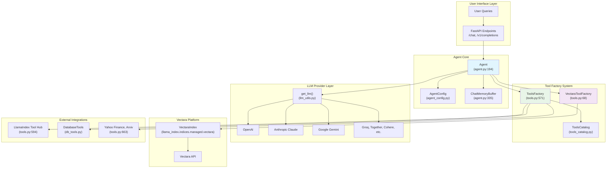
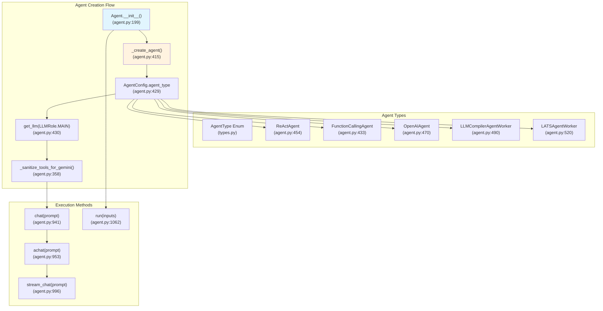
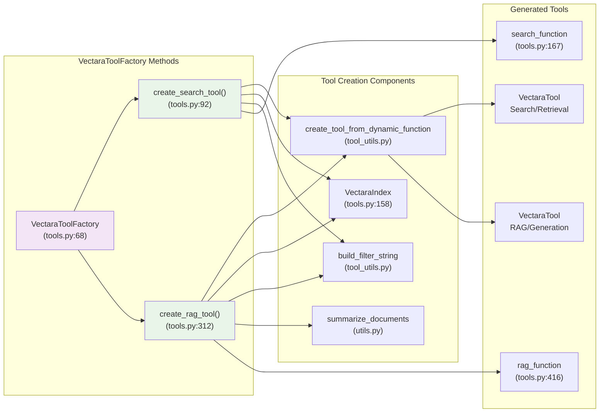
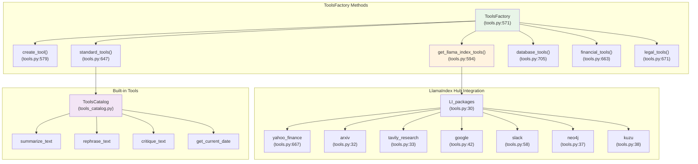
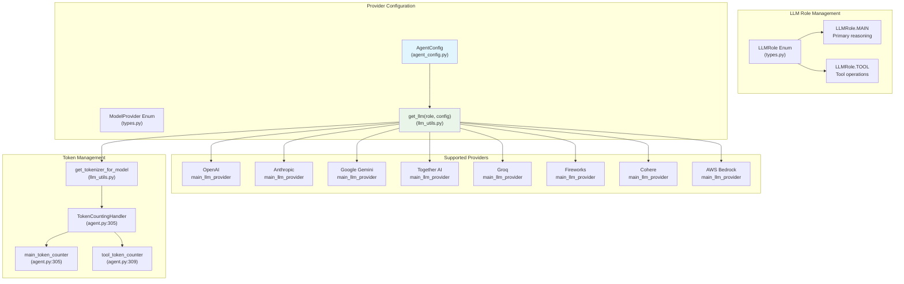
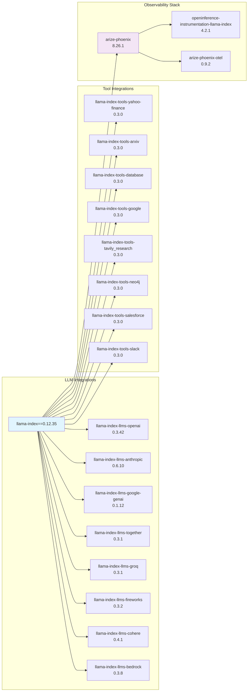
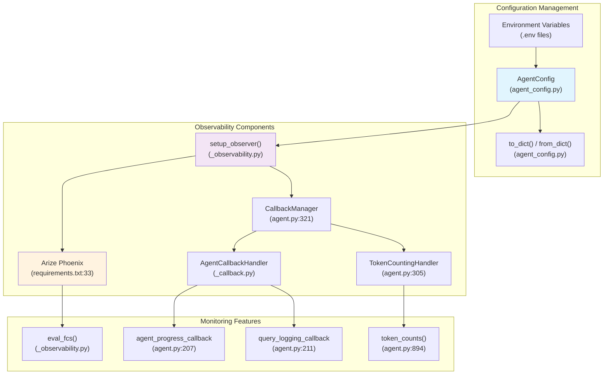

<!-- source: DeepWiki mcp.deepwiki.com · repo vectara/py-vectara-agentic · page 1.1 Architecture · fetched 2026-10-26 -->

# Architecture

<details>
<summary>Relevant source files</summary>

The following files were used as context for generating this wiki page:

- [requirements.txt](requirements.txt)
- [vectara_agentic/agent.py](vectara_agentic/agent.py)
- [vectara_agentic/tools.py](vectara_agentic/tools.py)

</details>


This document describes the high-level system architecture of the vectara-agentic framework. It covers the core components, their relationships, and how they work together to provide an AI agent system built around Vectara's RAG capabilities.

For specific implementation details of individual components, see [Core Components](#2). For configuration and setup information, see [Installation and Configuration](#3). For API endpoint documentation, see [API and Endpoints](#5).

## System Overview

The vectara-agentic framework is an agent-centric AI system that orchestrates multiple components to enable intelligent retrieval-augmented generation (RAG) applications. The system is built on the LlamaIndex framework and provides a factory-based approach to creating tools and agents.

### High-Level Component Mapping



Sources: [vectara_agentic/agent.py:194-218](), [vectara_agentic/tools.py:68-91](), [vectara_agentic/tools.py:571-577](), [requirements.txt:1-42]()

## Core Agent Architecture

The `Agent` class serves as the central orchestrator, supporting multiple agent types with different reasoning strategies. The system implements a factory pattern for both agents and tools, enabling flexible composition of capabilities.

### Agent Types and Execution Flow



Sources: [vectara_agentic/agent.py:194-218](), [vectara_agentic/agent.py:415-556](), [vectara_agentic/agent.py:941-995](), [vectara_agentic/types.py]()

## Tool Factory System

The tool factory system provides a modular approach to creating agent tools. Two main factories handle different categories of tools: `VectaraToolFactory` for Vectara-specific RAG tools and `ToolsFactory` for general-purpose tools.

### VectaraToolFactory Architecture



Sources: [vectara_agentic/tools.py:68-91](), [vectara_agentic/tools.py:92-310](), [vectara_agentic/tools.py:312-568]()

### ToolsFactory and External Integrations



Sources: [vectara_agentic/tools.py:571-779](), [vectara_agentic/tools.py:30-65](), [vectara_agentic/tools_catalog.py]()

## LLM Provider Layer

The system abstracts LLM interactions through a unified interface that supports multiple providers. This enables seamless switching between different language models based on configuration.

### LLM Provider Integration



Sources: [vectara_agentic/llm_utils.py](), [vectara_agentic/agent_config.py](), [vectara_agentic/agent.py:304-311](), [vectara_agentic/types.py](), [requirements.txt:6-14]()

## Data Flow and Processing Pipeline

The system processes user queries through a structured pipeline that involves agent reasoning, tool execution, and response generation. The flow varies based on agent type but follows consistent patterns.

### Query Processing Flow

```mermaid
sequenceDiagram
    participant User
    participant Agent["Agent.achat()<br/>(agent.py:953)"]
    participant CurrentAgent["_get_current_agent()<br/>(agent.py:914)"]
    participant ToolFactory["VectaraToolFactory<br/>create_rag_tool()"]
    participant VectaraIndex["VectaraIndex<br/>(tools.py:158)"]
    participant VectaraAPI["Vectara API"]
    participant LLM["LLM Provider"]
    participant Observer["Phoenix Observer<br/>(_observability.py)"]
    
    User->>Agent: "query string"
    Agent->>CurrentAgent: "Get active agent instance"
    CurrentAgent->>ToolFactory: "Execute tool with query"
    ToolFactory->>VectaraIndex: "as_query_engine()"
    VectaraIndex->>VectaraAPI: "Query with filters"
    VectaraAPI-->>VectaraIndex: "Retrieved documents"
    VectaraIndex->>LLM: "Summarize results"
    LLM-->>VectaraIndex: "Generated response"
    VectaraIndex-->>ToolFactory: "ToolOutput"
    ToolFactory-->>CurrentAgent: "Tool results"
    CurrentAgent->>LLM: "Generate final response"
    LLM-->>CurrentAgent: "AgentResponse"
    CurrentAgent->>Observer: "Log metrics & FCS"
    CurrentAgent-->>Agent: "AgentResponse"
    Agent-->>User: "Final response"
```

Sources: [vectara_agentic/agent.py:953-994](), [vectara_agentic/tools.py:416-549](), [vectara_agentic/tools.py:158-164](), [vectara_agentic/_observability.py]()

## Technology Stack and Dependencies

The framework is built on a comprehensive technology stack that integrates multiple AI and data processing libraries.

### Core Dependencies

| Component | Version | Purpose |
|-----------|---------|---------|
| `llama-index` | 0.12.35 | Core framework foundation |
| `llama-index-indices-managed-vectara` | 0.4.5 | Vectara integration |
| `llama-index-agent-llm-compiler` | 0.3.0 | LLMCompiler agent type |
| `llama-index-agent-lats` | 0.3.0 | LATS agent type |
| `llama-index-agent-openai` | 0.4.8 | OpenAI agent type |
| `arize-phoenix` | 8.26.1 | Observability platform |
| `pydantic` | 2.11.3 | Data validation |
| `tiktoken` | 0.9.0 | Tokenization |

### LLM Provider Dependencies



Sources: [requirements.txt:1-42]()

## Configuration and Observability

The system includes comprehensive configuration management and observability features to support production deployments.

### Configuration Architecture



Sources: [vectara_agentic/agent_config.py](), [vectara_agentic/_observability.py](), [vectara_agentic/_callback.py](), [vectara_agentic/agent.py:304-321](), [vectara_agentic/agent.py:894-912]()

The architecture demonstrates a well-structured, modular system that separates concerns while maintaining flexibility for different use cases and deployment scenarios. The factory patterns enable easy extension, while the LLM abstraction layer provides provider independence.

---

