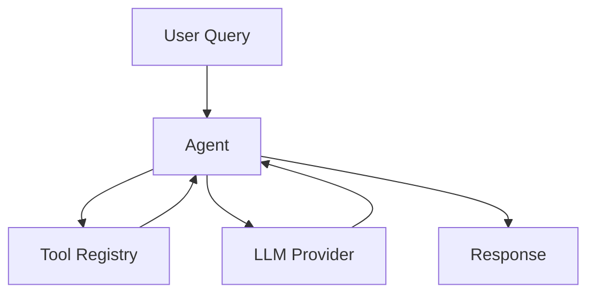
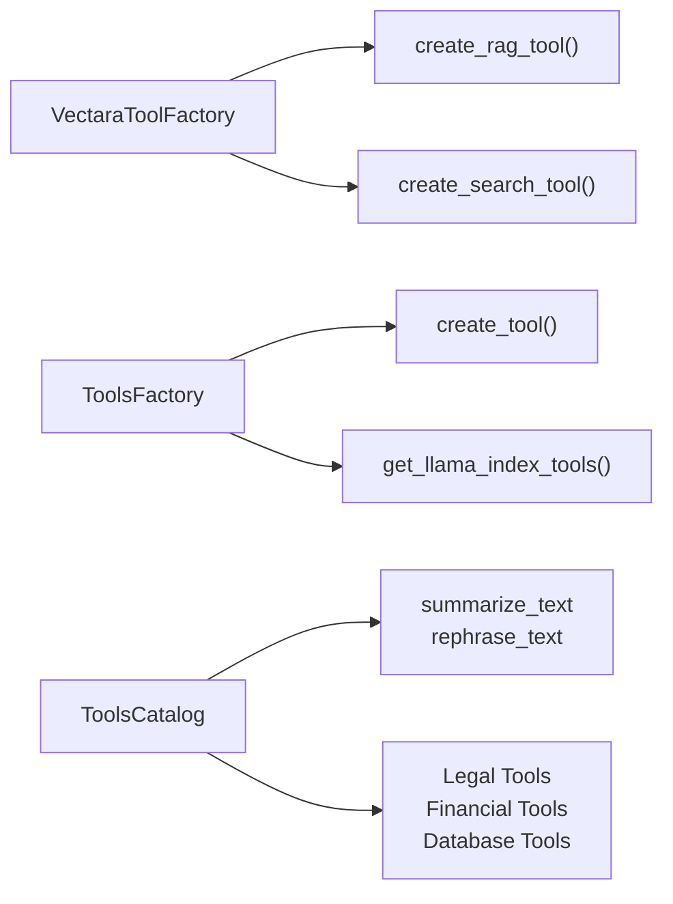
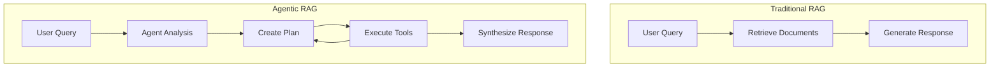
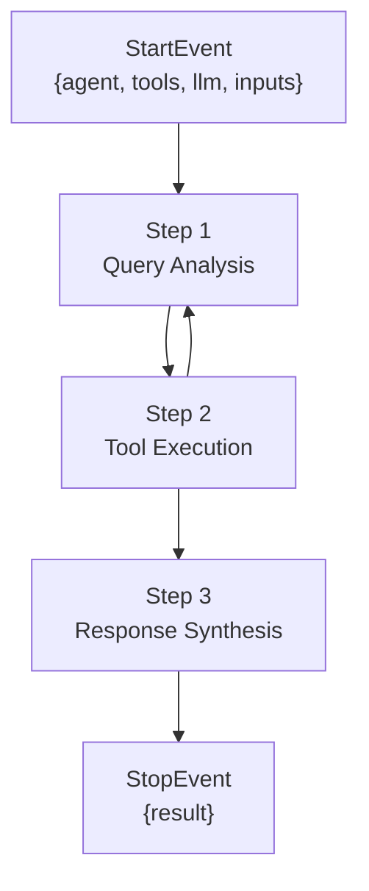
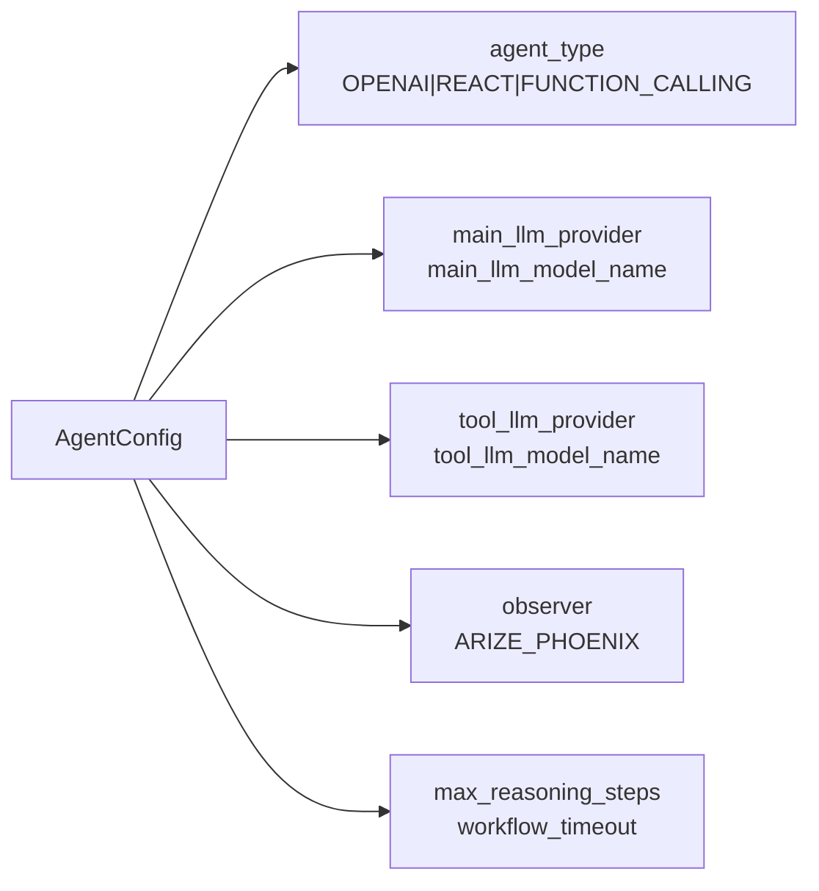
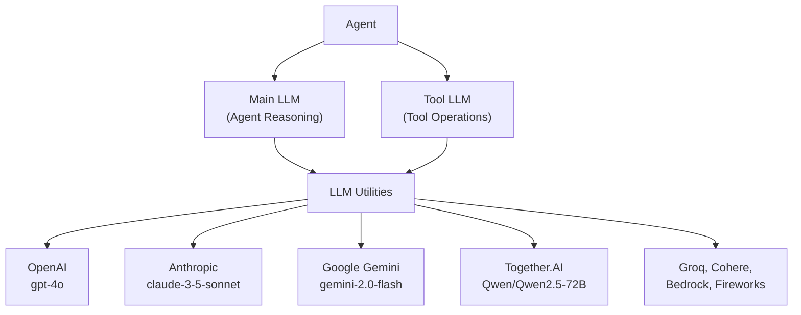
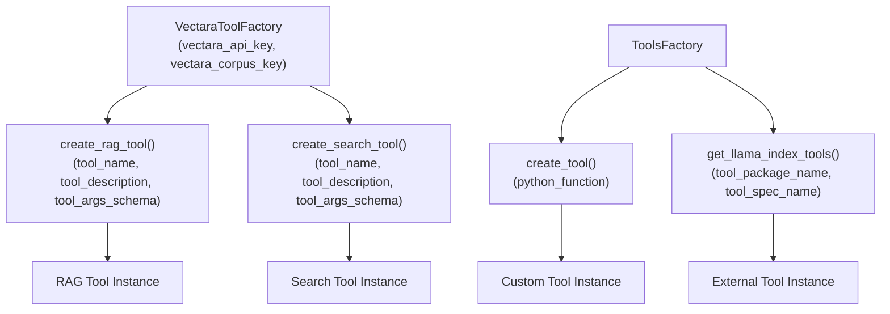
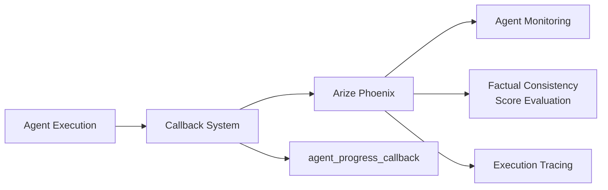
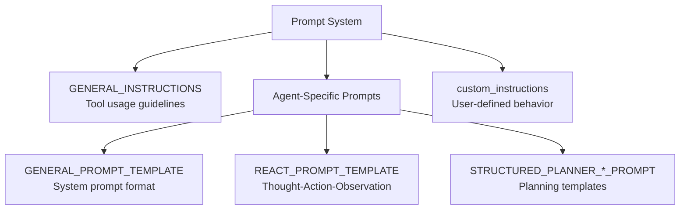

<!-- source: DeepWiki mcp.deepwiki.com · repo vectara/py-vectara-agentic · page 1.2 Key Concepts · fetched 2026-10-26 -->

# Key Concepts

Relevant source files

The following files were used as context for generating this wiki page:

- [README.md](README.md)
- [docs/index.md](docs/index.md)
- [requirements-dev.txt](requirements-dev.txt)
- [tests/test_agent_planning.py](tests/test_agent_planning.py)
- [tests/test_agent_type.py](tests/test_agent_type.py)
- [vectara_agentic/_prompts.py](vectara_agentic/_prompts.py)

This document defines the fundamental concepts and terminology used throughout the vectara-agentic system. It covers the core abstractions that developers need to understand when building AI agents with Vectara's RAG capabilities.

For implementation details about the agent system, see [Agent System](#2.1). For information about deploying agents as web services, see [REST API](#5.1).

## Core Concepts

### Agents

An **Agent** is the central orchestrator that manages the entire interaction flow between users and tools. The agent interprets user queries, creates execution plans, calls appropriate tools, and synthesizes final responses.

**Agent Types**

The system supports multiple agent architectures, each with different reasoning patterns:

| Agent Type | Description | Implementation |
|------------|-------------|----------------|
| `OPENAI` | Function-calling agent using OpenAI's native tool calling | Default agent type |
| `REACT` | Reasoning and acting agent that thinks step-by-step | Uses custom prompt template |
| `FUNCTION_CALLING` | Generic function calling agent for non-OpenAI providers | Works with multiple LLM providers |
| `LATS` | Language Agent Tree Search for complex reasoning | Advanced planning capabilities |
| `LLMCOMPILER` | Parallel tool execution agent | Optimized for performance |

Sources: [README.md:608-610](), [vectara_agentic/_prompts.py:1-171](), [tests/test_agent_type.py:16-68]()

### Tools

**Tools** are discrete functions that agents can invoke to perform specific tasks. They extend the agent's capabilities beyond pure language generation.

**Tool Categories**

- **Vectara Tools**: RAG and search tools for querying Vectara corpora
- **Standard Tools**: Text processing utilities like summarization and rephrasing  
- **Domain Tools**: Specialized tools for verticals (legal, finance, database)
- **External Tools**: Integration with third-party APIs and services

Sources: [README.md:204-386](), [README.md:255-292]()

### RAG vs Agentic RAG

**RAG (Retrieval-Augmented Generation)** is a technique where relevant information is retrieved from a knowledge base and used to generate more accurate responses.

**Agentic RAG** extends traditional RAG by using an LLM-powered agent to intelligently manage the retrieval and generation process through reasoning, planning, and tool usage.

**Key Differences**

| Aspect | Traditional RAG | Agentic RAG |
|--------|----------------|-------------|
| Query Processing | Direct retrieval | Intelligent analysis and planning |
| Tool Usage | Single retrieval call | Multiple tool interactions |
| Complex Queries | Limited capability | Breaks down into sub-questions |
| Filtering | Basic keyword matching | Dynamic metadata filtering |
| Response Quality | Good for simple queries | Excels at complex, multi-step queries |

Sources: [docs/index.md:5-70](), [README.md:37-59]()

### Workflows

**Workflows** provide structured, multi-step interactions for complex query processing. They define input/output models and execution sequences using the LlamaIndex workflow framework.

**Built-in Workflows**

- `SubQuestionQueryWorkflow`: Breaks complex queries into parallel sub-questions
- `SequentialSubQuestionsWorkflow`: Executes sub-questions sequentially with dependencies

Sources: [README.md:418-580]()

### Agent Configuration

**AgentConfig** controls agent behavior through structured configuration parameters rather than hardcoded values.

**Configuration Sources** (in priority order):
1. Direct parameters to `AgentConfig` constructor
2. Environment variables (e.g., `VECTARA_AGENTIC_AGENT_TYPE`)
3. Default values

Sources: [README.md:583-615]()

### LLM Provider Abstraction

The system abstracts different language model providers through a unified interface, allowing agents to work with multiple LLM services.

Sources: [README.md:609-610](), [docs/index.md:186-219]()

### Tool Factory Pattern

The **Factory Pattern** is used extensively for creating tools with consistent interfaces while hiding implementation complexity.

Sources: [README.md:86-125](), [README.md:389-401]()

### Observability and Monitoring

**Observability** provides insight into agent behavior through logging, metrics, and evaluation frameworks.

**Key Features**
- Progress callbacks for real-time monitoring
- Integration with Arize Phoenix for comprehensive observability
- Factual consistency scoring for response quality assessment
- Execution tracing for debugging and optimization

Sources: [README.md:55-56](), [README.md:170-171](), [vectara_agentic/_prompts.py:37]()

### Prompt System

The **Prompt System** provides structured instructions that guide agent behavior through carefully crafted templates and instructions.

**Instruction Hierarchy**
1. **General Instructions**: Universal guidelines for tool usage and response formatting
2. **Agent-Specific Templates**: Prompt templates tailored to each agent type  
3. **Custom Instructions**: User-defined behavioral guidelines for specific use cases

Sources: [vectara_agentic/_prompts.py:6-171](), [README.md:185-201]()

---

