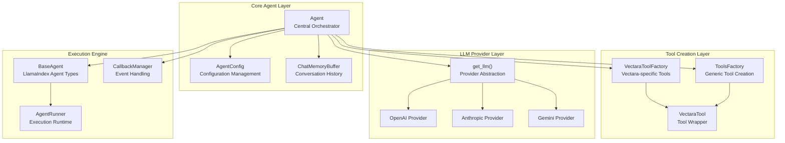
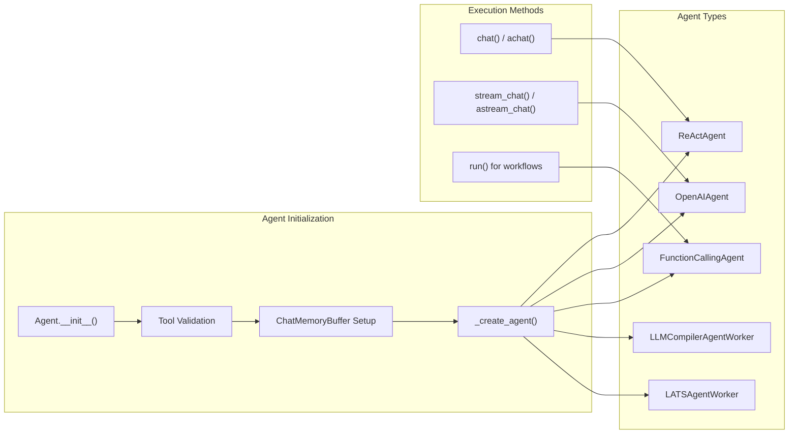
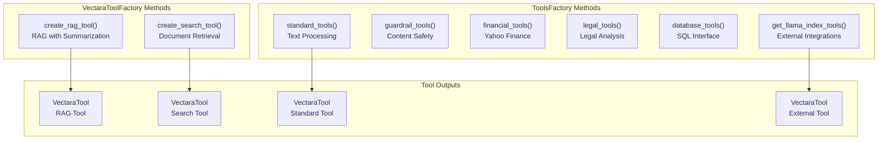
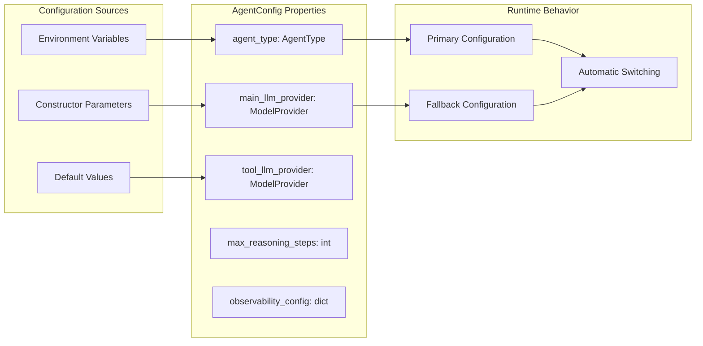
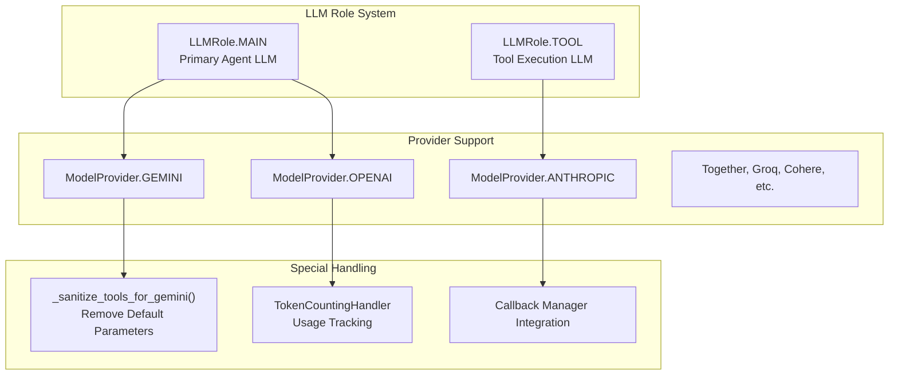
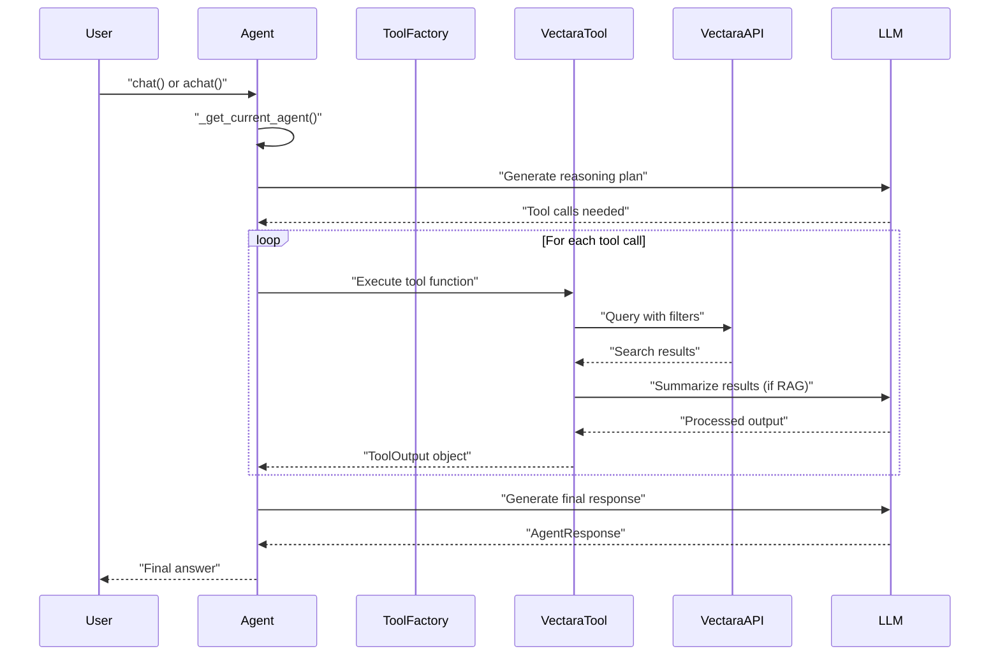
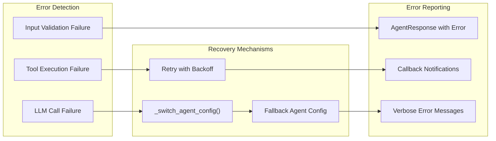

<!-- source: DeepWiki mcp.deepwiki.com · repo vectara/py-vectara-agentic · page 2 Core Components · fetched 2026-10-26 -->

# Core Components

Relevant source files

The following files were used as context for generating this wiki page:

- [vectara_agentic/agent.py](vectara_agentic/agent.py)
- [vectara_agentic/tools.py](vectara_agentic/tools.py)

This document covers the fundamental building blocks of the vectara-agentic system, explaining how the main classes and interfaces work together to create a flexible AI agent framework. For detailed information about agent types and lifecycle management, see [Agent System](#2.1). For comprehensive tool creation patterns, see [Tool Factory System](#2.2). For workflow orchestration capabilities, see [Workflow Engine](#2.3).

The core components form a modular architecture where agents coordinate tool execution through factory patterns, with extensive configuration management and LLM provider abstraction.

## Architecture Overview

The vectara-agentic system is built around several key components that work together to provide a complete agentic framework:

**Sources:** [vectara_agentic/agent.py:194-298](), [vectara_agentic/tools.py:68-780]()

## Agent as Central Orchestrator

The `Agent` class serves as the primary interface and orchestrator for the entire system. It manages tool execution, LLM interactions, memory, and configuration switching.

The `Agent` class provides several creation patterns:

| Method | Purpose | Key Parameters |
|--------|---------|----------------|
| `Agent.from_tools()` | Create agent from tool list | `tools`, `agent_config`, `topic` |
| `Agent.from_corpus()` | Create agent from Vectara corpus | `vectara_corpus_key`, `data_description` |
| `Agent.__init__()` | Direct instantiation | Full parameter control |

**Sources:** [vectara_agentic/agent.py:199-298](), [vectara_agentic/agent.py:630-686](), [vectara_agentic/agent.py:688-853]()

## Tool Factory Pattern

The system uses a factory pattern to create and manage tools. Two main factories handle different tool categories:

### VectaraToolFactory

The `VectaraToolFactory` specializes in creating tools that interact with the Vectara platform:

- **RAG Tools**: Created via `create_rag_tool()` for retrieval-augmented generation
- **Search Tools**: Created via `create_search_tool()` for document retrieval
- **Dynamic Function Generation**: Tools are created with dynamically generated functions that handle Vectara API calls

### ToolsFactory  

The `ToolsFactory` handles general-purpose tool creation:

- **Standard Tools**: Text processing tools like `summarize_text`, `rephrase_text`, `critique_text`
- **Domain-Specific Tools**: Financial, legal, and database tools
- **External Integrations**: LlamaIndex hub tools for various APIs

**Sources:** [vectara_agentic/tools.py:68-569](), [vectara_agentic/tools.py:571-780]()

## Configuration Management

The system uses `AgentConfig` to manage all configuration aspects, with support for fallback configurations and environment variable integration.

**Sources:** [vectara_agentic/agent.py:246-247](), [vectara_agentic/agent.py:343-349]()

## LLM Provider Integration

The system abstracts LLM provider differences through a unified interface:

The system includes special handling for provider-specific requirements, such as Gemini's tool parameter restrictions handled by `_sanitize_tools_for_gemini()`.

**Sources:** [vectara_agentic/agent.py:358-413](), [vectara_agentic/agent.py:253](), [vectara_agentic/agent.py:304-311]()

## Data Flow and Tool Execution

The following diagram shows how user queries flow through the system:

**Sources:** [vectara_agentic/agent.py:953-994](), [vectara_agentic/tools.py:167-263](), [vectara_agentic/tools.py:416-549]()

## Error Handling and Fallbacks

The system includes robust error handling with automatic configuration switching:

The system attempts up to 4 retries (2 with primary config, 2 with fallback) before returning an error response.

**Sources:** [vectara_agentic/agent.py:963-994](), [vectara_agentic/agent.py:855-863]()

## Serialization and Persistence

The `Agent` class supports serialization for persistence and deployment:

| Method | Purpose | Format |
|--------|---------|--------|
| `dumps()` | Serialize to JSON string | JSON with pickled functions |
| `loads()` | Deserialize from JSON | Reconstructs full agent |
| `to_dict()` | Convert to dictionary | Includes tool schemas |
| `from_dict()` | Create from dictionary | Handles schema reconstruction |

The serialization system handles complex cases like Pydantic model schemas and function pickling for complete state preservation.

**Sources:** [vectara_agentic/agent.py:1124-1297]()

---

