<!-- source: DeepWiki mcp.deepwiki.com · repo vectara/py-vectara-agentic · page 2.1 Agent System · fetched 2026-10-26 -->

# Agent System

Relevant source files

The following files were used as context for generating this wiki page:

- [tests/test_agent.py](tests/test_agent.py)
- [vectara_agentic/agent.py](vectara_agentic/agent.py)
- [vectara_agentic/agent_config.py](vectara_agentic/agent_config.py)
- [vectara_agentic/types.py](vectara_agentic/types.py)

This document covers the core `Agent` class that serves as the central orchestrator for AI agent interactions in the vectara-agentic framework. The Agent System handles agent lifecycle management, multi-turn conversations, tool coordination, and integration with various LLM providers through different agent implementation strategies.

For information about tool creation and management, see [Tool Factory System](#2.2). For workflow orchestration capabilities, see [Workflow Engine](#2.3). For prompt templates and instructions, see [Prompt System](#2.4).

## Purpose and Architecture

The Agent System provides a unified interface for creating and managing AI agents that can interact with tools, maintain conversation memory, and execute complex reasoning workflows. The system supports multiple agent types, each optimized for different LLM providers and reasoning strategies.

### Core Agent Architecture

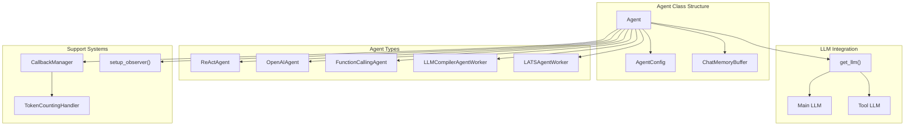

Sources: [vectara_agentic/agent.py:194-557](), [vectara_agentic/types.py:10-18](), [vectara_agentic/agent_config.py:9-115]()

## Agent Class Overview

The `Agent` class located at [vectara_agentic/agent.py:194-1187]() serves as the primary interface for all agent operations. It provides both synchronous and asynchronous methods for chat interactions, memory management, and tool coordination.

### Agent Initialization

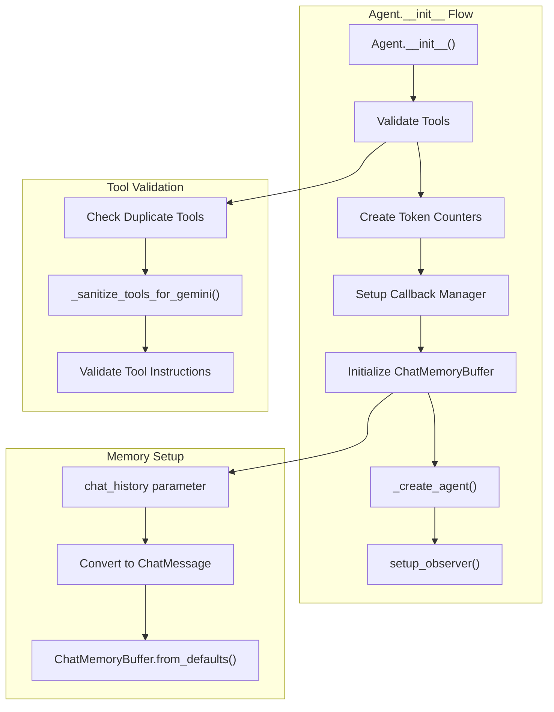

Sources: [vectara_agentic/agent.py:199-357](), [vectara_agentic/agent.py:358-413](), [vectara_agentic/agent.py:324-340]()

### Key Initialization Parameters

| Parameter | Type | Purpose | Default |
|-----------|------|---------|---------|
| `tools` | `List[FunctionTool]` | Tools available to the agent | Required |
| `topic` | `str` | Agent specialization topic | `"general"` |
| `custom_instructions` | `str` | Custom behavior instructions | `""` |
| `agent_config` | `AgentConfig` | LLM and agent configuration | `AgentConfig()` |
| `fallback_agent_config` | `AgentConfig` | Backup configuration for failures | `None` |
| `chat_history` | `list[Tuple[str, str]]` | Pre-populate conversation memory | `None` |
| `workflow_cls` | `Workflow` | Workflow class for `run()` method | `None` |
| `validate_tools` | `bool` | Validate tool-instruction consistency | `False` |

Sources: [vectara_agentic/agent.py:199-245]()

## Agent Types and Implementation

The system supports five distinct agent types, each implementing different reasoning strategies and optimized for specific LLM providers.

### Agent Type Implementation Matrix

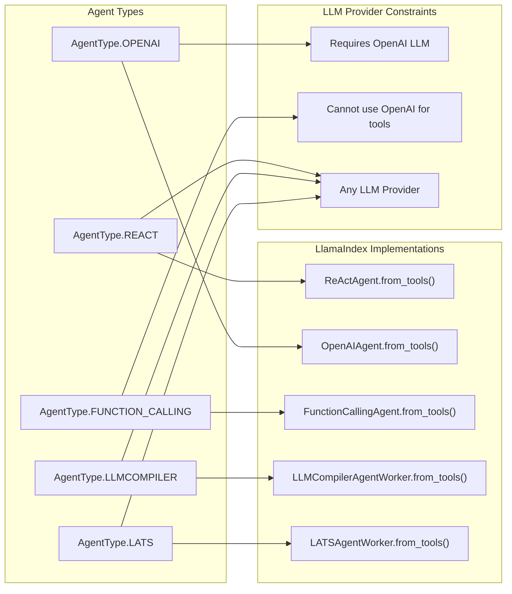

Sources: [vectara_agentic/agent.py:415-557](), [vectara_agentic/types.py:10-18]()

### Agent Creation Logic

The `_create_agent()` method at [vectara_agentic/agent.py:415-557]() implements the factory pattern for creating specific agent types:

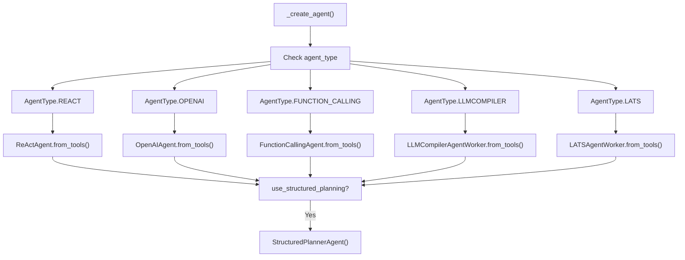

Sources: [vectara_agentic/agent.py:415-557]()

## Configuration System

The `AgentConfig` class at [vectara_agentic/agent_config.py:9-115]() provides centralized configuration management with environment variable support.

### Configuration Structure

```mermaid
graph TB
    subgraph "AgentConfig Fields"
        AgentType["agent_type: AgentType"]
        MainLLM["main_llm_provider: ModelProvider"]
        MainModel["main_llm_model_name: str"]
        ToolLLM["tool_llm_provider: ModelProvider"]
        ToolModel["tool_llm_model_name: str"]
        Observer["observer: ObserverType"]
        MaxSteps["max_reasoning_steps: int"]
        APIKey["endpoint_api_key: str"]
        PrivateAPI["private_llm_api_base: str"]
    end
    
    subgraph "Environment Variables"
        ENV_AGENT["VECTARA_AGENTIC_AGENT_TYPE"]
        ENV_MAIN_LLM["VECTARA_AGENTIC_MAIN_LLM_PROVIDER"]
        ENV_MAIN_MODEL["VECTARA_AGENTIC_MAIN_MODEL_NAME"]
        ENV_TOOL_LLM["VECTARA_AGENTIC_TOOL_LLM_PROVIDER"]
        ENV_TOOL_MODEL["VECTARA_AGENTIC_TOOL_MODEL_NAME"]
        ENV_OBSERVER["VECTARA_AGENTIC_OBSERVER_TYPE"]
        ENV_MAX_STEPS["VECTARA_AGENTIC_MAX_REASONING_STEPS"]
        ENV_API_KEY["VECTARA_AGENTIC_API_KEY"]
    end
    
    AgentType --> ENV_AGENT
    MainLLM --> ENV_MAIN_LLM
    MainModel --> ENV_MAIN_MODEL
    ToolLLM --> ENV_TOOL_LLM
    ToolModel --> ENV_TOOL_MODEL
    Observer --> ENV_OBSERVER
    MaxSteps --> ENV_MAX_STEPS
    APIKey --> ENV_API_KEY
```

Sources: [vectara_agentic/agent_config.py:18-73]()

### Fallback Configuration System

The Agent supports a fallback configuration mechanism for handling LLM failures:

| Configuration Type | Usage | Switching Logic |
|-------------------|-------|-----------------|
| `agent_config` | Primary configuration | Used for first 2 attempts |
| `fallback_agent_config` | Backup configuration | Used after primary fails |
| `agent_config_type` | Current active config | Tracked via `AgentConfigType` enum |

Sources: [vectara_agentic/agent.py:342-350](), [vectara_agentic/agent.py:855-863]()

## Chat Interface and Lifecycle

The Agent provides both synchronous and asynchronous chat interfaces with comprehensive error handling and retry logic.

### Chat Method Flow

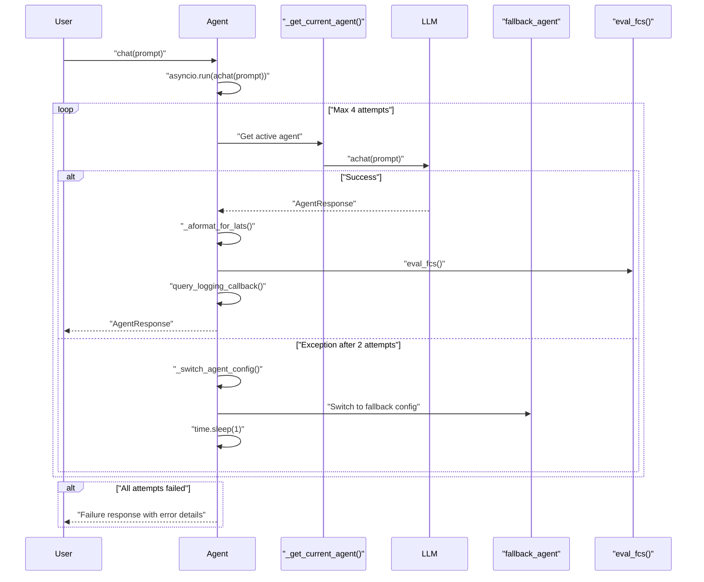

Sources: [vectara_agentic/agent.py:941-995](), [vectara_agentic/agent.py:953-995]()

### Streaming Chat Interface

The agent also supports streaming responses through `stream_chat()` and `astream_chat()` methods at [vectara_agentic/agent.py:996-1055](). The streaming implementation preserves the same retry logic while wrapping the response generator to execute post-streaming callbacks.

Sources: [vectara_agentic/agent.py:996-1055]()

## Memory Management

The Agent uses LlamaIndex's `ChatMemoryBuffer` for conversation state management with a default token limit of 128,000 tokens.

### Memory Initialization and Operations

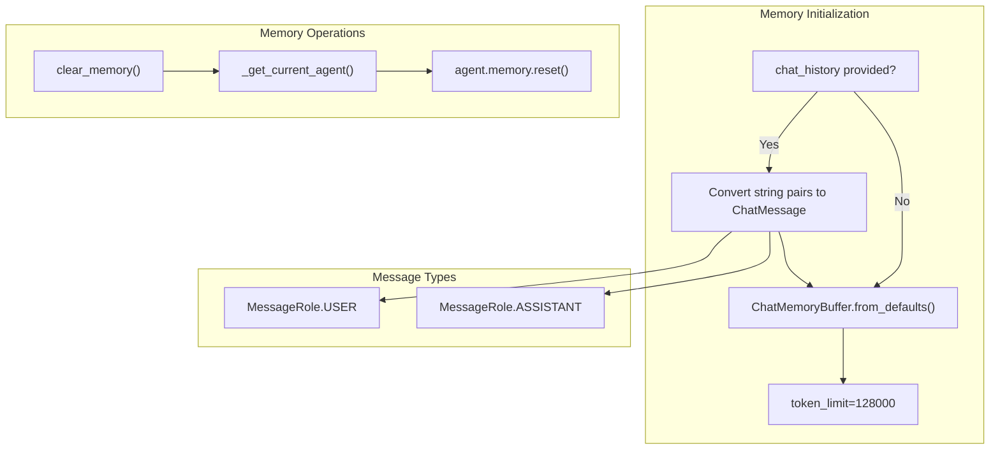

Sources: [vectara_agentic/agent.py:324-340](), [vectara_agentic/agent.py:558-571]()

## Tool Integration and Validation

The Agent System includes comprehensive tool management with validation, sanitization, and automatic tool injection.

### Tool Processing Pipeline

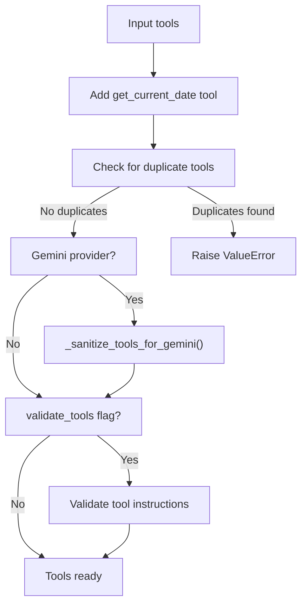

Sources: [vectara_agentic/agent.py:248-302](), [vectara_agentic/agent.py:358-413]()

### Gemini Tool Sanitization

For Gemini LLM provider compatibility, the system removes default parameter values from tool schemas at [vectara_agentic/agent.py:358-413]():

| Sanitization Step | Purpose | Implementation |
|------------------|---------|----------------|
| Strip function defaults | Remove `default=` from `tool.fn` signature | `Parameter.replace(default=Parameter.empty)` |
| Rebuild Pydantic schema | Make all fields required | `create_model()` with `Field(...)` |
| Update signatures | Clean `__signature__` attribute | `Signature(params)` with no defaults |

Sources: [vectara_agentic/agent.py:358-413]()

## Factory Methods

The Agent class provides convenient factory methods for common use cases.

### Factory Method Comparison

| Method | Purpose | Key Parameters |
|--------|---------|----------------|
| `from_tools()` | Create agent from tool list | `tools`, `agent_config`, `topic` |
| `from_corpus()` | Create single-corpus RAG agent | `vectara_corpus_key`, `data_description`, `assistant_specialty` |

### from_corpus Implementation

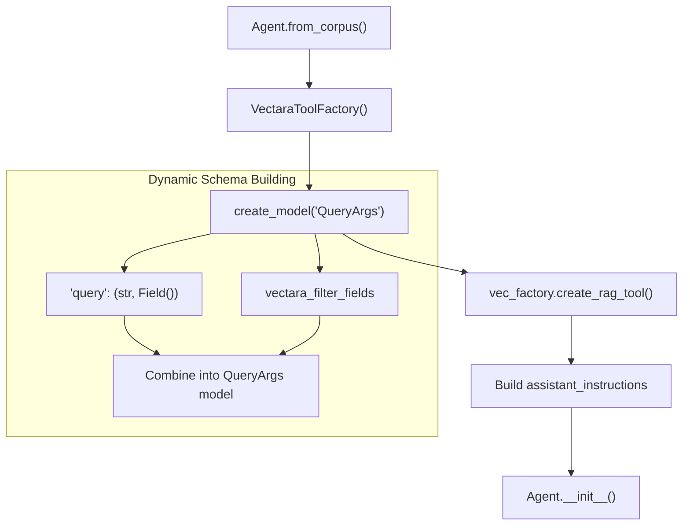

Sources: [vectara_agentic/agent.py:688-853]()

## Workflow Integration

The Agent supports workflow execution through the `run()` method, which integrates with LlamaIndex's Workflow system.

### Workflow Execution Flow

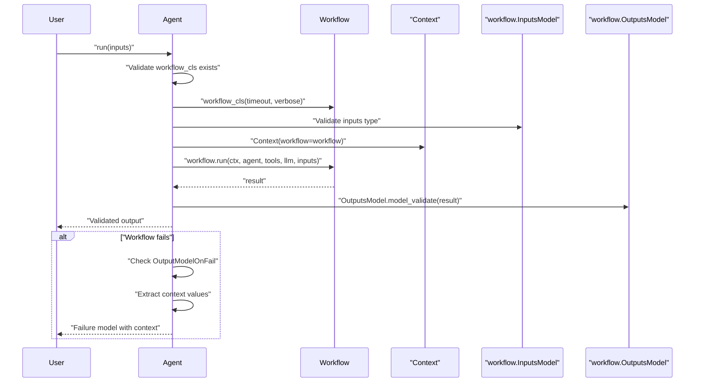

Sources: [vectara_agentic/agent.py:1062-1119]()

## Error Handling and Observability

The Agent System includes comprehensive error handling with automatic fallback configuration switching and observability integration.

### Token Counting and Callbacks

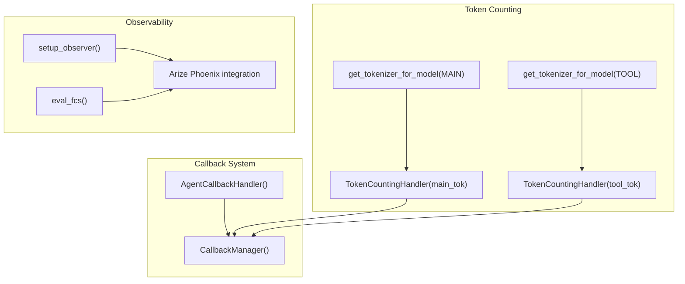

Sources: [vectara_agentic/agent.py:304-321](), [vectara_agentic/agent.py:352-356]()

The Agent System provides a robust foundation for AI agent interactions with comprehensive configuration management, multiple reasoning strategies, and seamless integration with the broader vectara-agentic ecosystem.

---

