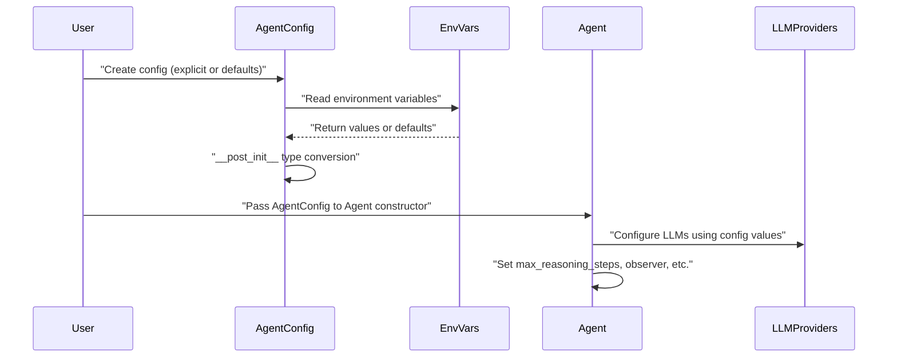
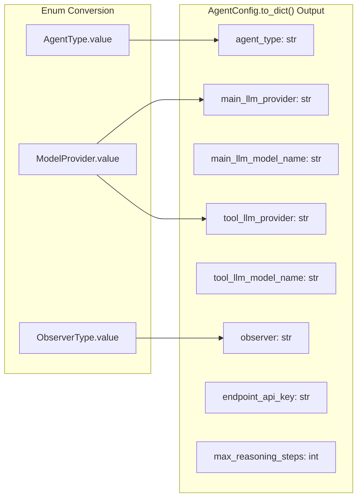
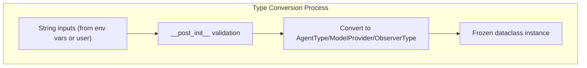

<!-- source: DeepWiki mcp.deepwiki.com · repo vectara/py-vectara-agentic · page 3.2 Agent Configuration · fetched 2026-10-26 -->

# Agent Configuration

<details>
<summary>Relevant source files</summary>

The following files were used as context for generating this wiki page:

- [docs/usage.md](docs/usage.md)
- [vectara_agentic/agent_config.py](vectara_agentic/agent_config.py)

</details>


This document provides a complete reference for the `AgentConfig` class and environment variable configuration in vectara-agentic. The `AgentConfig` class serves as the centralized configuration system for all agent behavior, LLM providers, observability settings, and runtime parameters.

For information about setting up specific LLM providers, see [LLM Provider Setup](#3.3). For basic agent usage examples, see [Basic Usage](#4.1).

## Configuration Architecture

The `AgentConfig` class implements a configuration-as-code pattern with environment variable fallbacks, allowing flexible deployment across different environments while maintaining type safety and validation.

### AgentConfig Class Structure

```mermaid
graph TB
    subgraph "AgentConfig Fields"
        AT["agent_type: AgentType"]
        MLP["main_llm_provider: ModelProvider"]
        MLN["main_llm_model_name: str"]
        TLP["tool_llm_provider: ModelProvider"] 
        TLN["tool_llm_model_name: str"]
        PAB["private_llm_api_base: str"]
        PAK["private_llm_api_key: str"]
        OBS["observer: ObserverType"]
        EAK["endpoint_api_key: str"]
        MRS["max_reasoning_steps: int"]
    end
    
    subgraph "Environment Variables"
        ENV1["VECTARA_AGENTIC_AGENT_TYPE"]
        ENV2["VECTARA_AGENTIC_MAIN_LLM_PROVIDER"]
        ENV3["VECTARA_AGENTIC_MAIN_MODEL_NAME"]
        ENV4["VECTARA_AGENTIC_TOOL_LLM_PROVIDER"]
        ENV5["VECTARA_AGENTIC_TOOL_MODEL_NAME"]
        ENV6["VECTARA_AGENTIC_PRIVATE_LLM_API_BASE"]
        ENV7["VECTARA_AGENTIC_PRIVATE_LLM_API_KEY"]
        ENV8["VECTARA_AGENTIC_OBSERVER_TYPE"]
        ENV9["VECTARA_AGENTIC_API_KEY"]
        ENV10["VECTARA_AGENTIC_MAX_REASONING_STEPS"]
    end
    
    ENV1 --> AT
    ENV2 --> MLP
    ENV3 --> MLN
    ENV4 --> TLP
    ENV5 --> TLN
    ENV6 --> PAB
    ENV7 --> PAK
    ENV8 --> OBS
    ENV9 --> EAK
    ENV10 --> MRS
```



Sources: [vectara_agentic/agent_config.py:9-73]()

### Configuration Data Flow



Sources: [vectara_agentic/agent_config.py:74-83](), [docs/usage.md:466-492]()

## Configuration Fields

The `AgentConfig` dataclass contains the following configuration categories:

### Agent Type Configuration

| Field | Type | Environment Variable | Default | Description |
|-------|------|---------------------|---------|-------------|
| `agent_type` | `AgentType` | `VECTARA_AGENTIC_AGENT_TYPE` | `OPENAI` | The agent reasoning strategy |

Valid `AgentType` values: `REACT`, `LLMCOMPILER`, `LATS`, `FUNCTION_CALLING`, `OPENAI`

### LLM Provider Configuration

| Field | Type | Environment Variable | Default | Description |
|-------|------|---------------------|---------|-------------|
| `main_llm_provider` | `ModelProvider` | `VECTARA_AGENTIC_MAIN_LLM_PROVIDER` | `OPENAI` | LLM provider for main agent reasoning |
| `main_llm_model_name` | `str` | `VECTARA_AGENTIC_MAIN_MODEL_NAME` | `""` | Specific model name for main LLM |
| `tool_llm_provider` | `ModelProvider` | `VECTARA_AGENTIC_TOOL_LLM_PROVIDER` | `OPENAI` | LLM provider for tool execution |
| `tool_llm_model_name` | `str` | `VECTARA_AGENTIC_TOOL_MODEL_NAME` | `""` | Specific model name for tool LLM |

Valid `ModelProvider` values: `OPENAI`, `ANTHROPIC`, `TOGETHER`, `GROQ`, `COHERE`, `BEDROCK`, `GEMINI`, `FIREWORKS`, `PRIVATE`

### Private LLM Configuration

| Field | Type | Environment Variable | Default | Description |
|-------|------|---------------------|---------|-------------|
| `private_llm_api_base` | `str` | `VECTARA_AGENTIC_PRIVATE_LLM_API_BASE` | `"http://private-endpoint.company.com:5000/v1"` | API endpoint for private LLM |
| `private_llm_api_key` | `str` | `VECTARA_AGENTIC_PRIVATE_LLM_API_KEY` | `"<private-api-key>"` | API key for private LLM |

### Observability and Runtime Configuration

| Field | Type | Environment Variable | Default | Description |
|-------|------|---------------------|---------|-------------|
| `observer` | `ObserverType` | `VECTARA_AGENTIC_OBSERVER_TYPE` | `NO_OBSERVER` | Observability framework |
| `endpoint_api_key` | `str` | `VECTARA_AGENTIC_API_KEY` | `"dev-api-key"` | API key for agent endpoints |
| `max_reasoning_steps` | `int` | `VECTARA_AGENTIC_MAX_REASONING_STEPS` | `50` | Maximum agent reasoning iterations |

Valid `ObserverType` values: `ARIZE_PHOENIX`, `NO_OBSERVER`

Sources: [vectara_agentic/agent_config.py:19-72]()

## Environment Variable Configuration

### Setting Environment Variables

Environment variables provide the default configuration when `AgentConfig` is instantiated without explicit parameters:

```bash
# Agent behavior
export VECTARA_AGENTIC_AGENT_TYPE="REACT"
export VECTARA_AGENTIC_MAX_REASONING_STEPS="30"

# Main agent LLM
export VECTARA_AGENTIC_MAIN_LLM_PROVIDER="ANTHROPIC"
export VECTARA_AGENTIC_MAIN_MODEL_NAME="claude-3-sonnet-20240229"

# Tool LLM (can be different from main LLM)
export VECTARA_AGENTIC_TOOL_LLM_PROVIDER="OPENAI"
export VECTARA_AGENTIC_TOOL_MODEL_NAME="gpt-4"

# Observability
export VECTARA_AGENTIC_OBSERVER_TYPE="ARIZE_PHOENIX"

# API endpoint security
export VECTARA_AGENTIC_API_KEY="your-secure-api-key"
```

### Private LLM Configuration

For organizations using private LLM deployments:

```bash
export VECTARA_AGENTIC_MAIN_LLM_PROVIDER="PRIVATE"
export VECTARA_AGENTIC_PRIVATE_LLM_API_BASE="https://internal-llm.company.com/v1"
export VECTARA_AGENTIC_PRIVATE_LLM_API_KEY="internal-api-key"
```

Sources: [vectara_agentic/agent_config.py:47-54](), [docs/usage.md:734-749]()

## Creating AgentConfig Objects

### Using Environment Variable Defaults

When no parameters are provided, `AgentConfig` reads from environment variables:

```python
from vectara_agentic.agent_config import AgentConfig

# Uses environment variables for all settings
config = AgentConfig()
```

### Explicit Configuration

Override specific settings while keeping environment variable defaults for others:

```python
from vectara_agentic.agent_config import AgentConfig

config = AgentConfig(
    agent_type="REACT",
    main_llm_provider="OPENAI", 
    tool_llm_provider="COHERE",
    max_reasoning_steps=25
)
```

### Mixed Configuration Example

```python
config = AgentConfig(
    agent_type="FUNCTION_CALLING",
    main_llm_provider="ANTHROPIC",
    main_llm_model_name="claude-3-haiku-20240307",
    observer="ARIZE_PHOENIX"
)
```

Sources: [docs/usage.md:484-492]()

## Serialization and Persistence

### Dictionary Conversion

The `AgentConfig` class supports serialization to and from dictionaries for persistence and API transport:

```python
# Convert to dictionary
config_dict = config.to_dict()

# Restore from dictionary  
restored_config = AgentConfig.from_dict(config_dict)
```

### Dictionary Structure



Sources: [vectara_agentic/agent_config.py:85-114]()

## Integration with Agent System

### Agent Constructor Usage

The `AgentConfig` object is passed to the `Agent` constructor to configure all agent behavior:

```python
from vectara_agentic import Agent
from vectara_agentic.agent_config import AgentConfig

config = AgentConfig(
    agent_type="REACT",
    main_llm_provider="ANTHROPIC",
    observer="ARIZE_PHOENIX"
)

agent = Agent(
    tools=[...],
    topic="financial analysis",
    custom_instructions="...",
    agent_config=config
)
```

### Fallback Agent Configuration

A separate `AgentConfig` can be provided for fallback scenarios when the primary LLM provider is unavailable:

```python
primary_config = AgentConfig(
    main_llm_provider="OPENAI",
    main_llm_model_name="gpt-4"
)

fallback_config = AgentConfig(
    main_llm_provider="ANTHROPIC", 
    main_llm_model_name="claude-3-haiku-20240307"
)

agent = Agent(
    tools=[...],
    agent_config=primary_config,
    fallback_agent_config=fallback_config
)
```

Sources: [docs/usage.md:396-401]()

## Type Safety and Validation

### Frozen Dataclass

The `AgentConfig` class is defined as a frozen dataclass, ensuring immutability after creation:

```python
@dataclass(eq=True, frozen=True)
class AgentConfig:
    # Configuration is immutable after instantiation
```

### Automatic Type Conversion

The `__post_init__` method handles automatic conversion of string values to appropriate enum types:



Sources: [vectara_agentic/agent_config.py:9](), [vectara_agentic/agent_config.py:74-83]()

---

