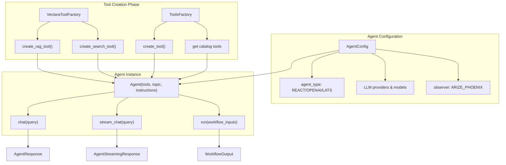
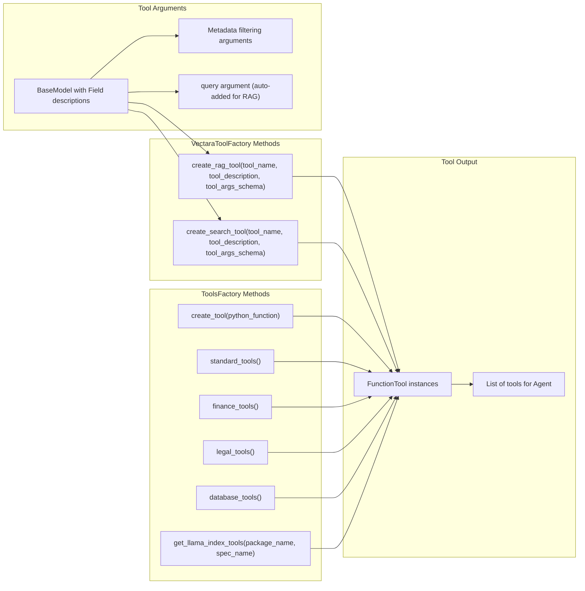
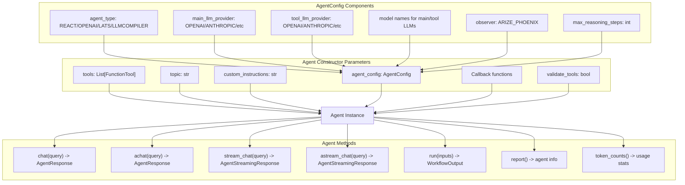

<!-- source: DeepWiki mcp.deepwiki.com · repo vectara/py-vectara-agentic · page 4 Usage Guide · fetched 2026-10-26 -->

# Usage Guide

Relevant source files

The following files were used as context for generating this wiki page:

- [README.md](README.md)
- [docs/usage.md](docs/usage.md)

This page provides comprehensive guidance on how to use vectara-agentic in real applications, covering the essential patterns for creating AI agents with Vectara's RAG capabilities. It demonstrates the core workflow from tool creation through agent configuration and interaction.

For installation and environment setup, see [Installation and Configuration](#3). For specific tool details, see [Available Tools](#4.2). For advanced capabilities like observability and callbacks, see [Advanced Features](#4.3).

## Core Usage Patterns

The vectara-agentic framework follows a consistent pattern: create tools, configure an agent, and interact through chat or workflow methods. The framework supports multiple agent types and provides extensive customization options for both tools and agent behavior.

Sources: [README.md:82-177](), [docs/usage.md:8-38](), [vectara_agentic/agent.py]()

## Tool Creation Workflow

Tools are the primary interface between agents and external systems. The framework provides three main approaches for tool creation, each optimized for different use cases.

Sources: [README.md:86-125](), [docs/usage.md:39-204](), [vectara_agentic/tools/vectara_tool_factory.py](), [vectara_agentic/tools/tools_factory.py]()

### Vectara RAG Tool Creation

The most common tool type connects to Vectara corpora for retrieval-augmented generation. These tools automatically include query functionality and support metadata filtering.

**Key Components:**
- `VectaraToolFactory` class for tool creation [vectara_agentic/tools/vectara_tool_factory.py]()
- `create_rag_tool()` method for full RAG pipeline [vectara_agentic/tools/vectara_tool_factory.py]()
- `create_search_tool()` method for document retrieval [vectara_agentic/tools/vectara_tool_factory.py]()
- Pydantic `BaseModel` schemas for argument validation [docs/usage.md:49-86]()

**Configuration Parameters:**
- `reranker` and `rerank_k` for result reranking [docs/usage.md:110-124]()
- `lambda_val` for lexical vs semantic search balance [README.md:121]()
- `fcs_threshold` for factual consistency scoring [docs/usage.md:157-166]()
- `fixed_filter` for persistent metadata filtering [docs/usage.md:224-231]()

Sources: [README.md:97-129](), [docs/usage.md:88-204]()

### Custom Tool Creation

The `ToolsFactory.create_tool()` method converts Python functions into agent tools with automatic type conversion and validation.

**Requirements:**
- Functions must be defined at module level (not nested) [README.md:399-401]()
- Clear docstrings for tool description [docs/usage.md:282-290]()
- Pydantic `Field` annotations for parameter descriptions [docs/usage.md:268-280]()
- Graceful exception handling with string error returns [docs/usage.md:369-373]()

Sources: [README.md:390-401](), [docs/usage.md:263-378]()

## Agent Configuration and Lifecycle

The `Agent` class serves as the central orchestrator, managing tools, LLM interactions, and conversation state. Agent behavior is controlled through configuration objects and instruction sets.

Sources: [docs/usage.md:379-516](), [README.md:154-177](), [vectara_agentic/agent.py]()

### Agent Instructions

The agent combines general base instructions with custom instructions to determine behavior. Instructions should focus on presentation and edge cases rather than tool usage, which is handled by tool descriptions.

**Instruction Guidelines:**
- Focus on behavior and presentation patterns [README.md:192-196]()
- Consider edge cases and unusual scenarios [docs/usage.md:420-423]()
- Avoid over-specifying based on primary use cases [docs/usage.md:421-423]()
- Reference specific tools only when necessary [docs/usage.md:441-444]()

Sources: [README.md:185-200](), [docs/usage.md:412-444]()

### Configuration Options

The `AgentConfig` class provides fine-grained control over agent behavior, LLM selection, and observability features.

**Core Configuration:**
- Agent types: `REACT`, `OPENAI`, `LATS`, `LLMCOMPILER` [docs/usage.md:470]()
- LLM providers: `OPENAI`, `ANTHROPIC`, `TOGETHER`, `GROQ`, `COHERE`, `BEDROCK`, `GEMINI`, `FIREWORKS` [docs/usage.md:471]()
- Model specification for main agent and tool operations [docs/usage.md:472]()
- Maximum reasoning steps for iterative processes [docs/usage.md:475]()

Sources: [README.md:581-646](), [docs/usage.md:467-492]()

## Interaction Methods

### Chat Interface

The primary interaction method provides synchronous and asynchronous chat capabilities with streaming support.

**Response Types:**
- `AgentResponse` with `response` text and `sources` metadata [README.md:182-183]()
- `AgentStreamingResponse` for chunked delivery [docs/usage.md:567-575]()
- Tool output tracking through `ToolOutput` objects [docs/usage.md:551-553]()

**Callback Integration:**
- `agent_progress_callback` for step-by-step monitoring [README.md:170](), [docs/usage.md:447-464]()
- `query_logging_callback` for query/response pair logging [docs/usage.md:717-725]()

Sources: [README.md:174-183](), [docs/usage.md:523-575]()

### Workflow Execution

The `run()` method enables structured multi-step interactions with validated inputs and outputs using the LlamaIndex workflow system.

**Workflow Components:**
- `InputsModel` and `OutputsModel` Pydantic schemas [docs/usage.md:583-597]()
- `StartEvent` with agent, tools, llm, and inputs [docs/usage.md:605-611]()
- Context management for state persistence [docs/usage.md:613-626]()
- Workflow class specification in agent constructor [docs/usage.md:630-640]()

**Built-in Workflows:**
- `SubQuestionQueryWorkflow` for parallel sub-question processing [README.md:511-536]()
- `SequentialSubQuestionsWorkflow` for sequential reasoning [README.md:538-563]()

Sources: [README.md:418-580](), [docs/usage.md:576-665]()

## Common Usage Patterns

### Financial Analysis Agent

A typical financial agent combines Vectara RAG tools with external data sources and custom calculation functions.

**Tool Composition:**
- Vectara corpus tools for financial document queries [docs/usage.md:97-129]()
- Yahoo Finance integration through `finance_tools()` [README.md:277-281]()
- Custom calculation functions [docs/usage.md:326-350]()
- Validation tools for company and year verification [docs/usage.md:311-324]()

Sources: [README.md:82-177](), [docs/usage.md:295-516]()

### Multi-Corpus RAG System

For applications requiring multiple data sources, the framework supports comma-separated corpus keys and unified querying.

**Configuration:**
- Multiple corpus keys in environment variables [docs/usage.md:144-146]()
- Query API keys with multi-corpus access [docs/usage.md:141-146]()
- Unified tool interface across corpora [docs/usage.md:134-146]()

Sources: [docs/usage.md:134-146](), [README.md:619-623]()

### Observability Integration

Phoenix integration provides comprehensive monitoring of agent interactions, tool calls, and factual consistency scores.

**Setup Requirements:**
- Environment variable or config specification [docs/usage.md:695-696]()
- Local or hosted Phoenix server connection [docs/usage.md:697-711]()
- Automatic FCS score recording for Vectara tools [docs/usage.md:713-715]()

Sources: [docs/usage.md:686-715](), [README.md:610-612]()

---

