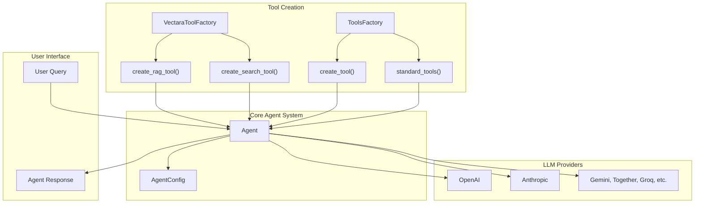
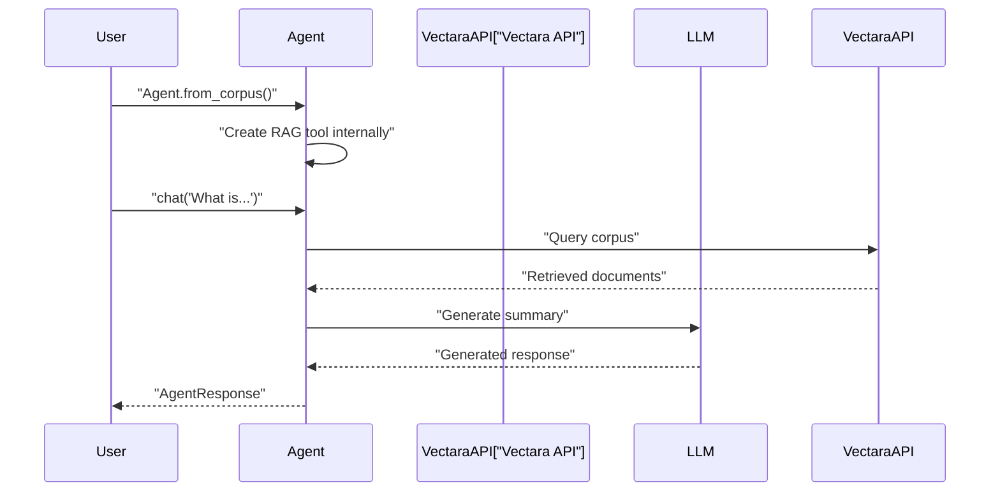
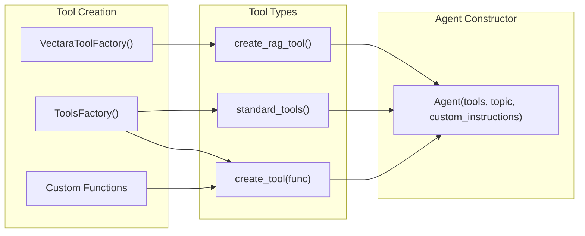
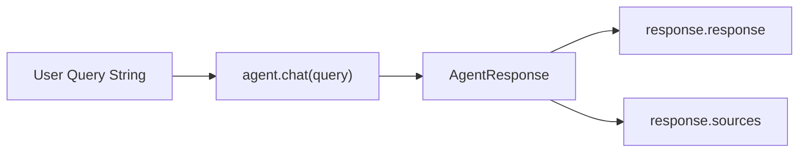
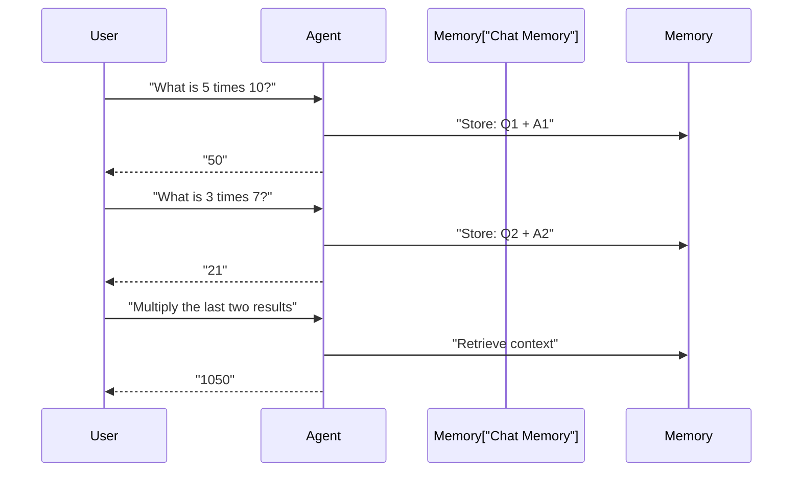
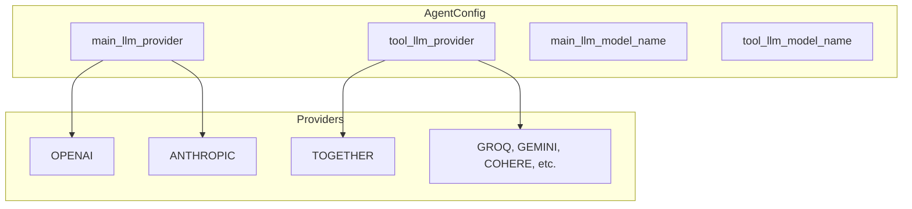
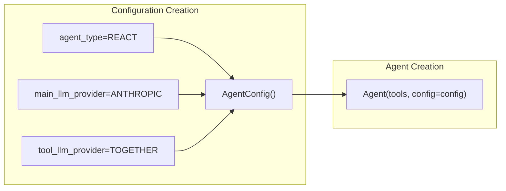

<!-- source: DeepWiki mcp.deepwiki.com · repo vectara/py-vectara-agentic · page 4.1 Basic Usage · fetched 2026-10-26 -->

# Basic Usage

Relevant source files

The following files were used as context for generating this wiki page:

- [docker/simple-agent.py](docker/simple-agent.py)
- [docs/usage.md](docs/usage.md)
- [tests/endpoint.py](tests/endpoint.py)
- [tests/test_agent.py](tests/test_agent.py)
- [vectara_agentic/types.py](vectara_agentic/types.py)

This page covers the fundamental concepts and patterns for creating and using agents with the vectara-agentic framework. It demonstrates how to create your first agent, perform basic interactions, and understand the core components involved.

For information about the complete catalog of available tools, see [Available Tools](#4.2). For advanced features like observability, workflows, and callbacks, see [Advanced Features](#4.3). For installation and environment setup, see [Installation and Configuration](#3).

## Core System Overview

The basic usage of vectara-agentic centers around three main components: the `Agent` class, tools created through factory classes, and configuration managed by `AgentConfig`.

Sources: [vectara_agentic/agent.py](), [vectara_agentic/agent_config.py](), [vectara_agentic/tools.py]()

## Quick Start Example

The simplest way to create an agent is using the `Agent.from_corpus()` class method, which creates an agent with a single RAG tool connected to a Vectara corpus:

The basic pattern involves calling `Agent.from_corpus()` with corpus credentials and then using the `chat()` method for interactions. This creates an agent with a single Vectara RAG tool automatically configured.

Sources: [tests/test_agent.py:100-111](), [docker/simple-agent.py:10-16]()

## Agent Creation Patterns

### From Corpus (Simplest)

The `from_corpus` class method creates an agent with a pre-configured Vectara RAG tool:

| Parameter | Purpose | Example |
|-----------|---------|---------|
| `tool_name` | Name for the RAG tool | `"query_vectara_website"` |
| `vectara_corpus_key` | Corpus identifier | `"corpus_key"` |
| `vectara_api_key` | API key for access | `"api_key"` |
| `data_description` | Description of corpus data | `"Data from vectara.com website"` |
| `assistant_specialty` | Agent's area of expertise | `"vectara"` |

Sources: [tests/test_agent.py:100-111](), [docker/simple-agent.py:10-16]()

### Manual Construction

For more control, create agents by explicitly providing tools and configuration:

The `Agent` constructor accepts a list of tools, a topic string, and custom instructions. Tools must be created through the factory pattern before being passed to the agent.

Sources: [tests/test_agent.py:33-41](), [tests/test_agent.py:85-98]()

## Essential Agent Parameters

| Parameter | Type | Purpose | Default |
|-----------|------|---------|---------|
| `tools` | `list[FunctionTool]` | List of available tools | Required |
| `topic` | `str` | Agent's specialty area | `"general"` |
| `custom_instructions` | `str` | Behavioral instructions | `""` |
| `agent_config` | `AgentConfig` | LLM and behavior config | Default config |
| `chat_history` | `list[tuple[str, str]]` | Previous conversations | `None` |

Sources: [tests/test_agent.py:33-41](), [tests/test_agent.py:112-124]()

## Basic Chat Interactions

### Synchronous Chat

The `chat()` method provides synchronous interaction and returns an `AgentResponse` object:

The response contains both the generated text and information about which tools were called during processing.

Sources: [tests/test_agent.py:42-48](), [tests/test_agent.py:77-83]()

### Multi-turn Conversations

Agents maintain conversation context automatically. Each call to `chat()` builds on previous interactions:

The agent automatically maintains conversation history and can reference previous interactions without explicit session management.

Sources: [tests/test_agent.py:85-98](), [tests/test_agent.py:112-124]()

## Configuration Basics

### Agent Types

The framework supports multiple agent architectures through the `AgentType` enum:

| Agent Type | Behavior | Use Case |
|------------|----------|----------|
| `OPENAI` | Function calling pattern | Default, good general purpose |
| `REACT` | Reasoning and acting loop | Complex multi-step tasks |
| `FUNCTION_CALLING` | Direct function invocation | Simple tool usage |
| `LLMCOMPILER` | Parallel execution | Performance optimization |
| `LATS` | Language agent tree search | Complex reasoning |

Sources: [vectara_agentic/types.py:10-17](), [tests/test_agent.py:50-76]()

### LLM Provider Configuration

Configure different LLM providers for the main agent and tool calling:

Different providers can be used for the main reasoning and tool execution, allowing optimization for cost and performance.

Sources: [tests/test_agent.py:50-76](), [vectara_agentic/types.py:26-37]()

### Basic Configuration Example

The `AgentConfig` class provides explicit control over agent behavior, LLM selection, and observability settings.

Sources: [tests/test_agent.py:50-76](), [vectara_agentic/agent_config.py]()

---

