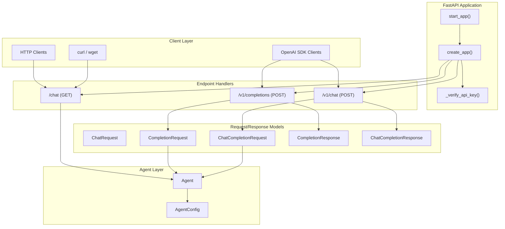
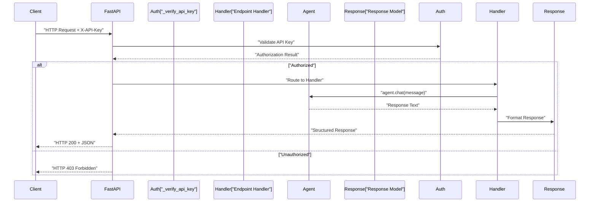

<!-- source: DeepWiki mcp.deepwiki.com · repo vectara/py-vectara-agentic · page 5 API and Endpoints · fetched 2026-10-26 -->

# API and Endpoints

<details>
<summary>Relevant source files</summary>

The following files were used as context for generating this wiki page:

- [docker/simple-agent.py](docker/simple-agent.py)
- [docs/endpoint.md](docs/endpoint.md)
- [docs/installation.md](docs/installation.md)
- [tests/endpoint.py](tests/endpoint.py)
- [tests/test_api_endpoint.py](tests/test_api_endpoint.py)
- [tests/test_gemini.py](tests/test_gemini.py)
- [tests/test_groq.py](tests/test_groq.py)
- [vectara_agentic/agent_endpoint.py](vectara_agentic/agent_endpoint.py)

</details>


This document covers the web API endpoints provided by vectara-agentic for deploying agents as HTTP services. The system provides both native endpoints for simple agent interaction and OpenAI-compatible endpoints for drop-in replacement with existing OpenAI client code.

For information about the core Agent system that powers these endpoints, see [Agent System](#2.1). For deployment strategies including Docker containers, see [Docker Deployment](#7.1).

## Endpoint Architecture

The vectara-agentic API system is built around FastAPI and provides a standardized way to expose `Agent` instances as web services. The architecture separates endpoint logic from agent logic, allowing any configured agent to be deployed behind HTTP endpoints.

### API System Overview



Sources: [vectara_agentic/agent_endpoint.py:97-253](), [tests/test_api_endpoint.py:1-127]()

### Request Flow Architecture



Sources: [vectara_agentic/agent_endpoint.py:114-127](), [vectara_agentic/agent_endpoint.py:128-196]()

## Native Vectara-Agentic Endpoints

### GET /chat

The `/chat` endpoint provides a simple interface for agent interaction using URL parameters.

| Parameter | Type | Required | Description |
|-----------|------|----------|-------------|
| `message` | string | Yes | User message to send to the agent |

**Request Example:**
```bash
curl -G "http://localhost:8000/chat" \
  --data-urlencode "message=What is Vectara?" \
  -H "X-API-Key: your-api-key"
```

**Response Schema:**
```json
{
  "response": "string"
}
```

The endpoint implementation validates the message parameter and calls `agent.chat()` directly:

```python
# From agent_endpoint.py:131-151
async def chat(message: str):
    if not message:
        raise HTTPException(status_code=400, detail="No message provided")
    try:
        res = agent.chat(message)
        return {"response": res}
    except Exception as e:
        raise HTTPException(status_code=500, detail="Internal server error") from e
```

Sources: [vectara_agentic/agent_endpoint.py:128-151](), [tests/test_api_endpoint.py:30-43]()

## OpenAI-Compatible Endpoints

The system provides OpenAI-compatible endpoints that allow existing OpenAI client code to work with vectara-agentic agents without modification.

### POST /v1/completions

Implements the OpenAI text completions API format.

**Request Schema (`CompletionRequest`):**

| Field | Type | Default | Description |
|-------|------|---------|-------------|
| `model` | string | - | Model identifier (passed through, not used) |
| `prompt` | string or string[] | - | Input prompt text |
| `max_tokens` | int | 16 | Maximum tokens in response |
| `temperature` | float | 1.0 | Sampling temperature (0.0-2.0) |
| `top_p` | float | 1.0 | Nucleus sampling parameter |
| `n` | int | 1 | Number of completions to generate |
| `stop` | string or string[] | None | Stop sequences |

**Response Schema (`CompletionResponse`):**
```json
{
  "id": "cmpl-{uuid}",
  "object": "text_completion", 
  "created": 1234567890,
  "model": "requested-model",
  "choices": [
    {
      "text": "completion text",
      "index": 0,
      "logprobs": null,
      "finish_reason": "stop"
    }
  ],
  "usage": {
    "prompt_tokens": 10,
    "completion_tokens": 15,
    "total_tokens": 25
  }
}
```

Sources: [vectara_agentic/agent_endpoint.py:25-63](), [vectara_agentic/agent_endpoint.py:153-196]()

### POST /v1/chat

Implements the OpenAI chat completions API format.

**Request Schema (`ChatCompletionRequest`):**

| Field | Type | Description |
|-------|------|-------------|
| `model` | string | Model identifier |
| `messages` | `ChatMessage[]` | Array of conversation messages |
| `temperature` | float | Sampling temperature |
| `top_p` | float | Nucleus sampling parameter |
| `n` | int | Number of completions |

**ChatMessage Schema:**
```json
{
  "role": "system" | "user" | "assistant",
  "content": "message text"
}
```

The endpoint concatenates all user messages and ignores system/assistant messages:

```python
# From agent_endpoint.py:207-208
raw = " ".join(m.content for m in req.messages if m.role == "user")
```

**Response Schema (`ChatCompletionResponse`):**
```json
{
  "id": "chatcmpl-{uuid}",
  "object": "chat.completion",
  "created": 1234567890,
  "model": "requested-model", 
  "choices": [
    {
      "index": 0,
      "message": {
        "role": "assistant",
        "content": "response text"
      },
      "finish_reason": "stop"
    }
  ],
  "usage": {
    "prompt_tokens": 10,
    "completion_tokens": 15, 
    "total_tokens": 25
  }
}
```

Sources: [vectara_agentic/agent_endpoint.py:71-95](), [vectara_agentic/agent_endpoint.py:198-237]()

## Authentication and Security

### API Key Authentication

All endpoints require authentication via the `X-API-Key` header. The API key is configured through the `AgentConfig.endpoint_api_key` field or the `VECTARA_AGENTIC_API_KEY` environment variable.

```python
# API key verification dependency
async def _verify_api_key(api_key: str = Depends(api_key_header)):
    if api_key != config.endpoint_api_key:
        raise HTTPException(status_code=403, detail="Unauthorized")
    return True
```

**Error Responses:**
- `403 Forbidden` - Invalid or missing API key
- `400 Bad Request` - Missing required parameters
- `500 Internal Server Error` - Agent processing errors

Sources: [vectara_agentic/agent_endpoint.py:114-126](), [tests/test_api_endpoint.py:40-42]()

## Deployment and Configuration

### Application Factory

The `create_app()` function creates a configured FastAPI application:

```python
def create_app(agent: Agent, config: AgentConfig) -> FastAPI:
    """
    Create and configure the FastAPI app.
    
    Args:
        agent (Agent): The agent instance to handle chat/completion.
        config (AgentConfig): Configuration containing the API key.
    
    Returns:
        FastAPI: Configured FastAPI application.
    """
```

### Server Startup

The `start_app()` function provides a convenient way to launch the server:

```python  
def start_app(agent: Agent, host="0.0.0.0", port=8000):
    """
    Launch the FastAPI application using Uvicorn.
    """
    app = create_app(agent, config=AgentConfig())
    uvicorn.run(app, host=host, port=port)
```

### Simple Deployment Example

```python
from vectara_agentic.agent import Agent
from vectara_agentic.agent_endpoint import start_app

# Create agent with tools
assistant = Agent.from_corpus(
    tool_name='query_vectara_website',
    vectara_corpus_id='corpus_key',
    vectara_api_key='api_key',
    data_description='Data from vectara.com website',
    assistant_specialty='vectara'
)

# Start API server
start_app(assistant, host="0.0.0.0", port=8000)
```

Sources: [vectara_agentic/agent_endpoint.py:97-108](), [vectara_agentic/agent_endpoint.py:242-252](), [docker/simple-agent.py:1-18]()

## Request/Response Models

### Core Model Definitions

The API uses Pydantic models for request validation and response serialization:

| Model | Purpose | Key Fields |
|-------|---------|------------|
| `ChatRequest` | Simple chat endpoint | `message: str` |
| `CompletionRequest` | OpenAI completions | `model`, `prompt`, `max_tokens`, `temperature` |
| `ChatCompletionRequest` | OpenAI chat | `model`, `messages`, `temperature` |
| `CompletionResponse` | Completions response | `id`, `choices`, `usage` |
| `ChatCompletionResponse` | Chat response | `id`, `choices`, `usage` |
| `Choice` | Response choice | `text`, `index`, `finish_reason` |
| `ChatCompletionChoice` | Chat choice | `message`, `index`, `finish_reason` |
| `CompletionUsage` | Token usage | `prompt_tokens`, `completion_tokens`, `total_tokens` |

### Token Counting

The system provides basic token counting by splitting on whitespace:

```python
p_tokens = len(raw.split())
c_tokens = len(text.split())
```

This is a simplified approximation since actual tokenization depends on the underlying LLM tokenizer.

Sources: [vectara_agentic/agent_endpoint.py:19-95](), [tests/test_api_endpoint.py:56-58]()

---

