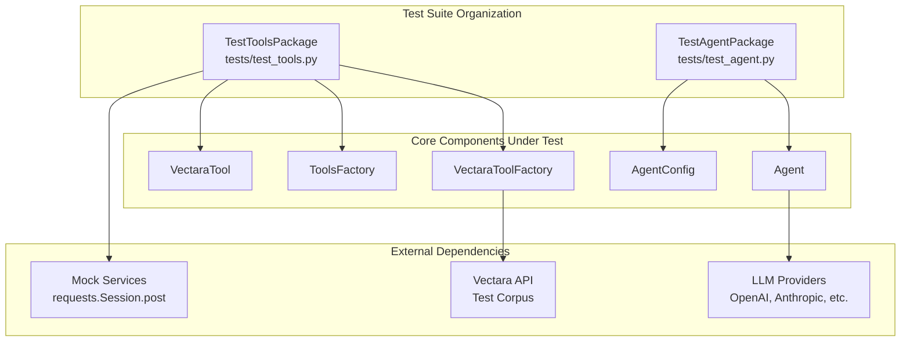
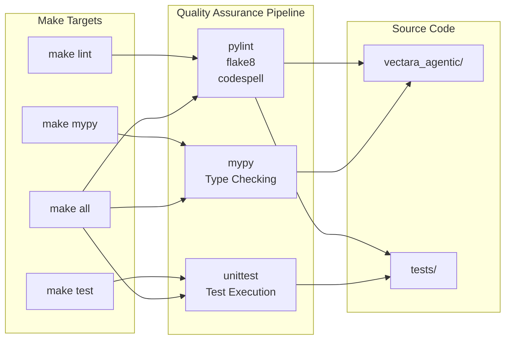
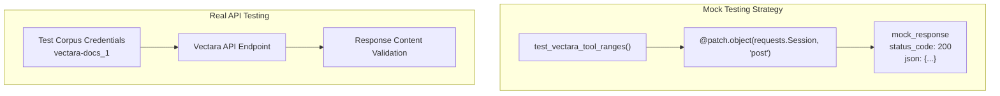
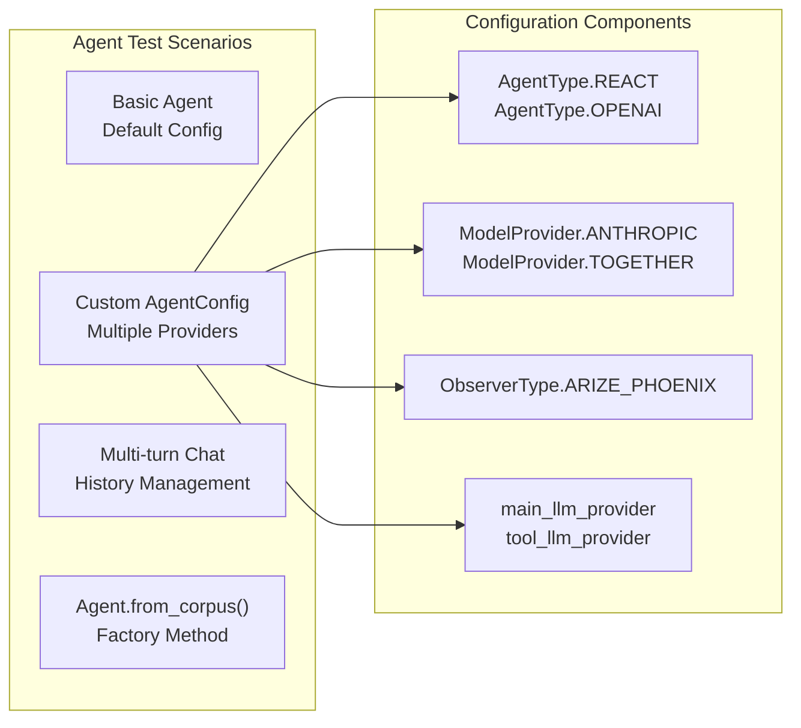

<!-- source: DeepWiki mcp.deepwiki.com · repo vectara/py-vectara-agentic · page 6 Development and Testing · fetched 2026-10-26 -->

# Development and Testing

<details>
<summary>Relevant source files</summary>

The following files were used as context for generating this wiki page:

- [Makefile](Makefile)
- [tests/test_agent.py](tests/test_agent.py)
- [tests/test_tools.py](tests/test_tools.py)
- [vectara_agentic/types.py](vectara_agentic/types.py)

</details>


This document covers the development environment setup, testing framework, and quality assurance processes for the vectara-agentic codebase. It provides guidance for contributors who want to extend the framework, add new tools, or improve existing functionality.

For information about deploying agents in production environments, see [Deployment](#7). For details about the core system architecture, see [Core Components](#2).

## Testing Framework Overview

The vectara-agentic framework uses Python's built-in `unittest` module for comprehensive testing coverage. The test suite validates core components including agent functionality, tool creation, configuration management, and external service integrations.

### Test Architecture



**Sources:** [tests/test_tools.py:1-380](), [tests/test_agent.py:1-142]()

### Test Categories

The testing framework covers several key areas:

| Test Category | Primary File | Coverage |
|---------------|--------------|----------|
| Tool Creation | `test_tools.py` | VectaraToolFactory, ToolsFactory, tool validation |
| Agent Behavior | `test_agent.py` | Agent initialization, chat functionality, configurations |
| Mock Testing | `test_tools.py` | External API mocking, error handling |
| Integration | Both files | Real API calls with test credentials |

**Sources:** [tests/test_tools.py:23-380](), [tests/test_agent.py:19-142]()

## Development Environment

The development environment includes automated quality assurance tools for maintaining code standards and reliability.

### Development Workflow



**Sources:** [Makefile:1-13]()

### Quality Assurance Tools

The `Makefile` defines automated checks that run during development:

- **Linting**: Uses `pylint`, `flake8`, and `codespell` for code quality
- **Type Checking**: Uses `mypy` for static type validation  
- **Testing**: Runs unittest discovery for all test modules

Each tool continues execution even on errors (using `|| true`) to provide complete feedback.

**Sources:** [Makefile:3-11]()

## Testing Strategies

### Mock Testing for External Services

The framework implements sophisticated mocking for external API calls to ensure reliable testing without network dependencies:



**Sources:** [tests/test_tools.py:132-211](), [tests/test_tools.py:17-20]()

### Tool Validation Testing

The test suite validates tool creation and argument handling extensively:

- **Schema Validation**: Tests custom `BaseModel` argument schemas with `Field` specifications
- **Error Handling**: Validates proper error messages for invalid arguments
- **Range Queries**: Tests complex query parameters like `">2023"`, `"[2021, 2023]"`, `"[2020, 2023)"`
- **Tool Factory Integration**: Verifies both `VectaraToolFactory` and `ToolsFactory` creation patterns

**Sources:** [tests/test_tools.py:86-211](), [tests/test_tools.py:212-293]()

### Agent Configuration Testing

The agent testing validates multiple configuration scenarios:



**Sources:** [tests/test_agent.py:50-83](), [tests/test_agent.py:100-124]()

### Integration Testing

The framework includes integration tests that connect to real external services:

- **Vectara API**: Uses dedicated test corpus `vectara-docs_1` with public API key
- **LLM Providers**: Tests OpenAI, Anthropic, Groq, and Together integrations
- **LlamaIndex Tools**: Validates integration with `ArxivToolSpec`, `YahooFinanceToolSpec`, `WikipediaToolSpec`

**Sources:** [tests/test_tools.py:222-236](), [tests/test_tools.py:309-324]()

### Test Execution

Run the complete test suite using:

```bash
make test           # Run all tests
make all           # Run linting, type checking, and tests
python -m unittest discover -s tests -b  # Direct unittest execution
```

Individual test classes can be run directly:

```bash
python -m unittest tests.test_tools.TestToolsPackage.test_vectara_rag_tool
python -m unittest tests.test_agent.TestAgentPackage.test_agent_config
```

**Sources:** [Makefile:10-11](), [tests/test_tools.py:379-380](), [tests/test_agent.py:141-142]()

---

