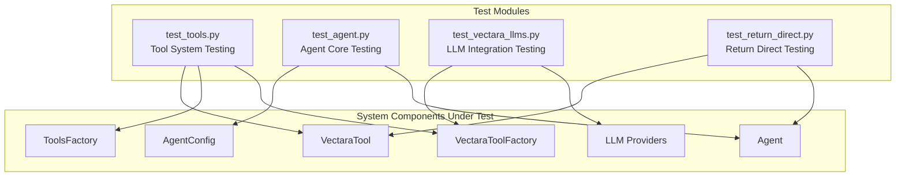
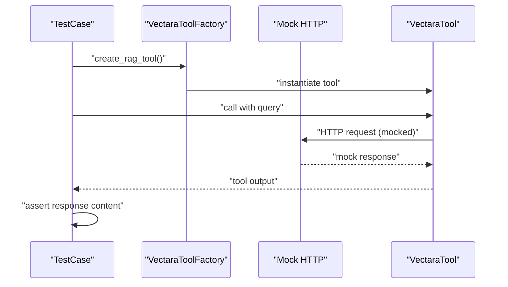
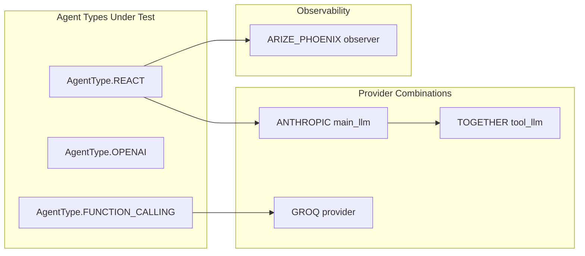
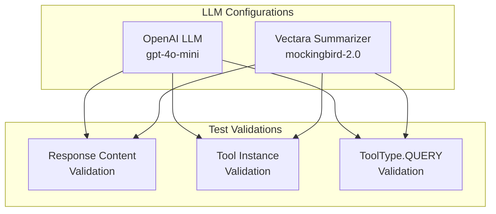
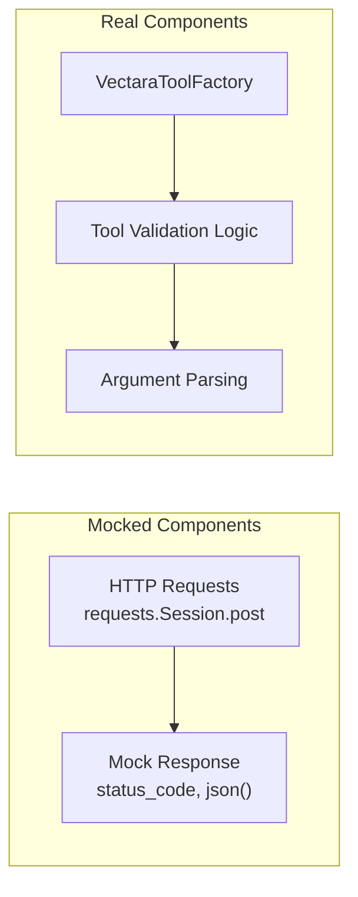

<!-- source: DeepWiki mcp.deepwiki.com · repo vectara/py-vectara-agentic · page 6.1 Testing Framework · fetched 2026-10-26 -->

# Testing Framework

<details>
<summary>Relevant source files</summary>

The following files were used as context for generating this wiki page:

- [tests/test_agent.py](tests/test_agent.py)
- [tests/test_return_direct.py](tests/test_return_direct.py)
- [tests/test_tools.py](tests/test_tools.py)
- [tests/test_vectara_llms.py](tests/test_vectara_llms.py)
- [vectara_agentic/types.py](vectara_agentic/types.py)

</details>


The testing framework in vectara-agentic provides comprehensive coverage for all major components including agents, tools, LLM integrations, and observability features. The test suite is built using Python's `unittest` framework and includes both unit tests and integration tests that validate functionality against live Vectara services.

This page covers the structure, execution, and key test patterns used in the codebase. For information about setting up a development environment, see [Development Environment](#6.2). For details about deployment testing, see [Docker Deployment](#7.1).

## Test Suite Structure

The testing framework is organized into focused test modules that correspond to the main system components:



Sources: [tests/test_tools.py:1-381](), [tests/test_agent.py:1-143](), [tests/test_vectara_llms.py:1-70](), [tests/test_return_direct.py:1-50]()

## Tool System Testing

The tool testing framework validates the creation, configuration, and execution of both Vectara-specific and generic tools.

### VectaraToolFactory Testing

The `test_tools.py` module extensively tests the `VectaraToolFactory` class with both RAG and search tool creation:

| Test Method | Purpose | Key Validations |
|-------------|---------|----------------|
| `test_vectara_rag_tool` | RAG tool creation | Tool type, instance validation, response content |
| `test_vectara_search_tool` | Search tool creation | Document retrieval, summarization options |
| `test_vectara_tool_validation` | Input validation | Error handling for invalid arguments |
| `test_vectara_tool_ranges` | Metadata filtering | Range queries, operators, mock responses |



Sources: [tests/test_tools.py:25-85](), [tests/test_tools.py:132-211]()

### Generic Tool Testing

The framework tests generic tool creation through `ToolsFactory` and validates integration with external tool specifications:

```python
# Example from test_tools.py showing LlamaIndex tool testing
for name, spec in [
    ("arxiv", "ArxivToolSpec"),
    ("yahoo_finance", "YahooFinanceToolSpec"), 
    ("wikipedia", "WikipediaToolSpec"),
]:
    tool = tools_factory.get_llama_index_tools(
        tool_package_name=name, tool_spec_name=spec
    )[0]
```

Sources: [tests/test_tools.py:212-236](), [tests/test_tools.py:326-352]()

## Agent System Testing

The agent testing framework validates core agent functionality, configuration management, and multi-turn conversations.

### Agent Configuration Testing

The test suite validates different agent types and provider configurations:



Sources: [tests/test_agent.py:50-84](), [tests/test_agent.py:279-308]()

### Multi-turn Conversation Testing

The framework validates conversation continuity and memory management:

| Test Scenario | Validation |
|---------------|------------|
| Sequential calculations | Memory of previous results |
| Chat history initialization | Pre-loaded conversation context |
| Custom instructions | Instruction adherence across turns |

Sources: [tests/test_agent.py:85-99](), [tests/test_agent.py:112-125]()

## LLM Integration Testing

The `test_vectara_llms.py` module focuses on validating LLM provider integrations with Vectara tools.

### Provider-Specific Testing



Sources: [tests/test_vectara_llms.py:17-54](), [tests/test_vectara_llms.py:55-66]()

## Specialized Feature Testing

### Return Direct Functionality

The `test_return_direct.py` module validates tools that bypass agent processing and return results directly:

```python
# Testing return_direct=True configuration
query_tool = vec_factory.create_rag_tool(
    tool_name="rag_tool",
    tool_description="A dummy tool for testing return_direct.",
    return_direct=True,
)
```

Expected response format validation:
- Response content structure
- FCS (Factual Consistency Score) inclusion
- Reference citations

Sources: [tests/test_return_direct.py:12-32](), [tests/test_return_direct.py:33-46]()

## Test Execution Patterns

### Mock Integration Testing

The framework uses strategic mocking for external dependencies while maintaining realistic test scenarios:



Sources: [tests/test_tools.py:132-145]()

### Test Credentials Management

The test suite uses dedicated test credentials for Vectara integration testing:

```python
# Special test account credentials for Vectara
vectara_corpus_key = "vectara-docs_1"
vectara_api_key = "zqt_UXrBcnI2UXINZkrv4g1tQPhzj02vfdtqYJIDiA"
```

Sources: [tests/test_tools.py:17-19](), [tests/test_vectara_llms.py:11-12](), [tests/test_return_direct.py:6-7]()

## Running Tests

The test framework follows standard `unittest` execution patterns:

```bash
# Run all tests
python -m unittest discover tests/

# Run specific test module
python -m unittest tests.test_tools

# Run specific test method
python -m unittest tests.test_tools.TestToolsPackage.test_vectara_rag_tool
```

Each test module includes a main execution block for standalone testing:

```python
if __name__ == "__main__":
    unittest.main()
```

Sources: [tests/test_tools.py:379-381](), [tests/test_agent.py:141-143](), [tests/test_vectara_llms.py:68-70](), [tests/test_return_direct.py:48-50]()

---

