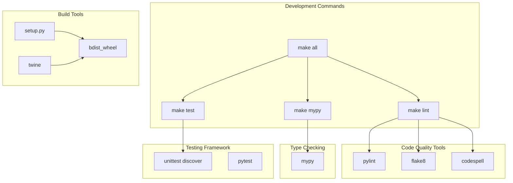
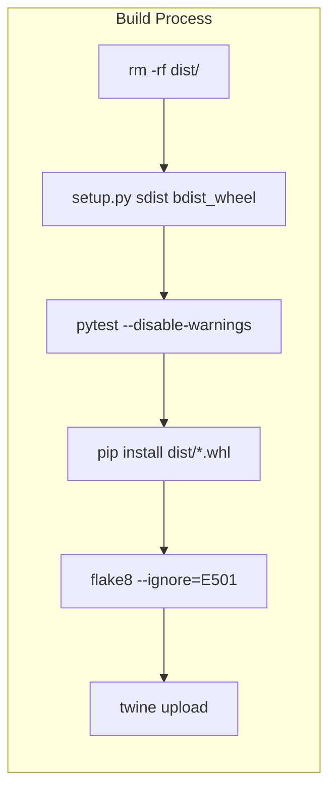
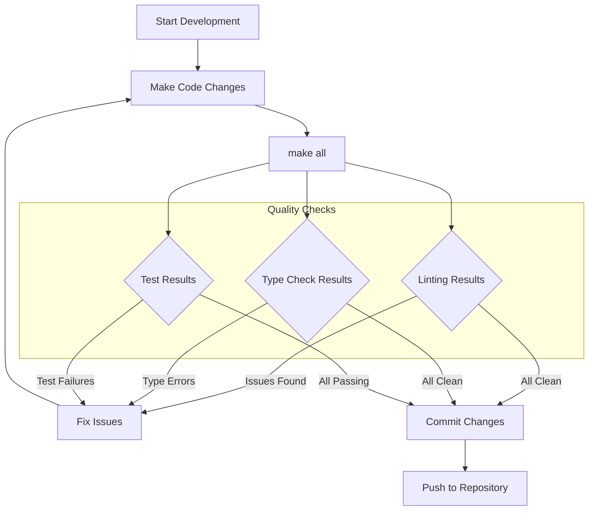

<!-- source: DeepWiki mcp.deepwiki.com · repo vectara/py-vectara-agentic · page 6.2 Development Environment · fetched 2026-10-26 -->

# Development Environment

<details>
<summary>Relevant source files</summary>

The following files were used as context for generating this wiki page:

- [.flake8](.flake8)
- [.github/assets/Vectara-logo.png](.github/assets/Vectara-logo.png)
- [Makefile](Makefile)
- [publish.sh](publish.sh)

</details>


This document covers setting up a development environment for contributing to the vectara-agentic codebase, including code quality tools, type checking, testing infrastructure, and build processes. 

For information about running the existing test suite, see [Testing Framework](#6.1). For details about the automated release workflow, see [Release Process](#6.3).

## Development Tools Overview

The vectara-agentic project uses a standard Python development toolchain with automated quality checks and testing. The development workflow is orchestrated through a `Makefile` that provides consistent commands across different environments.



Sources: [Makefile:1-13](), [publish.sh:1-21]()

## Code Quality and Linting

The project uses multiple linting tools to maintain code quality and consistency. These tools are configured to work together and can be run individually or as part of the complete quality check suite.

### Linting Configuration

The `make lint` command runs three complementary tools:

| Tool | Purpose | Configuration |
|------|---------|---------------|
| `pylint` | Python code analysis and style checking | Default configuration |
| `flake8` | Style guide enforcement and error detection | [.flake8:1-3]() |
| `codespell` | Spell checking in code and comments | Default configuration |

The flake8 configuration extends the default ignore list to accommodate the project's coding style:

```
extend-ignore = E501,E203,W503,E302,E129,E124,E402,W504,E231,E123,E251
max-line-length = 120
```

### Running Linting Tools

All linting tools are configured with the `|| true` suffix to prevent build failures, allowing developers to see all issues without stopping the development workflow:

```bash
# Run all linting tools
make lint

# Individual tools
pylint vectara_agentic
flake8 vectara_agentic tests
codespell vectara_agentic tests
```

Sources: [Makefile:3-6](), [.flake8:1-3](), [publish.sh:16-17]()

## Type Checking with MyPy

Type checking is performed using `mypy` to catch type-related errors and improve code reliability. The type checker runs against the main `vectara_agentic` package.

```bash
# Run type checking
make mypy

# Direct mypy execution
mypy vectara_agentic
```

Like the linting tools, mypy is configured with `|| true` to continue execution even when type errors are found, allowing developers to see all issues during development.

Sources: [Makefile:7-8]()

## Testing Framework

The project uses Python's built-in `unittest` framework for running tests. Tests are automatically discovered in the `tests` directory using the unittest discovery mechanism.

```bash
# Run all tests
make test

# Direct test execution
python -m unittest discover -s tests -b
```

The `-b` flag enables buffering of stdout and stderr during test runs, providing cleaner output by only showing output for failed tests.

For publishing and CI environments, the project also supports `pytest`:

```bash
# Used in publish workflow
pytest --disable-warnings
```

Sources: [Makefile:10-11](), [publish.sh:11]()

## Build and Publishing Process

The build process creates both source distributions and wheel packages using `setup.py`. The publishing workflow includes quality checks and package validation.



The publishing process ensures package quality through multiple validation steps:

1. **Clean Build**: Remove previous build artifacts
2. **Package Creation**: Generate source and wheel distributions
3. **Test Validation**: Run the test suite with warnings disabled
4. **Installation Check**: Verify the built package installs correctly
5. **Final Lint**: Perform a final linting pass
6. **Upload**: Publish to PyPI using authenticated twine

Sources: [publish.sh:4-20]()

## Development Workflow

The recommended development workflow integrates all quality checks and testing to ensure code meets project standards before submission.



### Complete Development Command

The `make all` command provides a comprehensive check that runs all quality assurance tools:

```bash
make all
```

This single command executes:
- `make lint` - All linting tools (pylint, flake8, codespell)
- `make mypy` - Type checking
- `make test` - Full test suite

Since all tools use the `|| true` pattern, developers can see the complete picture of code quality issues without the workflow stopping at the first error.

Sources: [Makefile:1](), [Makefile:13]()

---

