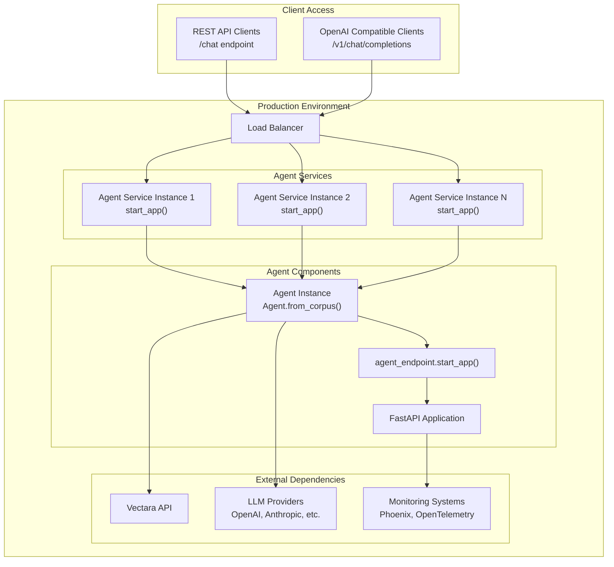
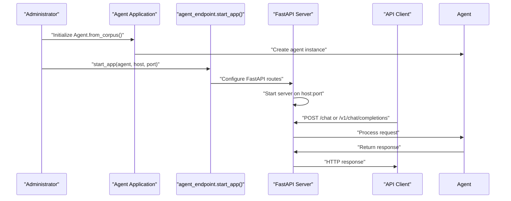
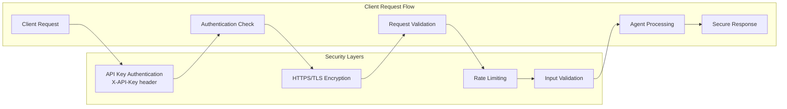
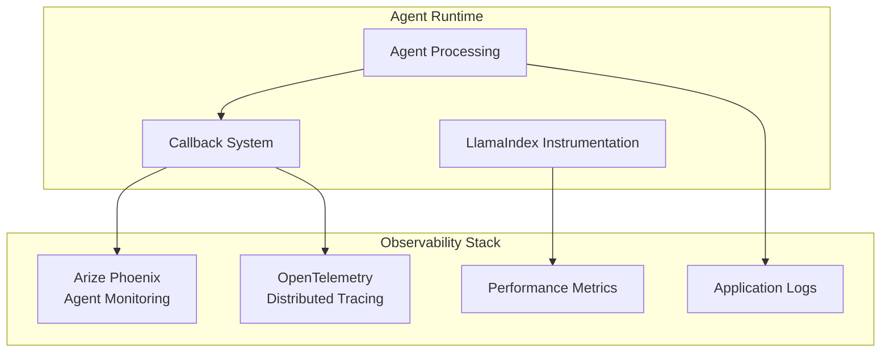

<!-- source: DeepWiki mcp.deepwiki.com · repo vectara/py-vectara-agentic · page 7 Deployment · fetched 2026-10-26 -->

# Deployment

<details>
<summary>Relevant source files</summary>

The following files were used as context for generating this wiki page:

- [docker/simple-agent.py](docker/simple-agent.py)
- [docs/endpoint.md](docs/endpoint.md)
- [docs/installation.md](docs/installation.md)
- [tests/endpoint.py](tests/endpoint.py)

</details>


This document covers production deployment strategies for vectara-agentic agents, including containerization options, API endpoint hosting, and production configuration considerations. It focuses on deploying agents as web services that can be accessed via REST APIs or OpenAI-compatible endpoints.

For Docker-specific deployment instructions, see [Docker Deployment](#7.1). For documentation site deployment, see [Documentation Site](#7.2).

## Deployment Overview

The vectara-agentic framework provides multiple deployment approaches for hosting AI agents in production environments. Agents can be deployed as standalone web services, containerized applications, or integrated into existing application infrastructure.

### Deployment Architecture



**Sources:** [docker/simple-agent.py:1-19](), [docs/endpoint.md:1-43]()

## API Endpoint Deployment

The primary deployment method involves hosting agents as web services using the built-in FastAPI server through the `start_app()` function.

### Basic Endpoint Setup



The basic deployment pattern follows this structure:

| Component | Function | Configuration |
|-----------|----------|---------------|
| `Agent` | Core agent logic | `Agent.from_corpus()` or custom initialization |
| `start_app()` | Web server startup | Host, port, and server configuration |
| FastAPI | HTTP request handling | Automatic route configuration |
| Environment | API keys and settings | Environment variables |

**Sources:** [docker/simple-agent.py:10-18](), [docs/endpoint.md:16-33]()

### Endpoint Configuration

The `start_app()` function accepts several configuration parameters:

- **host**: Network interface binding (default: "127.0.0.1", production: "0.0.0.0")
- **port**: Service port (default: 8000)
- **agent**: Initialized `Agent` instance

Production deployments typically use:
```python
start_app(assistant, host="0.0.0.0", port=8000)
```

**Sources:** [docker/simple-agent.py:18](), [docs/endpoint.md:32]()

## Production Configuration

### Environment Variables

Production deployments require proper environment variable configuration:

| Variable | Purpose | Required |
|----------|---------|----------|
| `VECTARA_AGENTIC_API_KEY` | Endpoint authentication | Yes |
| `VECTARA_API_KEY` | Vectara platform access | Yes |
| `OPENAI_API_KEY` | OpenAI LLM access | Conditional |
| `ANTHROPIC_API_KEY` | Anthropic LLM access | Conditional |

**Sources:** [docs/endpoint.md:9-14]()

### Security Considerations



API key authentication is implemented through the `X-API-Key` header:
```bash
curl -H "X-API-Key: <YOUR-API-KEY>" http://server:8000/chat
```

**Sources:** [docs/endpoint.md:39-42](), [tests/endpoint.py:16-23]()

### Scaling Considerations

Production deployments should consider:

- **Horizontal Scaling**: Multiple agent service instances behind a load balancer
- **Resource Management**: CPU and memory allocation for LLM operations
- **Connection Pooling**: Efficient handling of external API connections
- **Caching**: Response caching for frequently asked questions

## API Compatibility

The framework supports two API interfaces:

### Native REST API
- Endpoint: `/chat`
- Method: GET with query parameters
- Authentication: `X-API-Key` header

### OpenAI-Compatible API
- Endpoint: `/v1/chat/completions`
- Method: POST with JSON payload
- Authentication: `Authorization: Bearer <token>` header

**Sources:** [docs/endpoint.md:39-42](), [tests/endpoint.py:29-42]()

## Monitoring and Observability

Production deployments benefit from observability integration:



The framework includes built-in observability through the LlamaIndex instrumentation system and Arize Phoenix integration for monitoring agent performance and behavior in production.

**Sources:** Architecture diagrams from system overview

---

