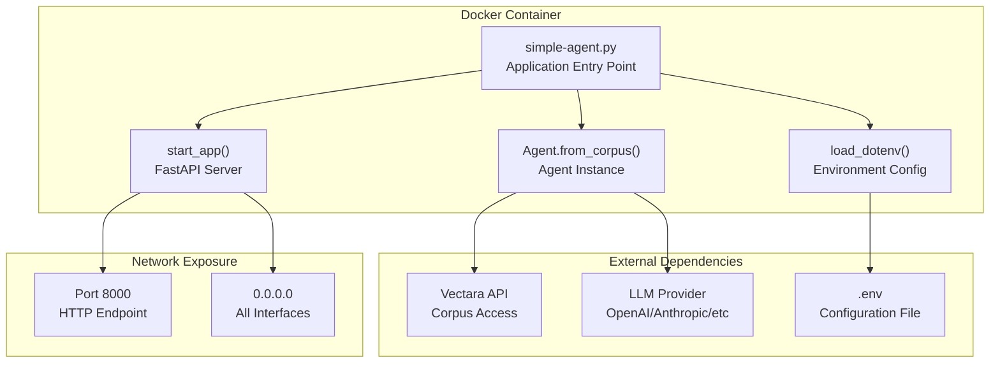
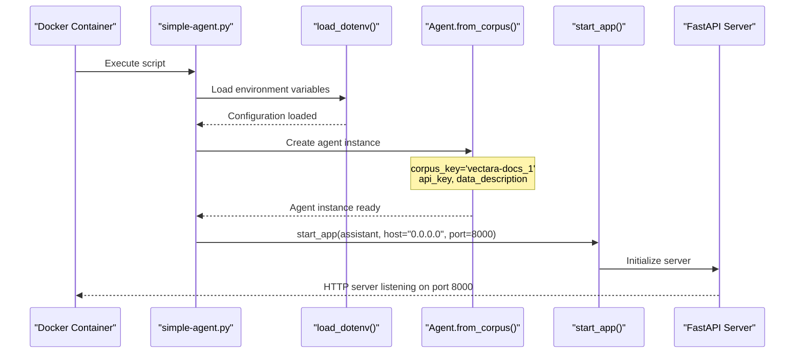
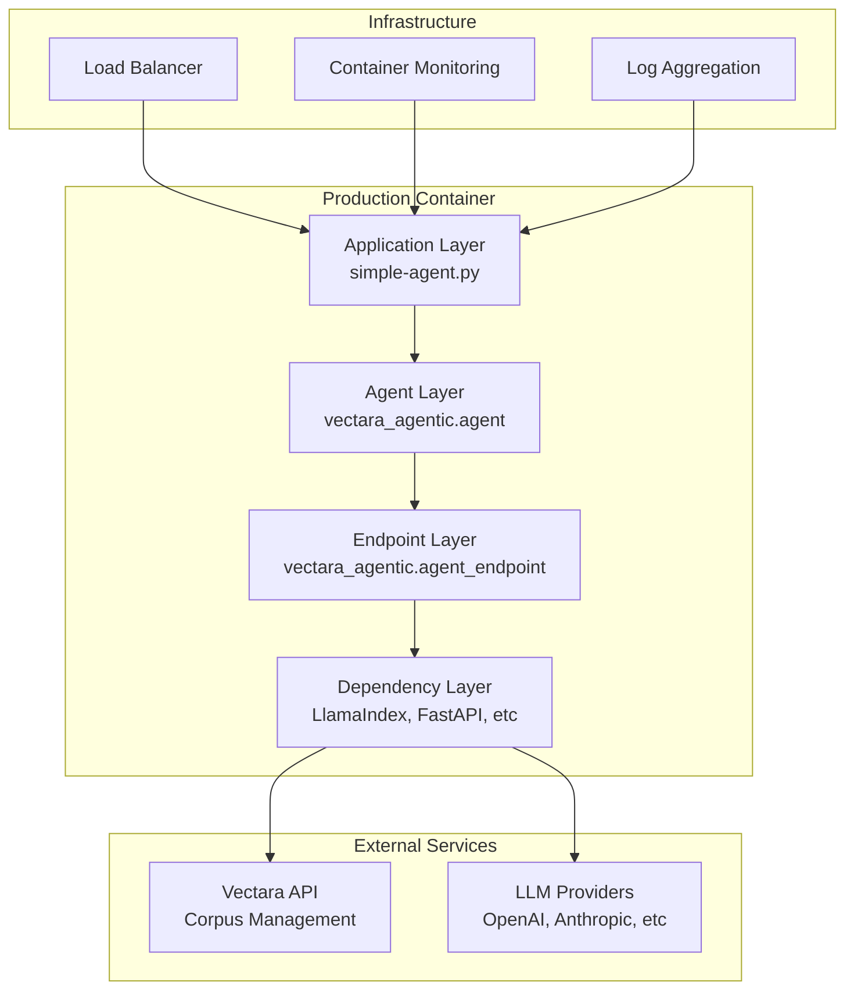

<!-- source: DeepWiki mcp.deepwiki.com · repo vectara/py-vectara-agentic · page 7.1 Docker Deployment · fetched 2026-10-26 -->

# Docker Deployment

<details>
<summary>Relevant source files</summary>

The following files were used as context for generating this wiki page:

- [docker/simple-agent.py](docker/simple-agent.py)
- [tests/endpoint.py](tests/endpoint.py)

</details>


This document covers deploying vectara-agentic agents as containerized applications using Docker. It provides practical guidance for packaging agents into containers and deploying them in production environments.

For information about the REST API endpoints exposed by deployed agents, see [REST API](#5.1). For details about development environment setup, see [Development Environment](#6.2).

## Container Architecture

The vectara-agentic framework supports containerized deployment through Docker, allowing agents to be packaged as standalone services that expose HTTP endpoints for interaction.

### Deployment Architecture



Sources: [docker/simple-agent.py:1-19]()

### Code Entity Flow



Sources: [docker/simple-agent.py:4-18]()

## Basic Deployment Process

### Agent Creation Pattern

The standard Docker deployment follows a simple pattern using the `Agent.from_corpus()` factory method:

```python
# Container entry point pattern
assistant = Agent.from_corpus(
    tool_name = 'query_vectara_website',
    vectara_corpus_id = corpus_key,
    vectara_api_key = api_key,
    data_description = 'Data from vectara.com website',
    assistant_specialty = 'vectara'
)

start_app(assistant, host="0.0.0.0", port=8000)
```

The key components in this deployment pattern are:

| Component | Purpose | Code Reference |
|-----------|---------|----------------|
| `Agent.from_corpus()` | Creates agent instance from Vectara corpus | [docker/simple-agent.py:10-16]() |
| `start_app()` | Launches FastAPI server for HTTP endpoints | [docker/simple-agent.py:18]() |
| `load_dotenv()` | Loads environment configuration | [docker/simple-agent.py:4-5]() |
| Host binding `0.0.0.0` | Exposes service on all network interfaces | [docker/simple-agent.py:18]() |
| Port `8000` | Default HTTP port for agent endpoints | [docker/simple-agent.py:18]() |

Sources: [docker/simple-agent.py:1-19]()

## Configuration Management

### Environment Variables

Docker deployments rely on environment variable configuration loaded through `load_dotenv(override=True)`. The `override=True` parameter ensures container environment variables take precedence over `.env` files.

### Corpus Configuration

The example deployment shows hardcoded configuration values:

| Configuration | Value | Purpose |
|---------------|-------|---------|
| `corpus_key` | `'vectara-docs_1'` | Identifies target Vectara corpus |
| `api_key` | `'zqt_UXrBcnI2UXINZkrv4g1tQPhzj02vfdtqYJIDiA'` | Vectara API authentication |
| `tool_name` | `'query_vectara_website'` | Identifies the agent's primary tool |
| `data_description` | `'Data from vectara.com website'` | Describes corpus content |
| `assistant_specialty` | `'vectara'` | Defines agent's domain expertise |

Sources: [docker/simple-agent.py:7-16]()

### Network Configuration

The `start_app()` function configures network exposure:

- **Host**: `"0.0.0.0"` binds to all available network interfaces, making the service accessible from outside the container
- **Port**: `8000` is the default port for HTTP endpoints

Sources: [docker/simple-agent.py:18]()

## Production Deployment Considerations

### Container Structure



Sources: [docker/simple-agent.py:1-19]()

### Security Considerations

For production deployments:

1. **API Key Management**: The example shows hardcoded API keys which should be replaced with secure environment variable injection or secrets management
2. **Network Exposure**: The `0.0.0.0` host binding exposes the service on all interfaces - consider restricting to specific interfaces in production
3. **Port Configuration**: Default port `8000` should be configurable for production environments

### Health Checks and Monitoring

The `start_app()` function from `vectara_agentic.agent_endpoint` provides the HTTP server foundation that can be extended with:

- Health check endpoints for container orchestration
- Metrics endpoints for monitoring
- Structured logging for observability

Sources: [docker/simple-agent.py:2](), [docker/simple-agent.py:18]()

## Testing Deployed Containers

The test infrastructure includes endpoint testing capabilities that can validate deployed containers. The test framework includes HTTP endpoint validation with authentication requirements.

Sources: [tests/endpoint.py:29-42]()

---

