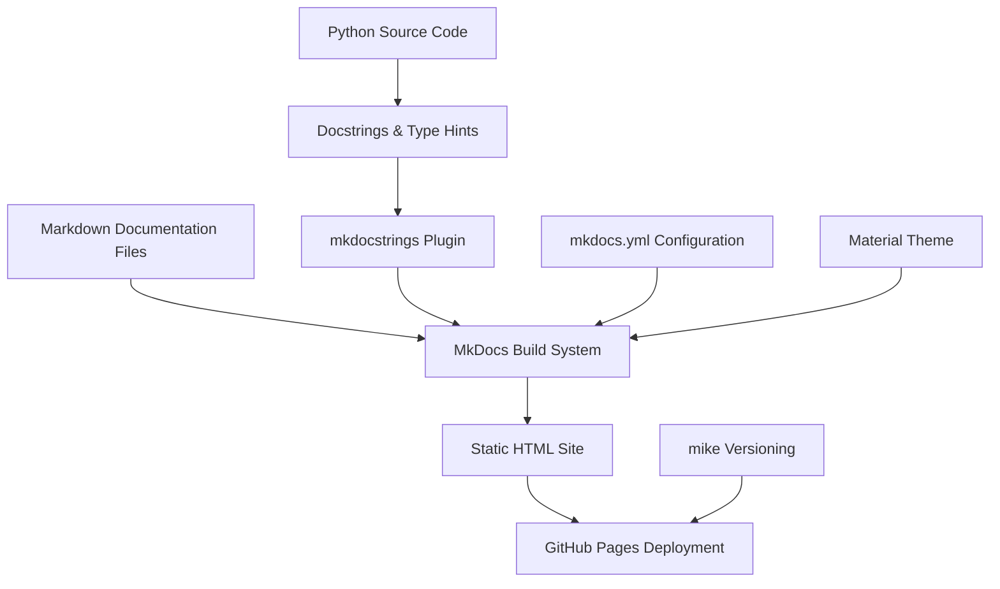
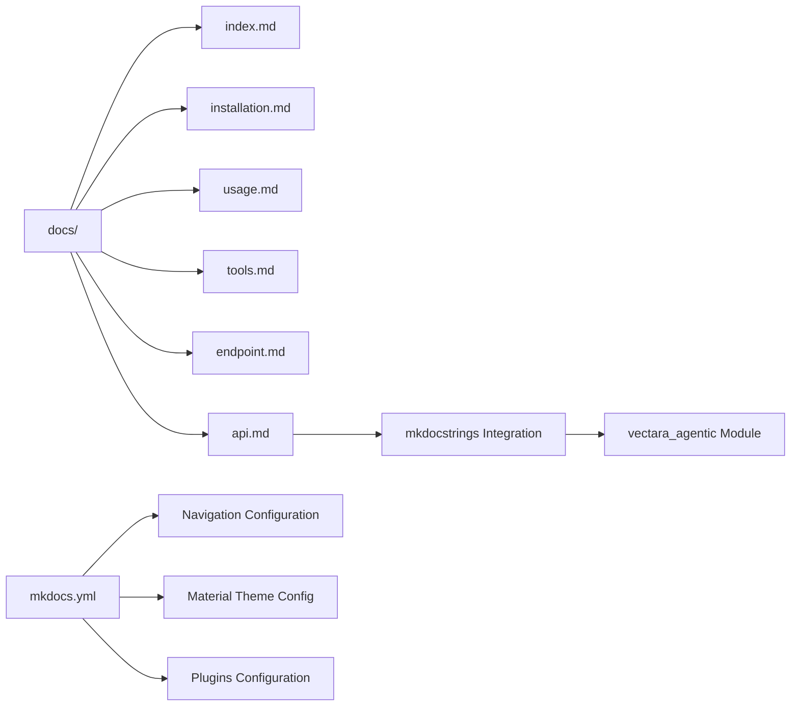
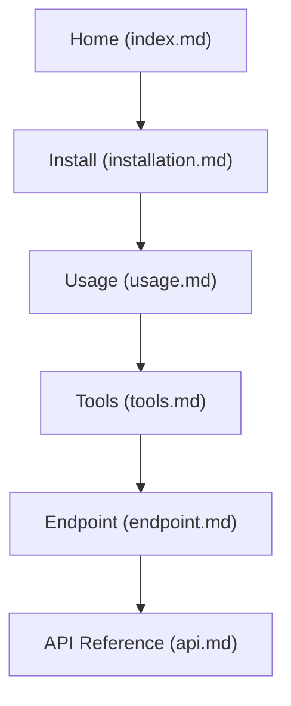
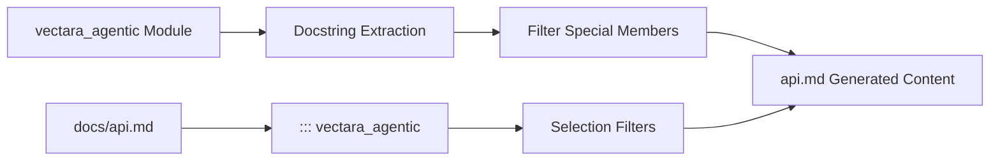
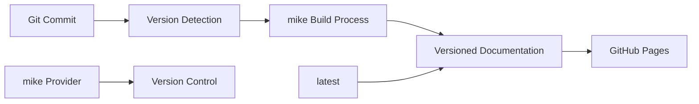

<!-- source: DeepWiki mcp.deepwiki.com · repo vectara/py-vectara-agentic · page 7.2 Documentation Site · fetched 2026-10-26 -->

# Documentation Site

<details>
<summary>Relevant source files</summary>

The following files were used as context for generating this wiki page:

- [docs/api.md](docs/api.md)
- [docs/endpoint.md](docs/endpoint.md)
- [docs/installation.md](docs/installation.md)
- [mkdocs.yml](mkdocs.yml)

</details>


This document covers the technical implementation of the vectara-agentic documentation site, including its build system, deployment pipeline, and content organization. The documentation site is built using MkDocs and automatically deployed to GitHub Pages.

For information about API endpoints themselves, see [API and Endpoints](#5). For development environment setup, see [Development Environment](#6.2).

## Purpose and Scope

The documentation site serves as the primary source of user-facing documentation for the vectara-agentic framework. It provides installation guides, usage examples, API references, and deployment instructions. The site is automatically generated from markdown files and Python docstrings, ensuring documentation stays synchronized with the codebase.

## Documentation Architecture

The documentation system follows a static site generation approach using MkDocs with automatic API documentation extraction.

### Documentation Build Pipeline



**Sources:** [mkdocs.yml:1-22]()

### File Structure and Organization



**Sources:** [mkdocs.yml:3-9](), [docs/api.md:1-6](), [docs/installation.md:1-8](), [docs/endpoint.md:1-43]()

## MkDocs Configuration

The documentation site is configured through the `mkdocs.yml` file, which defines the site structure, theme, and build plugins.

### Site Configuration

The site configuration specifies basic metadata and deployment settings:

| Configuration | Value |
|---------------|-------|
| Site Name | `Vectara Agentic Documentation` |
| Site URL | `https://vectara.github.io/py-vectara-agentic/` |
| Theme | `material` |
| Versioning Provider | `mike` |
| Default Version | `latest` |

**Sources:** [mkdocs.yml:1-2](), [mkdocs.yml:14-15](), [mkdocs.yml:10-13]()

### Navigation Structure

The site navigation is defined as a hierarchical structure mapping user-friendly names to markdown files:



**Sources:** [mkdocs.yml:3-9]()

### Plugin Configuration

The documentation build system uses two primary plugins:

#### Search Plugin
Provides full-text search capabilities across the documentation site.

#### MkDocstrings Plugin
Automatically extracts API documentation from Python docstrings with the following configuration:

```yaml
mkdocstrings:
  handlers:
    python:
      show_special_members: false
```

**Sources:** [mkdocs.yml:16-22]()

## API Documentation Generation

The API reference page uses the mkdocstrings plugin to automatically generate documentation from the Python codebase.

### Automatic Documentation Extraction



The API documentation is generated using a simple directive in `docs/api.md`:

```markdown
::: vectara_agentic
    selection:
      filters:
        - "!^__.*__$"
```

This directive tells mkdocstrings to include all public members from the `vectara_agentic` module while excluding special methods (those starting and ending with double underscores).

**Sources:** [docs/api.md:3-6]()

## Documentation Content Structure

The documentation is organized into focused pages covering different aspects of the framework:

### Core Documentation Pages

| Page | Purpose | Key Content |
|------|---------|-------------|
| `index.md` | Landing page | Framework overview and quick start |
| `installation.md` | Setup instructions | pip installation commands |
| `usage.md` | Usage examples | Agent creation and interaction patterns |
| `tools.md` | Tool catalog | Available tools and their configurations |
| `endpoint.md` | API deployment | FastAPI server setup and usage |
| `api.md` | Code reference | Auto-generated API documentation |

### Installation Documentation

The installation page provides straightforward pip installation instructions:

```bash
pip install vectara-agentic
```

**Sources:** [docs/installation.md:3-7]()

### Endpoint Documentation

The endpoint documentation covers API server deployment, including:

- Environment variable setup for `VECTARA_AGENTIC_API_KEY`
- Agent initialization and server startup using `start_app()`
- HTTP client interaction examples with curl

**Sources:** [docs/endpoint.md:1-43]()

## Deployment Process

The documentation site uses GitHub Pages for hosting with automated builds and versioning through the `mike` tool.

### Versioning Strategy



The versioning configuration uses `mike` as the provider with `latest` as the default version, enabling multiple documentation versions to coexist.

**Sources:** [mkdocs.yml:11-13]()

### Build and Deployment Pipeline

The documentation follows a typical static site generation workflow:

1. Source markdown files and Python code are processed by MkDocs
2. The mkdocstrings plugin extracts API documentation from docstrings
3. The Material theme renders the content into static HTML
4. The `mike` tool handles versioning and deployment to GitHub Pages
5. The site becomes available at the configured URL

**Sources:** [mkdocs.yml:1-22]()