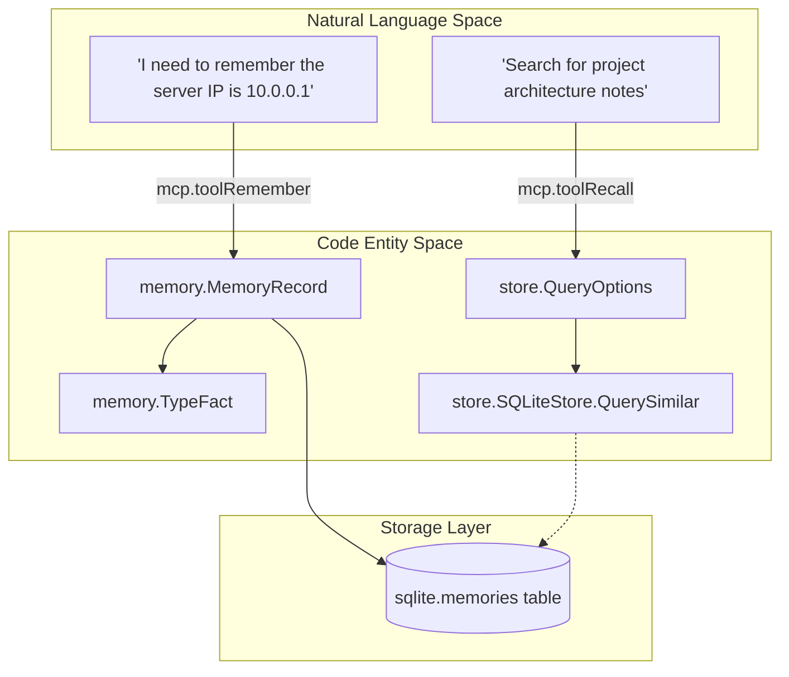
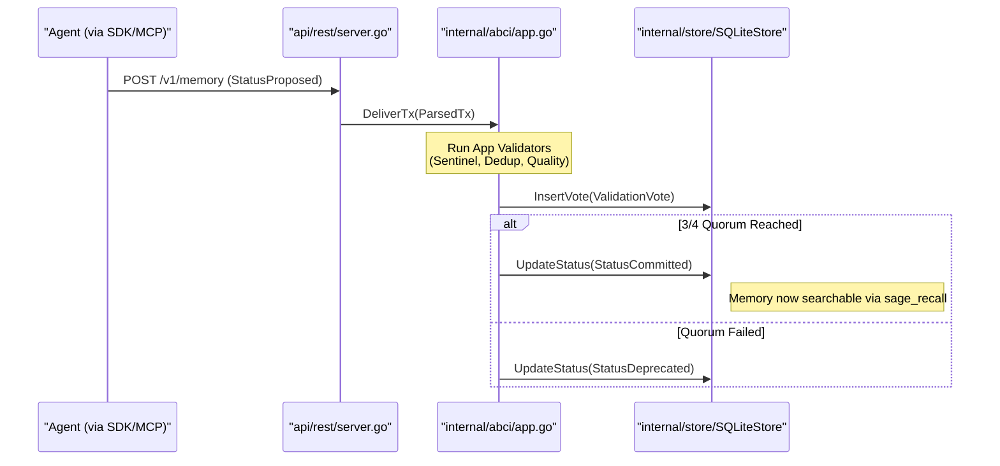

<!-- source: DeepWiki mcp.deepwiki.com · repo l33tdawg/sage · page 1.2 Key Concepts and Terminology · fetched 2026-10-26 -->

# Key Concepts and Terminology

Relevant source files

The following files were used as context for generating this wiki page:

- [README.md](README.md)
- [internal/mcp/server.go](internal/mcp/server.go)
- [internal/mcp/tools.go](internal/mcp/tools.go)
- [internal/memory/model.go](internal/memory/model.go)
- [internal/store/postgres.go](internal/store/postgres.go)
- [internal/store/sqlite.go](internal/store/sqlite.go)
- [internal/store/store.go](internal/store/store.go)
- [sdk/python/pyproject.toml](sdk/python/pyproject.toml)
- [sdk/python/src/sage_sdk/__init__.py](sdk/python/src/sage_sdk/__init__.py)

This page defines the core domain vocabulary and technical concepts required to understand the SAGE (Sovereign Agent Governed Experience) infrastructure. It serves as a bridge between high-level agentic memory concepts and their specific implementations in the Go and Python codebases.

## Core Data Entities

The primary unit of data in SAGE is the **MemoryRecord**. Unlike a simple vector embedding, a `MemoryRecord` contains rich metadata, cryptographic proofs, and lifecycle state.

### MemoryRecord
The fundamental data structure representing a piece of knowledge. It is defined in `internal/memory/model.go` [internal/memory/model.go:39-56]().
*   **MemoryID**: A unique identifier for the record.
*   **Content**: The actual text or data stored.
*   **ConfidenceScore**: A float (0.0 to 1.0) representing the system's certainty in the memory [internal/memory/model.go:49-49]().
*   **MemoryType**: Categorizes the memory to determine its decay and visibility rules.

| Type | Description | Default Confidence |
| :--- | :--- | :--- |
| `fact` | Durable knowledge (infrastructure, IPs, architecture) that resists decay. | 0.95+ |
| `observation` | Episodic, session-level context about what happened. | 0.80 |
| `inference` | Hypotheses or conclusions derived by the agent. | 0.60 |
| `task` | Actionable items with a lifecycle (`planned`, `in_progress`, `done`). | 1.0 |

**Sources:** [internal/memory/model.go:18-36](), [internal/mcp/tools.go:25-31]()

### Domain
A logical namespace used to partition memories. Domains are dynamic and created organically by agents (e.g., `security`, `go-debugging`, `quantum-physics`) [internal/mcp/tools.go:134-135](). Access control and recall filtering are often scoped by Domain.

### KnowledgeTriple
An optional structured representation of a memory using Subject-Predicate-Object format (e.g., "SAGE" -> "uses" -> "CometBFT") [internal/memory/model.go:67-71](). These are stored in the `knowledge_triples` table [internal/store/sqlite.go:170-176]().

---

## The Consensus & Validation Layer

SAGE treats memory commitment as a distributed systems problem, utilizing Byzantine Fault Tolerant (BFT) primitives.

### CometBFT & ABCI
*   **CometBFT**: The consensus engine that ensures all nodes in a SAGE network agree on the order and content of memory transactions [README.md:26-26]().
*   **ABCI (Application BlockChain Interface)**: The protocol that connects CometBFT to the SAGE application logic. The SAGE ABCI app handles validation, confidence scoring, and state transitions.

### Proof of Experience (PoE)
The weighting mechanism for validators. Instead of Proof of Stake, SAGE uses **PoE**, where a validator's voting power is determined by its historical accuracy, domain expertise, and corroboration by other agents [internal/store/store.go:54-66]().

### Synaptic Ledger (Vault)
The encryption layer that protects memory at rest. It uses **AES-256-GCM** and derives keys via **Argon2id** [internal/store/sqlite.go:22-22](). When the "Vault" is locked, memory content and embeddings remain encrypted and inaccessible to the agent [internal/store/sqlite.go:81-83]().

---

## System Architecture Diagrams

### From Natural Language to Code Entities
This diagram shows how an agent's intent (Natural Language Space) is transformed into specific code structures (Code Entity Space).

**Intent to Entity Mapping**

**Sources:** [internal/mcp/tools.go:23-53](), [internal/memory/model.go:39-56](), [internal/store/sqlite.go:150-166]()

### Memory Lifecycle and Validation Flow
This diagram maps the conceptual "validation" of a memory to the actual functions and state changes in the codebase.

**Validation State Machine**

**Sources:** [internal/memory/model.go:10-16](), [internal/store/store.go:11-20](), [internal/store/sqlite.go:113-113](), [internal/mcp/server.go:151-152]()

---

## Glossary of Key Components

| Term | Definition | Code Pointer |
| :--- | :--- | :--- |
| **CEREBRUM** | The web dashboard for visualizing the neural graph and managing the network. | `internal/api/dashboard` |
| **MCP** | Model Context Protocol; the stdio/JSON-RPC interface used by Claude and ChatGPT. | [internal/mcp/server.go:42-42]() |
| **Sentinel** | An app validator that checks for malformed data or unauthorized agents. | `internal/abci/validators` |
| **Confidence Decay** | The automatic reduction of `ConfidenceScore` over time for `observation` types. | `internal/abci/engine` |
| **AgentIdentity** | The Ed25519 keypair and metadata identifying a unique agent. | [sdk/python/src/sage_sdk/auth.py]() |
| **Synaptic Ledger** | The logical term for the encrypted, consensus-validated memory store. | [README.md:27-27]() |
| **sage_inception** | The mandatory "boot" tool that initializes an agent's session context. | [internal/mcp/tools.go:105-117]() |
| **sage_turn** | The atomic "recall + store" tool used every conversation turn. | [internal/mcp/tools.go:128-135]() |

**Sources:** [README.md:19-30](), [internal/mcp/server.go:1-17](), [internal/store/sqlite.go:1-23]()

---

