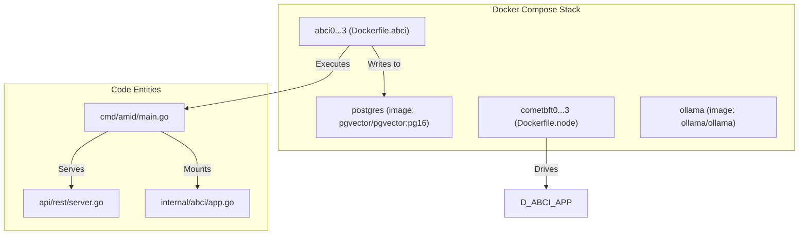
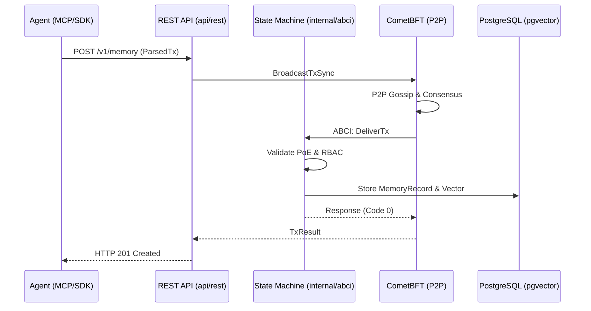

<!-- source: DeepWiki mcp.deepwiki.com · repo l33tdawg/sage · page 10 Deployment and Infrastructure · fetched 2026-10-26 -->

# Deployment and Infrastructure

Relevant source files

The following files were used as context for generating this wiki page:

- [.github/workflows/ci.yml](.github/workflows/ci.yml)
- [.github/workflows/release.yml](.github/workflows/release.yml)
- [.goreleaser.yaml](.goreleaser.yaml)
- [api/rest/helpers.go](api/rest/helpers.go)
- [deploy/Dockerfile.abci](deploy/Dockerfile.abci)
- [deploy/docker-compose.yml](deploy/docker-compose.yml)
- [go.mod](go.mod)
- [go.sum](go.sum)
- [installer/macos/build-dmg.sh](installer/macos/build-dmg.sh)
- [installer/windows/build-exe.sh](installer/windows/build-exe.sh)
- [installer/windows/sage-installer.nsi](installer/windows/sage-installer.nsi)
- [server.json](server.json)

SAGE is designed with a flexible infrastructure model that scales from a single-user local binary to a multi-node, consensus-governed institutional cluster. This page provides a high-level overview of the deployment topologies, the automated CI/CD pipeline, and the platform-specific installers that package the SAGE ecosystem.

## Deployment Topologies

SAGE supports two primary deployment modes, targeting different levels of trust and resource requirements. Both modes leverage the same underlying ABCI application logic but vary in their consensus and storage backends.

### 1. Personal Mode (Single-Binary)
In Personal Mode, the `sage-gui` binary acts as an all-in-one sovereign node. It utilizes an embedded SQLite database for off-chain storage and a local-only consensus mechanism. This mode is optimized for individual developers and privacy-conscious users who want a persistent memory for their AI agents (like Claude or ChatGPT) without external infrastructure.

### 2. Multi-Node Mode (Docker Cluster)
Multi-Node Mode is the "Synaptic Ledger" in its full form. It deploys a 4-node [CometBFT](https://github.com/cometbft/cometbft) network where each node runs a SAGE ABCI application instance (`amid`). This topology provides Byzantine Fault Tolerance (BFT) and requires a 3/4 quorum for memory commitment.

For details on the cluster architecture, see [Multi-Node Docker Deployment](#10.1).

#### Topology Comparison

| Feature | Personal Mode (`sage-gui`) | Multi-Node Mode (`amid`) |
| :--- | :--- | :--- |
| **Consensus** | Single-node (Instant) | 4-node CometBFT (BFT) |
| **Storage** | SQLite + BadgerDB | PostgreSQL + pgvector + BadgerDB |
| **Packaging** | Native OS Installer (DMG/EXE) | Docker Compose |
| **Scaling** | Vertical (Local machine) | Horizontal (Distributed cluster) |

**Sources:** [.goreleaser.yaml:10-44](), [deploy/docker-compose.yml:5-56]()

## Infrastructure Stack (Multi-Node)

The multi-node infrastructure is orchestrated via Docker Compose and consists of three functional layers:

### Data and Embedding Layer
*   **PostgreSQL + pgvector**: Stores off-chain memory records and provides vector similarity search capabilities [deploy/docker-compose.yml:9-27]().
*   **Ollama**: A local inference engine that provides the `nomic-embed-text` model for generating sovereign embeddings [deploy/docker-compose.yml:139-163]().

### Consensus and State Layer
*   **CometBFT**: Handles the P2P networking and Tendermint consensus algorithm [deploy/docker-compose.yml:168-236]().
*   **ABCI Application (`amid`)**: The Go-based state machine that enforces Proof of Experience (PoE) and RBAC rules [deploy/docker-compose.yml:32-134]().

### Deployment Orchestration to Code Mapping
The following diagram bridges the high-level service names in the `docker-compose.yml` to the specific code entities they execute.

**Service to Code Entity Mapping**

**Sources:** [deploy/docker-compose.yml:32-50](), [deploy/Dockerfile.abci:17-29](), [api/rest/helpers.go:1-48]()

## CI/CD and Release Pipeline

SAGE utilizes GitHub Actions and `goreleaser` to automate the testing, building, and distribution of binaries and installers.

### CI Workflow
The `ci.yml` workflow triggers on every push to `main`. It performs:
1.  **Linting**: Uses `golangci-lint` to ensure code quality [.github/workflows/ci.yml:14-27]().
2.  **Unit/Race Testing**: Executes `go test ./... -race` [.github/workflows/ci.yml:29-39]().
3.  **Integration Testing**: Verifies the Python SDK against the core logic [.github/workflows/ci.yml:66-79]().
4.  **Docker Validation**: Builds the `deploy/docker-compose.yml` stack to ensure no regression in container definitions [.github/workflows/ci.yml:54-65]().

### Release Workflow
The `release.yml` workflow triggers on version tags (e.g., `v4.5.7`). It automates the generation of:
*   **macOS DMG**: Includes code signing and notarization for `arm64` and `x86_64` [.github/workflows/release.yml:112-177]().
*   **Windows EXE**: Uses NSIS to create an installer that configures the system `PATH` and desktop shortcuts [.github/workflows/release.yml:178-208]().
*   **OCI Images**: Publishes the `sage` image to the GitHub Container Registry (GHCR) as defined in `server.json` [server.json:10-18]().

For a deep dive into the build scripts and signing requirements, see [Platform Installers and Release Pipeline](#10.2).

**Sources:** [.github/workflows/ci.yml:1-79](), [.github/workflows/release.yml:1-110](), [.goreleaser.yaml:1-150]()

## Infrastructure Management

Maintaining a SAGE deployment involves managing state transitions and node lifecycle.

### Redeployment Orchestrator
The system includes a specialized orchestrator for handling "hot" updates to the infrastructure. This state machine manages the transition from an old chain state to a new one, ensuring that backups are created and RBAC configurations are migrated before the consensus engine is restarted.

For details on the 9-phase redeployment process, see [Redeployment Orchestrator](#10.3).

### Infrastructure Component Interaction
This diagram illustrates how the various infrastructure components interact during a standard transaction flow.

**Transaction Flow Architecture**

**Sources:** [deploy/docker-compose.yml:43-50](), [api/rest/helpers.go:12-28](), [server.json:3-4]()

## See Also

*   [Multi-Node Docker Deployment](#10.1) — Detailed guide to the CometBFT cluster.
*   [Platform Installers and Release Pipeline](#10.2) — Technical details of the GoReleaser and NSIS workflows.
*   [Redeployment Orchestrator](#10.3) — The state machine for node and key lifecycle management.

---

