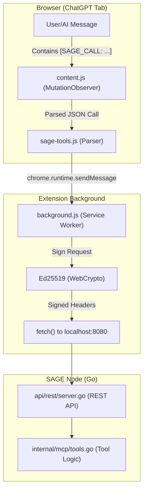
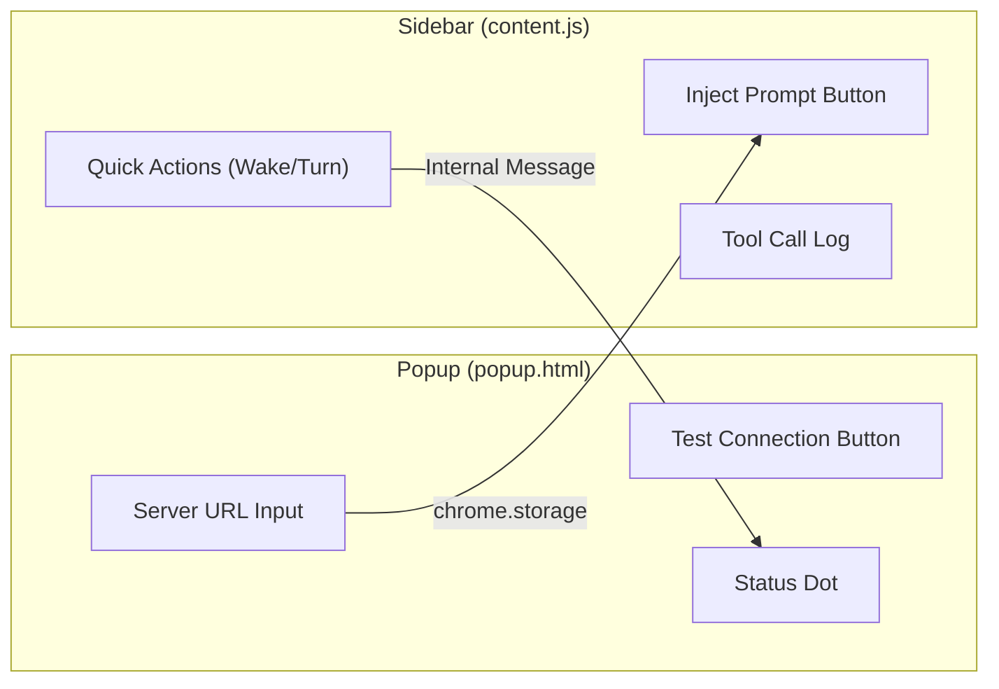

<!-- source: DeepWiki mcp.deepwiki.com · repo l33tdawg/sage · page 11 Browser Extension · fetched 2026-10-26 -->

# Browser Extension

Relevant source files

The following files were used as context for generating this wiki page:

- [cmd/sage-gui/mcp_test.go](cmd/sage-gui/mcp_test.go)
- [extension/build.sh](extension/build.sh)
- [extension/chrome/README.md](extension/chrome/README.md)
- [extension/chrome/background.js](extension/chrome/background.js)
- [extension/chrome/content.css](extension/chrome/content.css)
- [extension/chrome/icons/generate-icons.html](extension/chrome/icons/generate-icons.html)
- [extension/chrome/icons/generate-icons.js](extension/chrome/icons/generate-icons.js)
- [extension/chrome/icons/icon128.png](extension/chrome/icons/icon128.png)
- [extension/chrome/icons/icon16.png](extension/chrome/icons/icon16.png)
- [extension/chrome/icons/icon48.png](extension/chrome/icons/icon48.png)
- [extension/chrome/manifest.json](extension/chrome/manifest.json)
- [extension/chrome/popup.css](extension/chrome/popup.css)
- [extension/chrome/popup.html](extension/chrome/popup.html)
- [extension/chrome/popup.js](extension/chrome/popup.js)
- [extension/chrome/sage-tools.js](extension/chrome/sage-tools.js)
- [extension/manifest.firefox.json](extension/manifest.firefox.json)
- [extension/store-listing.md](extension/store-listing.md)
- [sdk/python/src/sage_sdk/auth.py](sdk/python/src/sage_sdk/auth.py)
- [web/handler_memorymode_test.go](web/handler_memorymode_test.go)

The SAGE Browser Extension (SuperAssistant) bridges the gap between web-based AI interfaces (like ChatGPT) and the local SAGE memory node. It enables persistent memory for AI agents even on free plans by injecting a monitoring layer that intercepts specific command patterns and executes them against the local SAGE REST API.

### Architecture Overview

The extension follows a standard Manifest V3 architecture, utilizing a content script for DOM manipulation and a background service worker for secure communication and cryptographic signing.

#### Data Flow: Natural Language to Code Entity

The following diagram illustrates how a user's natural language interaction in ChatGPT is transformed into a structured SAGE tool call and eventually a signed cryptographic request.

**User Interaction to SAGE Request Flow**

Sources: [extension/chrome/README.md:52-63](), [extension/chrome/manifest.json:12-26]()

---

### Core Components

#### 1. Content Script Injection
The extension targets `chatgpt.com` and `chat.openai.com` [extension/chrome/manifest.json:18-21](). It injects `content.js`, `sage-tools.js`, and `content.css` at `document_idle` [extension/chrome/manifest.json:22-25]().

*   **MutationObserver**: `content.js` monitors the ChatGPT chat log for the `[SAGE_CALL: ...]` pattern [extension/chrome/README.md:38-43]().
*   **Sidebar UI**: A floating action button (brain icon) triggers a sidebar that displays connection status, memory statistics, and quick-action buttons [extension/chrome/README.md:9-10]().

#### 2. Pattern Monitoring: `[SAGE_CALL:]`
Since web interfaces do not provide native tool-calling APIs to extensions, SAGE uses a text-interception pattern.
*   **Mechanism**: The extension injects a system prompt that instructs the AI to use the format `[SAGE_CALL: tool_name({params})]` [extension/chrome/README.md:32-33]().
*   **Execution**: Once detected, the content script extracts the tool name and JSON arguments, sending them to the background worker for execution [extension/chrome/README.md:58-60]().

#### 3. Background Service Worker (`background.js`)
The service worker acts as the secure gateway to the local SAGE node.
*   **Request Signing**: It implements Ed25519 signing using the Web Crypto API, mirroring the logic found in the Python SDK [sdk/python/src/sage_sdk/auth.py:75-96](). Every request includes `X-Agent-ID`, `X-Signature`, and `X-Timestamp` headers [extension/chrome/README.md:12-12]().
*   **API Proxy**: It performs the `fetch` calls to `http://localhost:8080` (or the user-configured URL) to bypass CORS restrictions and manage authentication [extension/chrome/manifest.json:8-11]().

Sources: [extension/chrome/README.md:65-75](), [extension/chrome/manifest.json:12-15]()

---

### Quick-Action Tools

The extension provides a set of pre-defined tools that can be triggered manually via the sidebar or automatically by the AI agent.

| Tool | Implementation | Description |
| :--- | :--- | :--- |
| `sage_inception` | `sage-tools.js` | Initializes the memory session and loads relevant context. |
| `sage_turn` | `sage-tools.js` | Per-turn synchronization: performs recall and stores observations. |
| `sage_remember` | `sage-tools.js` | Explicitly commits a fact or observation to the Synaptic Ledger. |
| `sage_recall` | `sage-tools.js` | Performs a semantic vector search for relevant past memories. |
| `sage_status` | `sage-tools.js` | Retrieves node health and memory counts for the UI. |

Sources: [extension/chrome/README.md:77-90](), [cmd/sage-gui/mcp_test.go:24-25]()

---

### UI and Connection Management

#### Floating Action Button & Sidebar
The sidebar provides real-time feedback on the agent's memory state.
*   **Connection Status**: Displays a status dot (Green/Red) based on the heartbeat to the local SAGE node [extension/chrome/popup.html:16-19]().
*   **Memory Stats**: Displays the total count of memories and domains indexed in the local SQLite store [extension/chrome/popup.html:21-30]().

#### Configuration Popup
The `popup.html` allows users to configure the connection to their SAGE instance.
*   **Server URL**: Default is `http://localhost:8080` [extension/chrome/popup.html:34-35]().
*   **Test Connection**: A manual trigger to verify the REST API is reachable and the Ed25519 keys are correctly initialized [extension/chrome/popup.html:37-37]().

**Extension UI Structure**

Sources: [extension/chrome/popup.html:1-47](), [extension/chrome/manifest.json:27-35]()

---

### Build and Publish Pipeline

The extension supports both Chrome and Firefox through a unified build script that manages manifest variations.

#### Pipeline Stages
1.  **Icon Generation**: `generate-icons.js` uses a canvas-less approach to generate 16x16, 48x48, and 128x128 PNGs from raw RGBA data [extension/chrome/icons/generate-icons.js:1-8]().
2.  **Manifest Selection**:
    *   **Chrome**: Uses `extension/chrome/manifest.json` (Manifest V3) [extension/chrome/manifest.json:1-41]().
    *   **Firefox**: Uses `extension/manifest.firefox.json` which includes `browser_specific_settings` for Gecko [extension/manifest.firefox.json:1-14]().
3.  **Packaging**: `build.sh` zips the assets into `dist/sage-chrome-extension.zip` and `dist/sage-firefox-extension.zip` [extension/build.sh:18-42]().

#### Key Files
*   `extension/build.sh`: Orchestrates the build process [extension/build.sh:1-61]().
*   `extension/chrome/icons/generate-icons.js`: Generates the "neural theme" icons [extension/chrome/icons/generate-icons.js:142-214]().

Sources: [extension/build.sh:1-62](), [extension/manifest.firefox.json:1-50](), [extension/chrome/manifest.json:1-41]()

---

