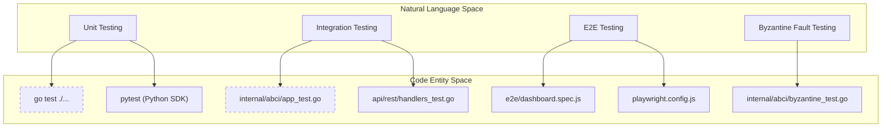
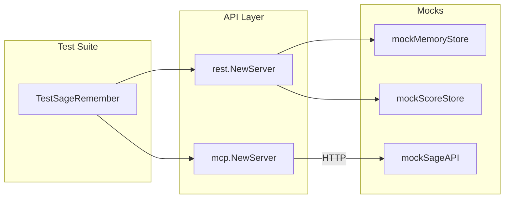

<!-- source: DeepWiki mcp.deepwiki.com · repo l33tdawg/sage · page 12 Testing · fetched 2026-10-26 -->

# Testing

Relevant source files

The following files were used as context for generating this wiki page:

- [.github/workflows/ci.yml](.github/workflows/ci.yml)
- [.github/workflows/release.yml](.github/workflows/release.yml)
- [LICENSE](LICENSE)
- [api/rest/handlers_test.go](api/rest/handlers_test.go)
- [cmd/amid/main.go](cmd/amid/main.go)
- [cmd/sage-cli/main.go](cmd/sage-cli/main.go)
- [deploy/Dockerfile.abci](deploy/Dockerfile.abci)
- [e2e/dashboard.spec.js](e2e/dashboard.spec.js)
- [e2e/network.spec.js](e2e/network.spec.js)
- [go.mod](go.mod)
- [go.sum](go.sum)
- [internal/embedding/ollama.go](internal/embedding/ollama.go)
- [internal/mcp/tools_test.go](internal/mcp/tools_test.go)
- [internal/tx/codec.go](internal/tx/codec.go)
- [internal/tx/codec_test.go](internal/tx/codec_test.go)
- [internal/tx/types.go](internal/tx/types.go)
- [server.json](server.json)

The SAGE codebase employs a multi-layered testing strategy to ensure the integrity of the Synaptic Ledger, the accuracy of the Proof of Experience (PoE) consensus, and the reliability of the agent-facing interfaces. Testing spans from low-level Go unit tests to end-to-end browser automation and Byzantine fault simulation.

### Testing Overview

The testing architecture is divided into three primary tiers:
1.  **Core Logic (Go):** Unit and integration tests for the ABCI application, state stores, and transaction codecs.
2.  **Agent Interfaces (Python/JS):** SDK validation and MCP tool integration tests.
3.  **System E2E (Playwright/k6):** Browser-based dashboard testing and performance benchmarking.

The CI/CD pipeline, defined in `.github/workflows/ci.yml`, automates these tests on every push to the `main` branch, including linting, Go race detection, and Python SDK verification [/.github/workflows/ci.yml:13-79]().

### Natural Language to Code Mapping: Testing Entities

The following diagram maps high-level testing concepts to the specific code entities and suites that implement them.

**Testing Strategy Mapping**

Sources: [/.github/workflows/ci.yml:29-79](), [/api/rest/handlers_test.go:26-191](), [/e2e/dashboard.spec.js:1-62]()

---

### Test Categories

#### Unit and Integration Tests
Go unit tests focus on isolated component logic, such as the `tx.EncodeTx` and `tx.DecodeTx` functions for transaction serialization [internal/tx/codec.go:24-142](). Integration tests verify the interaction between the REST API and the underlying storage layers using mocks like `mockMemoryStore` and `mockScoreStore` [api/rest/handlers_test.go:28-222]().

For details, see [Unit and Integration Tests](#12.1).

#### E2E and Load Tests
End-to-end tests utilize Playwright to simulate user interactions with the CEREBRUM dashboard, verifying navigation, health bar statistics, and SSE connection status [e2e/dashboard.spec.js:5-62](). Load tests (implemented via k6 or Python scripts) benchmark the system's ability to handle high-frequency memory submissions and complex vector queries.

For details, see [E2E and Load Tests](#12.2).

---

### Component Testing Architecture

The diagram below illustrates how test mocks isolate components during the testing process, specifically within the REST API and MCP layers.

**Mock Isolation Architecture**

Sources: [/api/rest/handlers_test.go:28-222](), [/internal/mcp/tools_test.go:15-152]()

### Summary Table: Test Coverage

| Category | Target | Key Files | Tools |
| :--- | :--- | :--- | :--- |
| **Unit** | Codecs, Logic | `internal/tx/codec_test.go` | `go test` |
| **API Integration** | REST Endpoints | `api/rest/handlers_test.go` | `testify/assert` |
| **MCP Integration** | Agent Tools | `internal/mcp/tools_test.go` | `httptest` |
| **E2E** | Dashboard UI | `e2e/dashboard.spec.js` | Playwright |
| **SDK** | Python Client | `sdk/python/tests/` | `pytest` |
| **Consensus** | ABCI / PoE | `internal/abci/app_test.go` | CometBFT TMLogger |

Sources: [/.github/workflows/ci.yml:1-79](), [/api/rest/handlers_test.go:1-25](), [/e2e/dashboard.spec.js:1-4]()

---

