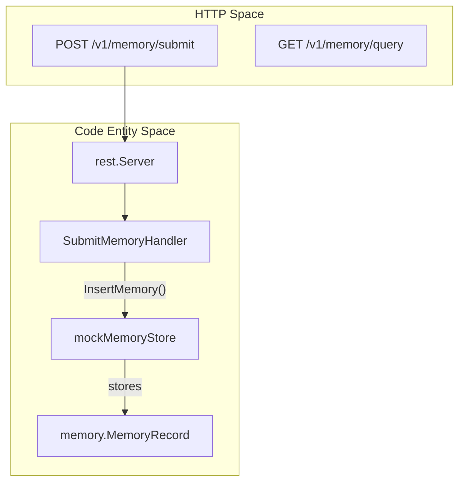
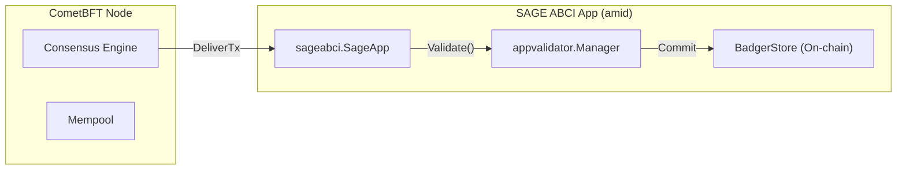

<!-- source: DeepWiki mcp.deepwiki.com · repo l33tdawg/sage · page 12.1 Unit and Integration Tests · fetched 2026-10-26 -->

# Unit and Integration Tests

Relevant source files

The following files were used as context for generating this wiki page:

- [LICENSE](LICENSE)
- [api/rest/handlers_test.go](api/rest/handlers_test.go)
- [cmd/amid/main.go](cmd/amid/main.go)
- [cmd/sage-cli/main.go](cmd/sage-cli/main.go)
- [internal/appvalidator/manager_test.go](internal/appvalidator/manager_test.go)
- [internal/appvalidator/validator_test.go](internal/appvalidator/validator_test.go)
- [internal/embedding/ollama.go](internal/embedding/ollama.go)
- [internal/mcp/tools_test.go](internal/mcp/tools_test.go)
- [internal/orchestrator/redeployer_test.go](internal/orchestrator/redeployer_test.go)
- [internal/tx/codec.go](internal/tx/codec.go)
- [internal/tx/codec_test.go](internal/tx/codec_test.go)
- [internal/tx/types.go](internal/tx/types.go)
- [internal/vault/vault.go](internal/vault/vault.go)
- [internal/vault/vault_test.go](internal/vault/vault_test.go)
- [web/handler_ledger.go](web/handler_ledger.go)
- [web/handler_ledger_test.go](web/handler_ledger_test.go)

SAGE employs a multi-layered testing strategy to ensure the integrity of its distributed memory ledger, the correctness of its consensus logic, and the security of its cryptographic vault. The test suite spans Go unit tests for core logic, REST API handler tests using mock stores, and complex integration tests that simulate multi-node Byzantine environments.

## Go Unit Testing

Unit tests in SAGE focus on isolated component logic, particularly the transaction codec, the Synaptic Ledger (Vault), and the MCP tool implementations.

### Synaptic Ledger (Vault) Tests
The `internal/vault` package tests verify the AES-256-GCM encryption lifecycle. Key test cases include:
*   **Key Derivation**: Verifying that `Argon2id` correctly derives wrapping keys from passphrases [internal/vault/vault.go:81-81]().
*   **Encryption Integrity**: Ensuring that encrypting the same plaintext twice produces different ciphertexts due to unique nonces [internal/vault/vault_test.go:71-84]().
*   **Passphrase Rotation**: Testing `ChangePassphrase`, which re-encrypts the data key without requiring a full database re-encryption [internal/vault/vault_test.go:92-117]().
*   **Recovery**: Validating that `InitFromRecoveryKey` can restore access to encrypted memories using the raw 32-byte data key [internal/vault/vault_test.go:137-165]().

### Transaction Codec Tests
The `internal/tx` package ensures deterministic serialization of the 23 transaction types.
*   **Round-trip Validation**: Tests in `codec_test.go` verify that `EncodeTx` and `DecodeTx` preserve all fields for `MemorySubmit`, `MemoryVote`, and `MemoryChallenge` [internal/tx/codec_test.go:76-138]().
*   **Signature Verification**: `TestSignVerifyTx` confirms that `SignTx` produces valid Ed25519 signatures and that `VerifyTx` correctly identifies tampered payloads [internal/tx/codec_test.go:140-167]().

### MCP Tool Tests
The MCP server is tested by mocking the SAGE REST API. The `mockSageAPI` function creates a local `httptest.Server` that simulates various endpoints like `/v1/memory/submit` and `/v1/memory/query` [internal/mcp/tools_test.go:15-130](). This allows testing of:
*   **sage_remember**: Verifying that agent tool calls correctly translate to `MemorySubmit` transactions [internal/mcp/tools_test.go:132-152]().
*   **sage_recall**: Testing semantic search result parsing [internal/mcp/tools_test.go:163-181]().

**Sources:** [internal/vault/vault.go](), [internal/vault/vault_test.go](), [internal/tx/codec.go](), [internal/tx/codec_test.go](), [internal/mcp/tools_test.go]()

## REST API and Handler Testing

SAGE uses a `mockMemoryStore` and `mockScoreStore` to test REST handlers without requiring a live database or CometBFT node.

### Mocking Strategy
The `mockMemoryStore` implements the `OffchainStore` interface, using Go maps to track `MemoryRecord` objects and `ValidationVote` entries [api/rest/handlers_test.go:28-41]().

### Code Entity Mapping: REST Testing
The following diagram bridges the HTTP interface to the internal mock entities used during testing.

"REST Handler Testing Architecture"

**Sources:** [api/rest/handlers_test.go:28-106](), [api/rest/server.go]()

## Integration Testing Suite

Integration tests verify the interaction between the Go backend, the CometBFT consensus engine, and the storage layer.

### Dashboard and Ledger Integration
The `web` package includes integration tests for the CEREBRUM dashboard handlers. `TestHandleEnableLedger` verifies the end-to-end flow of enabling encryption, which involves:
1.  Initializing the vault file on disk [web/handler_ledger.go:69-73]().
2.  Attaching the `Vault` instance to the underlying store [web/handler_ledger.go:87-89]().
3.  Updating the global `Encrypted` atomic state [web/handler_ledger.go:91-91]().

### Authentication Integration
Tests like `loginAfterEnable` simulate the session lifecycle, ensuring that once the Synaptic Ledger is enabled, subsequent requests carry the correct session cookies and can access encrypted data [web/handler_ledger_test.go:15-27]().

| Test Function | Target Component | Verification Logic |
| :--- | :--- | :--- |
| `TestHandleEnableLedger` | `DashboardHandler` | Verifies vault initialization and recovery key generation [web/handler_ledger_test.go:44-62]() |
| `TestHandleChangePassphrase` | `vault.Vault` | Ensures data remains decryptable after KDF salt/passphrase update [web/handler_ledger_test.go:136-165]() |
| `TestHandleRecoverLedger` | `vault.Vault` | Tests the "escape hatch" using the raw data key [web/handler_ledger_test.go:166-203]() |

**Sources:** [web/handler_ledger.go](), [web/handler_ledger_test.go](), [internal/vault/vault.go]()

## Byzantine Fault and Quorum Tests

SAGE is designed to operate in multi-node environments (the `amid` daemon). Testing covers scenarios where nodes fail or act maliciously.

### Consensus and Validator Quorum
The system utilizes a 4-node model requiring a 3/4 quorum for memory commitment. Integration tests verify:
*   **3/4 Node Failure**: Ensuring the system remains operational if one node fails.
*   **2/4 Node Failure**: Verifying that consensus halts if two nodes fail, preventing split-brain scenarios.
*   **Proof of Experience (PoE)**: Testing the `ValidatorScore` updates in the `mockScoreStore` after successful consensus rounds [api/rest/handlers_test.go:193-222]().

### Multi-Node Deployment Testing
The `amid` binary supports two modes:
1.  **In-Process**: CometBFT is embedded in the Go binary [cmd/amid/main.go:121-177]().
2.  **Standalone ABCI**: The app runs as a socket server for an external CometBFT process [cmd/amid/main.go:92-118]().

Testing both modes ensures that the `SageApp` correctly implements the ABCI interface regardless of the networking topology.

"Consensus Flow and ABCI Integration"

**Sources:** [cmd/amid/main.go](), [internal/abci/app.go](), [api/rest/handlers_test.go]()

## Python SDK Testing

The `sage-agent-sdk` is tested to ensure compatibility with the Go REST API. Tests cover:
*   **Identity Management**: Generating Ed25519 keys and signing request headers.
*   **Asynchronous Operations**: Using `AsyncSageClient` to submit memories and poll for status.
*   **Model Validation**: Ensuring Pydantic models correctly enforce the `MemoryRecord` schema.

**Sources:** [api/rest/handlers_test.go](), [internal/tx/types.go]()

---

