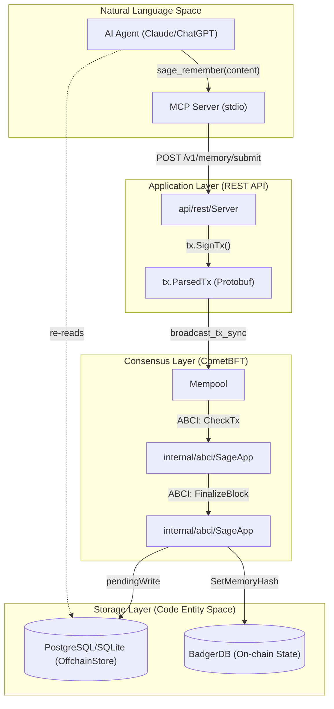
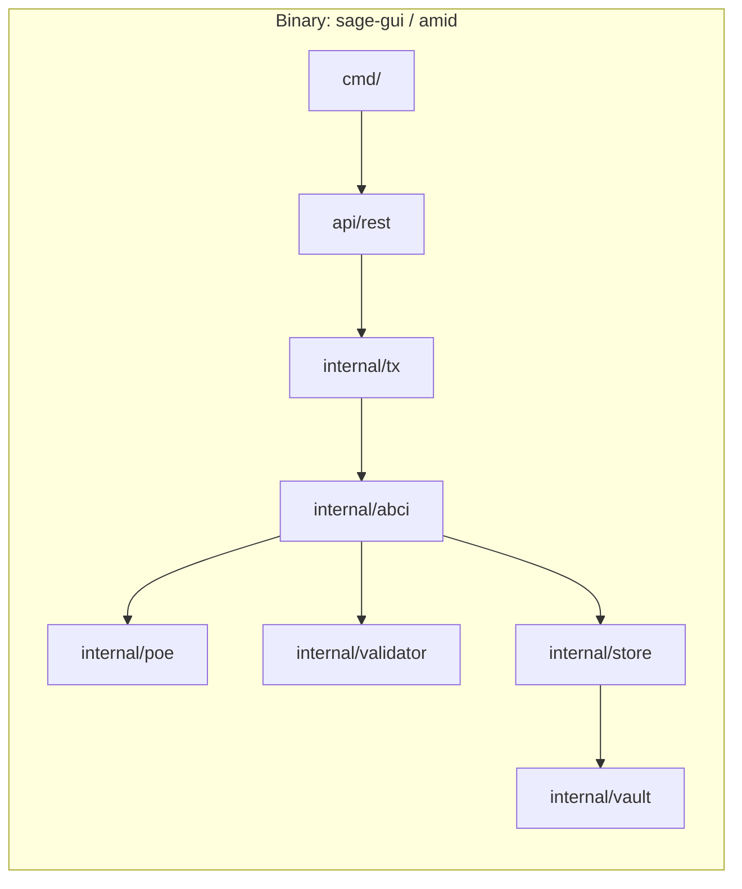

<!-- source: DeepWiki mcp.deepwiki.com · repo l33tdawg/sage · page 2 Core Architecture · fetched 2026-10-26 -->

# Core Architecture

Relevant source files

The following files were used as context for generating this wiki page:

- [.github/workflows/ci.yml](.github/workflows/ci.yml)
- [.github/workflows/release.yml](.github/workflows/release.yml)
- [api/rest/agent_handler.go](api/rest/agent_handler.go)
- [cmd/sage-gui/node.go](cmd/sage-gui/node.go)
- [deploy/Dockerfile.abci](deploy/Dockerfile.abci)
- [docs/ARCHITECTURE.md](docs/ARCHITECTURE.md)
- [docs/GETTING_STARTED.md](docs/GETTING_STARTED.md)
- [go.mod](go.mod)
- [go.sum](go.sum)
- [internal/abci/app.go](internal/abci/app.go)
- [internal/abci/app_test.go](internal/abci/app_test.go)
- [internal/abci/migrate.go](internal/abci/migrate.go)
- [internal/store/badger.go](internal/store/badger.go)
- [sdk/python/README.md](sdk/python/README.md)
- [sdk/python/src/sage_sdk/models.py](sdk/python/src/sage_sdk/models.py)
- [server.json](server.json)

SAGE (Sovereign Agent Governed Experience) is a distributed, consensus-validated memory system for AI agents. It operates as a two-tier architecture that bridges the gap between high-frequency agent interactions and cryptographically secure, long-term storage.

The system is designed to run in two primary modes:
1.  **Personal Mode**: A single-binary deployment (`sage-gui`) using SQLite and an in-process CometBFT node for local agent memory [cmd/sage-gui/node.go:187-190]().
2.  **Multi-Node Mode**: A Byzantine Fault Tolerant (BFT) cluster (`amid`) using PostgreSQL and a 4-validator quorum to provide institutional-grade memory [docs/ARCHITECTURE.md:41-57]().

## End-to-End Data Flow

The following diagram traces a memory submission from an AI agent's tool call through the various architectural layers to final commitment.

### Memory Submission Pipeline

**Sources:** [docs/ARCHITECTURE.md:31-79](), [internal/abci/app.go:115-127](), [api/rest/server.go:15-40]()

## Major System Layers

### 1. The Interface Layer (MCP & REST)
Agents interact with SAGE primarily through the **Model Context Protocol (MCP)** or the **Python SDK**. The MCP server translates agent tool calls into signed REST API requests [docs/GETTING_STARTED.md:128-143](). Every submission is wrapped in a `ParsedTx` struct, which includes an Ed25519 signature from the agent to ensure non-repudiation [internal/tx/codec.go:15-30]().

For details, see [Agent Interfaces](#4).

### 2. The Consensus Engine (CometBFT & ABCI)
SAGE uses **CometBFT** to ensure that all nodes in a cluster agree on the order and validity of memories. The `internal/abci/SageApp` implements the ABCI 2.0 interface to handle block proposals and state transitions [internal/abci/app.go:115-127](). 
*   **CheckTx**: Validates signatures and nonces before a transaction enters the mempool [internal/abci/app.go:218-240]().
*   **FinalizeBlock**: Executes the transactions, updating the local state [internal/abci/app.go:260-285]().

For details, see [Consensus Engine (CometBFT & ABCI)](#2.2).

### 3. Validation & Proof of Experience (PoE)
Before a memory is committed, it must pass through a 3/4 quorum of application-level validators: **Sentinel** (safety), **Dedup** (redundancy), **Quality** (utility), and **Consistency** (logic) [internal/validator/validator.go:10-45](). The system uses **Proof of Experience (PoE)** to weight validator influence based on their historical accuracy and domain expertise [internal/poe/poe.go:20-55]().

For details, see [App Validators and Proof of Experience (PoE)](#2.3).

### 4. The Storage Tier
SAGE employs a hybrid storage strategy:
*   **On-chain State (BadgerDB)**: Stores cryptographic hashes of memories, agent nonces, and the global Synaptic Ledger state [internal/store/badger.go:15-18](). This ensures the integrity of the record.
*   **Off-chain Store (PostgreSQL/SQLite)**: Stores the full text, metadata, and vector embeddings [internal/store/postgres.go:20-40](). It supports semantic search via `pgvector` or in-memory cosine similarity [internal/store/sqlite.go:50-75]().

For details, see [Storage Layer](#3).

## Internal Package Structure

The codebase is organized into functional packages that isolate the blockchain logic from the storage and API concerns.

| Package | Responsibility | Key Entities |
|:---|:---|:---|
| `internal/abci` | CometBFT Application Logic | `SageApp`, `AppState` |
| `internal/tx` | Transaction Processing & Codec | `ParsedTx`, `TxType` |
| `internal/store` | Persistence (SQL & Key-Value) | `SQLiteStore`, `PostgresStore`, `BadgerStore` |
| `internal/memory` | Memory Data Model | `MemoryRecord`, `MemoryStatus` |
| `internal/vault` | Encryption at Rest | `Vault`, `AES-256-GCM` |
| `api/rest` | HTTP Interface & Dashboard | `Server`, `DashboardHandler` |

### System Package Interactions

**Sources:** [cmd/sage-gui/node.go:32-41](), [internal/abci/app.go:15-21]()

## Deployment Topologies

### Personal Deployment (`sage-gui`)
Designed for individual developers. It bundles CometBFT, SQLite, and the MCP server into a single process.
*   **Consensus**: Single-validator (self-signing).
*   **Storage**: `sage.db` (SQLite).
*   **Security**: Synaptic Ledger (Vault) encryption enabled by default [cmd/sage-gui/node.go:106-137]().

### Multi-Node Cluster (`amid`)
Designed for organizations. It runs as a distributed network of 4+ nodes.
*   **Consensus**: 3/4 Quorum BFT [docs/ARCHITECTURE.md:103-108]().
*   **Storage**: PostgreSQL with `pgvector` for high-performance semantic retrieval [docs/ARCHITECTURE.md:160-165]().
*   **Identity**: Agents register on-chain and are governed by Role-Based Access Control (RBAC) [internal/abci/app.go:26-30]().

For details on the deployment process, see [Deployment and Infrastructure](#10).

---
**Sources:**
*   End-to-End Flow: [docs/ARCHITECTURE.md:31-79](), [internal/abci/app.go:115-127](), [api/rest/server.go:15-40]()
*   Deployment Modes: [cmd/sage-gui/node.go:187-190](), [docs/ARCHITECTURE.md:103-108]()
*   Package Structure: [cmd/sage-gui/node.go:32-41](), [internal/abci/app.go:15-21]()

---

