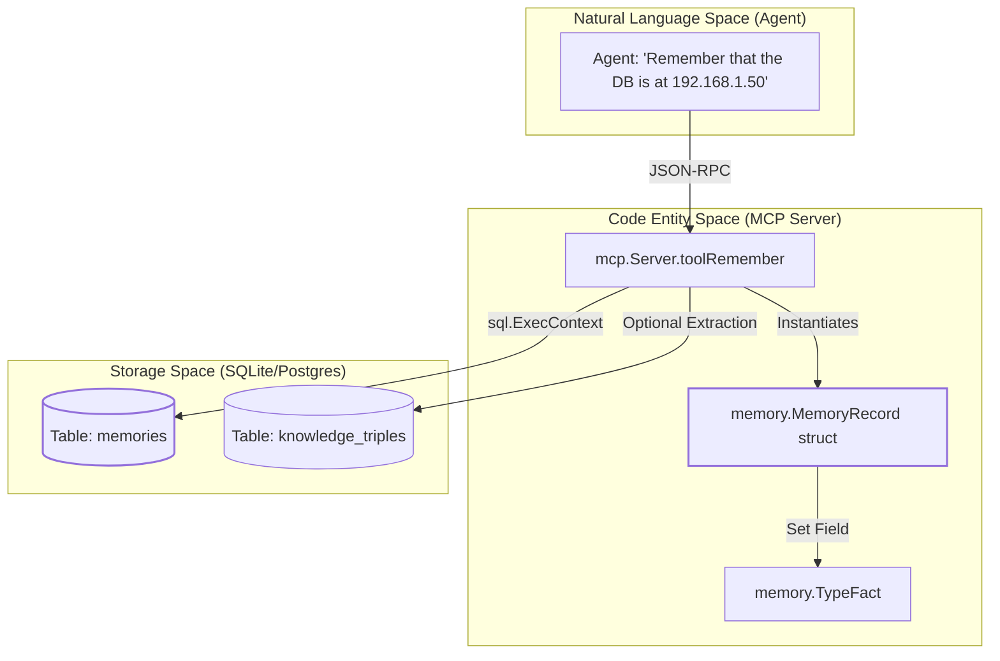

<!-- source: DeepWiki mcp.deepwiki.com · repo l33tdawg/sage · page 2.1 Memory Lifecycle and Data Model · fetched 2026-10-26 -->

# Memory Lifecycle and Data Model

<details>
<summary>Relevant source files</summary>

The following files were used as context for generating this wiki page:

- [internal/mcp/server.go](internal/mcp/server.go)
- [internal/mcp/tools.go](internal/mcp/tools.go)
- [internal/memory/confidence.go](internal/memory/confidence.go)
- [internal/memory/model.go](internal/memory/model.go)
- [internal/store/postgres.go](internal/store/postgres.go)
- [internal/store/sqlite.go](internal/store/sqlite.go)
- [internal/store/store.go](internal/store/store.go)

</details>


The SAGE system treats memory not as a static text file, but as a dynamic, governed, and decaying knowledge graph. Every piece of information submitted by an agent is encapsulated in a `MemoryRecord`, which undergoes a rigorous state machine transition from a mere proposal to a consensus-validated commitment.

## The MemoryRecord Data Model

The `MemoryRecord` is the fundamental unit of storage in SAGE. It contains the raw content, its vector embedding for semantic search, and metadata required for governance and confidence tracking.

| Field | Type | Description |
| :--- | :--- | :--- |
| `MemoryID` | `string` | Unique identifier (often a UUID or hash). |
| `SubmittingAgent` | `string` | The Ed25519 public key of the agent that created the memory. |
| `Content` | `string` | The natural language content (encrypted at rest in the Vault). |
| `MemoryType` | `enum` | Categorization (Fact, Observation, Inference, Task). |
| `Status` | `enum` | Current position in the validation state machine. |
| `ConfidenceScore` | `float64` | Initial confidence (0.0 to 1.0) assigned at creation. |
| `DomainTag` | `string` | Namespace for the memory (e.g., `security`, `code-review`). |
| `CreatedAt` | `time.Time` | Timestamp of initial submission. |

**Sources:** [internal/memory/model.go:39-56](), [internal/store/sqlite.go:150-166]()

### Memory Types
The `MemoryType` determines how the system handles the record's longevity and visibility.

*   **`fact`**: Durable, verified knowledge (e.g., server IPs, architecture decisions). These typically have high initial confidence (0.95+) and are prioritized in recall across different providers.
*   **`observation`**: Ephemeral session-level context. Used by `sage_turn` to track what happened in the current conversation.
*   **`inference`**: Hypotheses or conclusions drawn by an agent that require further validation.
*   **`task`**: Actionable items. These have an associated `TaskStatus` (`planned`, `in_progress`, `done`, `dropped`).

**Sources:** [internal/memory/model.go:18-26](), [internal/mcp/tools.go:25-31]()

---

## Memory Status State Machine

Memories transition through statuses as they move from an agent's tool call to the global Synaptic Ledger. In multi-node deployments, this lifecycle is governed by the ABCI application and CometBFT consensus.

### State Transition Diagram
"Code Entity Space" mapping: The `MemoryStatus` type in `internal/memory/model.go` defines these states, while `internal/store/store.go` provides the `UpdateStatus` interface used by the consensus engine.

```mermaid
stateDiagram-v2
    [*] --> "proposed" : "sage_remember" / "TxTypeMemorySubmit"
    "proposed" --> "validated" : "3/4 App Validators Approve"
    "validated" --> "committed" : "CometBFT Block Finalization"
    "committed" --> "challenged" : "TxTypeMemoryChallenge"
    "committed" --> "deprecated" : "sage_forget" / "Confidence < Threshold"
    "challenged" --> "committed" : "Challenge Rejected"
    "challenged" --> "deprecated" : "Challenge Upheld"
    "deprecated" --> [*]
```
**Sources:** [internal/memory/model.go:7-16](), [internal/store/store.go:113-113](), [internal/mcp/tools.go:54-66]()

---

## Knowledge Representation: Triples and Links

Beyond flat text, SAGE supports structured knowledge through `KnowledgeTriple` and `MemoryLink`.

### Knowledge Triples
Agents can extract structured facts from content using the Subject-Predicate-Object model. These are stored in the `knowledge_triples` table and linked to a specific `memory_id`.
*   **Example**: `[Subject: "Server-A"] [Predicate: "has_ip"] [Object: "10.0.0.5"]`

**Sources:** [internal/memory/model.go:67-71](), [internal/store/sqlite.go:170-176]()

### Memory Links
`MemoryLink` defines directed relationships between two `MemoryRecord` entities, allowing for the construction of a knowledge graph.
*   **LinkTypes**: `supports`, `contradicts`, `supersedes`, `relates_to`.

**Sources:** [internal/memory/model.go:58-64](), [internal/store/store.go:129-130]()

---

## Confidence Decay and Corroboration

SAGE implements a temporal decay model to ensure that stale information eventually loses relevance unless corroborated by other agents.

### The Formula
The current confidence $C(t)$ of a memory is calculated as:
$$C(t) = C_0 \cdot e^{-\lambda \Delta t} \cdot (1 + 0.1 \cdot \ln(1 + N_{corr}))$$

Where:
*   $C_0$: Initial `ConfidenceScore`.
*   $\lambda$: Decay rate (domain-specific).
*   $\Delta t$: Time elapsed since creation (in days).
*   $N_{corr}$: Number of `Corroboration` entries from other agents.

### Implementation Details
*   **Domain-Specific Rates**: The `crypto` domain decays slowly ($\lambda=0.001$), while `vuln_intel` decays rapidly ($\lambda=0.01$).
*   **Task Immunity**: Open tasks (`planned` or `in_progress`) do not decay; they maintain their initial confidence until completed or dropped.
*   **Clamping**: The result is always clamped between `0.0` and `1.0`.

**Sources:** [internal/memory/confidence.go:8-60]()

---

## Data Flow: Natural Language to Storage

The following diagram bridges the gap between the agent's natural language intent and the underlying code structures and database schemas.

### Natural Language to Code Entity Space

**Sources:** [internal/mcp/tools.go:23-38](), [internal/mcp/server.go:189-210](), [internal/store/sqlite.go:148-166](), [internal/store/postgres.go:55-79]()

### Storage Implementation Summary
SAGE supports two primary backends via the `MemoryStore` interface:
1.  **`SQLiteStore`**: Used in personal `sage-gui` mode. Includes a `vault` field for AES-256-GCM encryption of the `content` and `embedding` fields.
2.  **`PostgresStore`**: Used in multi-node `amid` deployments. Utilizes `pgvector` for high-performance HNSW indexing of memory embeddings.

**Sources:** [internal/store/store.go:109-142](), [internal/store/sqlite.go:34-41](), [internal/store/postgres.go:26-30]()

---

