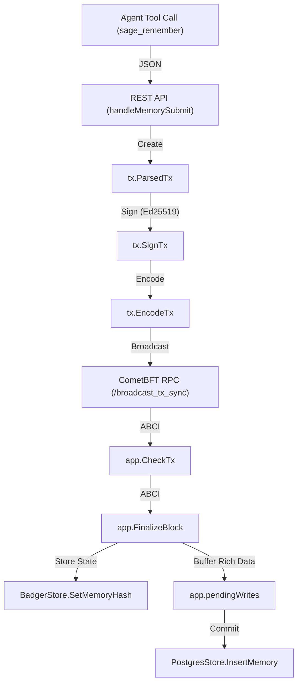
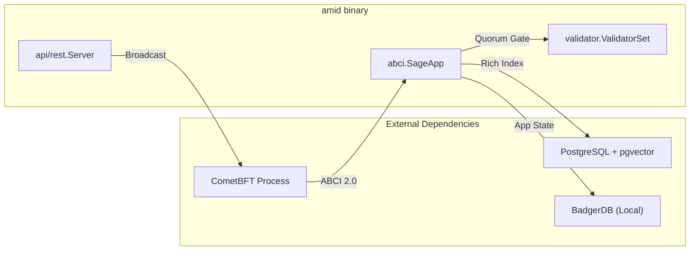

<!-- source: DeepWiki mcp.deepwiki.com · repo l33tdawg/sage · page 2.2 Consensus Engine (CometBFT & ABCI) · fetched 2026-10-26 -->

# Consensus Engine (CometBFT & ABCI)

Relevant source files

The following files were used as context for generating this wiki page:

- [.github/workflows/ci.yml](.github/workflows/ci.yml)
- [.github/workflows/release.yml](.github/workflows/release.yml)
- [LICENSE](LICENSE)
- [api/rest/agent_handler.go](api/rest/agent_handler.go)
- [cmd/amid/main.go](cmd/amid/main.go)
- [cmd/sage-cli/main.go](cmd/sage-cli/main.go)
- [cmd/sage-gui/node.go](cmd/sage-gui/node.go)
- [deploy/Dockerfile.abci](deploy/Dockerfile.abci)
- [go.mod](go.mod)
- [go.sum](go.sum)
- [internal/abci/app.go](internal/abci/app.go)
- [internal/abci/app_test.go](internal/abci/app_test.go)
- [internal/abci/migrate.go](internal/abci/migrate.go)
- [internal/embedding/ollama.go](internal/embedding/ollama.go)
- [internal/mcp/tools_test.go](internal/mcp/tools_test.go)
- [internal/store/badger.go](internal/store/badger.go)
- [internal/tx/codec.go](internal/tx/codec.go)
- [internal/tx/codec_test.go](internal/tx/codec_test.go)
- [internal/tx/types.go](internal/tx/types.go)
- [server.json](server.json)

SAGE utilizes a Byzantine Fault Tolerant (BFT) consensus engine to ensure that institutional memory remains consistent, immutable, and verifiable across multiple nodes. This is achieved by integrating a custom Application BlockChain Interface (ABCI) application with **CometBFT**.

## Overview

The consensus layer acts as the "ground truth" for the SAGE network. While individual nodes may have local copies of data, the state of the **Synaptic Ledger** (including agent identities, memory hashes, and access control lists) is governed by the consensus process [internal/abci/app.go:114-127]().

### Deployment Modes
1.  **Personal Mode (`sage-gui`)**: Runs a single-validator CometBFT instance in-process. It uses a 1-second commit timeout for high responsiveness [cmd/sage-gui/node.go:187-190]().
2.  **Multi-Node Mode (`amid`)**: Deploys a full 4-validator quorum. This mode is designed for institutional use where high availability and Byzantine fault tolerance are required [cmd/amid/main.go:1-50]().

---

## The ABCI Application (`SageApp`)

The `SageApp` struct implements the CometBFT ABCI 2.0 interface. It manages two distinct storage backends to balance consensus speed with query flexibility:

| Component | Entity | Role |
| :--- | :--- | :--- |
| **On-Chain State** | `BadgerStore` | Stores nonces, memory hashes, agent registrations, and validator power. This state is used to calculate the deterministic `AppHash` [internal/store/badger.go:15-18](). |
| **Off-Chain Store** | `OffchainStore` | A `PostgresStore` (multi-node) or `SQLiteStore` (personal) used for rich indexing, vector embeddings, and complex queries [internal/abci/app.go:115-120](). |

### Block Execution Flow

The `SageApp` processes transactions through a multi-stage lifecycle:

1.  **CheckTx**: Validates transaction syntax, signatures, and nonces before allowing them into the mempool [internal/abci/app.go:217-250]().
2.  **FinalizeBlock**: Executes a batch of transactions. State changes are applied to `BadgerStore` immediately, while writes to the `OffchainStore` are buffered in `pendingWrites` [internal/abci/app.go:252-300]().
3.  **Commit**: Flushes the `pendingWrites` to the persistent database and returns a deterministic SHA-256 `AppHash` of the BadgerDB state to CometBFT [internal/abci/app.go:302-340]().

**Sources:** [internal/abci/app.go:115-214](), [internal/store/badger.go:15-31](), [cmd/sage-gui/node.go:146-153]()

---

## Transaction Structure (`ParsedTx`)

All actions in SAGE (submitting memories, registering agents, granting access) are encapsulated in a `ParsedTx`. This structure is the primary unit of data for the consensus engine.

### Data Flow: Natural Language to On-Chain Code
The following diagram illustrates how a high-level agent action is transformed into a consensus-validated transaction.

**Transaction Encoding and Validation Flow**

**Sources:** [api/rest/agent_handler.go:69-96](), [internal/tx/types.go:1-50](), [internal/abci/app.go:252-302]()

### Transaction Types
SAGE supports 23 transaction types defined in the `tx` package. Key types include:
*   `TxTypeMemorySubmit`: Proposes a new memory record [internal/tx/types.go:15-20]().
*   `TxTypeAgentRegister`: Links an Ed25519 public key to an agent identity [internal/tx/types.go:25-30]().
*   `TxTypeAccessGrant`: Defines RBAC permissions for a domain [internal/tx/types.go:35-40]().

---

## 4-Validator Quorum Model

In multi-node deployments, SAGE defaults to a 4-validator configuration. This setup provides resilience against a single node failure (3/4 quorum required for consensus).

### Quorum Configuration
The `QuorumConfig` in `config.yaml` manages the P2P networking layer:
*   **P2PAddr**: The address where the node listens for peer connections [cmd/sage-gui/node.go:173-177]().
*   **PersistentPeers**: A list of `ID@IP:Port` strings for the other 3 nodes in the quorum [cmd/sage-gui/node.go:178]().

### Validator State Management
The `SageApp` tracks validator performance and voting power on-chain.
*   **Validator Power**: Stored in BadgerDB and reloaded on startup [internal/abci/app.go:162-174]().
*   **Height Regression Protection**: The node logic includes a safeguard to detect if the validator signing state (`priv_validator_state.json`) is ahead of the local block store, auto-resetting to prevent consensus deadlocks [cmd/sage-gui/node.go:197-210]().

**Sources:** [cmd/sage-gui/node.go:170-190](), [internal/abci/app.go:162-175]()

---

## Deployment with `amid`

The `amid` (Agent Memory Institutional Daemon) binary is the specialized version of SAGE for multi-node, server-side deployments. Unlike `sage-gui`, which focuses on a single-user experience, `amid` is optimized for:

1.  **PostgreSQL Backend**: Uses `PostgresStore` for high-concurrency memory indexing and pgvector search [internal/abci/app.go:137-141]().
2.  **Docker Orchestration**: Typically deployed via Docker Compose with dedicated containers for CometBFT and the ABCI app [deploy/Dockerfile.abci:1-20]().
3.  **Headless Operation**: Managed entirely via environment variables and the REST API.

### Integration Diagram: `amid` Component Architecture
This diagram maps the `amid` binary components to their respective code entities.

**`amid` Internal Component Mapping**

**Sources:** [cmd/amid/main.go:1-100](), [internal/abci/app.go:129-177](), [api/rest/server.go:1-50]()

---

## Key Functions

### `ComputeAppHash()`
This is the most critical function for BFT consensus. It iterates through the `BadgerStore` in deterministic, sorted key order and computes a SHA-256 hash of all on-chain state. If nodes return different hashes for the same block, the chain halts [internal/store/badger.go:176-225]().

### `CheckTx()`
Performs stateless and stateful validation:
*   Verifies the Ed25519 signature of the `ParsedTx` [internal/abci/app.go:217-230]().
*   Checks the `Nonce` against the stored value in BadgerDB to prevent replay attacks [internal/abci/app.go:235-240]().

### `FinalizeBlock()`
The primary execution engine. It iterates through the block's transactions and routes them to specific processors (e.g., `processMemorySubmit`, `processAgentRegister`) based on the `TxType` [internal/abci/app.go:252-280]().

**Sources:** [internal/store/badger.go:176-225](), [internal/abci/app.go:217-300]()

---

