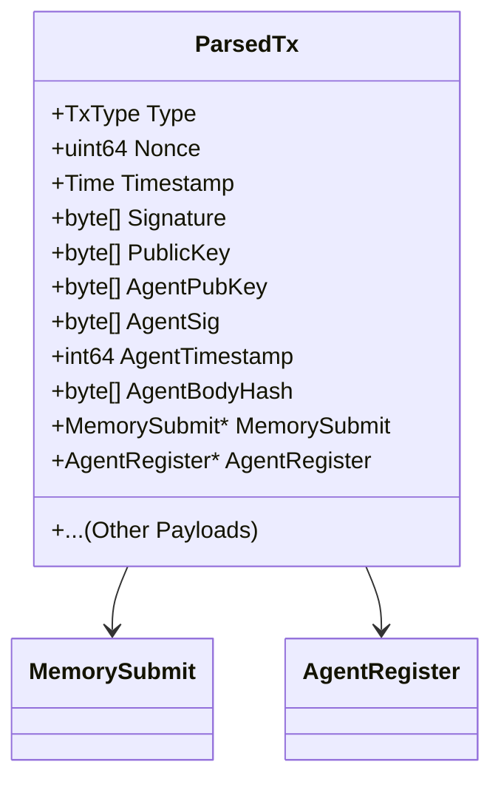
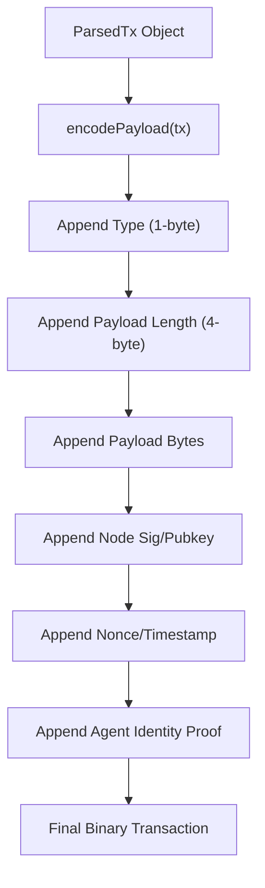
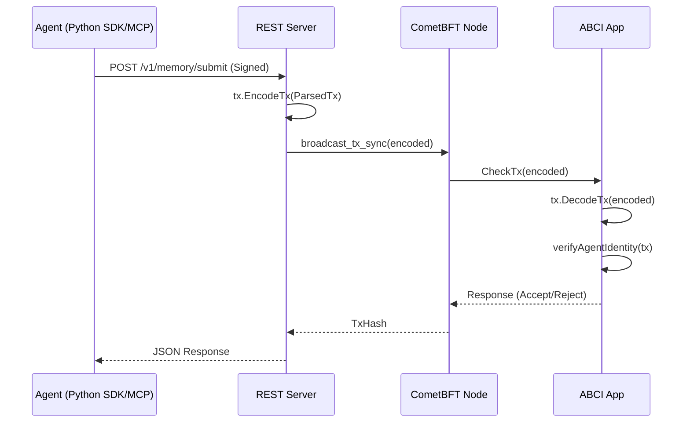

<!-- source: DeepWiki mcp.deepwiki.com · repo l33tdawg/sage · page 2.4 Transaction Types and Codec · fetched 2026-10-26 -->

# Transaction Types and Codec

Relevant source files

The following files were used as context for generating this wiki page:

- [LICENSE](LICENSE)
- [api/rest/agent_handler.go](api/rest/agent_handler.go)
- [cmd/amid/main.go](cmd/amid/main.go)
- [cmd/sage-cli/main.go](cmd/sage-cli/main.go)
- [internal/abci/app.go](internal/abci/app.go)
- [internal/abci/app_test.go](internal/abci/app_test.go)
- [internal/abci/migrate.go](internal/abci/migrate.go)
- [internal/embedding/ollama.go](internal/embedding/ollama.go)
- [internal/mcp/tools_test.go](internal/mcp/tools_test.go)
- [internal/store/badger.go](internal/store/badger.go)
- [internal/tx/codec.go](internal/tx/codec.go)
- [internal/tx/codec_test.go](internal/tx/codec_test.go)
- [internal/tx/types.go](internal/tx/types.go)
- [web/handler_test.go](web/handler_test.go)
- [web/import.go](web/import.go)
- [web/network_handler.go](web/network_handler.go)

The SAGE network utilizes a custom binary wire format for all on-chain operations. This page documents the 23 transaction types, the `ParsedTx` structure, and the deterministic encoding/decoding logic used to synchronize state across the Synaptic Ledger.

## Transaction Types (TxType)

SAGE defines a comprehensive set of transaction types covering memory lifecycles, agent identity, and organizational governance. These are defined as a byte-based enum in the `tx` package.

| Value | Type Name | Description |
|:---|:---|:---|
| `0x01` | `TxTypeMemorySubmit` | Proposes a new `MemoryRecord` to the network. |
| `0x02` | `TxTypeMemoryVote` | Validator vote (Accept/Reject) on a proposed memory. |
| `0x03` | `TxTypeMemoryChallenge` | Challenges the validity of an existing committed memory. |
| `0x04` | `TxTypeMemoryCorroborate` | Provides supporting evidence for a memory to increase confidence. |
| `0x05` | `TxTypeAccessRequest` | Agent request for access to a specific domain or clearance level. |
| `0x06` | `TxTypeAccessGrant` | Administrator approval of an access request. |
| `0x07` | `TxTypeAccessRevoke` | Removal of an agent's access rights. |
| `0x08` | `TxTypeDomainRegister` | Registration of a new knowledge domain (e.g., `security`, `finance`). |
| `0x09` | `TxTypeAgentRegister` | On-boarding a new agent identity with Ed25519 public key. |
| `0x0a` | `TxTypeAgentUpdate` | Updates to agent metadata (Name, Bio). |
| `0x0b` | `TxTypeAgentSetPermission` | Admin-level update of agent RBAC and clearance. |
| `0x0c` | `TxTypeOrgRegister` | Creation of a new Organization entity. |
| `0x0d` | `TxTypeOrgMemberAdd` | Adding an agent to an organization. |
| `0x0e` | `TxTypeOrgMemberRemove` | Removing an agent from an organization. |
| `0x0f` | `TxTypeOrgMemberClearance` | Updating a member's clearance within an organization. |
| `0x10` | `TxTypeFederationRequest` | Requesting a federation agreement between two organizations. |
| `0x11` | `TxTypeFederationApprove` | Approval of a cross-org federation. |
| `0x12` | `TxTypeFederationRevoke` | Termination of a federation agreement. |
| `0x13` | `TxTypeMemoryClassify` | Updating the classification level of a specific memory. |
| `0x14` | `TxTypeDeptRegister` | Registration of a Department within an Organization. |
| `0x15` | `TxTypeDeptMemberAdd` | Assigning an agent to a specific department. |
| `0x16` | `TxTypeDeptMemberRemove` | Removing an agent from a department. |
| `0x17` | `TxTypeMemoryReassign` | Transferring ownership of memories between agents. |

Sources: `[internal/tx/types.go:5-32]()`, `[internal/abci/app.go:26-26]()`

## The ParsedTx Structure

The `ParsedTx` struct is the primary data container for transactions. It includes the routing type, the specific payload for that type, and two layers of cryptographic proof: the Node Signature (for consensus) and the Agent Identity Proof (for provenance).

### Code Entity Space: ParsedTx

Sources: `[internal/tx/types.go:37-77]()`

## Wire Format and Codec

SAGE uses a custom length-prefixed binary format designed for determinism and efficiency. Unlike JSON, this format ensures that the same transaction data always produces the same byte array, which is critical for BFT consensus.

### Binary Layout
The `EncodeTx` function produces a byte slice with the following layout:

1.  **Type (1 byte):** The `TxType` enum value.
2.  **Payload Length (4 bytes):** Big-endian `uint32` indicating the size of the type-specific data.
3.  **Payload (Variable):** The actual transaction data (e.g., memory content, agent ID).
4.  **Node Signature (64 bytes):** Ed25519 signature from the submitting validator node.
5.  **Node Public Key (32 bytes):** Ed25519 public key of the node.
6.  **Nonce (8 bytes):** Big-endian `uint64` to prevent replay attacks.
7.  **Timestamp (8 bytes):** Unix-nano timestamp.
8.  **Agent Identity Proof (112 bytes):**
    *   Agent Public Key (32 bytes)
    *   Agent Signature (64 bytes)
    *   Agent Timestamp (8 bytes)
    *   Agent Body Hash (8 bytes)

Sources: `[internal/tx/codec.go:13-14]()`, `[internal/tx/codec.go:53-72]()`

### Encoding Logic
The `EncodeTx` function handles the serialization of the `ParsedTx` into the wire format. It first calls `encodePayload` to handle the type-specific data before appending the standard headers and signatures.

Sources: `[internal/tx/codec.go:24-72]()`

## Agent Identity Proofs

Every transaction includes an embedded proof that the originating agent authorized the action. This is distinct from the CometBFT node signature.

### Proof Generation
When an agent submits a request via the REST API or MCP, the `embedAgentAuth` or `embedDashboardAgentProof` functions are used to populate the `AgentPubKey`, `AgentSig`, `AgentBodyHash`, and `AgentTimestamp` fields.

1.  **Body Hash:** A SHA-256 hash of the transaction's core content (e.g., for `AgentRegister`, this is `name + role + bio`).
2.  **Signing Message:** The concatenation of the `BodyHash` and the `AgentTimestamp`.
3.  **Signature:** An Ed25519 signature over the signing message using the Agent's private key.

### Proof Verification
The ABCI application verifies these proofs in `verifyAgentIdentity` before processing any state change. It ensures that:
1.  The `AgentPubKey` matches the `AgentID` in the transaction.
2.  The signature is valid for the provided `AgentBodyHash` and `AgentTimestamp`.
3.  The `AgentBodyHash` matches a fresh hash of the received transaction payload.

Sources: `[web/network_handler.go:185-185]()`, `[api/rest/agent_handler.go:83-83]()`, `[internal/abci/app_test.go:69-78]()`

## Implementation Details

### Key Functions
*   `EncodeTx(tx *ParsedTx) ([]byte, error)`: Serializes a transaction. `[internal/tx/codec.go:24-72]()`
*   `DecodeTx(data []byte) (*ParsedTx, error)`: Deserializes a transaction, supporting both legacy and full formats. `[internal/tx/codec.go:75-142]()`
*   `SignTx(tx *ParsedTx, privateKey ed25519.PrivateKey)`: Computes the Node Signature. `[internal/tx/codec.go:146-155]()`
*   `VerifyTx(tx *ParsedTx)`: Validates the Node Signature. `[internal/tx/codec.go:158-170]()`

### Error Handling
The codec defines specific errors for validation failures:
*   `ErrInvalidTxData`: Data is too short or malformed.
*   `ErrUnknownTxType`: The type byte does not match a known `TxType`.
*   `ErrSignatureLength`: The Ed25519 signature is not 64 bytes.
*   `ErrPublicKeyLength`: The Ed25519 public key is not 32 bytes.

Sources: `[internal/tx/codec.go:16-21]()`

### Data Flow: Transaction Broadcasting

Sources: `[api/rest/agent_handler.go:69-116]()`, `[internal/abci/app.go:240-270]()`

---

