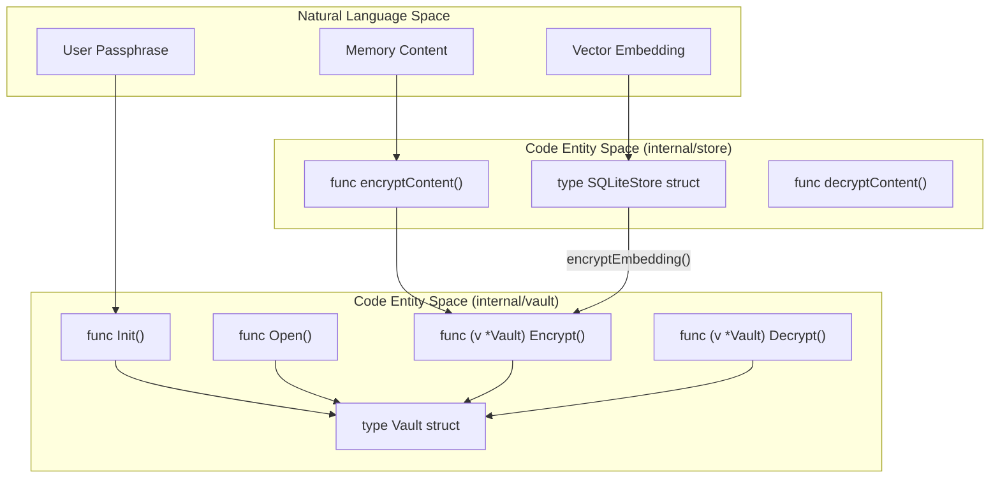
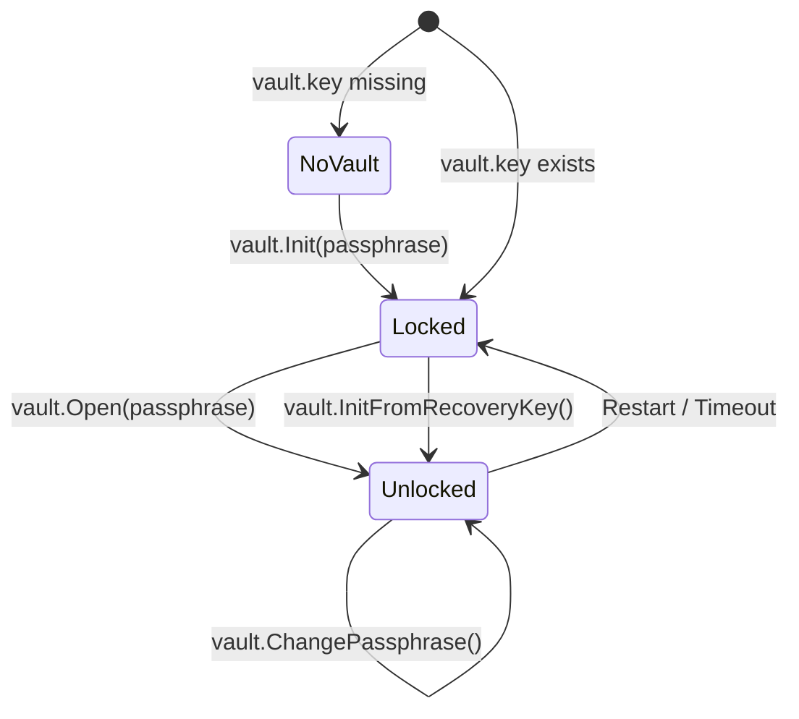

<!-- source: DeepWiki mcp.deepwiki.com · repo l33tdawg/sage · page 3.3 Synaptic Ledger (Vault Encryption) · fetched 2026-10-26 -->

# Synaptic Ledger (Vault Encryption)

Relevant source files

The following files were used as context for generating this wiki page:

- [internal/store/postgres.go](internal/store/postgres.go)
- [internal/store/sqlite.go](internal/store/sqlite.go)
- [internal/store/store.go](internal/store/store.go)
- [internal/vault/vault.go](internal/vault/vault.go)
- [internal/vault/vault_test.go](internal/vault/vault_test.go)
- [web/handler_ledger.go](web/handler_ledger.go)
- [web/handler_ledger_test.go](web/handler_ledger_test.go)

The Synaptic Ledger provides at-rest encryption for SAGE memories using the **AES-256-GCM** algorithm. It ensures that sensitive memory content and vector embeddings are unreadable if the underlying storage (SQLite or PostgreSQL) is compromised or uploaded to cloud providers. The system uses a **Vault** architecture where a randomly generated data key is protected by a user-defined passphrase via the **Argon2id** key derivation function.

## Vault Architecture and Key Derivation

The encryption system is decoupled: the passphrase does not encrypt the memories directly. Instead, it encrypts a `dataKey`. This design allows users to change their passphrase or recover access via a recovery key without re-encrypting the entire database.

### Key Derivation Flow (Argon2id)

When a vault is initialized, SAGE derives a "wrapping key" from the user's passphrase. This wrapping key is used to encrypt the master `dataKey`, which is then stored in the `vault.key` file.

**Argon2id Parameters:**
*   **Time:** 3 iterations [internal/vault/vault.go:25]()
*   **Memory:** 64 MB [internal/vault/vault.go:26]()
*   **Threads:** 4 [internal/vault/vault.go:27]()
*   **Key Length:** 32 bytes (AES-256) [internal/vault/vault.go:28]()

### The `vault.key` Format

The `vault.key` file is a JSON-encoded structure stored with `0600` (owner-only) permissions [internal/vault/vault.go:115]().

| Field | Description |
| :--- | :--- |
| `salt` | 16-byte random salt for Argon2id [internal/vault/vault.go:41]() |
| `encrypted_key` | The master `dataKey` encrypted with the wrapping key [internal/vault/vault.go:42]() |
| `nonce` | 12-byte GCM nonce used for the `encrypted_key` [internal/vault/vault.go:43]() |
| `verify_hash` | SHA-256 hash of the decrypted `dataKey` for fast passphrase validation [internal/vault/vault.go:44]() |

**Sources:** [internal/vault/vault.go:24-52](), [internal/vault/vault.go:103-116]()

---

## Data Flow: Code to Entity Mapping

The following diagram maps the logical encryption operations to the specific Go functions and structures that implement them.

### Encryption Implementation Mapping

**Sources:** [internal/vault/vault.go:49-52](), [internal/vault/vault.go:63-116](), [internal/store/sqlite.go:34-41](), [internal/store/sqlite.go:61-73]()

---

## Content and Embedding Encryption

SAGE encrypts two primary data types: the `content` string (the actual text of the memory) and the `embedding` (the high-dimensional vector).

### Content Encryption
Encrypted content is stored in the database as a string with a specific prefix: `enc::<base64_ciphertext>`. 
*   **Encryption:** The `SQLiteStore.encryptContent` function checks if a vault is attached. If so, it calls `vault.EncryptString` and prepends the prefix [internal/store/sqlite.go:61-73]().
*   **Decryption:** The `SQLiteStore.decryptContent` function looks for the `enc::` prefix. If the vault is locked, it returns a placeholder `[encrypted — vault locked]` [internal/store/sqlite.go:77-83]().

### Embedding Encryption
Embeddings are stored as raw binary blobs (`BLOB`).
*   **Encryption:** `encryptEmbedding` converts the float vector to bytes and encrypts it using the vault [internal/store/sqlite.go:102-110]().
*   **Decryption:** `decryptEmbedding` attempts decryption. If it fails (e.g., legacy unencrypted data), it returns the data as-is for backward compatibility [internal/store/sqlite.go:114-124]().

**Sources:** [internal/store/sqlite.go:44-124]()

---

## State Machine: Locked vs. Unlocked

The system operates in a state machine managed by the `DashboardHandler` and the `Vault` struct.

### Vault State Transitions

### State Behavior
1.  **Locked:** The `Vault` pointer in `SQLiteStore` is `nil`. If `vaultExpected` is true, all writes to the memory store will fail with an error to prevent accidental plaintext leaks [internal/store/sqlite.go:62-65]().
2.  **Unlocked:** The `Vault` holds the `dataKey` in memory [internal/vault/vault.go:51](). `SQLiteStore` uses this key to transparently encrypt/decrypt during CRUD operations.

**Sources:** [internal/store/sqlite.go:48-67](), [web/handler_ledger.go:17-36](), [internal/vault/vault.go:47-52]()

---

## Passphrase Management and Recovery

### Passphrase Change
Because SAGE uses a wrapped-key architecture, the user can change their passphrase without re-encrypting all memories. The `vault.ChangePassphrase` function:
1.  Opens the vault with the old passphrase to retrieve the `dataKey`.
2.  Generates a new `salt` and `nonce`.
3.  Re-wraps the existing `dataKey` with a new wrapping key derived from the new passphrase [internal/vault/vault.go:218-240]().

### Recovery Key Mechanism
During initialization or passphrase change, the system provides a **Recovery Key**. This is the raw `dataKey` encoded in Base64 [web/handler_ledger.go:101-104]().
*   If the passphrase is lost, `vault.InitFromRecoveryKey` can be used to create a new `vault.key` file using the recovery key and a new passphrase [internal/vault/vault.go:244-275]().
*   The `DashboardHandler` creates a `.bak` of the existing key file before performing a recovery for safety [web/handler_ledger.go:195-200]().

**Sources:** [internal/vault/vault.go:218-275](), [web/handler_ledger.go:117-161](), [web/handler_ledger.go:165-204]()

---

