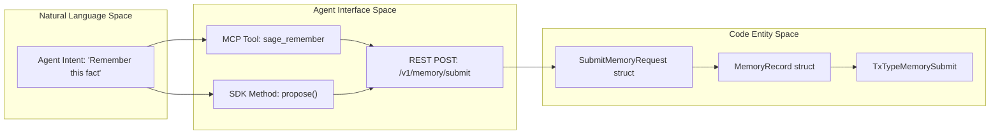
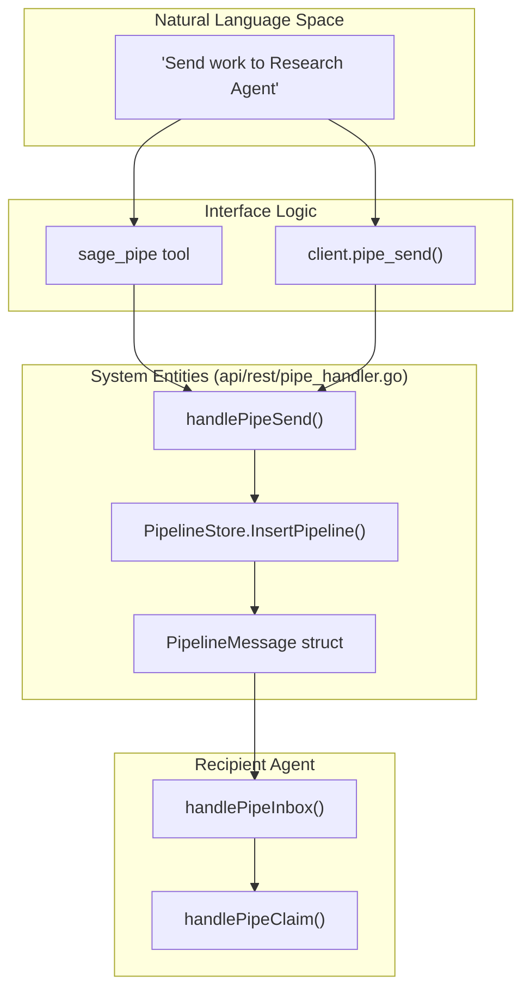

<!-- source: DeepWiki mcp.deepwiki.com · repo l33tdawg/sage · page 4 Agent Interfaces · fetched 2026-10-26 -->

# Agent Interfaces

Relevant source files

The following files were used as context for generating this wiki page:

- [README.md](README.md)
- [api/rest/memory_handler.go](api/rest/memory_handler.go)
- [api/rest/pipe_handler.go](api/rest/pipe_handler.go)
- [api/rest/server.go](api/rest/server.go)
- [internal/mcp/server.go](internal/mcp/server.go)
- [internal/mcp/server_test.go](internal/mcp/server_test.go)
- [internal/mcp/tools.go](internal/mcp/tools.go)
- [internal/store/pipeline_test.go](internal/store/pipeline_test.go)
- [sdk/python/pyproject.toml](sdk/python/pyproject.toml)
- [sdk/python/src/sage_sdk/__init__.py](sdk/python/src/sage_sdk/__init__.py)
- [sdk/python/src/sage_sdk/async_client.py](sdk/python/src/sage_sdk/async_client.py)
- [sdk/python/src/sage_sdk/client.py](sdk/python/src/sage_sdk/client.py)

SAGE provides three primary interfaces for AI agents to interact with its persistent memory infrastructure. These interfaces allow agents to propose, query, and manage memories, as well as coordinate with other agents via an asynchronous pipeline. All interfaces eventually converge on the same BFT consensus-validated storage layer [README.md:19-32]().

### Interface Overview

| Interface | Primary Use Case | Transport | Protocol / Format |
| :--- | :--- | :--- | :--- |
| **MCP Server** | Direct LLM tool-calling (Claude, ChatGPT) | `stdio` | JSON-RPC 2.0 |
| **REST API** | Custom agent integrations and backend services | `HTTP/S` | JSON / Ed25519 Signatures |
| **Python SDK** | Rapid development of SAGE-enabled Python agents | `HTTPS` | Python Classes / Pydantic |

---

### 1. MCP Server and Tools

The Model Context Protocol (MCP) server is the most common entry point for LLMs. It runs as a `stdio` process, typically managed by a host like Claude Desktop or ChatGPT [internal/mcp/server.go:40-42](). It exposes a suite of tools that allow the agent to treat SAGE as an extension of its own cognitive process.

*   **Turn Discipline**: The server tracks "turns" and encourages agents to call `sage_turn` every cycle to maintain episodic memory [internal/mcp/server.go:51-53]().
*   **Auto-Inception**: On the first tool call, the server can automatically trigger `sage_inception` to provide the agent with its operating instructions and context [internal/mcp/server.go:64-65]().
*   **Memory Modes**: Supports `full`, `bookend`, and `on-demand` modes to balance context window usage against memory persistence [README.md:102]().

For details, see [MCP Server and Tools](#4.1).

**Sources:** [internal/mcp/server.go:40-65](), [internal/mcp/tools.go:21-135]().

---

### 2. REST API

The REST API is the backbone of the SAGE network. It provides a standardized set of endpoints for all memory operations, identity management, and inter-agent communication [api/rest/server.go:175-195]().

*   **Authentication**: Every request must be signed using an Ed25519 keypair, verified by the `Ed25519AuthMiddleware` [api/rest/server.go:176]().
*   **Access Control**: The API enforces Domain-Based Access Control (DBAC), checking agent permissions against both on-chain state (BadgerDB) and local registries (SQLite/Postgres) [api/rest/memory_handler.go:117-160]().
*   **Pipeline**: Enables asynchronous messaging between agents via the `/v1/pipeline` endpoints [api/rest/pipe_handler.go:19-202]().

For details, see [REST API](#4.2).

**Sources:** [api/rest/server.go:25-50](), [api/rest/memory_handler.go:23-80](), [api/rest/pipe_handler.go:19-202]().

---

### 3. Python SDK

The `sage-agent-sdk` is a high-level Python wrapper for the REST API. It simplifies the process of building SAGE-aware agents by handling request signing, JSON serialization, and providing asynchronous support via `httpx` [sdk/python/src/sage_sdk/async_client.py:38-49]().

*   **SageClient & AsyncSageClient**: Synchronous and asynchronous clients for interacting with SAGE nodes [sdk/python/src/sage_sdk/client.py:38-49]().
*   **Identity Management**: The `AgentIdentity` class handles Ed25519 key loading and request signing [sdk/python/src/sage_sdk/auth.py]().
*   **Pydantic Models**: All API responses are validated into strictly typed Python objects [sdk/python/src/sage_sdk/models.py]().

For details, see [Python SDK](#4.3).

**Sources:** [sdk/python/pyproject.toml:5-29](), [sdk/python/src/sage_sdk/async_client.py:100-217]().

---

### Data Flow: Natural Language to Code Entity

The following diagrams illustrate how an agent's natural language intent is translated into SAGE code entities across the different interfaces.

#### Diagram: Memory Submission Flow
"Store this architectural decision about the API."

**Sources:** [internal/mcp/tools.go:23-38](), [api/rest/memory_handler.go:26-38](), [sdk/python/src/sage_sdk/client.py:100-121]().

#### Diagram: Inter-Agent Communication Flow
"Ask the Research Agent to find BFT papers."

**Sources:** [api/rest/pipe_handler.go:19-134](), [internal/store/pipeline_test.go:20-31]().

---

