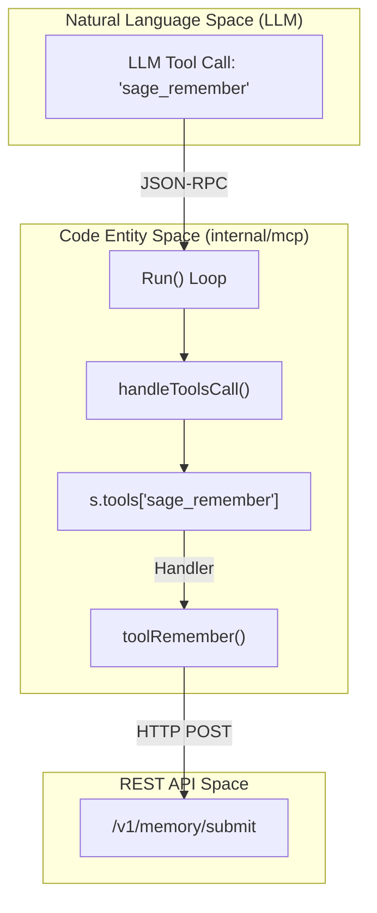
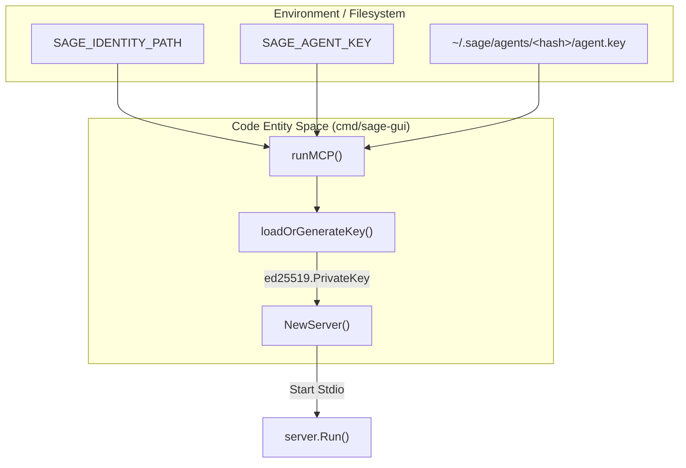

<!-- source: DeepWiki mcp.deepwiki.com · repo l33tdawg/sage · page 4.1 MCP Server and Tools · fetched 2026-10-26 -->

# MCP Server and Tools

Relevant source files

The following files were used as context for generating this wiki page:

- [LICENSE](LICENSE)
- [cmd/amid/main.go](cmd/amid/main.go)
- [cmd/sage-cli/main.go](cmd/sage-cli/main.go)
- [cmd/sage-gui/config.go](cmd/sage-gui/config.go)
- [cmd/sage-gui/mcp.go](cmd/sage-gui/mcp.go)
- [cmd/sage-gui/mcp_test.go](cmd/sage-gui/mcp_test.go)
- [extension/chrome/manifest.json](extension/chrome/manifest.json)
- [extension/manifest.firefox.json](extension/manifest.firefox.json)
- [extension/store-listing.md](extension/store-listing.md)
- [internal/embedding/ollama.go](internal/embedding/ollama.go)
- [internal/mcp/server.go](internal/mcp/server.go)
- [internal/mcp/tools.go](internal/mcp/tools.go)
- [internal/mcp/tools_test.go](internal/mcp/tools_test.go)
- [internal/tx/codec.go](internal/tx/codec.go)
- [internal/tx/codec_test.go](internal/tx/codec_test.go)
- [internal/tx/types.go](internal/tx/types.go)
- [web/handler_memorymode_test.go](web/handler_memorymode_test.go)

The SAGE MCP (Model Context Protocol) server is the primary interface through which Large Language Models (LLMs) interact with the SAGE memory layer. It implements a **stdio-based JSON-RPC 2.0** server that exposes a suite of specialized tools for memory persistence, retrieval, and session management.

## JSON-RPC 2.0 Implementation

The server operates over standard input/output (stdio), allowing it to be easily integrated as an MCP server in clients like Claude Desktop or ChatGPT. It handles standard MCP lifecycle methods including `initialize`, `tools/list`, and `tools/call` [internal/mcp/server.go:120-135]().

### Core Request/Response Loop
The server utilizes a `bufio.Scanner` with a 1MB buffer to process incoming JSON-RPC requests [internal/mcp/server.go:96-117](). Each request is unmarshaled into a `jsonRPCRequest` struct [internal/mcp/server.go:20-25]() and dispatched to the appropriate handler.

### Data Flow: Tool Call to REST API
When an agent calls a SAGE tool, the MCP server acts as a proxy, signing the request with the agent's Ed25519 key and forwarding it to the SAGE REST API.

| Step | Component | Action |
| :--- | :--- | :--- |
| 1 | LLM | Issues `tools/call` via stdio |
| 2 | `mcp.Server` | Validates parameters and checks "Turn Discipline" [internal/mcp/server.go:189-210]() |
| 3 | `mcp.Server` | Signs request using `agentKey` (Ed25519) [internal/mcp/server.go:134]() |
| 4 | REST API | Receives signed request, validates identity, and processes memory [api/rest/server.go:193]() |
| 5 | `mcp.Server` | Returns JSON-RPC result to LLM [internal/mcp/server.go:113]() |

**Sources:** [internal/mcp/server.go:20-117](), [internal/mcp/server.go:189-210]()

---

## SAGE Tools Reference

The server registers a comprehensive set of tools defined in `internal/mcp/tools.go`.

### 1. Consciousness & Session Tools
*   **`sage_inception` (Alias: `sage_red_pill`)**: Initializes the agent's persistent consciousness. It seeds foundational memories and returns operating instructions [internal/mcp/tools.go:105-127]().
*   **`sage_turn`**: The atomic "heartbeat" of SAGE. It should be called every turn to recall relevant memories and store an observation of the current turn [internal/mcp/tools.go:128-135]().
*   **`sage_reflect`**: Used after significant tasks to store "dos and don'ts" (learnings) to improve future performance [internal/mcp/tools.go:25]().

### 2. Memory Management Tools
*   **`sage_remember`**: Stores facts (durable, confidence 0.95+) or observations (ephemeral context). Facts survive confidence decay [internal/mcp/tools.go:23-38]().
*   **`sage_recall`**: Semantic search across memories using natural language queries [internal/mcp/tools.go:39-53]().
*   **`sage_forget`**: Deprecates a memory by ID when it is no longer accurate [internal/mcp/tools.go:54-66]().
*   **`sage_list`**: Browse memories with filters for domain, tag, or status [internal/mcp/tools.go:67-82]().

### 3. Pipeline & Task Tools
*   **`sage_task`**: Lists pending tasks and actionable items [internal/mcp/tools_test.go:98-113]().
*   **`sage_pipe` / `sage_inbox` / `sage_pipe_result`**: Facilitates inter-agent communication and asynchronous message passing.

**Sources:** [internal/mcp/tools.go:22-135](), [internal/mcp/tools_test.go:98-113]()

---

## Turn Discipline and Auto-Inception

The MCP server enforces specific agent behaviors to ensure memory integrity and consistency.

### Turn Discipline Enforcement
The server tracks the number of tool calls made since the last `sage_turn`. If an agent makes multiple calls without updating its episodic memory via `sage_turn`, the server can issue nudges [internal/mcp/server.go:51-53]().

### Auto-Inception
To ensure a seamless onboarding experience, the server features **Auto-Inception**. On the very first tool call of a session, the server checks if the agent's brain is empty. If so, it automatically triggers the inception sequence before processing the requested tool [internal/mcp/server.go:211-215]().

### Memory Mode Configuration
The server behavior adapts based on the `memory_mode` file located in `SAGE_HOME` [cmd/sage-gui/mcp.go:29]().
*   **`full`**: Standard behavior; `sage_turn` is expected every turn.
*   **`bookend`**: Agents are instructed to only call `sage_reflect` at the end of a conversation [cmd/sage-gui/mcp.go:36-38]().
*   **`on-demand`**: No automatic reminders; the user triggers SAGE manually [cmd/sage-gui/mcp.go:31-33]().

**Sources:** [internal/mcp/server.go:51-65](), [cmd/sage-gui/mcp.go:25-58](), [web/handler_memorymode_test.go:128-152]()

---

## Technical Architecture Diagrams

### Diagram 1: MCP Tool Dispatch Logic
This diagram bridges the natural language request from the LLM to the Go function handlers.

**Sources:** [internal/mcp/server.go:95-117](), [internal/mcp/server.go:189-209](), [internal/mcp/tools.go:37]()

### Diagram 2: Identity Resolution and Server Initialization
How the MCP server resolves its cryptographic identity before starting the JSON-RPC loop.

**Sources:** [cmd/sage-gui/mcp.go:60-140](), [internal/mcp/server.go:71-86]()

---

## Configuration and Deployment

The MCP server is typically launched via the `sage-gui mcp` command.

### Identity Resolution Priority
The server resolves the agent's Ed25519 identity in the following order:
1.  `SAGE_IDENTITY_PATH` environment variable.
2.  `SAGE_AGENT_KEY` environment variable.
3.  Per-project key in `~/.sage/agents/<project-name>-<hash>/agent.key`.
4.  Default global key in `~/.sage/agent.key`.

[cmd/sage-gui/mcp.go:84-114]()

### Self-Healing Integration
On every startup, the MCP server performs a "self-heal" of the local project directory. This includes:
*   Patching `CLAUDE.md` with the latest SAGE instructions [cmd/sage-gui/mcp_test.go:13-26]().
*   Updating hook scripts in `.claude/hooks/` to ensure they support the current `memory_mode` [cmd/sage-gui/mcp_test.go:137-154]().

**Sources:** [cmd/sage-gui/mcp.go:84-114](), [cmd/sage-gui/mcp_test.go:137-154](), [cmd/sage-gui/config.go:83-120]()

---

