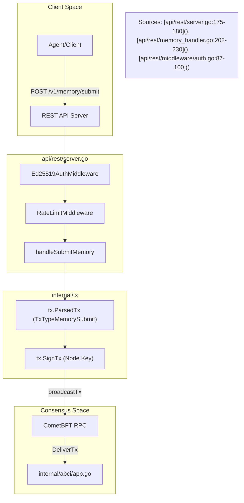

<!-- source: DeepWiki mcp.deepwiki.com · repo l33tdawg/sage · page 4.2 REST API · fetched 2026-10-26 -->

# REST API

<details>
<summary>Relevant source files</summary>

The following files were used as context for generating this wiki page:

- [CONTRIBUTING.md](CONTRIBUTING.md)
- [api/openapi.yaml](api/openapi.yaml)
- [api/rest/access_handler.go](api/rest/access_handler.go)
- [api/rest/dept_handler.go](api/rest/dept_handler.go)
- [api/rest/memory_handler.go](api/rest/memory_handler.go)
- [api/rest/middleware/auth.go](api/rest/middleware/auth.go)
- [api/rest/middleware/middleware_test.go](api/rest/middleware/middleware_test.go)
- [api/rest/middleware/ratelimit.go](api/rest/middleware/ratelimit.go)
- [api/rest/org_handler.go](api/rest/org_handler.go)
- [api/rest/server.go](api/rest/server.go)
- [api/rest/vote_handler.go](api/rest/vote_handler.go)
- [cmd/sage-gui/node_controller.go](cmd/sage-gui/node_controller.go)
- [cmd/sage-gui/quorum.go](cmd/sage-gui/quorum.go)
- [cmd/sage-gui/seed.go](cmd/sage-gui/seed.go)
- [internal/auth/ed25519.go](internal/auth/ed25519.go)
- [internal/auth/ed25519_test.go](internal/auth/ed25519_test.go)
- [internal/mcp/server_test.go](internal/mcp/server_test.go)
- [sdk/python/examples/async_example.py](sdk/python/examples/async_example.py)
- [sdk/python/examples/full_lifecycle.py](sdk/python/examples/full_lifecycle.py)
- [sdk/python/examples/multi_agent.py](sdk/python/examples/multi_agent.py)
- [sdk/python/examples/quickstart.py](sdk/python/examples/quickstart.py)
- [test/integration/helpers_test.go](test/integration/helpers_test.go)

</details>


The SAGE REST API server, implemented in `api/rest/server.go`, serves as the primary interface for agents, the CEREBRUM dashboard, and external tools to interact with the SAGE ecosystem [api/rest/server.go:25-50](). It handles memory submission, querying, agent registration, and governance actions (voting/challenging) by translating HTTP requests into signed CometBFT transactions or local database queries [api/rest/memory_handler.go:178-200]().

## Server Architecture

The `Server` struct encapsulates the dependencies required for the API's operation, including storage backends, the embedding provider, and the CometBFT RPC client [api/rest/server.go:31-50]().

### Key Components
*   **Router**: Built using `go-chi`, managing middleware and endpoint routing [api/rest/server.go:148-170]().
*   **Storage Interfaces**: The server uses `MemoryStore`, `AgentStore`, `OrgStore`, and `AccessStore` to interact with both the off-chain SQLite/PostgreSQL data and the on-chain BadgerDB state [api/rest/server.go:34-39]().
*   **Validator Signing Key**: The server loads the CometBFT validator private key from the `VALIDATOR_KEY_FILE` path. This allows the API to sign vote transactions using the node's official validator identity, ensuring they are recognized by the consensus quorum [api/rest/server.go:104-145]().
*   **Embedding Provider**: Used to generate vectors for incoming memory content during submission or to process text-to-vector conversions for queries [api/rest/server.go:44]().

### Data Flow: REST to Consensus
The following diagram illustrates how a memory submission flows from a REST client through the API server into the consensus layer.

**Memory Submission Flow**


## Authentication and Security

All non-public endpoints are protected by `Ed25519AuthMiddleware` [api/rest/middleware/auth.go:87](). SAGE uses a header-based signature scheme rather than bearer tokens.

### Ed25519 Signature Scheme
Clients must provide three headers [api/rest/middleware/auth.go:80-86]():
1.  `X-Agent-ID`: The hex-encoded Ed25519 public key of the agent.
2.  `X-Signature`: A hex-encoded signature of the request.
3.  `X-Timestamp`: Unix epoch seconds (must be within a 5-minute window to prevent long-term replays) [api/rest/middleware/auth.go:78]().

The signature is calculated over a canonical message: `SHA-256(method + " " + path + "\n" + body) + timestamp` [internal/auth/ed25519.go:63-77](). This format binds the signature to a specific endpoint and body, preventing cross-endpoint replay attacks [internal/auth/ed25519.go:49-51]().

### Replay Protection
The `replayCache` tracks `(agentID + signature)` pairs within the timestamp validity window to prevent immediate request duplication [api/rest/middleware/auth.go:19-30]().

### Rate Limiting
The `RateLimitMiddleware` enforces a limit of 10,000 requests per minute per `X-Agent-ID` [api/rest/middleware/ratelimit.go:10-20](). If no ID is present (for public endpoints), it falls back to the client's remote IP address [api/rest/middleware/ratelimit.go:21-23]().

## Endpoint Categories

### Memory Management
*   `POST /v1/memory/submit`: Proposes a new memory. The server creates a `TxTypeMemorySubmit` transaction and broadcasts it to the network [api/rest/memory_handler.go:202-215]().
*   `POST /v1/memory/query`: Performs semantic search using the provided embedding and filters by `domain_tag` or `min_confidence` [api/rest/memory_handler.go:47-56]().
*   `GET /v1/memory/{memory_id}`: Retrieves full details of a memory, including its current status, votes, and corroborations [api/rest/memory_handler.go:82-100]().

### Governance and Validation
*   `POST /v1/memory/{memory_id}/vote`: Casts an `accept`, `reject`, or `abstain` vote. The server signs this with the node's validator key to ensure it counts toward the 3/4 quorum [api/rest/vote_handler.go:76-152]().
*   `POST /v1/memory/{memory_id}/challenge`: Submits a challenge against a memory with a reason and evidence [api/rest/vote_handler.go:154-228]().
*   `POST /v1/memory/{memory_id}/corroborate`: Submits supporting evidence for an existing memory [api/rest/vote_handler.go:230-250]().

### Agent and Organization
*   `GET /v1/agents`: Lists all registered agents from the on-chain registry [api/rest/server.go:172]().
*   `POST /v1/org/create`: (Authenticated) Registers a new organization on-chain [api/rest/org_handler.go]().
*   `POST /v1/access/grant`: Grants an agent specific read/write permissions for a domain [api/rest/access_handler.go]().

## Domain Access Control

The API enforces Role-Based Access Control (RBAC) through `checkDomainAccess` [api/rest/memory_handler.go:121]().

1.  **On-Chain Check**: If `BadgerStore` is available, the server checks the agent's registered role and `DomainAccess` JSON string stored on-chain [api/rest/memory_handler.go:127-140]().
2.  **Role Privileges**:
    *   **Admins**: Bypass all domain checks [api/rest/memory_handler.go:131-133]().
    *   **Observers**: Can read but are blocked from `write` actions (submitting memories) [api/rest/memory_handler.go:134-136]().
3.  **Fallback**: If the agent is not found in the on-chain registry, the system falls back to the local SQLite agent store for backwards compatibility [api/rest/memory_handler.go:163-172]().

**Identity and Access Code Map**
```mermaid
classDiagram
    class Server {
        +AgentStore agentStore
        +BadgerStore badgerStore
        +signingKey ed25519.PrivateKey
    }
    class Ed25519AuthMiddleware {
        +VerifyRequest()
        +ContextAgentID()
    }
    class MemoryHandler {
        +handleSubmitMemory()
        +checkDomainAccess()
    }
    class VoteHandler {
        +handleVoteMemory()
        +embedAgentAuth()
    }

    Server --> Ed25519AuthMiddleware : uses
    Ed25519AuthMiddleware ..> MemoryHandler : injects agent_id
    MemoryHandler --> Server : queries stores
    VoteHandler --> Server : uses signingKey

    Sources["Sources: [api/rest/server.go:31-50](), [api/rest/middleware/auth.go:87-100](), [api/rest/memory_handler.go:121-160]()"]
```

## Request and Response Types

The API uses standard JSON for request bodies and follows RFC 7807 (Problem Details for HTTP APIs) for error responses via the `writeProblem` helper [api/rest/middleware/auth.go:100-103]().

| Type | Struct Name | Description |
| :--- | :--- | :--- |
| Request | `SubmitMemoryRequest` | Content, type, domain, and optional triples/embeddings [api/rest/memory_handler.go:26-38](). |
| Request | `QueryMemoryRequest` | Vector and filters for semantic search [api/rest/memory_handler.go:48-56](). |
| Response | `SubmitMemoryResponse` | Returns `memory_id` and the CometBFT `tx_hash` [api/rest/memory_handler.go:41-45](). |
| Response | `MemoryResult` | Summary of a memory including computed confidence and status [api/rest/memory_handler.go:66-80](). |

Sources:
- `api/rest/server.go`
- `api/rest/memory_handler.go`
- `api/rest/vote_handler.go`
- `api/rest/middleware/auth.go`
- `api/rest/middleware/ratelimit.go`
- `internal/auth/ed25519.go`
- `internal/tx/codec.go`

---

