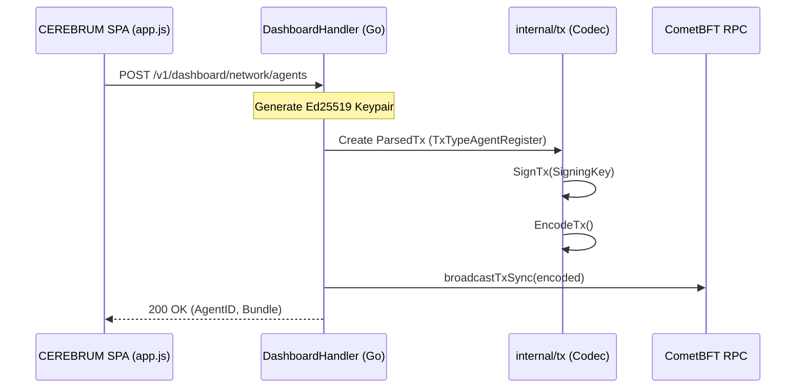

<!-- source: DeepWiki mcp.deepwiki.com · repo l33tdawg/sage · page 5 CEREBRUM Dashboard · fetched 2026-10-26 -->

# CEREBRUM Dashboard

<details>
<summary>Relevant source files</summary>

The following files were used as context for generating this wiki page:

- [web/handler.go](web/handler.go)
- [web/handler_test.go](web/handler_test.go)
- [web/import.go](web/import.go)
- [web/network_handler.go](web/network_handler.go)
- [web/static/css/sage.css](web/static/css/sage.css)
- [web/static/js/api.js](web/static/js/api.js)
- [web/static/js/app.js](web/static/js/app.js)

</details>


The **CEREBRUM Dashboard** is the primary management interface for the SAGE ecosystem. It provides a web-based UI for visualizing the memory graph, managing autonomous agents, monitoring the Synaptic Ledger, and orchestrating system-wide tasks. It serves as the bridge between the underlying cryptographic state (CometBFT/ABCI) and the human operator.

The dashboard is served by the `DashboardHandler` [web/handler.go:49-91](), which integrates the local memory store, the preference store, and the real-time Server-Sent Events (SSE) broadcaster.

### System Overview

The dashboard architecture consists of a Go-based backend handler and a Preact-based Single Page Application (SPA).

| Component | Role | Primary Files |
| :--- | :--- | :--- |
| **Backend Handler** | REST API, SSE broadcasting, RBAC enforcement, and transaction signing. | `web/handler.go`, `web/network_handler.go` |
| **Frontend SPA** | Force-directed graph visualization, agent management, and import wizard. | `web/static/js/app.js`, `web/static/js/api.js` |
| **Import Engine** | Multi-format parser for ChatGPT, Claude, and Markdown history. | `web/import.go` |

### Code-to-System Mapping

The following diagram illustrates how high-level dashboard features map to specific backend structures and frontend components.

**Dashboard Architecture Mapping**
```mermaid
graph TD
    subgraph "Natural Language Space (UI Concepts)"
        "BrainView"["Brain Visualization"]
        "AgentMgr"["Agent Management"]
        "LedgerUI"["Security/Vault UI"]
        "Importer"["Memory Import"]
    end

    subgraph "Code Entity Space (Implementation)"
        "DashboardHandler"["DashboardHandler (Go)"]
        "SSEBroadcaster"["SSEBroadcaster (Real-time)"]
        "JS_App"["app.js (Preact SPA)"]
        "JS_API"["api.js (Fetch Client)"]
        "MemStore"["MemoryStore (SQLite/Postgres)"]
        "Vault"["Vault (Encryption)"]
    end

    "BrainView" -.-> "JS_App"
    "JS_App" -- "fetchGraph()" --> "JS_API"
    "JS_API" -- "GET /v1/dashboard/memory/graph" --> "DashboardHandler"
    "DashboardHandler" --> "MemStore"

    "AgentMgr" -.-> "JS_App"
    "JS_App" -- "fetchAgents()" --> "JS_API"
    "JS_API" -- "GET /v1/dashboard/network/agents" --> "DashboardHandler"
    "DashboardHandler" -- "Broadcast Tx" --> "CometBFT"

    "Importer" -.-> "JS_App"
    "JS_App" -- "importPreview()" --> "JS_API"
    "JS_API" -- "POST /v1/dashboard/import/preview" --> "DashboardHandler"
    "DashboardHandler" --> "pendingImports"
end
```
Sources: [web/handler.go:49-91](), [web/static/js/app.js:1-114](), [web/static/js/api.js:1-68](), [web/import.go:96-145]()

---

### Core Functionality

#### 1. Memory Management & Visualization
The dashboard provides a force-directed graph (BrainView) that visualizes memories as nodes and their semantic or domain-based relationships as edges [web/static/js/app.js:246-256](). Users can filter memories by domain, status (proposed, validated, committed), or submitting agent [web/static/js/api.js:37-48]().

#### 2. Agent & Network Orchestration
Through the `network_handler.go`, the dashboard manages the lifecycle of agents, including:
*   **Registration:** Creating new Ed25519 keypairs and broadcasting `TxTypeAgentRegister` transactions [web/network_handler.go:107-195]().
*   **Bundling:** Generating deployment bundles for agents to use in their local environments [web/network_handler.go:197-200]().
*   **RBAC:** Defining clearance levels (0-4) and domain access for each agent [web/network_handler.go:110-118]().

#### 3. Security & The Synaptic Ledger
The dashboard manages the `Vault` state. If encryption is enabled, the handler enforces an `authMiddleware` that requires a session cookie [web/handler.go:59-63](). Users can lock/unlock the ledger, rotate keys, and recover the vault using a recovery key [web/static/js/api.js:154-187]().

#### 4. Memory Import Pipeline
The import engine allows users to ingest large volumes of historical data from other AI platforms. It supports a two-phase "Preview then Confirm" flow to ensure data quality before commitment [web/import.go:96-173]().

---

### Data Flow: Dashboard to Consensus

When an administrative action is taken in the UI (like creating an agent), the request traverses the backend handler and is committed to the blockchain via CometBFT.

**Transaction Broadcast Flow**

Sources: [web/network_handler.go:107-195](), [web/handler.go:76-80]()

---

### Sub-Pages

For detailed technical specifications of each subsystem, refer to the following child pages:

*   **[Dashboard Backend (Handler Layer)](#5.1)**
    Details on the `DashboardHandler`, session management, RBAC resolution via `BadgerStore`, and the SSE event broadcaster.
*   **[Dashboard Frontend (CEREBRUM SPA)](#5.2)**
    Deep dive into the Preact architecture, the `BrainView` canvas renderer, and the real-time state synchronization logic.
*   **[Memory Import Pipeline](#5.3)**
    Technical details on format detection, the conversation tree-walking logic for ChatGPT/Claude exports, and embedding generation during import.

Sources: [web/handler.go:1-153](), [web/network_handler.go:1-79](), [web/import.go:1-173](), [web/static/js/app.js:1-114]()

---

