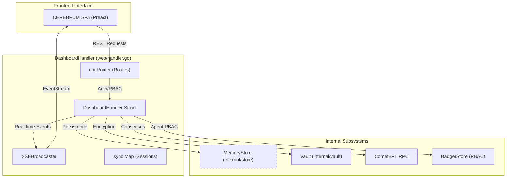
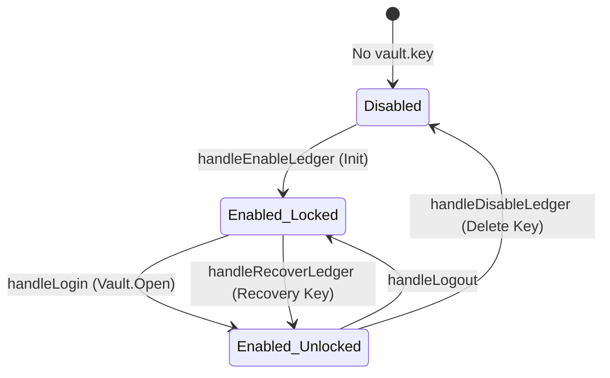

<!-- source: DeepWiki mcp.deepwiki.com · repo l33tdawg/sage · page 5.1 Dashboard Backend (Handler Layer) · fetched 2026-10-26 -->

# Dashboard Backend (Handler Layer)

Relevant source files

The following files were used as context for generating this wiki page:

- [internal/vault/vault.go](internal/vault/vault.go)
- [internal/vault/vault_test.go](internal/vault/vault_test.go)
- [web/handler.go](web/handler.go)
- [web/handler_ledger.go](web/handler_ledger.go)
- [web/handler_ledger_test.go](web/handler_ledger_test.go)
- [web/handler_pipeline.go](web/handler_pipeline.go)
- [web/handler_test.go](web/handler_test.go)
- [web/import.go](web/import.go)
- [web/network_handler.go](web/network_handler.go)
- [web/sse.go](web/sse.go)
- [web/sse_test.go](web/sse_test.go)
- [web/static/js/app.js](web/static/js/app.js)
- [web/update_handler.go](web/update_handler.go)
- [web/update_handler_test.go](web/update_handler_test.go)

The `DashboardHandler` serves as the primary backend for the CEREBRUM web interface. It provides a comprehensive REST API for memory management, agent orchestration, security configuration (Synaptic Ledger), and real-time system monitoring via Server-Sent Events (SSE).

## Core Architecture and Data Flow

The `DashboardHandler` acts as a bridge between the frontend SPA and the internal SAGE subsystems (Storage, Vault, and CometBFT). It implements a multi-layered security model, supporting both standard session-based authentication for human users and Ed25519-signed request bypass for automated agents.

### Entity Mapping: Natural Language to Code Space

The following diagram maps high-level dashboard features to their corresponding Go entities and data structures.

**CEREBRUM Backend Entity Map**

**Sources:** [web/handler.go:49-91](), [web/handler.go:141-153](), [web/sse.go:38-41]()

## Authentication and RBAC

The handler implements a dual-mode authentication strategy. For human users, it uses a secure session cookie (`sage_session`) with a 24-hour TTL [web/handler.go:202-203](). For agents, it supports a bypass mechanism where requests are validated against the `BadgerStore` [web/handler.go:112-138]().

### RBAC Resolution
When a request includes an `X-Agent-ID` header, the handler performs on-chain RBAC resolution via `resolveAgentRBAC`:
1. **Admin/Wildcard:** If the agent has an `admin` role or `VisibleAgents` set to `*`, no filtering is applied [web/handler.go:120-125]().
2. **Restricted:** Otherwise, the handler retrieves a whitelist of allowed agent IDs from the agent's on-chain registration [web/handler.go:126-133]().
3. **Isolated:** Unregistered agents are restricted to viewing only their own memories [web/handler.go:137]().

**Sources:** [web/handler.go:112-138](), [web/handler.go:202-203]()

## Real-time Events (SSE)

The `SSEBroadcaster` manages a pool of up to 50 concurrent client connections [web/sse.go:15](). It streams system events to the dashboard to ensure the UI reflects the current state of the ledger without polling.

| Event Type | Trigger | Data Payload |
| :--- | :--- | :--- |
| `EventRemember` | New memory committed | MemoryID, Domain, Content |
| `EventVote` | Validator casts a vote | Validator ID, Decision, Reason |
| `EventConsensus` | Quorum reached | MemoryID, Status |
| `EventImport` | Background import progress | Phase, Total, Imported, Skipped |
| `EventUpdate` | Binary update status | Step, Status, Message |

The broadcaster includes a 10-second heartbeat mechanism to prevent idle connection termination by intermediate proxies or the HTTP server's `WriteTimeout` [web/sse.go:116-127]().

**Sources:** [web/sse.go:17-26](), [web/sse.go:72-88](), [web/sse.go:116-135]()

## Memory and Agent Management

### On-Chain Broadcasting
When agents are created or updated via the dashboard, the handler doesn't just update the local store; it also broadcasts a `TxTypeAgentRegister` transaction to the CometBFT network if `CometBFTRPC` is configured [web/network_handler.go:170-195](). This ensures that agent metadata is synchronized across all nodes in a multi-node deployment.

### Pre-Validation Quorum
Before submitting memories, the dashboard can invoke `handlePreValidate`. This runs the four internal app validators (Sentinel, Dedup, Quality, Consistency) against proposed content [web/handler.go:163-200](). It returns the individual votes and a boolean `accepted` status based on a 3/4 BFT quorum requirement [web/handler.go:196-199]().

**Sources:** [web/network_handler.go:170-195](), [web/handler.go:163-200]()

## Synaptic Ledger (Vault) Integration

The dashboard manages the `Synaptic Ledger` (Vault) state machine. It handles the initialization, unlocking, and recovery of the AES-256-GCM encryption system.

**Vault Lifecycle Flow**

### Key Functions:
- **`handleEnableLedger`**: Generates a random 32-byte data key and wraps it with an Argon2id-derived key from the user's passphrase [web/handler_ledger.go:38-114]().
- **`handleChangePassphrase`**: Re-wraps the existing data key with a new passphrase, avoiding the need to re-encrypt stored memories [web/handler_ledger.go:117-161]().
- **`handleRecoverLedger`**: Provides an escape hatch using a base64-encoded recovery key to reset the passphrase if lost [web/handler_ledger.go:165-206]().

**Sources:** [web/handler_ledger.go:38-114](), [web/handler_ledger.go:117-161](), [web/handler_ledger.go:165-206](), [internal/vault/vault.go:63-116]()

## Update Orchestration

The `DashboardHandler` includes a self-update mechanism that interacts with the GitHub Releases API.

1. **Check**: `handleCheckUpdate` compares the current `h.Version` against the latest tag on GitHub using semver logic [web/update_handler.go:43-124]().
2. **Apply**: `handleApplyUpdate` initiates an asynchronous process [web/update_handler.go:128-171]().
3. **Perform**: `performUpdate` downloads the platform-specific binary, verifies its SHA-256 checksum, extracts the archive, and replaces the running executable using `syscall.Exec` or binary replacement [web/update_handler.go:188-230]().
4. **Progress**: Throughout the process, status updates are streamed via `EventUpdate` SSE events [web/update_handler.go:174-186]().

**Sources:** [web/update_handler.go:43-124](), [web/update_handler.go:128-171](), [web/update_handler.go:188-230]()

---

