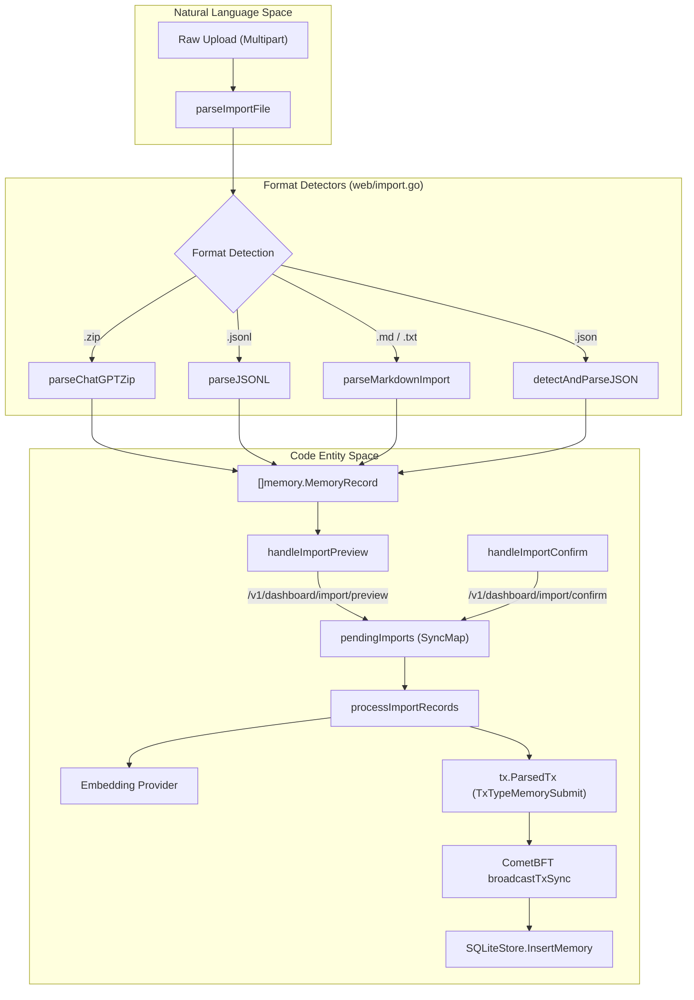
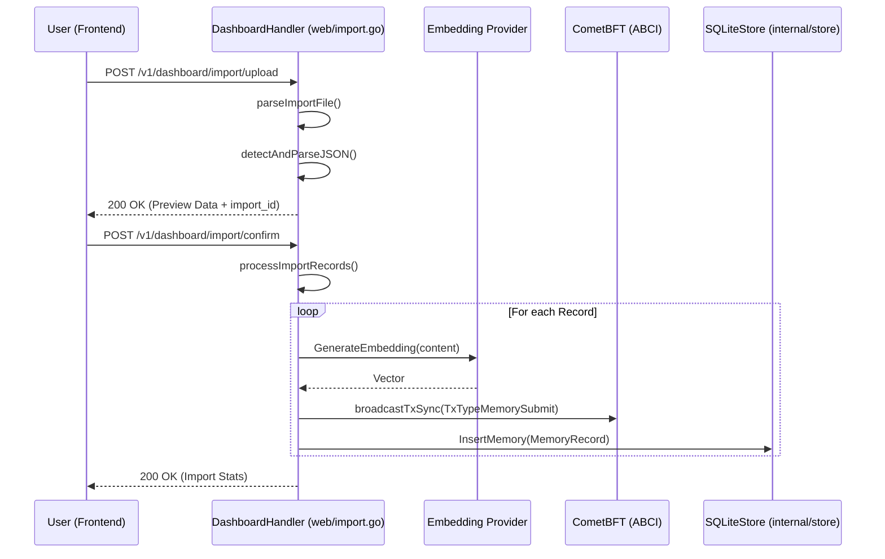

<!-- source: DeepWiki mcp.deepwiki.com · repo l33tdawg/sage · page 5.3 Memory Import Pipeline · fetched 2026-10-26 -->

# Memory Import Pipeline

Relevant source files

The following files were used as context for generating this wiki page:

- [web/autostart.go](web/autostart.go)
- [web/handler_test.go](web/handler_test.go)
- [web/import.go](web/import.go)
- [web/import_realdata_test.go](web/import_realdata_test.go)
- [web/import_test.go](web/import_test.go)
- [web/network_handler.go](web/network_handler.go)

The Memory Import Pipeline is a multi-format ingestion engine responsible for converting external data sources—such as LLM conversation histories (ChatGPT, Claude, Gemini, Grok), structured JSONL files, and Markdown documents—into validated SAGE `MemoryRecord` objects. It employs a two-phase "Preview and Confirm" flow to ensure data quality before commitment to the Synaptic Ledger.

## Import Workflow Overview

The pipeline operates through a series of stages: format detection, tree-walking (for hierarchical conversations), content chunking, and finally, parallelized embedding generation and on-chain broadcasting.

### Two-Phase Import Flow
To prevent bulk ingestion of irrelevant data, the pipeline uses a stateful preview mechanism [web/import.go:43-48]().

1.  **Preview Phase**: The user uploads a file. The system parses it into memory, generates a unique `import_id`, and stores the `pendingImport` struct in a TTL-limited cache [web/import.go:114-120](). A subset of records is returned to the UI for inspection [web/import.go:123-136]().
2.  **Confirmation Phase**: Upon user approval, the `import_id` is used to retrieve the cached records. The system then performs the heavy lifting: embedding generation and transaction broadcasting [web/import.go:172-173]().

### Data Flow Diagram: Import to Ledger
This diagram illustrates the transition from external "Natural Language Space" (raw files) into "Code Entity Space" (MemoryRecords and Transactions).

"Memory Import Data Flow"

Sources: [web/import.go:51-92](), [web/import.go:96-145](), [web/import.go:148-173](), [web/import.go:198-223]()

## Format Detection and Parsing

The engine identifies formats based on file extensions and internal JSON structure. Each provider has a specialized parser to handle its unique schema.

### Supported Formats
| Format | Detector | Logic |
| :--- | :--- | :--- |
| **ChatGPT** | `parseChatGPTJSON` | Walks a mapping of nodes (parent/child) to reconstruct linear conversation threads [web/import_test.go:19-69](). |
| **Claude** | `parseClaudeJSON` | Extracts messages from the `chat_messages` array, filtering out "thinking" blocks [web/import_realdata_test.go:60-78](). |
| **Grok** | `parseGrokJSON` | Maps Grok's internal conversation structure to standard SAGE turns [web/import_realdata_test.go:80-95](). |
| **JSONL** | `parseJSONL` | Processes line-delimited JSON, supporting both SAGE exports and standard fine-tuning formats [web/import.go:78-79](). |
| **Markdown** | `parseMarkdownImport` | Splits documents by headers or significant whitespace into discrete chunks [web/import.go:80-86](). |

### Conversation Tree Walking
For ChatGPT exports, the pipeline must resolve a complex tree structure where nodes represent individual messages. The `parseChatGPTJSON` function performs a recursive walk to linearize these nodes into a single cohesive string for the `MemoryRecord.Content` field [web/import_test.go:71-122]().

**Key Constraints:**
- **System Messages**: Filtered out to focus on actual interaction [web/import_test.go:124-155]().
- **Content Truncation**: Individual memories are capped at `maxMemoryContent` (2000 characters) to ensure high-density retrieval [web/import.go:25]().

Sources: [web/import.go:23-27](), [web/import.go:73-89](), [web/import_test.go:19-69](), [web/import_realdata_test.go:15-110]()

## Implementation Details

### Processing and Enrichment
Once records are confirmed, `processImportRecords` orchestrates the final ingestion.

1.  **Identity Resolution**: Memories are attributed to the first available `admin` agent. If none exists, they are assigned to a generic `import-agent` [web/import.go:199-210]().
2.  **Parallel Embedding**: The system iterates through records, calling the configured `embedding.Provider` to generate vectors [web/import.go:245-255]().
3.  **On-Chain Integrity**: Each memory is wrapped in a `tx.TxTypeMemorySubmit` transaction and broadcast to the consensus layer via `broadcastTxSync` [web/import.go:275-298]().
4.  **Local Persistence**: Finally, the record is saved to the local `store.SQLiteStore` [web/import.go:303-305]().

### Component Interaction Diagram
This diagram shows how the `DashboardHandler` coordinates between the storage layer and the consensus engine during an import.

"Import Logic Orchestration"

Sources: [web/import.go:177-194](), [web/import.go:198-310]()

## Validation and Error Handling

The pipeline includes safeguards against "unstructured" data. If a Markdown or Plaintext file is detected as a raw document rather than a set of discrete memories, the `isUnstructuredDocument` check triggers a `422 Unprocessable Entity` response [web/import.go:104-111](). This encourages users to have an agent process the document via `sage_reflect` instead of polluting the ledger with raw text chunks [web/import.go:108-109]().

**Limits:**
- **Max Upload Size**: 100 MB [web/import.go:24]().
- **Preview Cache TTL**: 10 minutes [web/import.go:166]().

Sources: [web/import.go:24-26](), [web/import.go:104-111](), [web/import.go:165-169]()

---

