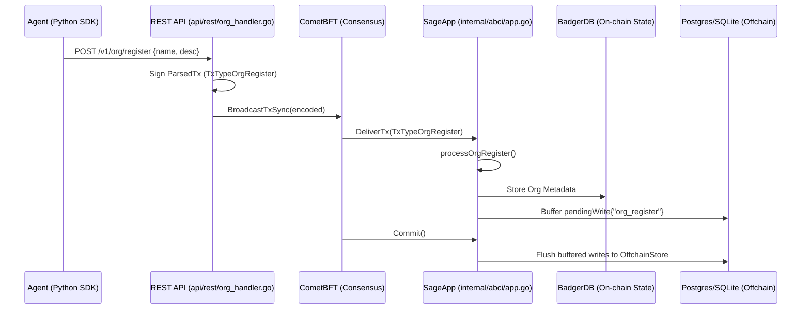
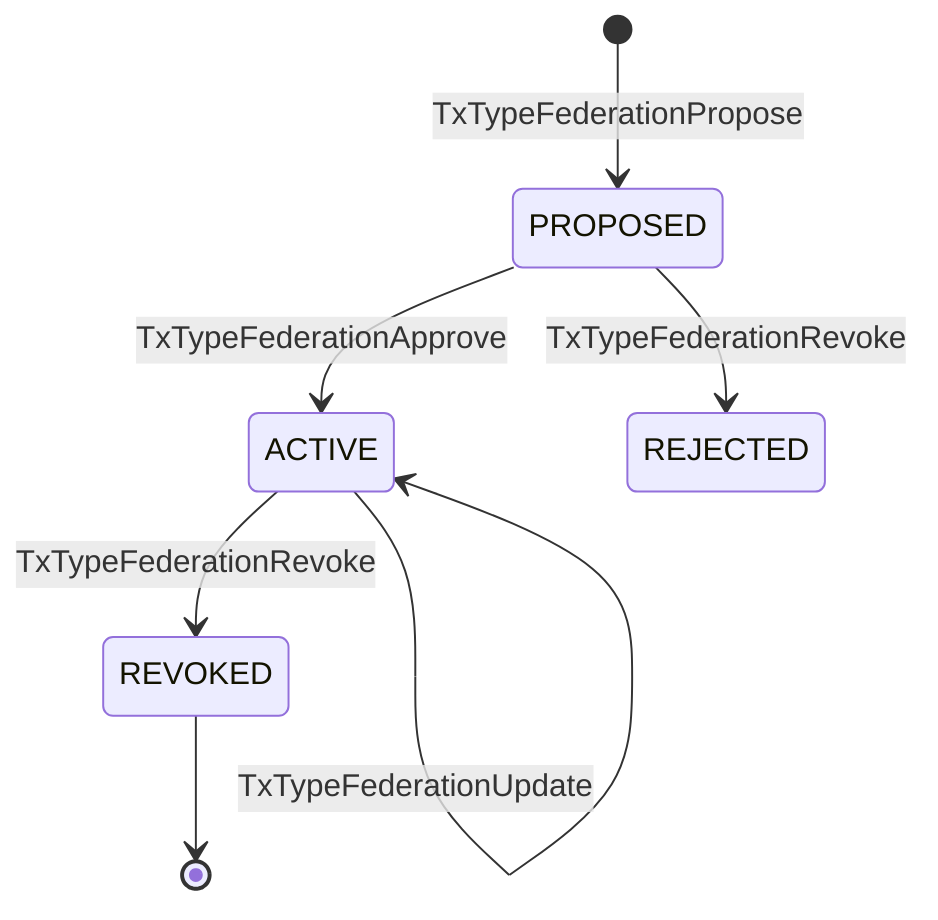

<!-- source: DeepWiki mcp.deepwiki.com · repo l33tdawg/sage · page 6.2 RBAC, Organizations, and Federation · fetched 2026-10-26 -->

# RBAC, Organizations, and Federation

Relevant source files

The following files were used as context for generating this wiki page:

- [api/rest/access_handler.go](api/rest/access_handler.go)
- [api/rest/agent_handler.go](api/rest/agent_handler.go)
- [api/rest/dept_handler.go](api/rest/dept_handler.go)
- [api/rest/org_handler.go](api/rest/org_handler.go)
- [api/rest/vote_handler.go](api/rest/vote_handler.go)
- [internal/abci/app.go](internal/abci/app.go)
- [internal/abci/app_test.go](internal/abci/app_test.go)
- [internal/abci/migrate.go](internal/abci/migrate.go)
- [internal/store/badger.go](internal/store/badger.go)
- [internal/store/postgres.go](internal/store/postgres.go)
- [internal/store/sqlite.go](internal/store/sqlite.go)
- [internal/store/store.go](internal/store/store.go)
- [papers/Paper4 - Longitudinal Learning in Governed Multi-Agent Systems - How Institutional Memory Improves Agent Performance Over Time.pdf](papers/Paper4 - Longitudinal Learning in Governed Multi-Agent Systems - How Institutional Memory Improves Agent Performance Over Time.pdf)
- [sdk/python/examples/complete_walkthrough.py](sdk/python/examples/complete_walkthrough.py)
- [sdk/python/examples/federation.py](sdk/python/examples/federation.py)
- [sdk/python/examples/org_setup.py](sdk/python/examples/org_setup.py)
- [sdk/python/examples/rbac_clearance.py](sdk/python/examples/rbac_clearance.py)

SAGE implements a multi-tier identity and access control system that governs how agents interact with the Synaptic Ledger. Unlike traditional centralized systems, SAGE's Role-Based Access Control (RBAC), organizational hierarchies, and federation agreements are committed to the blockchain via the **ABCI application layer**, ensuring that permissions are replicated, auditable, and enforceable across all nodes in a multi-node deployment.

### 1. Clearance Levels (RBAC Tiers)

Access to memories and system operations is governed by five distinct `ClearanceLevel` tiers. These levels are defined as an enumeration in the storage layer and enforced during transaction processing.

| Level | Name | Numeric Value | Capabilities |
| :--- | :--- | :--- | :--- |
| **Public** | `Public` | 0 | Observer only; can query public memories but cannot submit. |
| **Internal** | `Internal` | 1 | Standard read access; default for new agents. |
| **Trusted** | `Trusted` | 2 | Read + Write; can submit new memories and corroborate others. |
| **Privileged** | `Privileged` | 3 | Read + Write + Validate; can participate in the PoE voting quorum. |
| **TopSecret** | `TopSecret` | 4 | Administrative; full control over org/dept settings and RBAC. |

**Sources:** [internal/store/store.go:163-170](), [sdk/python/examples/org_setup.py:83-89]()

### 2. Organizational Hierarchy

SAGE models access through a structured hierarchy of Organizations and Departments. This state is managed on-chain in `BadgerDB` for consensus and mirrored in the `OffchainStore` (Postgres/SQLite) for efficient querying.

*   **Organizations (Org):** The top-level entity representing a sovereign group (e.g., "Security Lab").
*   **Departments (Dept):** Sub-units within an organization (e.g., "Cryptography Team").
*   **Membership:** Agents are added to Orgs or Depts with specific roles and clearance levels.

#### Data Flow: Org Registration
When an agent registers an organization, the request flows through the REST API, is signed, and broadcast as a `TxTypeOrgRegister` transaction.

Title: Organization Registration Flow

**Sources:** [api/rest/org_handler.go:15-50](), [internal/abci/app.go:25-28](), [internal/abci/app.go:125-127]()

### 3. Domain-Scoped Access Grants

Knowledge in SAGE is partitioned into **Domains** (e.g., `vuln_intel`, `crypto`). Access to these domains is not global; it must be explicitly granted via an `AccessGrant`.

*   **Domain Registration:** Domains must be registered on-chain before they can be used as `domain_tag` in memories.
*   **Grants:** A `TxTypeAccessGrant` associates an `AgentID` with a `Domain` and an `AccessLevel`.
*   **Enforcement:** The `OffchainStore` uses these grants to filter results during `QuerySimilar` and `ListMemories` calls.

**Key Implementation:**
In `internal/store/postgres.go`, the `QuerySimilar` function enforces RBAC by checking the `submitting_agent` against allowed agents if `QueryOptions.SubmittingAgents` is populated by the API layer based on active grants.

**Sources:** [internal/store/store.go:158-166](), [internal/store/postgres.go:172-180](), [sdk/python/examples/org_setup.py:137-152]()

### 4. Federation Agreements

Federation allows two independent organizations to share knowledge without merging their identities. This is achieved through a two-phase handshake:

1.  **Propose:** Org A submits a `TxTypeFederationPropose`, specifying the target Org B and the `allowed_domains`.
2.  **Approve:** Org B submits a `TxTypeFederationApprove`.

Once "Active", agents in Org A can query memories in Org B's shared domains, subject to a `max_clearance` cap defined in the agreement.

Title: Federation Handshake State Machine

**Sources:** [sdk/python/examples/federation.py:138-159](), [internal/abci/app.go:65-75]()

### 5. On-Chain Enforcement (ABCI)

The `SageApp` (ABCI Application) is the final arbiter of RBAC. It processes transactions in `DeliverTx` and ensures only authorized agents can modify the hierarchy.

#### Agent Identity Verification
Every transaction must contain a cryptographic proof of the agent's identity. The `SageApp` verifies this by checking the `AgentPubKey` and `AgentSig` against the `AgentBodyHash` and `AgentTimestamp`.

**Key Function:** `verifyAgentIdentity` (called within `DeliverTx`)
The system checks:
1.  Is the agent registered in `BadgerDB`? [internal/store/badger.go:167-172]()
2.  Is the signature valid for the provided public key? [internal/abci/app_test.go:69-78]()
3.  Is the nonce incrementing correctly to prevent replay attacks? [internal/store/badger.go:126-145]()

#### Buffering and Persistence
To maintain consistency between the BFT chain (`BadgerDB`) and the searchable memory store (`Postgres/SQLite`), the ABCI app uses a `pendingWrites` buffer.

*   **BadgerDB:** Updated immediately during `DeliverTx` to provide the state for the next transaction in the same block. [internal/store/badger.go:77-86]()
*   **OffchainStore:** Writes are buffered in `pendingWrite` structs and only flushed during the `Commit` phase after consensus is reached. [internal/abci/app.go:25-29]()

**Sources:** [internal/abci/app.go:114-127](), [api/rest/agent_handler.go:69-81](), [internal/store/badger.go:53-68]()

---

