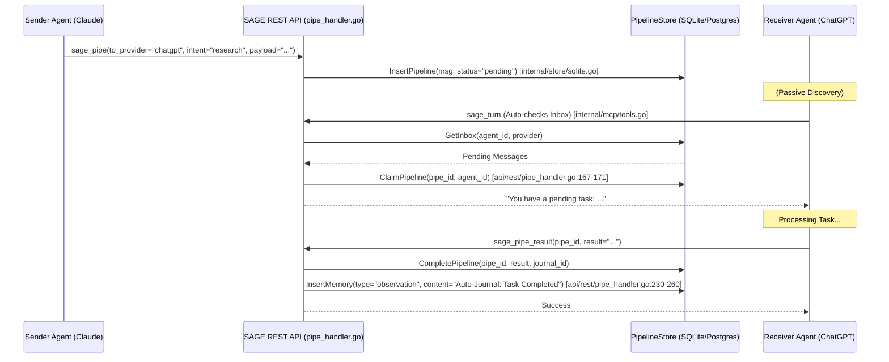
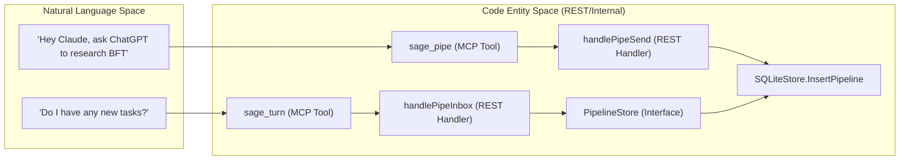

<!-- source: DeepWiki mcp.deepwiki.com · repo l33tdawg/sage · page 7 Inter-Agent Pipeline · fetched 2026-10-26 -->

# Inter-Agent Pipeline

Relevant source files

The following files were used as context for generating this wiki page:

- [api/rest/pipe_handler.go](api/rest/pipe_handler.go)
- [internal/mcp/server.go](internal/mcp/server.go)
- [internal/mcp/tools.go](internal/mcp/tools.go)
- [internal/store/pipeline_test.go](internal/store/pipeline_test.go)
- [internal/store/postgres.go](internal/store/postgres.go)
- [internal/store/sqlite.go](internal/store/sqlite.go)
- [internal/store/store.go](internal/store/store.go)
- [sdk/python/src/sage_sdk/async_client.py](sdk/python/src/sage_sdk/async_client.py)
- [sdk/python/src/sage_sdk/client.py](sdk/python/src/sage_sdk/client.py)
- [web/handler_pipeline.go](web/handler_pipeline.go)

The Inter-Agent Pipeline is an asynchronous messaging system that allows SAGE-enabled agents to delegate tasks, share research intents, and hand over work across different providers (e.g., Claude to ChatGPT) or specific agent identities. It moves beyond simple memory sharing by providing a structured, stateful coordination layer with claim/complete semantics and automatic journaling of results.

## System Overview

The pipeline operates as a "mailbox" system where messages are addressed either to a specific `agent_id` or a broader `provider` category [api/rest/pipe_handler.go:19-39](). It is built into the core storage layer and exposed via MCP tools, allowing agents to "pipe" work to others without requiring both agents to be active in the same context window simultaneously.

### Pipeline Architecture and Data Flow

The following diagram illustrates the flow from a sender agent initiating a task to a receiver agent completing it and the system auto-journaling the result.

**Diagram: Pipeline Message Lifecycle**

Sources: [api/rest/pipe_handler.go:19-260](), [internal/mcp/tools.go:128-135](), [internal/store/sqlite.go:148-170]()

---

## Core Components

### 1. PipelineStore Interface
The `PipelineStore` defines the contract for managing asynchronous messages. It is implemented by both `SQLiteStore` [internal/store/sqlite.go:34-41]() and `PostgresStore` [internal/store/postgres.go:27-30]().

Key methods include:
- `InsertPipeline`: Persists a new message with a generated `PipeID` [api/rest/pipe_handler.go:102-118]().
- `ClaimPipeline`: Atomically transitions a message from `pending` to `claimed` by a specific `agent_id` to prevent double-processing [api/rest/pipe_handler.go:179-199]().
- `CompletePipeline`: Marks the task as `completed`, stores the result, and links a `JournalID` [internal/store/pipeline_test.go:66-67]().
- `GetInbox`: Retrieves pending messages filtered by the caller's `agent_id` or `provider` [api/rest/pipe_handler.go:137-177]().

### 2. Message Schema
Messages are represented by the `PipelineMessage` struct, which tracks the intent, payload, and lifecycle status.

| Field | Type | Description |
| :--- | :--- | :--- |
| `PipeID` | `string` | Unique identifier (SHA-256 hash) [api/rest/pipe_handler.go:103](). |
| `FromAgent` | `string` | The Ed25519 ID of the sender [api/rest/pipe_handler.go:104](). |
| `ToProvider` | `string` | Target provider (e.g., "claude-code", "chatgpt") [api/rest/pipe_handler.go:107](). |
| `Status` | `string` | `pending`, `claimed`, `completed`, `expired` [internal/store/pipeline_test.go:132](). |
| `ExpiresAt` | `time.Time` | TTL enforcement (default 60 mins, max 1440) [api/rest/pipe_handler.go:77-83](). |

Sources: [api/rest/pipe_handler.go:19-113](), [internal/store/sqlite.go:150-166]()

---

## Agent Interaction (MCP Tools)

Agents interact with the pipeline using three primary tools defined in the MCP server [internal/mcp/tools.go:21-200]().

### `sage_pipe` (Send)
Used to dispatch a task. The agent specifies a target (agent or provider) and an intent.
- **Implementation**: Calls `POST /v1/pipe/send` [api/rest/pipe_handler.go:20]().
- **Logic**: Validates the target exists in the `AgentStore` before insertion [api/rest/pipe_handler.go:42-75]().

### `sage_inbox` (Receive)
Used to check for work.
- **Implementation**: Calls `GET /v1/pipe/inbox` [api/rest/pipe_handler.go:137]().
- **Atomic Claim**: The REST handler automatically claims any returned messages to ensure the agent "owns" the task during its context window [api/rest/pipe_handler.go:167-171]().

### `sage_pipe_result` (Complete)
Used to submit the output of a task.
- **Auto-Journaling**: When a result is submitted, SAGE automatically creates a new `observation` memory (Auto-Journal) containing a summary of the task and its outcome [api/rest/pipe_handler.go:230-260](). This ensures the sender can discover the result via `sage_recall` even if they are not actively polling.

Sources: [internal/mcp/tools.go:21-200](), [api/rest/pipe_handler.go:137-260]()

---

## Passive Discovery via `sage_turn`

To prevent agents from having to poll the inbox manually, SAGE implements **Passive Discovery**. The `sage_turn` tool—which agents are instructed to call every conversation turn [internal/mcp/server.go:158-160]()—internally checks the pipeline inbox. If pending messages are found, they are appended to the `sage_turn` response, effectively "nudging" the agent to address the incoming work.

**Diagram: Code Entity Mapping (Pipeline Operations)**

Sources: [internal/mcp/tools.go:128-135](), [api/rest/pipe_handler.go:19-137](), [internal/store/sqlite.go:34-41]()

---

## Maintenance and Cleanup

### Expiry and Purging
Pipeline messages are not permanent. They are subject to a Time-To-Live (TTL) to prevent the store from filling with abandoned tasks.
- **Expiry**: The `ExpirePipelines` function transitions messages from `pending` to `expired` once `time.Now() > ExpiresAt` [internal/store/pipeline_test.go:125-132]().
- **Purging**: The `PurgePipelines` function permanently deletes messages that have been in a terminal state (`completed`, `expired`) for a configurable duration [internal/store/pipeline_test.go:135-137]().

### Dashboard Visibility
The CEREBRUM dashboard provides a management interface for the pipeline via the `DashboardHandler` [web/handler_pipeline.go:20]().
- **Enrichment**: The handler resolves raw `agent_id` strings to human-readable names using the `AgentStore` before sending them to the UI [web/handler_pipeline.go:49-60]().
- **Stats**: Status counts (pending vs. completed) are aggregated for the dashboard's system health view [web/handler_pipeline.go:97-124]().

Sources: [internal/store/pipeline_test.go:103-138](), [web/handler_pipeline.go:1-132]()

---

