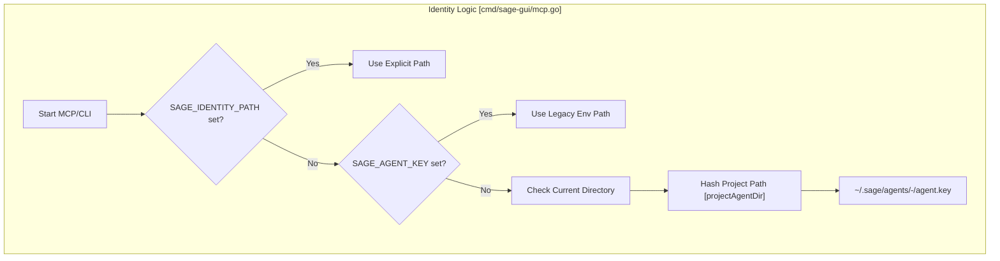
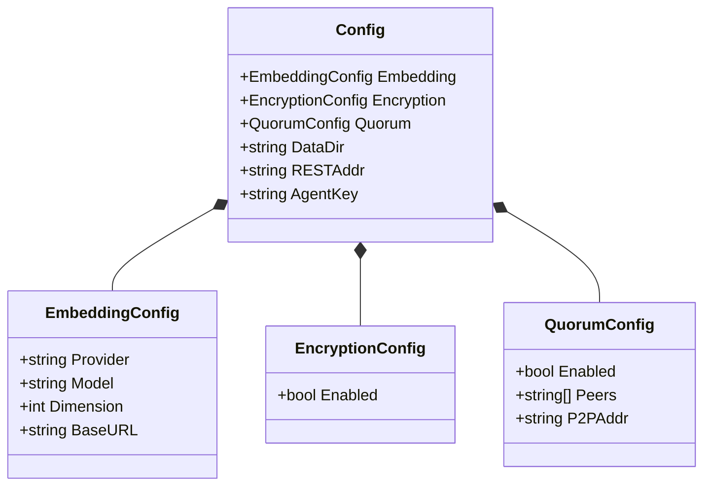

<!-- source: DeepWiki mcp.deepwiki.com · repo l33tdawg/sage · page 9 CLI Reference (sage-gui) · fetched 2026-10-26 -->

# CLI Reference (sage-gui)

Relevant source files

The following files were used as context for generating this wiki page:

- [.golangci.yml](.golangci.yml)
- [api/rest/middleware/ratelimit.go](api/rest/middleware/ratelimit.go)
- [cmd/sage-gui/config.go](cmd/sage-gui/config.go)
- [cmd/sage-gui/main.go](cmd/sage-gui/main.go)
- [cmd/sage-gui/mcp.go](cmd/sage-gui/mcp.go)
- [cmd/sage-gui/migrate.go](cmd/sage-gui/migrate.go)
- [cmd/sage-gui/node.go](cmd/sage-gui/node.go)
- [cmd/sage-gui/node_controller.go](cmd/sage-gui/node_controller.go)
- [cmd/sage-gui/quorum.go](cmd/sage-gui/quorum.go)
- [cmd/sage-gui/seed.go](cmd/sage-gui/seed.go)
- [cmd/sage-gui/vault.go](cmd/sage-gui/vault.go)
- [cmd/sage-gui/wizard.go](cmd/sage-gui/wizard.go)
- [internal/orchestrator/backup.go](internal/orchestrator/backup.go)

The `sage-gui` binary is the primary interface for managing a SAGE Personal node. It serves as an all-in-one tool encompassing the consensus engine (CometBFT), the REST API, the CEREBRUM dashboard, and the MCP server for agent integration.

## Command Overview

The CLI follows a standard subcommand pattern: `sage-gui <command> [options]`.

| Command | Purpose |
|:---|:---|
| `serve` | Starts the full SAGE stack (Consensus, API, Dashboard). |
| `setup` | Launches the web-based first-time configuration wizard. |
| `mcp` | Runs the Model Context Protocol (MCP) stdio server. |
| `mcp install` | Configures a local project directory for Claude Code/MCP. |
| `seed` | Batch-imports memories from external files (.txt, .json, .md). |
| `export` | Saves memories to a `.vault` file (supports AES-256 encryption). |
| `import` | Restores memories from a `.vault` file into the active node. |
| `status` | Displays health metrics and node synchronization state. |
| `backup` | Triggers an atomic SQLite `VACUUM INTO` backup. |
| `recover` | Facilitates vault passphrase recovery via the recovery key. |
| `quorum-init` | Generates a manifest to start a multi-node network. |
| `quorum-join` | Joins an existing quorum using a peer manifest. |

Sources: [cmd/sage-gui/main.go:65-92]()

## Core Subcommands

### serve
The `serve` command initializes the `SageApp` [cmd/sage-gui/node.go:147-150](), opens the Synaptic Ledger (Vault), and starts the in-process CometBFT node. It manages the transition between **Personal Mode** (single-validator, 1s blocks) and **Quorum Mode** (multi-validator, P2P enabled) based on the `config.yaml` [cmd/sage-gui/node.go:170-190]().

### setup
The `setup` command starts a temporary local web server (typically on a random available port) to guide the user through provider selection (Ollama/Hash) and encryption setup [cmd/sage-gui/wizard.go:58-67](). It generates the initial `agent.key` and `config.yaml` [cmd/sage-gui/wizard.go:39-43]().

### mcp and mcp install
`mcp` runs the stdio server used by Claude Desktop or ChatGPT to access SAGE tools. `mcp install` automates the creation of `.mcp.json` and patches project-specific `CLAUDE.md` files to ensure agents are aware of their memory capabilities [cmd/sage-gui/mcp.go:175-202]().

For details on hook scripts and deep-merge logic, see [Claude Code Integration and Hooks](#9.2).

## Environment Variables

The CLI and MCP server respect several environment variables to override default behaviors or provide secrets without interactive prompts.

| Variable | Description | Default |
|:---|:---|:---|
| `SAGE_HOME` | Root directory for config, keys, and databases. | `~/.sage` |
| `SAGE_API_URL` | Base URL for MCP/CLI to reach the SAGE REST API. | `http://localhost:8080` |
| `SAGE_IDENTITY_PATH` | Path to the Ed25519 `agent.key` for request signing. | (Derived) |
| `SAGE_PASSPHRASE` | Passphrase to unlock the Synaptic Ledger vault. | (Interactive) |
| `REST_ADDR` | Bind address for the REST API (useful for Docker). | `127.0.0.1:8080` |

Sources: [cmd/sage-gui/config.go:69-79](), [cmd/sage-gui/mcp.go:84-114](), [cmd/sage-gui/node.go:114-126]()

## Identity and Key Resolution

`sage-gui` uses a hierarchical resolution strategy to determine which `agent.key` to use for signing transactions and MCP tool calls.

Title: Agent Identity Resolution Flow

Sources: [cmd/sage-gui/mcp.go:84-114](), [cmd/sage-gui/mcp.go:146-155]()

## Configuration Structure

The `config.yaml` file defines the operational parameters of the node. It is managed via the `Config` struct.

Title: Config Entity Mapping

Sources: [cmd/sage-gui/config.go:24-53]()

For a detailed field-by-field breakdown, see [Configuration Reference](#9.1).

## Maintenance and Migration

The CLI includes built-in logic to handle version upgrades and data integrity:
*   **Auto-Migration:** On binary version changes, `sage-gui` performs a `VACUUM INTO` backup of SQLite, resets the CometBFT chain state (BadgerDB), and rebuilds the chain from the preserved SQLite memories [cmd/sage-gui/migrate.go:17-41]().
*   **Self-Healing:** Every time `mcp` starts, it verifies and repairs project-level hook scripts and `CLAUDE.md` instructions to ensure they match the current binary version [cmd/sage-gui/mcp.go:76-82]().

Sources: [cmd/sage-gui/migrate.go:21-36](), [cmd/sage-gui/mcp.go:76-82]()

---

