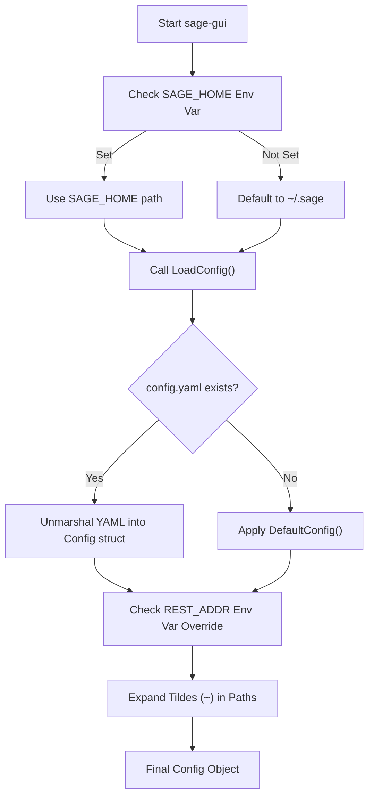
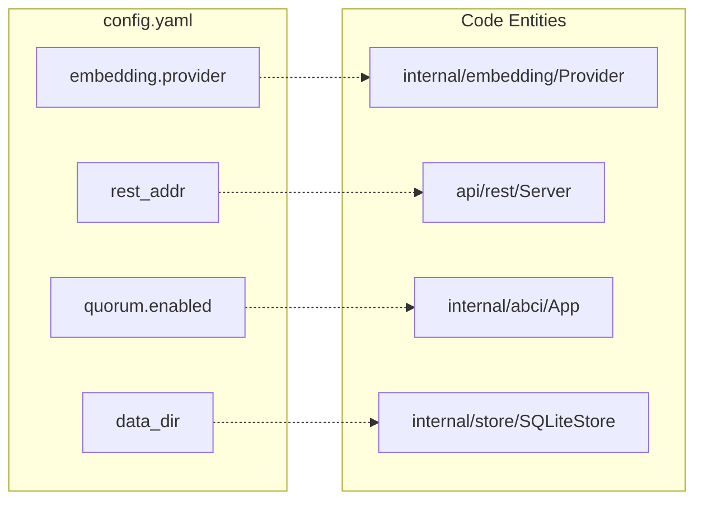
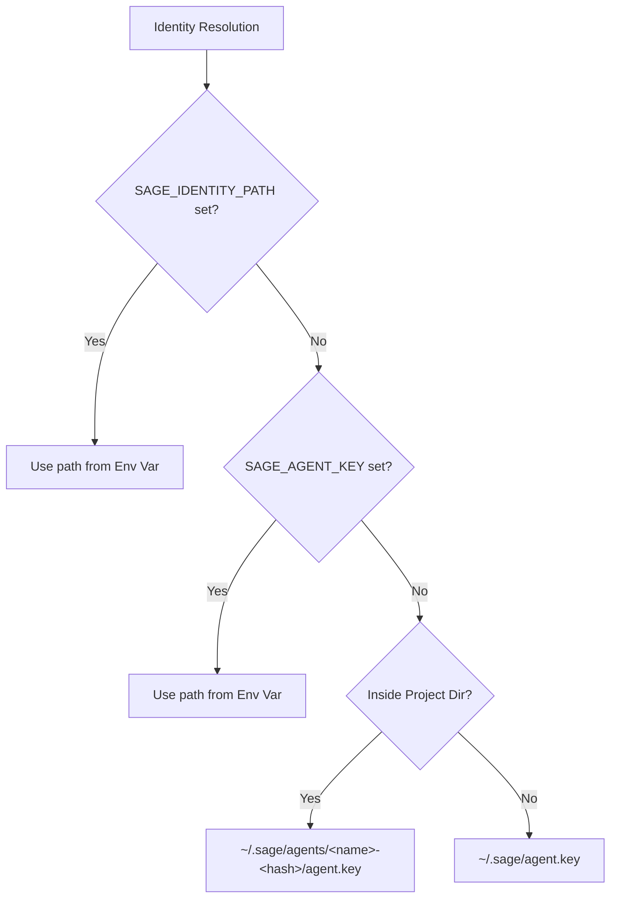

<!-- source: DeepWiki mcp.deepwiki.com · repo l33tdawg/sage · page 9.1 Configuration Reference · fetched 2026-10-26 -->

# Configuration Reference

Relevant source files

The following files were used as context for generating this wiki page:

- [cmd/sage-gui/config.go](cmd/sage-gui/config.go)
- [cmd/sage-gui/config_test.go](cmd/sage-gui/config_test.go)
- [cmd/sage-gui/mcp.go](cmd/sage-gui/mcp.go)
- [docs/ARCHITECTURE.md](docs/ARCHITECTURE.md)
- [docs/GETTING_STARTED.md](docs/GETTING_STARTED.md)
- [sdk/python/README.md](sdk/python/README.md)
- [sdk/python/src/sage_sdk/models.py](sdk/python/src/sage_sdk/models.py)

This page provides a technical reference for the SAGE configuration system. SAGE uses a YAML-based configuration file (`config.yaml`) supplemented by environment variables to manage its embedding providers, consensus parameters, and local storage settings.

## Configuration Overview

The primary configuration is managed via the `Config` struct in the `sage-gui` binary. This struct governs how the local node behaves, including how it connects to other peers in a quorum and how it processes vector embeddings.

### Data Flow: Configuration Loading
The system follows a specific priority chain when resolving configuration:
1.  **Environment Variables**: High-priority overrides (e.g., `SAGE_HOME`, `REST_ADDR`).
2.  **YAML File**: Settings defined in `~/.sage/config.yaml`.
3.  **Defaults**: Hardcoded fallbacks if no file or environment variables are present.

Title: Configuration Resolution Logic

Sources: [cmd/sage-gui/config.go:69-79](), [cmd/sage-gui/config.go:83-120]()

---

## The `Config` Struct

The `Config` struct is the central data structure for system parameters.

| Field | Type | Description |
| :--- | :--- | :--- |
| `Embedding` | `EmbeddingConfig` | Settings for vector generation (Ollama, Hash, etc.) |
| `Encryption` | `EncryptionConfig` | Toggle for AES-256-GCM at-rest encryption |
| `Quorum` | `QuorumConfig` | P2P and consensus settings for multi-node mode |
| `DataDir` | `string` | Path to the SQLite/BadgerDB data files |
| `RESTAddr` | `string` | Listen address for the API (default `127.0.0.1:8080`) |
| `AgentKey` | `string` | Path to the Ed25519 private key file |

Sources: [cmd/sage-gui/config.go:24-32]()

### Embedding Configuration (`EmbeddingConfig`)
Defines how SAGE transforms natural language into vector space for semantic search.

*   **`provider`**: Supported values are `ollama` (semantic search) or `hash` (deterministic keyword-like matching) [cmd/sage-gui/config.go:48]().
*   **`base_url`**: The endpoint for the provider (e.g., `http://localhost:11434` for Ollama) [cmd/sage-gui/config.go:52]().
*   **`model`**: The specific model name, typically `nomic-embed-text` [cmd/sage-gui/config.go:50]().
*   **`dimension`**: Vector size, default is `768` [cmd/sage-gui/config.go:51]().

### Quorum Configuration (`QuorumConfig`)
Used when `sage-gui` is running in multi-validator mode rather than standalone personal mode.

*   **`enabled`**: Boolean to activate CometBFT consensus [cmd/sage-gui/config.go:36]().
*   **`peers`**: A list of persistent P2P peers in the format `nodeID@host:port` [cmd/sage-gui/config.go:37]().
*   **`p2p_addr`**: The local address to listen for P2P connections [cmd/sage-gui/config.go:38]().

### Encryption Configuration (`EncryptionConfig`)
Controls the "Synaptic Ledger" vault.
*   **`enabled`**: If true, memory content and embeddings are encrypted using AES-256-GCM before being written to the `OffchainStore` [cmd/sage-gui/config.go:43]().

---

## Environment Variable Overrides

Certain parameters are frequently overridden in containerized or development environments.

| Variable | Target Field | Purpose |
| :--- | :--- | :--- |
| `SAGE_HOME` | N/A | Changes the root directory for config and data (default `~/.sage`) [cmd/sage-gui/config.go:70-73]() |
| `REST_ADDR` | `RESTAddr` | Overrides the API listen address [cmd/sage-gui/config.go:92-95]() |
| `SAGE_API_URL` | N/A | Used by the MCP server to find the SAGE REST API [cmd/sage-gui/mcp.go:129-132]() |
| `SAGE_IDENTITY_PATH`| `AgentKey` | Direct path to the agent's Ed25519 private key [cmd/sage-gui/mcp.go:89-91]() |

---

## Path Handling and Tilde Expansion

SAGE performs automatic tilde (`~`) expansion for all path-related configuration fields. This is implemented in `expandTilde` and `expandHome` to ensure compatibility between shell-provided paths and Go's filesystem operations.

1.  **`expandTilde(path)`**: Replaces `~` or `~/` with the value of `os.UserHomeDir()` [cmd/sage-gui/config.go:14-21]().
2.  **`LoadConfig` Integration**: After unmarshaling the YAML, the system explicitly calls `expandHome` on `DataDir` and `AgentKey`, then converts them to absolute paths relative to `SAGE_HOME` if they are not already absolute [cmd/sage-gui/config.go:109-117]().

---

## Implementation Details

### Key Functions

*   **`DefaultConfig(home)`**: Returns a configuration object initialized with the `hash` provider and standard local paths [cmd/sage-gui/config.go:56-66]().
*   **`LoadConfig()`**: Orchestrates the loading sequence. It reads `config.yaml`, unmarshals the YAML, and applies environment overrides [cmd/sage-gui/config.go:83-120]().
*   **`SaveConfig(cfg)`**: Serializes the current `Config` struct back to YAML and writes it to disk with restricted permissions (`0600`) [cmd/sage-gui/config.go:135-147]().

### Configuration to Code Entity Mapping

Title: Configuration Field to System Entity Mapping

Sources: [cmd/sage-gui/config.go:24-32](), [docs/ARCHITECTURE.md:91-102]()

### Identity Resolution Logic

The `sage-gui mcp` command uses a specific priority logic to resolve which `AgentKey` to use for signing requests.

Title: Identity Resolution (mcp.go)

Sources: [cmd/sage-gui/mcp.go:84-114](), [cmd/sage-gui/mcp.go:146-155]()

Sources: [cmd/sage-gui/config.go:1-148](), [cmd/sage-gui/mcp.go:60-140](), [docs/GETTING_STARTED.md:48-70]()

---

