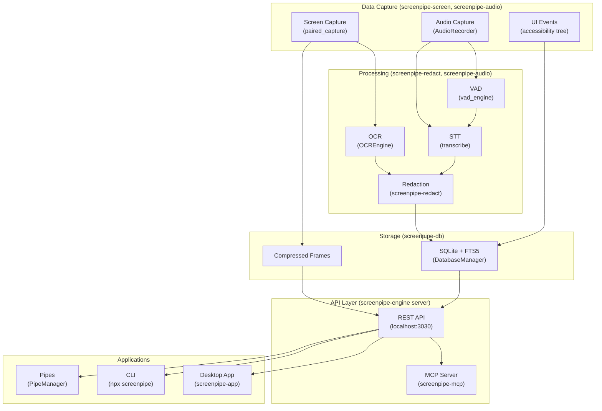
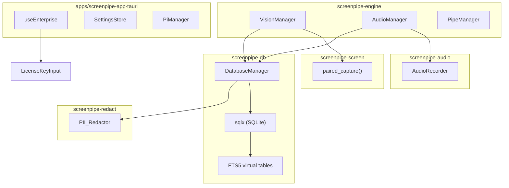
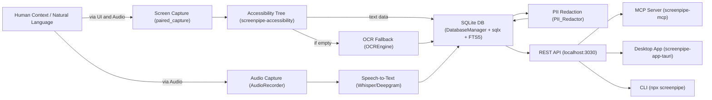
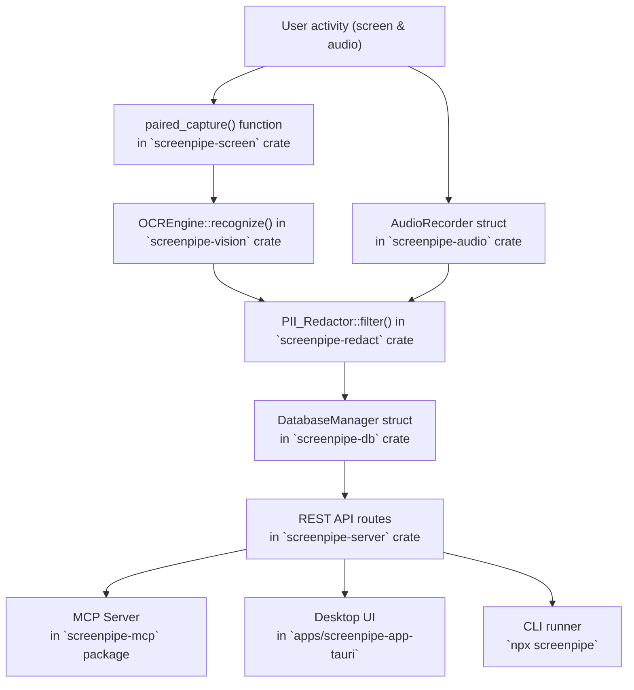

<!-- source: DeepWiki mcp.deepwiki.com · repo screenpipe/screenpipe · page 1 Overview · fetched 2026-10-26 -->

# Overview

Relevant source files

The following files were used as context for generating this wiki page:

- [LICENSE.md](LICENSE.md)
- [README.md](README.md)
- [docs/mintlify/docs-mintlify-mig-tmp/ai-memory.mdx](docs/mintlify/docs-mintlify-mig-tmp/ai-memory.mdx)
- [docs/mintlify/docs-mintlify-mig-tmp/api-recipes.mdx](docs/mintlify/docs-mintlify-mig-tmp/api-recipes.mdx)
- [docs/mintlify/docs-mintlify-mig-tmp/architecture.mdx](docs/mintlify/docs-mintlify-mig-tmp/architecture.mdx)
- [docs/mintlify/docs-mintlify-mig-tmp/cli-reference.mdx](docs/mintlify/docs-mintlify-mig-tmp/cli-reference.mdx)
- [docs/mintlify/docs-mintlify-mig-tmp/connections.mdx](docs/mintlify/docs-mintlify-mig-tmp/connections.mdx)
- [docs/mintlify/docs-mintlify-mig-tmp/docs.json](docs/mintlify/docs-mintlify-mig-tmp/docs.json)
- [docs/mintlify/docs-mintlify-mig-tmp/faq.mdx](docs/mintlify/docs-mintlify-mig-tmp/faq.mdx)
- [docs/mintlify/docs-mintlify-mig-tmp/getting-started.mdx](docs/mintlify/docs-mintlify-mig-tmp/getting-started.mdx)
- [docs/mintlify/docs-mintlify-mig-tmp/home.mdx](docs/mintlify/docs-mintlify-mig-tmp/home.mdx)
- [docs/mintlify/docs-mintlify-mig-tmp/meeting-transcription.mdx](docs/mintlify/docs-mintlify-mig-tmp/meeting-transcription.mdx)
- [docs/mintlify/docs-mintlify-mig-tmp/privacy-data-flow.mdx](docs/mintlify/docs-mintlify-mig-tmp/privacy-data-flow.mdx)
- [docs/mintlify/docs-mintlify-mig-tmp/privacy-filter.mdx](docs/mintlify/docs-mintlify-mig-tmp/privacy-filter.mdx)
- [docs/mintlify/docs-mintlify-mig-tmp/quickstart.mdx](docs/mintlify/docs-mintlify-mig-tmp/quickstart.mdx)
- [docs/mintlify/docs-mintlify-mig-tmp/troubleshooting.mdx](docs/mintlify/docs-mintlify-mig-tmp/troubleshooting.mdx)
- [docs/mintlify/docs-mintlify-mig-tmp/vs-fathom.mdx](docs/mintlify/docs-mintlify-mig-tmp/vs-fathom.mdx)
- [docs/mintlify/docs-mintlify-mig-tmp/vs-fireflies.mdx](docs/mintlify/docs-mintlify-mig-tmp/vs-fireflies.mdx)
- [docs/mintlify/docs-mintlify-mig-tmp/vs-granola.mdx](docs/mintlify/docs-mintlify-mig-tmp/vs-granola.mdx)
- [docs/mintlify/docs-mintlify-mig-tmp/vs-limitless.mdx](docs/mintlify/docs-mintlify-mig-tmp/vs-limitless.mdx)
- [docs/mintlify/docs-mintlify-mig-tmp/vs-littlebird.mdx](docs/mintlify/docs-mintlify-mig-tmp/vs-littlebird.mdx)
- [docs/mintlify/docs-mintlify-mig-tmp/vs-omi.mdx](docs/mintlify/docs-mintlify-mig-tmp/vs-omi.mdx)
- [docs/mintlify/docs-mintlify-mig-tmp/vs-otter.mdx](docs/mintlify/docs-mintlify-mig-tmp/vs-otter.mdx)
- [docs/mintlify/docs-mintlify-mig-tmp/vs-pieces.mdx](docs/mintlify/docs-mintlify-mig-tmp/vs-pieces.mdx)
- [docs/mintlify/docs-mintlify-mig-tmp/vs-recall.mdx](docs/mintlify/docs-mintlify-mig-tmp/vs-recall.mdx)
- [docs/mintlify/docs-mintlify-mig-tmp/vs-rewind.mdx](docs/mintlify/docs-mintlify-mig-tmp/vs-rewind.mdx)

This document provides a high-level introduction to Screenpipe: its purpose, architecture, core capabilities, and system components. For platform-specific installation instructions, see [Installation](#1.1). For first-time setup and basic usage, see [Quick Start](#1.2). For detailed architecture documentation, see [Core Concepts](#1.3).

## What is Screenpipe?

Screenpipe is an open-source, 24/7 AI memory system that continuously captures your screen content, audio, and UI interactions, recording everything locally in a searchable database [README.md:16-18](). It provides a REST API, desktop application, CLI tools, and a plugin system (referred to as Pipes) for building AI-powered automations on top of your digital activity history [README.md:63-72]().

Operating under a **local-first philosophy**, data capture, processing, and storage occur entirely on your device by default. This ensures privacy and offline functionality while allowing optional cloud AI, team sync, and integrations through separate data paths [README.md:73]().

Screenpipe helps you:
- **Remember everything** — never lose track of what you did, saw, or heard.
- **Map workflows** — automatically discover workflows worth automating without tedious interviews or consultants.
- **Run AI agents** — generate agents, skills, and automations triggered by your actual screen activity.

### System Topology Diagram

This diagram shows how hardware inputs (screen and audio) are captured and processed through OCR, speech-to-text, and PII redaction before being stored locally. The API layer exposes this data to the desktop app, CLI, and AI agents using either REST or the Model Context Protocol (MCP).

> Sources: [README.md:16-18](), [README.md:63-78](), [docs/mintlify/docs-mintlify-mig-tmp/architecture.mdx:12-130]()

## Core Capabilities

Screenpipe offers several core capabilities through tightly integrated components:

| Capability           | Description                                                  | Implementation Highlights                          |
|----------------------|--------------------------------------------------------------|--------------------------------------------------|
| Screen Recording     | Capture screen frames paired with accessibility tree data    | Event-driven capture using OS APIs [architecture.mdx:130-152]()  |
| OCR Text Extraction  | Fallback pixel-based text extraction when accessibility unavailable | Apple Vision (macOS), Windows OCR, Tesseract (Linux) [architecture.mdx:154-157]() |
| Audio Transcription  | Local and cloud speech-to-text, with speaker diarization     | Whisper (local), Deepgram, OpenAI-compatible endpoints [meeting-transcription.mdx:12-15]() |
| PII Redaction       | Local AI model for sensitive data redaction                   | screenpipe-redact crate, outperforms cloud solutions [README.md:56-57]() |
| Full-Text Search     | Natural language semantic search across screen and audio data | SQLite FTS5 backend with background indexing [README.md:77]() |
| MCP Integration      | Provide AI assistants (Claude, Cursor, Codex) access to screen data | MCP server (`screenpipe-mcp`) to serve AI tools [README.md:101-103]() |
| Enterprise Controls  | License keys, managed policies, MDM lock for secure deployments | Features in `ee/` folder and desktop app [ee/README.md:9-13]() |

For developers and advanced users, Screenpipe is extensible via **Pipes** — YAML/Markdown scheduled tasks that automate workflows using your screen and audio data.

> Sources: [README.md:56-57](), [meeting-transcription.mdx:12-38](), [README.md:101-115](), [ee/README.md:9-13](), [docs/mintlify/docs-mintlify-mig-tmp/architecture.mdx:150-190]()

## System Components

Screenpipe is structured as a Rust workspace encompassing capture, processing, database, API, and UI crates, combined with a Tauri frontend application.

### Crate-to-Code Entity Mapping

### Key Crates and Roles

| Crate / Module            | Primary Entities              | Role and Responsibility                        |
|--------------------------|------------------------------|------------------------------------------------|
| `screenpipe-engine`       | `VisionManager`, `AudioManager`, `PipeManager` | Orchestrates capture, processing, and scheduled tasks [README.md:101-103]() |
| `screenpipe-db`           | `DatabaseManager`, `sqlx`, `FTS5`                | SQLite storage, full-text search indexing [README.md:67-68]() |
| `screenpipe-screen`       | `paired_capture()`                               | Event-driven screen capture and accessibility processing [architecture.mdx:145-147]() |
| `screenpipe-audio`        | `AudioRecorder`                                   | Audio capture and speech-to-text transcription [meeting-transcription.mdx:12-15]() |
| `screenpipe-redact`       | `PII_Redactor`                                    | Local PII detection and redaction on text and images [README.md:56-57]() |
| `apps/screenpipe-app-tauri` | `useEnterprise`, `SettingsStore`, `PiManager` | Desktop app UI, settings, and AI agent orchestration [ee/desktop/index.ts:4-30]() |
| `ee/` (Enterprise)        | `AdminPolicy`, `LicenseInfo`                      | Enterprise-only enterprise policies, license validation [ee/README.md:9-13]() |

> Sources: [README.md:56-57](), [README.md:101-115](), [ee/README.md:9-13](), [ee/desktop/index.ts:4-30](), [docs/mintlify/docs-mintlify-mig-tmp/architecture.mdx:100-126]()

## Data Flow: Bridging Human Context to Code

The data flow bridges your natural world (screen and audio) into data structures that the system processes and AI agents consume.

### Conceptual Flowchart: Natural Language to Code Entities

This diagram illustrates how real-world activities (screen visuals, audio, UI events) are captured and transformed into structured data, stored locally, then exposed via API for searching or AI interactions.

> Sources: [README.md:16-18](), [README.md:63-78](), [docs/mintlify/docs-mintlify-mig-tmp/architecture.mdx:12-130](), [docs/mintlify/docs-mintlify-mig-tmp/cli-reference.mdx:8-156]()

### Code Entity Relation: From Natural Language to Crate-Level Components

This diagram highlights key code entities involved in processing the natural activities into stored records accessible via API and AI interfaces.

> Sources: [README.md:63-78](), [docs/mintlify/docs-mintlify-mig-tmp/architecture.mdx:101-126]()

## Local-First Philosophy and Privacy

Screenpipe is designed to keep your data local by default:
- All capture, transcription, and indexing happen on your machine to maximize privacy.
- Optional cloud AI providers, team sync, and third-party integrations use separate controlled paths.
- You can run fully offline with local models (e.g., Whisper, Ollama).
- PII redaction runs locally using proprietary AI models.
- Encryption at rest is available.
- Full API authentication is enabled by default for secure local access.

This design prevents data leakage and reduces reliance on cloud services, while still enabling scalable AI integration where desired.

> Sources: [README.md:73, 114-115](), [meeting-transcription.mdx:140](), [docs/mintlify/docs-mintlify-mig-tmp/privacy-filter.mdx]()

## Deployment and Access Models

| Deployment Model  | Description                                                  | Access Methods                       |
|-------------------|--------------------------------------------------------------|------------------------------------|
| Desktop App       | Tauri-based UI and full experience including timeline, settings, scheduled tasks, connections | Desktop GUI, REST API              |
| CLI               | Headless, lightweight recording and API server for terminal-first use | Command line, REST API             |
| SDK               | Embeddable libraries for Tauri, Electron, Swift, Node apps    | Direct API integration             |

The desktop app offers the richest user experience, while the CLI and SDK provide flexible integration points for automation and embedding into other tools.

> Sources: [README.md:90, 95](), [ee/README.md:13]()

## Performance and Resources

- CPU usage typically ranges from 5% to 20%, depending on hardware and workload.
- RAM usage ranges from 0.5 to 3 GB for capture; local AI models and processing can increase usage.
- Storage usage varies with retention policies, display count, and recording settings. Expect roughly 20 GB per month at standard fidelity.
- Data is stored in `~/.screenpipe/db.sqlite` (SQLite DB with FTS5) and media files in `~/.screenpipe/data/`.

> Sources: [README.md:125-127]()

## Next Steps: Explore Child Pages

For more detailed information, proceed to these child pages:

- **[Installation](#1.1)** — Platform-specific installation instructions for the desktop app and CLI, including development environment setup.
- **[Quick Start](#1.2)** — Step-by-step guide to get started with your first screen capture, search, and AI interaction.
- **[Core Concepts](#1.3)** — Deep dive into event-driven capture, local storage architecture, Pipes plugin system, MCP protocol, and privacy model.

---

This overview summarizes Screenpipe’s purpose as a local-first, source-available AI memory system that empowers you to continually record, understand, and automate your computer work, while maintaining full control over privacy and data.

---

**Sources:**  
`README.md:16-78`(),  
`docs/mintlify/docs-mintlify-mig-tmp/architecture.mdx:12-130`(),  
`README.md:56-57`(),  
`meeting-transcription.mdx:12-15`(),  
`docs/mintlify/docs-mintlify-mig-tmp/cli-reference.mdx:8-156`(),  
`ee/README.md:9-13`(),  
`ee/desktop/index.ts:4-30`()

---

