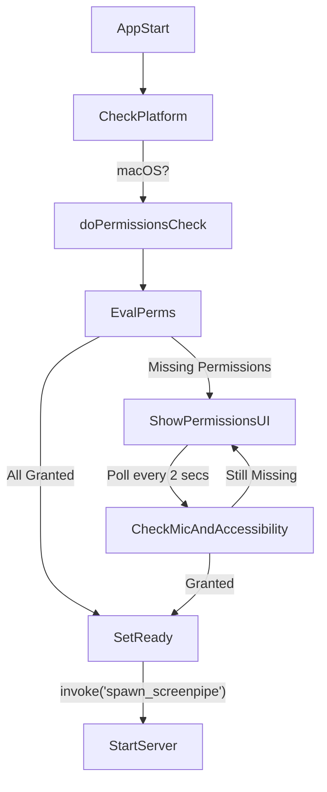
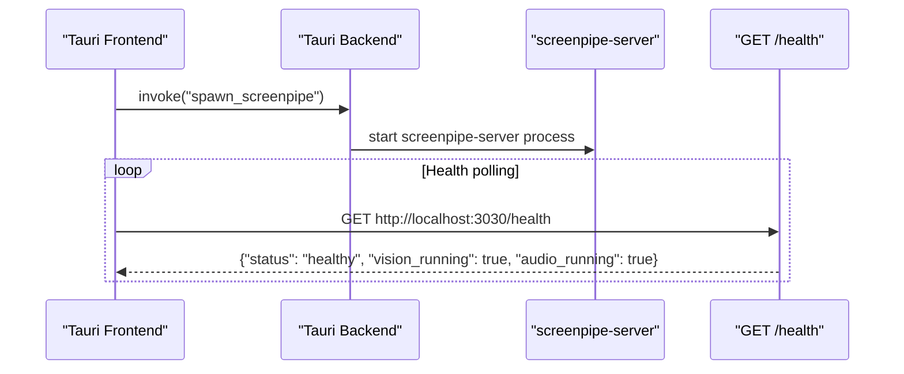
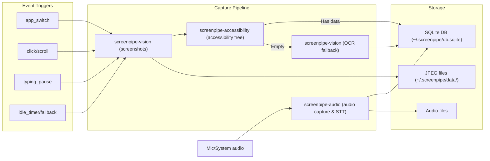
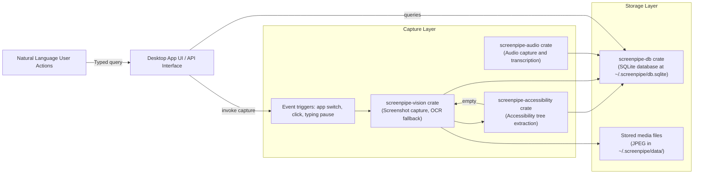

<!-- source: DeepWiki mcp.deepwiki.com · repo screenpipe/screenpipe · page 1.2 Quick Start · fetched 2026-10-26 -->

# Quick Start

<details>
<summary>Relevant source files</summary>

The following files were used as context for generating this wiki page:

- [LICENSE.md](LICENSE.md)
- [README.md](README.md)
- [docs/mintlify/docs-mintlify-mig-tmp/ai-memory.mdx](docs/mintlify/docs-mintlify-mig-tmp/ai-memory.mdx)
- [docs/mintlify/docs-mintlify-mig-tmp/api-recipes.mdx](docs/mintlify/docs-mintlify-mig-tmp/api-recipes.mdx)
- [docs/mintlify/docs-mintlify-mig-tmp/architecture.mdx](docs/mintlify/docs-mintlify-mig-tmp/architecture.mdx)
- [docs/mintlify/docs-mintlify-mig-tmp/cli-reference.mdx](docs/mintlify/docs-mintlify-mig-tmp/cli-reference.mdx)
- [docs/mintlify/docs-mintlify-mig-tmp/connections.mdx](docs/mintlify/docs-mintlify-mig-tmp/connections.mdx)
- [docs/mintlify/docs-mintlify-mig-tmp/docs.json](docs/mintlify/docs-mintlify-mig-tmp/docs.json)
- [docs/mintlify/docs-mintlify-mig-tmp/faq.mdx](docs/mintlify/docs-mintlify-mig-tmp/faq.mdx)
- [docs/mintlify/docs-mintlify-mig-tmp/getting-started.mdx](docs/mintlify/docs-mintlify-mig-tmp/getting-started.mdx)
- [docs/mintlify/docs-mintlify-mig-tmp/home.mdx](docs/mintlify/docs-mintlify-mig-tmp/home.mdx)
- [docs/mintlify/docs-mintlify-mig-tmp/meeting-transcription.mdx](docs/mintlify/docs-mintlify-mig-tmp/meeting-transcription.mdx)
- [docs/mintlify/docs-mintlify-mig-tmp/privacy-data-flow.mdx](docs/mintlify/docs-mintlify-mig-tmp/privacy-data-flow.mdx)
- [docs/mintlify/docs-mintlify-mig-tmp/privacy-filter.mdx](docs/mintlify/docs-mintlify-mig-tmp/privacy-filter.mdx)
- [docs/mintlify/docs-mintlify-mig-tmp/quickstart.mdx](docs/mintlify/docs-mintlify-mig-tmp/quickstart.mdx)
- [docs/mintlify/docs-mintlify-mig-tmp/troubleshooting.mdx](docs/mintlify/docs-mintlify-mig-tmp/troubleshooting.mdx)
- [docs/mintlify/docs-mintlify-mig-tmp/vs-fathom.mdx](docs/mintlify/docs-mintlify-mig-tmp/vs-fathom.mdx)
- [docs/mintlify/docs-mintlify-mig-tmp/vs-fireflies.mdx](docs/mintlify/docs-mintlify-mig-tmp/vs-fireflies.mdx)
- [docs/mintlify/docs-mintlify-mig-tmp/vs-granola.mdx](docs/mintlify/docs-mintlify-mig-tmp/vs-granola.mdx)
- [docs/mintlify/docs-mintlify-mig-tmp/vs-limitless.mdx](docs/mintlify/docs-mintlify-mig-tmp/vs-limitless.mdx)
- [docs/mintlify/docs-mintlify-mig-tmp/vs-littlebird.mdx](docs/mintlify/docs-mintlify-mig-tmp/vs-littlebird.mdx)
- [docs/mintlify/docs-mintlify-mig-tmp/vs-omi.mdx](docs/mintlify/docs-mintlify-mig-tmp/vs-omi.mdx)
- [docs/mintlify/docs-mintlify-mig-tmp/vs-otter.mdx](docs/mintlify/docs-mintlify-mig-tmp/vs-otter.mdx)
- [docs/mintlify/docs-mintlify-mig-tmp/vs-pieces.mdx](docs/mintlify/docs-mintlify-mig-tmp/vs-pieces.mdx)
- [docs/mintlify/docs-mintlify-mig-tmp/vs-recall.mdx](docs/mintlify/docs-mintlify-mig-tmp/vs-recall.mdx)
- [docs/mintlify/docs-mintlify-mig-tmp/vs-rewind.mdx](docs/mintlify/docs-mintlify-mig-tmp/vs-rewind.mdx)

</details>


This page guides you through your first 10 minutes with Screenpipe: installing the application, granting necessary permissions, verifying recording is working, and performing your initial search. By the end, you will have Screenpipe capturing your screen and audio locally, making the data searchable both via the UI and AI assistants.

For detailed platform-specific installation instructions, see [Installation](#1.1). For technical background on how Screenpipe functions internally, see [Core Concepts](#1.3).

---

## Installation Options

Screenpipe can be installed via two main methods: a full desktop application with an integrated UI and a CLI-only mode ideal for headless or server deployments.

### Desktop Application (Recommended)

Download the desktop app from [screenpi.pe/onboarding](https://screenpi.pe/onboarding). This gives you a full user interface including:

- Visual timeline to browse captured data.
- Integrated search UI.
- System tray controls.
- Automatic management of native dependencies like FFmpeg, Tesseract OCR, and audio capture frameworks.
- Built-in automation “Pipes” support for scheduled AI tasks.

The desktop app offers platform-specific installers:

| Platform | Installer Type           |
|----------|-------------------------|
| macOS    | Native `.dmg` (Intel & Apple Silicon) |
| Windows  | Native `.exe` (x64)      |
| Linux    | Build from source        |

This method is the fastest way to start with Screenpipe, managing permissions and capture out of the box.

Sources: [README.md:87-101](), [README.md:179-184](), [docs/mintlify/docs-mintlify-mig-tmp/getting-started.mdx:21-33]()

### CLI-Only Mode

For headless usage or those preferring terminal-first workflows, use:

```bash
npx screenpipe@latest record
```

This starts the Screenpipe daemon, capturing your screen and audio to `~/.screenpipe/` locally without a visual UI.

Use this mode if you want lightweight background capture or to build custom integrations.

Sources: [README.md:93-95](), [docs/mintlify/docs-mintlify-mig-tmp/getting-started.mdx:29-33]()

---

## First Launch: Permissions Setup

Screenpipe requires system permissions to capture screen content and audio on macOS and Windows platforms.

### Permission Flow



This flow ensures interactive permission prompts until all required permissions are granted, after which the core recording server starts.

### Required Permissions

| Permission          | Purpose                                                   |
|---------------------|-----------------------------------------------------------|
| **Screen Recording**| Capture screenshots and walk the accessibility UI tree   |
| **Microphone**       | Capture system audio and mic input for transcription      |
| **Accessibility**    | Access UI element text (buttons, labels, input fields)    |

These are essential to extract structured text metadata from apps directly (best quality) and fall back to OCR when necessary.

Sources: [docs/mintlify/docs-mintlify-mig-tmp/architecture.mdx:141-147](), [docs/mintlify/docs-mintlify-mig-tmp/getting-started.mdx:53-58](), [README.md:108]()

---

## Server Startup and Health Monitoring

After permissions are accepted, Screenpipe launches an embedded REST API server on `localhost:3030`.

### Server Startup Sequence



The `/health` endpoint reports system status including the screen capture engine and audio transcription process.

Query it with:

```bash
curl http://localhost:3030/health
```

This confirms whether screen and audio capture engines are active.

Sources: [docs/mintlify/docs-mintlify-mig-tmp/getting-started.mdx:102-110](), [docs/mintlify/docs-mintlify-mig-tmp/cli-reference.mdx:74-80]()

---

## Verifying Recording Activity

Screenpipe uses an event-driven, reactive capture model that triggers on meaningful UI events instead of high-frequency polling. This reduces CPU and storage usage significantly.

### Event-Driven Capture Flow



- UI events (app switch, typing, clicks) trigger screenshot capture and accessibility tree extraction.
- If accessibility data is missing (remote desktop, games), OCR acts as fallback.
- Audio streams (microphone/system) are captured and transcribed (Whisper, Deepgram).
- All data is indexed and stored locally for fast retrieval.

Sources: [docs/mintlify/docs-mintlify-mig-tmp/architecture.mdx:14-56](), [docs/mintlify/docs-mintlify-mig-tmp/architecture.mdx:128-147]()

### Success Indicators

- CPU usage generally ~5-10% depending on hardware and capture settings.
- Screenpipe writes to `~/.screenpipe/db.sqlite` and media files in `~/.screenpipe/data/`.
- The desktop app timeline view populates with frame thumbnails and text shortly after startup.

Sources: [README.md:110](), [docs/mintlify/docs-mintlify-mig-tmp/architecture.mdx:165-170]()

---

## Searching Your First Data

Once you have created some screen and audio data, try querying your history via the REST API or the built-in UI.

### Search Example with curl

```bash
curl "http://localhost:3030/search?q=meeting&limit=5&content_type=all"
```

This performs a natural language search for the term "meeting" across all data types (screen text, OCR fallback, audio transcripts).

> Note: By default, the API does not require authentication. If enabled, provide the token via a Bearer header:
> ```bash
> curl -H "Authorization: Bearer $(npx screenpipe auth token)" "http://localhost:3030/search?q=meeting"
> ```

### Search Parameters

| Parameter     | Description                                      |
|---------------|------------------------------------------------|
| `q`           | Query string (natural language or keywords)    |
| `content_type`| `accessibility`, `ocr`, `audio`, `input`, or `all` |
| `app_name`    | Filter by application name                       |
| `window_name` | Filter by window title                           |
| `browser_url` | Filter by browser URL                            |
| `start_time`  | ISO 8601 timestamp to filter start              |
| `end_time`    | ISO 8601 timestamp to filter end                |
| `limit`       | Maximum number of results (pagination)          |
| `offset`      | Pagination offset                                |

Start broad with `content_type=all` for initial discovery.

Sources: [docs/mintlify/docs-mintlify-mig-tmp/cli-reference.mdx:103-120](), [docs/mintlify/docs-mintlify-mig-tmp/getting-started.mdx:110]()

---

## Connecting to AI (MCP)

Screenpipe integrates with external AI tools using the Model Context Protocol (MCP), allowing AI assistants like Claude or Cursor to query your recent screen and audio history as context.

### MCP Setup

The simplest way to connect is by running:

```bash
claude mcp add screenpipe --transport stdio -- npx -y screenpipe-mcp
```

Or use the built-in agent setup command:

```bash
npx -y screenpipe@latest agent setup claude-desktop
```

This registers Screenpipe as an MCP data provider and makes it queryable inside supported AI applications.

### Example AI Requests

You can ask your AI:

- *"What did I see in the last 5 minutes?"*
- *"Summarize today’s conversations."*
- *"What tasks was I working on this morning?"*

These queries leverage Screenpipe’s indexed screen and audio data to provide informed replies.

Sources: [README.md:99-101](), [README.md:104](), [docs/mintlify/docs-mintlify-mig-tmp/mcp-server.mdx:18-24]()

---

## Next Steps

- **Explore Pipes**: Install automation “pipes” (AI workflows) from the sidebar’s Pipes section.
- **Configure Connections**: Add app connections like Google Calendar under **Settings → Connections** to enrich AI context and improve speaker identification.
- **Enable Cloud Archive**: Offload older data securely to cloud storage in **Settings → Cloud Archive** to save local disk space.

---

# Summary Diagrams

## 1. Natural Language Space to Code Entity Space: Screen Capture and Data Flow



This shows the connection between user-level actions or queries in natural language through the core capture crates and into persistent storage, accessible via the UI or API.

Sources: [docs/mintlify/docs-mintlify-mig-tmp/architecture.mdx:12-64](), [README.md:58-62]()

## 2. Natural Language Space to Code Entity Space: AI Interaction with MCP

```mermaid
graph TD
    AI[Natural Language AI Assistant\n(Claude, Cursor, Codex)]
    MCP["screenpipe-mcp package\n(MCP server interface)"]
    API["screenpipe-server crate\n(REST API on localhost:3030)"]
    DB["screenpipe-db crate\n(SQLite database)"]

    AI -->|MCP Query| MCP
    MCP -->|Data request| API
    API --> DB
    DB -->|Response with screen/audio context| API
    API --> MCP
    MCP --> AI
```

The diagram illustrates how AI assistants send queries to the MCP server, which queries the Screenpipe REST API and database, streaming back context to the AI in natural language conversational flow.

Sources: [docs/mintlify/docs-mintlify-mig-tmp/mcp-server.mdx:18-24](), [README.md:104]()

---

This completes your quick start guide to getting Screenpipe recording, searchable, and AI-integrated in your environment.

Sources:  
[README.md:87-101,93-95,99-104]()  
[docs/mintlify/docs-mintlify-mig-tmp/getting-started.mdx:21-33,53-58,102-134,159]()  
[docs/mintlify/docs-mintlify-mig-tmp/architecture.mdx:12-64,128-147]()  
[docs/mintlify/docs-mintlify-mig-tmp/cli-reference.mdx:31-50,103-120]()  
[docs/mintlify/docs-mintlify-mig-tmp/mcp-server.mdx:18-24]()

---

