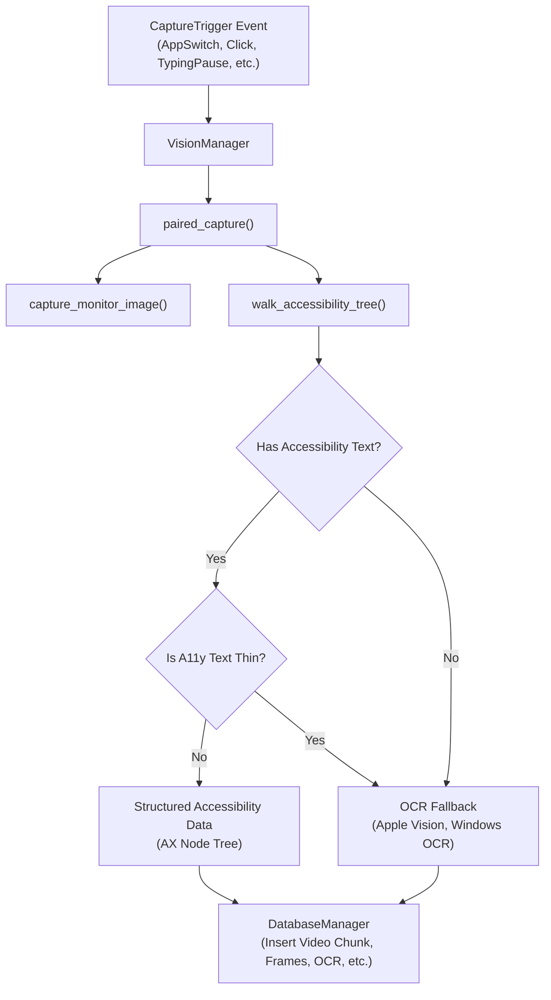
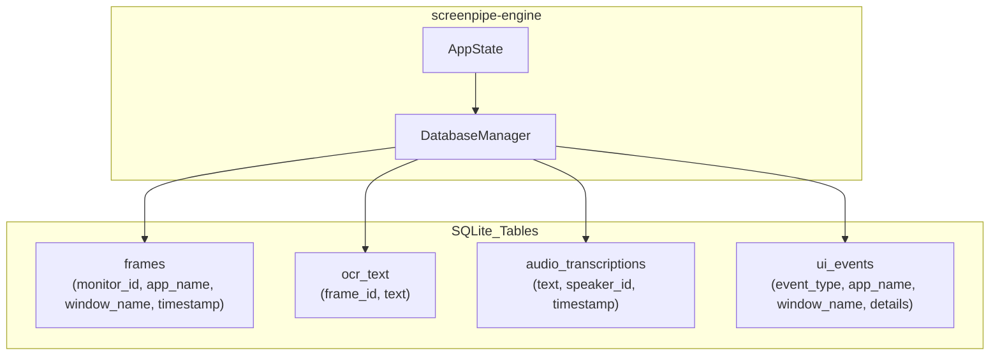
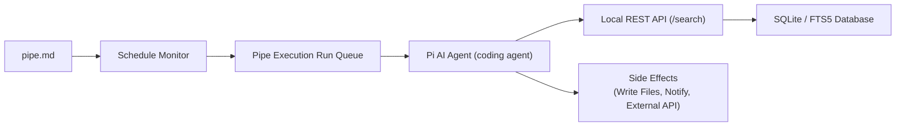
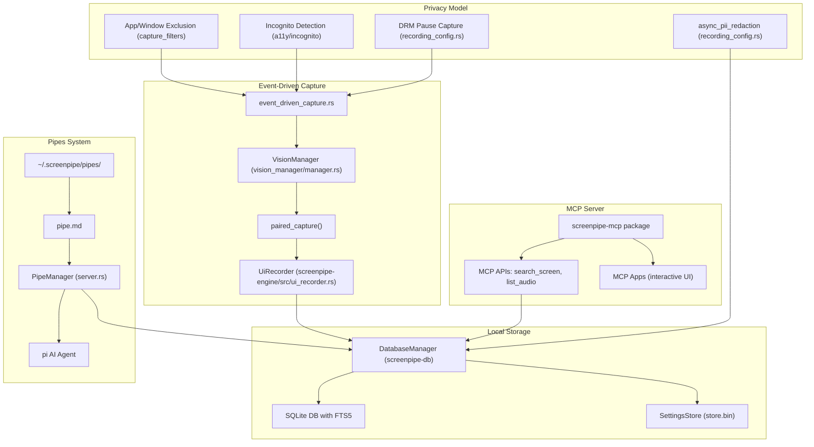

<!-- source: DeepWiki mcp.deepwiki.com · repo screenpipe/screenpipe · page 1.3 Core Concepts · fetched 2026-10-26 -->

# Core Concepts

<details>
<summary>Relevant source files</summary>

The following files were used as context for generating this wiki page:

- [LICENSE.md](LICENSE.md)
- [README.md](README.md)
- [apps/screenpipe-app-tauri/components/settings/capture-filters/content-filters-card.tsx](apps/screenpipe-app-tauri/components/settings/capture-filters/content-filters-card.tsx)
- [crates/screenpipe-a11y/Cargo.toml](crates/screenpipe-a11y/Cargo.toml)
- [crates/screenpipe-a11y/examples/macos_weburl_probe.rs](crates/screenpipe-a11y/examples/macos_weburl_probe.rs)
- [crates/screenpipe-a11y/src/config.rs](crates/screenpipe-a11y/src/config.rs)
- [crates/screenpipe-a11y/src/incognito/linux.rs](crates/screenpipe-a11y/src/incognito/linux.rs)
- [crates/screenpipe-a11y/src/incognito/macos.rs](crates/screenpipe-a11y/src/incognito/macos.rs)
- [crates/screenpipe-a11y/src/incognito/mod.rs](crates/screenpipe-a11y/src/incognito/mod.rs)
- [crates/screenpipe-a11y/src/incognito/titles.rs](crates/screenpipe-a11y/src/incognito/titles.rs)
- [crates/screenpipe-a11y/src/incognito/windows.rs](crates/screenpipe-a11y/src/incognito/windows.rs)
- [crates/screenpipe-a11y/src/platform/macos.rs](crates/screenpipe-a11y/src/platform/macos.rs)
- [crates/screenpipe-a11y/src/platform/windows.rs](crates/screenpipe-a11y/src/platform/windows.rs)
- [crates/screenpipe-a11y/src/platform/windows_uia.rs](crates/screenpipe-a11y/src/platform/windows_uia.rs)
- [crates/screenpipe-a11y/src/tree/linux.rs](crates/screenpipe-a11y/src/tree/linux.rs)
- [crates/screenpipe-a11y/src/tree/macos.rs](crates/screenpipe-a11y/src/tree/macos.rs)
- [crates/screenpipe-a11y/src/tree/mod.rs](crates/screenpipe-a11y/src/tree/mod.rs)
- [crates/screenpipe-a11y/src/tree/windows.rs](crates/screenpipe-a11y/src/tree/windows.rs)
- [crates/screenpipe-a11y/src/url_filter.rs](crates/screenpipe-a11y/src/url_filter.rs)
- [crates/screenpipe-engine/src/event_driven_capture.rs](crates/screenpipe-engine/src/event_driven_capture.rs)
- [crates/screenpipe-engine/src/ui_recorder.rs](crates/screenpipe-engine/src/ui_recorder.rs)
- [crates/screenpipe-engine/src/vision_manager/manager.rs](crates/screenpipe-engine/src/vision_manager/manager.rs)
- [crates/screenpipe-screen/src/capture_screenshot_by_window.rs](crates/screenpipe-screen/src/capture_screenshot_by_window.rs)

</details>


This page explains the fundamental architectural concepts that make Screenpipe unique: event-driven capture, local-first storage, AI integration through Pipes and MCP, and the privacy model.

---

## Event-Driven Capture

Screenpipe uses an **event-driven capture model** rather than continuous polling. Instead of capturing every frame at fixed intervals, the system listens for meaningful OS events that indicate user activity or screen changes, triggering captures only when necessary. This approach dramatically reduces CPU usage (to roughly 5-10%) and average storage requirements (around 20GB/month).

### Trigger Events and Capture Model

The core coordination for event-driven capture resides in the `event_driven_capture` module. This replaces older polling-based video capture with a system that responds to specific user and system events. Key capture triggers include:

| Event Type       | Code Entity                     | Description                                  |
|------------------|--------------------------------|----------------------------------------------|
| **App Switch**   | `CaptureTrigger::AppSwitch`     | When the foreground application changes.    |
| **Window Focus** | `CaptureTrigger::WindowFocus`   | Focus changes between windows within an app.|
| **Click**       | `CaptureTrigger::Click`          | Mouse click events detected.                  |
| **Typing Pause**| `CaptureTrigger::TypingPause`    | Triggered during pauses in keyboard input.   |
| **Scroll Stop** | `CaptureTrigger::ScrollStop`     | Triggered when scrolling activity ceases.    |
| **Visual Change**| `CaptureTrigger::VisualChange`   | Screen content changes independent of input (e.g. video). |
| **Idle Fallback**| `CaptureTrigger::Idle`           | Periodic fallback capture after inactivity timeout. |

This design ensures captures happen only on meaningful activity, avoiding redundant data capture during idle or unchanged periods.

### Implementation Highlights

- Each active monitor recording spawns an event-driven capture loop (`event_driven_capture.rs`) that listens asynchronously for trigger events and orchestrates captures under a timeout budget (typically 15s per capture).

- A key function, `paired_capture()`, performs an atomic operation concatenating a screen image snapshot with an accessibility tree capture. This synchronous pairing ensures the image and semantic context are aligned in time.

- Captures include multi-layered exclusion filters, power profile adaptations (e.g., idle throttling), and fallback logic for accessibilities that might not expose enough text.

### Accessibility Tree Extraction vs. OCR

Screenpipe prioritizes accessibility tree extraction over OCR for textual data because it provides structured semantic context, is faster, and more accurate. However, if accessibility text is thin or incomplete, OCR (e.g., Apple Vision or Windows OCR) activates as a fallback.

The combined "paired capture" produces:

- A **screenshot** with pixel data
- An **accessibility node tree** with text, roles, bounds, and metadata
- Optional **OCR transcriptions** for unidentified text regions

**Capture flow with decision points:**



This layered approach combines semantic accuracy with fallback robustness for text extraction.

Sources: [crates/screenpipe-engine/src/event_driven_capture.rs:5-62](), [crates/screenpipe-engine/src/vision_manager/manager.rs:5-142](), [README.md:104-119]()

---

## Local-First Data Storage

Screenpipe emphasizes a **local-first** philosophy. All captured data—video frames, audio transcriptions, UI events, accessibility trees, and extracted text—are stored locally, by default offline and optionally encrypted at rest.

### Directory and File Layout

The base directory is typically `~/.screenpipe/` (user’s home directory). The structure includes:

```
~/.screenpipe/
├── db.sqlite                # Core SQLite database (WAL journal mode)
├── store.bin                # Persistent settings store (SettingsStore)
├── screenpipe.log           # Rotating application logs
├── data/
│   └── snapshots/           # Per-monitor JPEG screenshots by monitor ID
└── pipes/                   # Local pipes directory
    └── my-pipe/
        └── pipe.md          # Pipe definition file (YAML + markdown)
```

This filesystem organization supports modular management of data and workflows.

### Database Architecture

The primary data repository is a SQLite database managed by the `DatabaseManager` abstraction. Features include:

- **WAL mode** for concurrency (enables readers during writes).
- **FTS5 (Full Text Search)** extensions powering robust natural language search across:

  - Full frames and metadata
  - OCR text chunks from screenshots
  - Audio transcription texts
  - UI events including keyboard, mouse, and window activity

**Storage Schema Entity Map:**



- **Redaction**: The system supports asynchronous PII redaction on text and images at rest, configurable through `RecordingConfig` flags such as `async_pii_redaction` and `async_image_pii_redaction`.

Sources: [crates/screenpipe-engine/src/bin/screenpipe-engine.rs:131-156](), [crates/screenpipe-engine/src/server.rs:130-170](), [crates/screenpipe-engine/src/recording_config.rs:35-70](), [README.md:60-80]()

---

## Pipes System

**Pipes** are user-definable automated AI workflows that operate on Screenpipe data at scheduled intervals. Each pipe corresponds to a directory under `~/.screenpipe/pipes/` containing a `pipe.md` file that specifies the workflow, AI prompts, scheduling, and optionally environment variables for secrets.

### PipeManager Responsibilities

- **Discovery**: Watches the `pipes` directory for new, changed, or removed pipes.
- **Scheduling**: Parses `schedule` frontmatter like `"every 30m"` to trigger execution.
- **Prompt Construction**: Prepends context such as time ranges, API URL endpoints, and output directories to the `pipe.md` content.
- **Execution**: Runs pipes using the `pi` coding agent through JSON-RPC or local API calls.
- **Result Handling**: Pipes can write files, trigger notifications, or call external APIs.

### Pipe Execution Flow



This enables flexible, scheduled AI processing loops that leverage the entire local data store.

Sources: [docs/mintlify/docs-mintlify-mig-tmp/pipes.mdx:130-160](), [crates/screenpipe-engine/src/server.rs:150-170]()

---

## Model Context Protocol (MCP) Integration

Screenpipe implements the **Model Context Protocol (MCP)**, which exposes local captured data securely to external AI assistants, IDEs, or tools such as Claude, Cursor, or VS Code extensions.

### MCP Server Features

- The `screenpipe-mcp` package runs a microservice that provides MCP endpoints.
- Offers LLM-accessible methods like `search_screen`, `list_audio`, `get_activity_summary` to query local data.
- Supports **MCP Apps**: interactive HTML/UI overlays that agents can show, enabling rich visualizations and workflows that operate on Screenpipe data in real time.

This integration enables external AI agents to tap into the user’s capture history, enabling augmented intelligence features.

Sources: [README.md:99-104](), [docs/mintlify/docs-mintlify-mig-tmp/pipes.mdx:150-160]()

---

## Privacy Model

Screenpipe follows a privacy-conscious design with several technical enforcements:

1. **Local-Only Storage:**  
   All data is stored locally in SQLite databases. Cloud sync or AI inference uses separate data paths and opt-in flows. Data does not leave the user’s device by default.  

2. **PII Masking and Redaction:**  
   A trained ONNX privacy model on-device or the Tinfoil enclave automatically removes personally identifiable information from stored text and images asynchronously.

3. **Selective Capture Filtering:**

   - **App and Window Exclusion:**  
     Password managers, lock screens, and other sensitive apps are excluded automatically by name patterns.  

   - **Incognito Window Detection:**  
     Private browsing windows are detected and ignored to protect browsing privacy automatically.

4. **DRM Content Detection:**  
   Captures pause automatically when DRM-protected streaming apps (Netflix, Disney+, etc.) are in focus, avoiding unauthorized recording.

5. **Auditability and Transparency:**  
   Screenpipe is source-available, with a clearly documented privacy model and modular design permitting security audits and user modifications.

This multi-layered model prioritizes local control and data minimization to protect user privacy.

Sources: [crates/screenpipe-engine/src/recording_config.rs:40-65](), [apps/screenpipe-app-tauri/components/settings/privacy-section.tsx:10-15](), [README.md:70-80]()

---

# Summary Mermaid Diagram: Core Concepts to Code Entities



This diagram maps the major conceptual areas of Screenpipe to the core code entities handling them.

---

# Full Details and File Pointers

| Concept                    | Primary Files and Lines                                            |
|----------------------------|------------------------------------------------------------------|
| Event-Driven Capture Loop   | `crates/screenpipe-engine/src/event_driven_capture.rs:1-163`      |
| VisionManager (Multi-Monitor Capture) | `crates/screenpipe-engine/src/vision_manager/manager.rs:1-142`         |
| Accessibility Tree Capture  | `crates/screenpipe-a11y/src/tree/mod.rs` and platform-specific modules (`macos.rs`, `windows.rs`, `linux.rs`) |
| UI Recorder Integration     | `crates/screenpipe-engine/src/ui_recorder.rs:1-182`               |
| DatabaseManager & Storage   | `crates/screenpipe-engine/src/server.rs:130-170` and `bin/screenpipe-engine.rs:130-156` |
| Pipe System Lifecycle       | `docs/mintlify/docs-mintlify-mig-tmp/pipes.mdx` and `crates/screenpipe-engine/src/server.rs` |
| MCP Server Integration      | `packages/screenpipe-mcp` (not shown here) and README notes      |
| Privacy Controls            | `crates/screenpipe-engine/src/recording_config.rs:30-70` and UI filters in `apps/screenpipe-app-tauri/components/settings/privacy-section.tsx` |

Sources:  
[crates/screenpipe-engine/src/event_driven_capture.rs:1-163](),  
[crates/screenpipe-engine/src/vision_manager/manager.rs:1-142](),  
[crates/screenpipe-a11y/src/tree/mod.rs:1-150](),  
[crates/screenpipe-engine/src/ui_recorder.rs:1-182](),  
[crates/screenpipe-engine/src/server.rs:130-170](),  
[crates/screenpipe-engine/src/bin/screenpipe-engine.rs:130-156](),  
[docs/mintlify/docs-mintlify-mig-tmp/pipes.mdx:130-160](),  
[README.md:60-140](),  
[apps/screenpipe-app-tauri/components/settings/privacy-section.tsx:10-15](),  
[crates/screenpipe-engine/src/recording_config.rs:30-70]()

---

