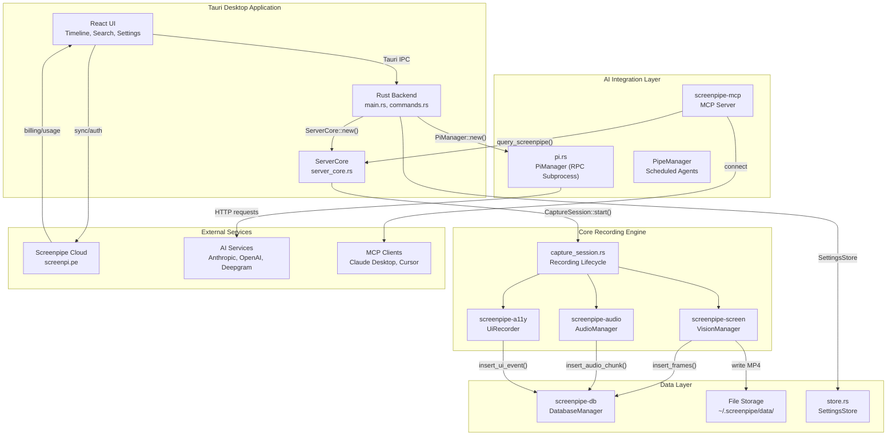
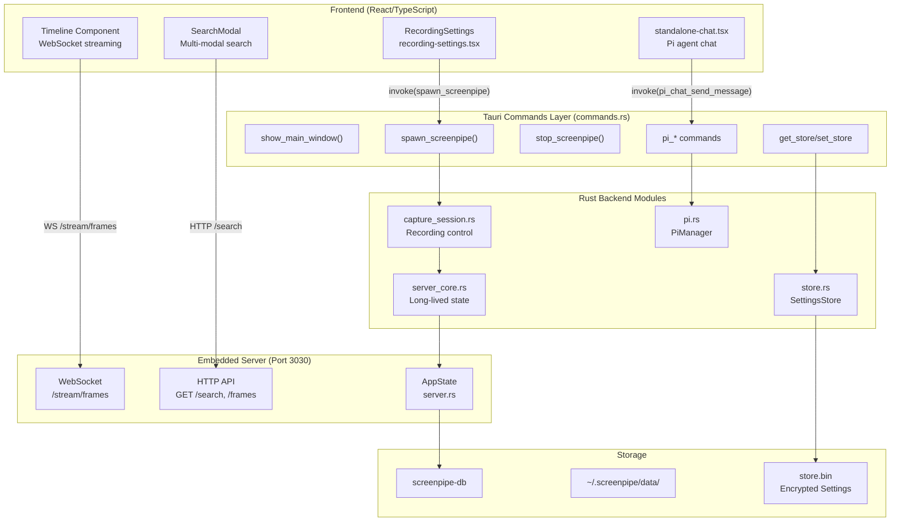
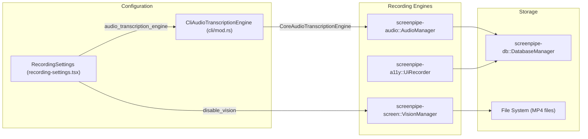

<!-- source: DeepWiki mcp.deepwiki.com · repo screenpipe/screenpipe · page 2 Architecture · fetched 2026-10-26 -->

# Architecture

Relevant source files

The following files were used as context for generating this wiki page:

- [Cargo.lock](Cargo.lock)
- [Cargo.toml](Cargo.toml)
- [apps/screenpipe-app-tauri/components/settings/general-settings.tsx](apps/screenpipe-app-tauri/components/settings/general-settings.tsx)
- [apps/screenpipe-app-tauri/components/settings/privacy-section.tsx](apps/screenpipe-app-tauri/components/settings/privacy-section.tsx)
- [apps/screenpipe-app-tauri/components/settings/recording-settings.tsx](apps/screenpipe-app-tauri/components/settings/recording-settings.tsx)
- [apps/screenpipe-app-tauri/components/update-banner.tsx](apps/screenpipe-app-tauri/components/update-banner.tsx)
- [apps/screenpipe-app-tauri/lib/hooks/use-settings.tsx](apps/screenpipe-app-tauri/lib/hooks/use-settings.tsx)
- [apps/screenpipe-app-tauri/lib/utils/tauri.ts](apps/screenpipe-app-tauri/lib/utils/tauri.ts)
- [apps/screenpipe-app-tauri/src-tauri/Cargo.lock](apps/screenpipe-app-tauri/src-tauri/Cargo.lock)
- [apps/screenpipe-app-tauri/src-tauri/Cargo.toml](apps/screenpipe-app-tauri/src-tauri/Cargo.toml)
- [apps/screenpipe-app-tauri/src-tauri/src/commands.rs](apps/screenpipe-app-tauri/src-tauri/src/commands.rs)
- [apps/screenpipe-app-tauri/src-tauri/src/embedded_server.rs](apps/screenpipe-app-tauri/src-tauri/src/embedded_server.rs)
- [apps/screenpipe-app-tauri/src-tauri/src/health.rs](apps/screenpipe-app-tauri/src-tauri/src/health.rs)
- [apps/screenpipe-app-tauri/src-tauri/src/main.rs](apps/screenpipe-app-tauri/src-tauri/src/main.rs)
- [apps/screenpipe-app-tauri/src-tauri/src/process_exit.rs](apps/screenpipe-app-tauri/src-tauri/src/process_exit.rs)
- [apps/screenpipe-app-tauri/src-tauri/src/recording.rs](apps/screenpipe-app-tauri/src-tauri/src/recording.rs)
- [apps/screenpipe-app-tauri/src-tauri/src/recording/db_wedge.rs](apps/screenpipe-app-tauri/src-tauri/src/recording/db_wedge.rs)
- [apps/screenpipe-app-tauri/src-tauri/src/server_core.rs](apps/screenpipe-app-tauri/src-tauri/src/server_core.rs)
- [apps/screenpipe-app-tauri/src-tauri/src/store.rs](apps/screenpipe-app-tauri/src-tauri/src/store.rs)
- [apps/screenpipe-app-tauri/src-tauri/src/tray.rs](apps/screenpipe-app-tauri/src-tauri/src/tray.rs)
- [apps/screenpipe-app-tauri/src-tauri/src/updates.rs](apps/screenpipe-app-tauri/src-tauri/src/updates.rs)
- [crates/screenpipe-audio/Cargo.toml](crates/screenpipe-audio/Cargo.toml)
- [crates/screenpipe-config/src/recording.rs](crates/screenpipe-config/src/recording.rs)
- [crates/screenpipe-engine/src/bin/screenpipe-engine.rs](crates/screenpipe-engine/src/bin/screenpipe-engine.rs)
- [crates/screenpipe-engine/src/cli/mod.rs](crates/screenpipe-engine/src/cli/mod.rs)
- [crates/screenpipe-engine/src/lib.rs](crates/screenpipe-engine/src/lib.rs)
- [crates/screenpipe-engine/src/recording_config.rs](crates/screenpipe-engine/src/recording_config.rs)
- [crates/screenpipe-engine/src/routes/mod.rs](crates/screenpipe-engine/src/routes/mod.rs)
- [crates/screenpipe-engine/src/server.rs](crates/screenpipe-engine/src/server.rs)
- [crates/screenpipe-screen/Cargo.toml](crates/screenpipe-screen/Cargo.toml)
- [packages/sdk/Cargo.lock](packages/sdk/Cargo.lock)
- [packages/sdk/examples/tauri-app/src-tauri/Cargo.lock](packages/sdk/examples/tauri-app/src-tauri/Cargo.lock)

Screenpipe is a Tauri-based desktop application embedding a high-performance recording engine directly in-process. The architecture is layered into three primary tiers: the **Desktop Application** (Tauri with React UI and Rust backend), the **Core Recording Engine** (event-driven screen/audio/UI capture), and the **Data Layer** (SQLite with FTS5, local file storage). All captured data remains local by default, aligned with Screenpipe’s local-first philosophy, with optional cloud integrations for AI model access and device synchronization.

This page presents a high-level overview of the system architecture, illustrating major components and their interactions. For in-depth technical details, please refer to the child pages linked below.

---

## System Topology and Component Relationships

Screenpipe's system architecture centers on an embedded server model and modular engine components that collectively handle screen and audio capture, accessibility recording, and AI integration. The desktop application coordinates user interactions and orchestrates the underlying recording subsystems.

The `ServerCore` component manages long-lived resources such as the embedded HTTP server and SQLite database. Meanwhile, the `CaptureSession` handles volatile recording lifecycles for vision, audio, and UI events [apps/screenpipe-app-tauri/src-tauri/src/embedded_server.rs:5-12](). The screen and audio streams are persisted primarily in SQLite and local file storage under the data directory, with `store.rs` providing a robust settings store including snapshotting to prevent corruption during app updates [apps/screenpipe-app-tauri/src-tauri/src/store.rs:49-86]().

**Sources:** [apps/screenpipe-app-tauri/src-tauri/src/embedded_server.rs:5-12](), [crates/screenpipe-engine/src/server.rs:185-187](), [apps/screenpipe-app-tauri/src-tauri/src/store.rs:49-86]()

---

## Desktop Application Architecture

Screenpipe’s frontend is built using React and TypeScript within a Tauri application shell. The React UI presents components like Timeline, Search, and Settings, and communicates through Tauri IPC commands with the Rust backend. The backend coordinates with modular subsystems managing recording sessions, state, AI agents, and persistent settings.

Key backend components include `AppState`, which encapsulates shared resources like `DatabaseManager` and `AudioManager` [crates/screenpipe-engine/src/server.rs:129-171](), and the `PiManager` for AI assistant RPC communication. Settings management uses a persistent encrypted `store.bin` file backed by a fail-safe snapshot mechanism, avoiding configuration loss upon abrupt shutdown or app upgrade [apps/screenpipe-app-tauri/src-tauri/src/store.rs:89-95]().

The frontend `RecordingSettings` component exposes unified UI controls for complex recording configurations, including audio capture modes, transcription engine selection, and capture frequency. This aligns settings management across the desktop GUI, CLI, and engine subsystems [apps/screenpipe-app-tauri/components/settings/recording-settings.tsx:14-38](), [crates/screenpipe-engine/src/cli/mod.rs:67-78]().

**Sources:** [crates/screenpipe-engine/src/server.rs:129-171](), [apps/screenpipe-app-tauri/components/settings/recording-settings.tsx:14-38](), [apps/screenpipe-app-tauri/src-tauri/src/store.rs:89-95](), [crates/screenpipe-engine/src/cli/mod.rs:67-78]()

---

## Data Capture & Recording Configuration

Screenpipe’s recording configuration is designed for consistency across interfaces and execution environments — configuring the screen, audio, UI recorder, and transcription engines in a cohesive manner.

The system automatically selects the best-fitting audio transcription engine based on hardware tiers, defaulting to `WhisperTiny` for low-tier configurations and `Parakeet` for devices with higher capabilities [crates/screenpipe-engine/src/cli/mod.rs:71-78](). The `VisionManager` captures video frames for screen context and optionally writes MP4 files. Accessibility tree events and audio data are inserted into SQLite for integrated searching and AI analysis [apps/screenpipe-app-tauri/components/settings/recording-settings.tsx:14-38]().

**Sources:** [crates/screenpipe-engine/src/cli/mod.rs:71-78](), [apps/screenpipe-app-tauri/components/settings/recording-settings.tsx:14-38]()

---

## Cargo Workspace & Build Configuration

Screenpipe is structured as a unified Cargo workspace comprising multiple interdependent crates. The workspace enables modular development and deployment while optimizing binary size and runtime performance.

| Crate                    | Description                                                         |
|--------------------------|---------------------------------------------------------------------|
| `screenpipe-app-tauri`   | Main desktop application entry point; Tauri app frontend and Rust backend [apps/screenpipe-app-tauri/src-tauri/Cargo.toml:1-179]() |
| `screenpipe-engine`      | Core recording engine, embedded HTTP server, CLI, and recording control [crates/screenpipe-engine/src/bin/screenpipe-engine.rs:27-49]() |
| `screenpipe-audio`       | Audio capture, VAD, speaker ID, and transcription engines [apps/screenpipe-app-tauri/src-tauri/Cargo.toml:135-154]() |
| `screenpipe-db`          | SQLite storage, FTS5 integration, migration system [apps/screenpipe-app-tauri/src-tauri/Cargo.toml:155]() |
| `screenpipe-core`        | Shared utilities, pipe runtime, AI agent executors [Cargo.toml:22-28]() |

To minimize memory usage on non-Windows platforms, the project uses `jemalloc` as the global allocator. Build profiles include a fully optimized `release` profile with LTO and a `release-dev` profile using thin LTO for faster iteration cycles [Cargo.toml:165-177]().

**Sources:** [Cargo.toml:1-179](), [apps/screenpipe-app-tauri/src-tauri/Cargo.toml:1-179](), [crates/screenpipe-engine/src/bin/screenpipe-engine.rs:27-49]()

---

## Summary and Links to Subsystems

The Screenpipe system consists of several major subsystems working together under a common local-first principle:

- **System Overview (#2.1):** In-depth component topology and crate map detailing Tauri app, embedded server, engines, DB, AI layer.  
- **Data Capture Pipeline (#2.2):** Event-driven screen capture, accessibility extraction, OCR fallback, UI event monitoring, DRM detection, monitor watching.  
- **Audio Processing (#2.3):** Audio capture workflow, VAD and speaker identification, transcription engines (Whisper, Deepgram, OpenAI), deduplication, CoreAudio taps.  
- **Storage & Database (#2.4):** SQLite with FTS5, WAL mode, write queue/coalescing, migration system, cloud sync integration. Includes hybrid storage details.  
- **AI Gateway & Usage Tracking (#2.5):** Cloud AI gateway on Cloudflare Workers, tiered SaaS access, rate limiting, cost metrics, routing to Anthropic, Gemini, OpenRouter, Vertex providers.  
- **Privacy & Redaction (#2.6):** screenpipe-redact pipeline with ONNX/CoreML/DirectML backends, image/text privacy filters, secrets vaults.

For detailed architectural and functional information on these subsystems, please consult their respective child pages.

---

# End of Architecture Page

---

**Sources:**

- [apps/screenpipe-app-tauri/src-tauri/src/embedded_server.rs:5-12]()
- [crates/screenpipe-engine/src/server.rs:185-187]()
- [apps/screenpipe-app-tauri/src-tauri/src/store.rs:49-86]()
- [crates/screenpipe-engine/src/server.rs:129-171]()
- [apps/screenpipe-app-tauri/components/settings/recording-settings.tsx:14-38]()
- [crates/screenpipe-engine/src/cli/mod.rs:67-78]()
- [apps/screenpipe-app-tauri/src-tauri/src/store.rs:89-95]()
- [Cargo.toml:1-179]()
- [apps/screenpipe-app-tauri/src-tauri/Cargo.toml:1-179]()
- [crates/screenpipe-engine/src/bin/screenpipe-engine.rs:27-49]()

---

