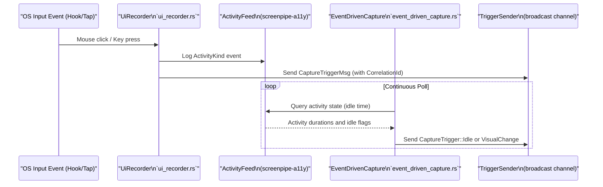
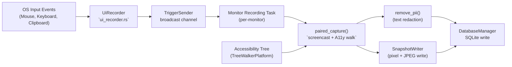

<!-- source: DeepWiki mcp.deepwiki.com · repo screenpipe/screenpipe · page 2.2 Data Capture Pipeline · fetched 2026-10-26 -->

# Data Capture Pipeline

<details>
<summary>Relevant source files</summary>

The following files were used as context for generating this wiki page:

- [.github/workflows/docs.yml](.github/workflows/docs.yml)
- [.github/workflows/eval-diarization.yml](.github/workflows/eval-diarization.yml)
- [.github/workflows/eval-meeting-detection.yml](.github/workflows/eval-meeting-detection.yml)
- [.github/workflows/sdk.yml](.github/workflows/sdk.yml)
- [.github/workflows/test-ai-gateway.yml](.github/workflows/test-ai-gateway.yml)
- [apps/screenpipe-app-tauri/components/settings/capture-filters/content-filters-card.tsx](apps/screenpipe-app-tauri/components/settings/capture-filters/content-filters-card.tsx)
- [apps/screenpipe-app-tauri/lib/hooks/__tests__/use-permission-monitor.test.tsx](apps/screenpipe-app-tauri/lib/hooks/__tests__/use-permission-monitor.test.tsx)
- [apps/screenpipe-app-tauri/lib/hooks/use-permission-monitor.tsx](apps/screenpipe-app-tauri/lib/hooks/use-permission-monitor.tsx)
- [apps/screenpipe-app-tauri/src-tauri/src/capture_session.rs](apps/screenpipe-app-tauri/src-tauri/src/capture_session.rs)
- [apps/screenpipe-app-tauri/src-tauri/src/engine_events/permission.rs](apps/screenpipe-app-tauri/src-tauri/src/engine_events/permission.rs)
- [apps/screenpipe-app-tauri/src-tauri/src/recording/retry.rs](apps/screenpipe-app-tauri/src-tauri/src/recording/retry.rs)
- [crates/screenpipe-a11y/Cargo.toml](crates/screenpipe-a11y/Cargo.toml)
- [crates/screenpipe-a11y/examples/macos_weburl_probe.rs](crates/screenpipe-a11y/examples/macos_weburl_probe.rs)
- [crates/screenpipe-a11y/src/config.rs](crates/screenpipe-a11y/src/config.rs)
- [crates/screenpipe-a11y/src/incognito/linux.rs](crates/screenpipe-a11y/src/incognito/linux.rs)
- [crates/screenpipe-a11y/src/incognito/macos.rs](crates/screenpipe-a11y/src/incognito/macos.rs)
- [crates/screenpipe-a11y/src/incognito/mod.rs](crates/screenpipe-a11y/src/incognito/mod.rs)
- [crates/screenpipe-a11y/src/incognito/titles.rs](crates/screenpipe-a11y/src/incognito/titles.rs)
- [crates/screenpipe-a11y/src/incognito/windows.rs](crates/screenpipe-a11y/src/incognito/windows.rs)
- [crates/screenpipe-a11y/src/platform/macos.rs](crates/screenpipe-a11y/src/platform/macos.rs)
- [crates/screenpipe-a11y/src/platform/windows.rs](crates/screenpipe-a11y/src/platform/windows.rs)
- [crates/screenpipe-a11y/src/platform/windows_uia.rs](crates/screenpipe-a11y/src/platform/windows_uia.rs)
- [crates/screenpipe-a11y/src/tree/linux.rs](crates/screenpipe-a11y/src/tree/linux.rs)
- [crates/screenpipe-a11y/src/tree/macos.rs](crates/screenpipe-a11y/src/tree/macos.rs)
- [crates/screenpipe-a11y/src/tree/mod.rs](crates/screenpipe-a11y/src/tree/mod.rs)
- [crates/screenpipe-a11y/src/tree/windows.rs](crates/screenpipe-a11y/src/tree/windows.rs)
- [crates/screenpipe-a11y/src/url_filter.rs](crates/screenpipe-a11y/src/url_filter.rs)
- [crates/screenpipe-audio-eval/Cargo.toml](crates/screenpipe-audio-eval/Cargo.toml)
- [crates/screenpipe-audio-eval/src/bin/eval_transcription.rs](crates/screenpipe-audio-eval/src/bin/eval_transcription.rs)
- [crates/screenpipe-core/examples/probe_accessibility.rs](crates/screenpipe-core/examples/probe_accessibility.rs)
- [crates/screenpipe-core/examples/probe_screen_recording.rs](crates/screenpipe-core/examples/probe_screen_recording.rs)
- [crates/screenpipe-core/src/permissions.rs](crates/screenpipe-core/src/permissions.rs)
- [crates/screenpipe-engine/src/event_driven_capture.rs](crates/screenpipe-engine/src/event_driven_capture.rs)
- [crates/screenpipe-engine/src/permission_monitor.rs](crates/screenpipe-engine/src/permission_monitor.rs)
- [crates/screenpipe-engine/src/routes/vision.rs](crates/screenpipe-engine/src/routes/vision.rs)
- [crates/screenpipe-engine/src/sleep_monitor.rs](crates/screenpipe-engine/src/sleep_monitor.rs)
- [crates/screenpipe-engine/src/ui_recorder.rs](crates/screenpipe-engine/src/ui_recorder.rs)
- [crates/screenpipe-engine/src/vision_manager/manager.rs](crates/screenpipe-engine/src/vision_manager/manager.rs)
- [crates/screenpipe-engine/src/vision_manager/monitor_watcher.rs](crates/screenpipe-engine/src/vision_manager/monitor_watcher.rs)
- [crates/screenpipe-screen/examples/wgc_cpu_probe.rs](crates/screenpipe-screen/examples/wgc_cpu_probe.rs)
- [crates/screenpipe-screen/examples/wgc_session_ab.rs](crates/screenpipe-screen/examples/wgc_session_ab.rs)
- [crates/screenpipe-screen/src/capture_screenshot_by_window.rs](crates/screenpipe-screen/src/capture_screenshot_by_window.rs)
- [crates/screenpipe-screen/src/lib.rs](crates/screenpipe-screen/src/lib.rs)
- [crates/screenpipe-screen/src/microsoft.rs](crates/screenpipe-screen/src/microsoft.rs)
- [crates/screenpipe-screen/src/monitor.rs](crates/screenpipe-screen/src/monitor.rs)
- [crates/screenpipe-screen/src/monitor/macos.rs](crates/screenpipe-screen/src/monitor/macos.rs)
- [crates/screenpipe-screen/src/monitor/windows.rs](crates/screenpipe-screen/src/monitor/windows.rs)
- [crates/screenpipe-screen/src/ocr_worker.rs](crates/screenpipe-screen/src/ocr_worker.rs)
- [crates/screenpipe-screen/src/wgc_capture.rs](crates/screenpipe-screen/src/wgc_capture.rs)
- [crates/screenpipe-screen/tests/windows_vision_test.rs](crates/screenpipe-screen/tests/windows_vision_test.rs)

</details>


This page documents how Screenpipe captures screen data and UI events driven by user activity, accessibility tree extraction with OCR fallback, UI event monitoring, DRM detection to avoid protected content capture, and monitor watching for dynamic system changes.

---

## Overview

Screenpipe implements an **event-driven screen capture pipeline** that triggers captures only on meaningful user interactions such as application switches, window focus changes, clicks, typing pauses, scroll stops, clipboard changes, visual changes, and idle fallbacks. This optimizes resource usage by avoiding unnecessary polling captures.

It combines native accessibility tree extraction on macOS, Windows, and Linux with a fallback to OCR-based text extraction for robust text retrieval from screen content. UI events like clicks and keypresses are captured and correlated to captured frames, enhancing contextual search and recall.

Dynamic monitor watching supports detection of monitor connect/disconnect events and adapts capture tasks accordingly. DRM detection prevents capture during protected video playback by known apps or URLs. The pipeline uses various controllers and power profiles to manage capture quality, frequency, and resource use.

The following diagram shows the relationship between major subsystems and key code entities:

```mermaid
flowchart TD
    subgraph "UI Event Capture\n(screenpipe-a11y / ui_recorder.rs)"
        UIR[UiRecorder\n`ui_recorder.rs`]
        TWP[TreeWalkerPlatform\n`tree/macos.rs`, `tree/windows.rs`, `tree/linux.rs`]
    end

    subgraph "Event-Driven Capture\n(screenpipe-engine/event_driven_capture.rs)"
        EDC[EventDrivenCapture module\n`event_driven_capture.rs`]
        TRIG[CaptureTrigger enum\n`event_driven_capture.rs`]
        TRIG_TX[TriggerSender broadcast channel\n`event_driven_capture.rs`]
    end

    subgraph "Paired Capture\n(screenpipe-capture/paired_capture.rs)"
        PC[paired_capture()\n`paired_capture.rs`]
        SNAP[SnapshotWriter\n`screenpipe-screen/src/snapshot_writer.rs`]
        PII[remove_pii()\n`screenpipe-core`]
    end

    subgraph "Vision Manager\n(screenpipe-engine/vision_manager/manager.rs)"
        VM[VisionManager struct\n`vision_manager/manager.rs`]
        MON_TASK[Per-monitor capture task]
    end

    subgraph "Storage\n(screenpipe-db)"
        DB[DatabaseManager\n`db.rs`]
        FRAMES[frames table]
    end

    subgraph "DRM Detection\n(screenpipe-engine/drm_detector.rs)"
        DRM[DRMDetector class]
    end

    subgraph "Monitor Watcher\n(screenpipe-engine/vision_manager/monitor_watcher.rs)"
        MON_WATCHER[MonitorWatcher loop]
    end

    UIR -->|UI events| TRIG_TX
    EDC -->|Polls ActivityFeed| TRIG_TX
    TRIG_TX -->|Broadcast triggers| MON_TASK
    MON_TASK --> PC
    TWP -->|Accessibility trees| PC
    PC --> SNAP
    PC --> PII
    PC --> DB
    DB --> FRAMES
    DRM --> VM
    MON_WATCHER --> VM
```

Sources:  
[crates/screenpipe-engine/src/event_driven_capture.rs:5-52]()  
[crates/screenpipe-engine/src/vision_manager/manager.rs:5-142]()  
[crates/screenpipe-a11y/src/platform/macos.rs:5-162]()  
[crates/screenpipe-a11y/src/tree/macos.rs:5-182]()  
[crates/screenpipe-a11y/src/tree/windows.rs:5-208]()  
[crates/screenpipe-a11y/src/tree/linux.rs:5-203]()  
[crates/screenpipe-engine/src/ui_recorder.rs:1-182]()  
[crates/screenpipe-engine/src/drm_detector.rs:5-56]()  
[crates/screenpipe-engine/src/vision_manager/monitor_watcher.rs:1-132]()

---

## Screen Capture Pipeline

### Capture Triggers

Capture events are represented by the `CaptureTrigger` enum, which enumerates all user events causing a capture:

| Variant | Trigger Condition | Source |
|---------|-------------------|--------|
| `AppSwitch { app_name }` | User switches applications | UI event |
| `WindowFocus { window_name }` | Window focus change within same app | UI event |
| `Click` | Mouse click detected | UI event |
| `TypingPause` | User stopped typing (pause after keystroke activity) | Activity poll |
| `ScrollStop` | Scrolling stopped | Activity poll |
| `KeyPress` | Keyboard event observed (if enabled) | UI event |
| `Clipboard` | Clipboard content changed | UI event |
| `VisualChange` | Screen visual content changed without input (video, animation) | Visual poll |
| `Idle` | Periodic fallback when idle | Activity poll |
| `Manual` | Manual/forced capture request | API / code |

These triggers drive an event-driven capture loop that listens on a broadcast channel (`TriggerSender`) to schedule capture tasks per monitor.

Sources: [crates/screenpipe-engine/src/event_driven_capture.rs:87-117]()

---

### EventDrivenCapture and VisionManager Coordination

`VisionManager` manages screen recording across multiple monitors. It:

- Maintains a map of active per-monitor recording tasks.
- Uses a broadcast channel to receive `CaptureTrigger`s.
- Spawns dynamic capture loops that respond to triggers and power profile changes.
- Coordinates with specialized controllers:
  - **FocusAwareController**: prioritizes focused monitor capture.
  - **HighFpsController**: manages high frame rate capture during active sessions.
  - **PowerProfile**: adapts capture intervals and detail level based on power states.

Each monitor task captures paired screenshots and accessibility trees triggered by the event-driven capture system.

Sources:  
[crates/screenpipe-engine/src/vision_manager/manager.rs:70-130]()

---

### Accessibility Tree Extraction with Fallback

Screenpipe extracts UI accessibility trees to obtain structured text content from applications to enhance search and recall.

- The `TreeWalkerPlatform` trait defines platform-specific tree walking strategies.
- On **macOS**, `tree/macos.rs` uses `cidre` AX APIs including:
  - Filtering excluded apps (e.g., password managers, screen capture UIs).
  - Extracting absolute file paths for editor documents via AXDocument or Electron-specific state files.
  - Retrieving browser URL information from Safari, Chrome, Arc.
- On **Windows**, `tree/windows.rs` utilizes UI Automation (UIA) with caching:
  - Filters exclude password managers, system UI, and certain fragile providers.
  - Captures visible text and certain structural nodes.
- On **Linux**, `tree/linux.rs` uses AT-SPI2 over D-Bus:
  - Parses UI hierarchy with role-based filtering.

Accessibility tree nodes are represented by the `AccessibilityTreeNode` struct, which stores hierarchy, bounding boxes (normalized to 0-1 relative to monitor or window), line spans for multi-line text, and various automation properties such as automation ID, class name, and URL.

OCR acts as a fallback for content not accessible via the accessibility APIs.

Sources:  
[crates/screenpipe-a11y/src/tree/macos.rs:10-182]()  
[crates/screenpipe-a11y/src/tree/windows.rs:5-208]()  
[crates/screenpipe-a11y/src/tree/linux.rs:5-203]()  
[crates/screenpipe-a11y/src/tree/mod.rs:73-156]()

---

### DRM Detection to Avoid Protected Content Capture

Screenpipe uses a DRM detection mechanism (`DRMDetector`) that:

- Checks the focused app's executable or process name against a list of known DRM/streaming providers (Netflix, Disney+, Hulu, Horizon Client, etc.).
- Checks URLs in the focused browser matching domains serving DRM content (e.g., netflix.com, primevideo.com).
- On DRM detection, releases system recording handles by stopping VisionManager monitor tasks and suspending UI event recording. This avoids capturing blank or black screens common with DRM playback.

This behavior preserves system stability and user privacy.

Sources:  
[crates/screenpipe-engine/src/drm_detector.rs:5-56]()

---

### UI Event Monitoring and Correlation

The `UiRecorder` integrates UI event capture into the Screenpipe pipeline:

- Runs platform-specific capture (macOS uses CGEventTap and Accessibility APIs; Windows uses low-level SetWindowsHookEx hooks and UI Automation).
- Captures events such as clicks, key presses, clipboard updates, scrolls, app switches, and window focus changes.
- Correlates UI events with captures via a `CorrelationId` assigned on capture triggers.
- Batches events and applies throttling to mouse movement and keystrokes to reduce noise.
- Supports configurable granularity in capturing privacy-sensitive information like keystrokes and clipboard content.
- Enriches click events with accessibility context when available to improve semantic understanding.

**UI Event to Capture Trigger Flow**



Sources:  
[crates/screenpipe-engine/src/ui_recorder.rs:5-182]()  
[crates/screenpipe-a11y/src/platform/macos.rs:5-162]()  
[crates/screenpipe-engine/src/event_driven_capture.rs:87-91]()  
[crates/screenpipe-engine/src/frame_linker_actor.rs:15-23]()

---

### Monitor Watching and Lifecycle Management

Screenpipe includes a `MonitorWatcher` that:

- Polls the system every few seconds for monitor connect/disconnect, resolution, and primary status changes with `list_monitors_detailed()`.
- Keeps a cached snapshot of monitor info to avoid blocking system calls on hot paths like health checks.
- Observes system sleep/wake and screen lock/unlock states using platform-specific methods (e.g., `CGSessionCopyCurrentDictionary` on macOS).
- Implements watchdogs to detect silent capture loop stalls ("silent-wedge") where frames stop being written but status remains "Running".
- Triggers recovery and restart of capture loops on fault detection or topology changes.

This maintains robustness by adapting capture tasks dynamically and recovering from system or capture pipeline faults.

Sources:  
[crates/screenpipe-engine/src/vision_manager/monitor_watcher.rs:1-132]()  
[crates/screenpipe-engine/src/sleep_monitor.rs:5-157]()  
[crates/screenpipe-screen/src/monitor.rs:43-55]()

---

### Key Data Structures

| Entity | Description | Defined In |
|--------|-------------|------------|
| `CaptureParams` | Stable configuration bundle for a single capture operation | `event_driven_capture.rs` [62-74]() |
| `CaptureTrigger` | Enum representing user/system events that cause captures | `event_driven_capture.rs` [87-120]() |
| `CaptureTriggerMsg` | Capture trigger coupled with a unique `correlation_id` for linking UI events | `event_driven_capture.rs` [126-129]() |
| `VisionManager` | Central orchestrator managing multi-monitor recording tasks | `vision_manager/manager.rs` [111-142]() |
| `UiRecorder` | UI event capture system integrating input and accessibility data | `ui_recorder.rs` [109-182]() |
| `AccessibilityTreeNode` | Structured node from platform accessibility tree, with hierarchical and bounding box metadata | `tree/mod.rs` [77-156]() |
| `SafeMonitor` | Represents a physical monitor with cached handles and metadata | `screenpipe-screen/src/monitor.rs` [97-171]() |
| `DRMDetector` | Detects DRM protected content by process or URL and triggers capture pause | `drm_detector.rs` [5-56]() |

Sources:  
[crates/screenpipe-engine/src/event_driven_capture.rs:62-129]()  
[crates/screenpipe-engine/src/vision_manager/manager.rs:111-142]()  
[crates/screenpipe-engine/src/ui_recorder.rs:109-182]()  
[crates/screenpipe-a11y/src/tree/mod.rs:77-156]()  
[crates/screenpipe-screen/src/monitor.rs:97-171]()  
[crates/screenpipe-engine/src/drm_detector.rs:5-56]()

---

# Summary

The Data Capture Pipeline in Screenpipe is a complex, event-driven system that balances responsiveness, privacy, and efficiency. It leverages native platform capabilities to extract rich UI context beyond mere pixels, efficiently manages capture tasks per monitor, integrates UI event recording for contextual correlation, and guards against capturing protected content via DRM detection. Dynamic system state monitoring ensures resilient capture through topology changes, screen locks, and system sleep states. This design underpins Screenpipe’s core value of recording a trustworthy, searchable memory of user screen activity.

# Mermaid Diagram: Associating Natural Language Components to Core Code Entities

```mermaid
classDiagram
    class VisionManager {
        <<struct>>
        -config: VisionManagerConfig
        -recording_tasks: DashMap<u32, JoinHandle<()>>
        +start()
        +stop()
    }

    class EventDrivenCapture {
        <<module>>
        +CaptureTrigger
        +TriggerSender
        +capture_loop()
    }

    class UiRecorder {
        <<struct>>
        -config: UiCaptureConfig
        +start_recording()
        +stop_recording()
        +recv_event()
    }

    class DRMPause {
        <<struct>>
        +detect_drm()
        +pause_capture()
    }

    class MonitorWatcher {
        <<async task>>
        +poll_monitors()
        +detect_topology_change()
    }

    VisionManager --> EventDrivenCapture : subscribes to triggers
    UiRecorder --> EventDrivenCapture : sends capture triggers
    EventDrivenCapture --> VisionManager : triggers per-monitor captures
    VisionManager --> DRMPause : queries DRM status
    MonitorWatcher --> VisionManager : restart tasks on topology changes
```

Sources:  
[crates/screenpipe-engine/src/event_driven_capture.rs:21-42]()  
[crates/screenpipe-engine/src/vision_manager/manager.rs:111-142]()  
[crates/screenpipe-engine/src/ui_recorder.rs:109-182]()  
[crates/screenpipe-engine/src/drm_detector.rs:5-56]()  
[crates/screenpipe-engine/src/vision_manager/monitor_watcher.rs:1-132]()

---

# Mermaid Diagram: Data Flow from OS Input to Persisted Frames



Sources:  
[crates/screenpipe-engine/src/ui_recorder.rs:10-40]()  
[crates/screenpipe-engine/src/event_driven_capture.rs:20-45]()  
[crates/screenpipe-engine/src/vision_manager/manager.rs:111-142]()  
[crates/screenpipe-a11y/src/tree/mod.rs:75-120]()  
[crates/screenpipe-core/src/pii_removal.rs]()  

---

This completes the detailed technical documentation for the Screenpipe Data Capture Pipeline.

---

