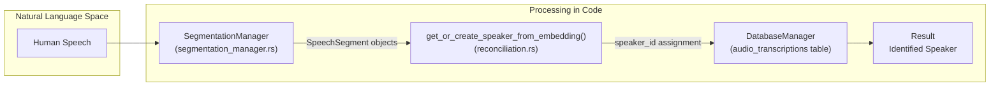

<!-- source: DeepWiki mcp.deepwiki.com · repo screenpipe/screenpipe · page 2.3 Audio Processing · fetched 2026-10-26 -->

# Audio Processing

<details>
<summary>Relevant source files</summary>

The following files were used as context for generating this wiki page:

- [crates/screenpipe-audio-eval/evals/README.md](crates/screenpipe-audio-eval/evals/README.md)
- [crates/screenpipe-audio/examples/coreaudio_tap_signal_probe.rs](crates/screenpipe-audio/examples/coreaudio_tap_signal_probe.rs)
- [crates/screenpipe-audio/examples/coreaudio_tap_stage_probe.rs](crates/screenpipe-audio/examples/coreaudio_tap_stage_probe.rs)
- [crates/screenpipe-audio/examples/meeting_input_probe.rs](crates/screenpipe-audio/examples/meeting_input_probe.rs)
- [crates/screenpipe-audio/examples/meeting_tap_probe.rs](crates/screenpipe-audio/examples/meeting_tap_probe.rs)
- [crates/screenpipe-audio/examples/wer_battle_test.rs](crates/screenpipe-audio/examples/wer_battle_test.rs)
- [crates/screenpipe-audio/onnxruntime-win-x64-1.22.0.zip](crates/screenpipe-audio/onnxruntime-win-x64-1.22.0.zip)
- [crates/screenpipe-audio/scripts/gen_wer_corpus.sh](crates/screenpipe-audio/scripts/gen_wer_corpus.sh)
- [crates/screenpipe-audio/src/audio_manager/builder.rs](crates/screenpipe-audio/src/audio_manager/builder.rs)
- [crates/screenpipe-audio/src/audio_manager/device_monitor.rs](crates/screenpipe-audio/src/audio_manager/device_monitor.rs)
- [crates/screenpipe-audio/src/audio_manager/manager.rs](crates/screenpipe-audio/src/audio_manager/manager.rs)
- [crates/screenpipe-audio/src/audio_manager/meeting_piggyback.rs](crates/screenpipe-audio/src/audio_manager/meeting_piggyback.rs)
- [crates/screenpipe-audio/src/audio_manager/mod.rs](crates/screenpipe-audio/src/audio_manager/mod.rs)
- [crates/screenpipe-audio/src/audio_manager/piggyback_listeners.rs](crates/screenpipe-audio/src/audio_manager/piggyback_listeners.rs)
- [crates/screenpipe-audio/src/audio_manager/reconciliation.rs](crates/screenpipe-audio/src/audio_manager/reconciliation.rs)
- [crates/screenpipe-audio/src/audio_manager/windows_output_follow.rs](crates/screenpipe-audio/src/audio_manager/windows_output_follow.rs)
- [crates/screenpipe-audio/src/core/device.rs](crates/screenpipe-audio/src/core/device.rs)
- [crates/screenpipe-audio/src/core/e2e_ghost_word_silent_room.rs](crates/screenpipe-audio/src/core/e2e_ghost_word_silent_room.rs)
- [crates/screenpipe-audio/src/core/meeting_audio/macos.rs](crates/screenpipe-audio/src/core/meeting_audio/macos.rs)
- [crates/screenpipe-audio/src/core/meeting_audio/mod.rs](crates/screenpipe-audio/src/core/meeting_audio/mod.rs)
- [crates/screenpipe-audio/src/core/meeting_audio/null.rs](crates/screenpipe-audio/src/core/meeting_audio/null.rs)
- [crates/screenpipe-audio/src/core/meeting_audio/windows.rs](crates/screenpipe-audio/src/core/meeting_audio/windows.rs)
- [crates/screenpipe-audio/src/core/mod.rs](crates/screenpipe-audio/src/core/mod.rs)
- [crates/screenpipe-audio/src/core/process_tap/counters.rs](crates/screenpipe-audio/src/core/process_tap/counters.rs)
- [crates/screenpipe-audio/src/core/process_tap/macos.rs](crates/screenpipe-audio/src/core/process_tap/macos.rs)
- [crates/screenpipe-audio/src/core/process_tap/mod.rs](crates/screenpipe-audio/src/core/process_tap/mod.rs)
- [crates/screenpipe-audio/src/core/process_tap/windows.rs](crates/screenpipe-audio/src/core/process_tap/windows.rs)
- [crates/screenpipe-audio/src/core/run_record_and_transcribe.rs](crates/screenpipe-audio/src/core/run_record_and_transcribe.rs)
- [crates/screenpipe-audio/src/core/stream.rs](crates/screenpipe-audio/src/core/stream.rs)
- [crates/screenpipe-audio/src/device/device_manager.rs](crates/screenpipe-audio/src/device/device_manager.rs)
- [crates/screenpipe-audio/src/lib.rs](crates/screenpipe-audio/src/lib.rs)
- [crates/screenpipe-audio/src/meeting_streaming/config.rs](crates/screenpipe-audio/src/meeting_streaming/config.rs)
- [crates/screenpipe-audio/src/meeting_streaming/controller.rs](crates/screenpipe-audio/src/meeting_streaming/controller.rs)
- [crates/screenpipe-audio/src/meeting_streaming/deepgram_live.rs](crates/screenpipe-audio/src/meeting_streaming/deepgram_live.rs)
- [crates/screenpipe-audio/src/meeting_streaming/events.rs](crates/screenpipe-audio/src/meeting_streaming/events.rs)
- [crates/screenpipe-audio/src/meeting_streaming/selected_engine.rs](crates/screenpipe-audio/src/meeting_streaming/selected_engine.rs)
- [crates/screenpipe-audio/src/metrics.rs](crates/screenpipe-audio/src/metrics.rs)
- [crates/screenpipe-audio/src/models/download.rs](crates/screenpipe-audio/src/models/download.rs)
- [crates/screenpipe-audio/src/models/mod.rs](crates/screenpipe-audio/src/models/mod.rs)
- [crates/screenpipe-audio/src/segmentation/segmentation_manager.rs](crates/screenpipe-audio/src/segmentation/segmentation_manager.rs)
- [crates/screenpipe-audio/src/speaker/embedding.rs](crates/screenpipe-audio/src/speaker/embedding.rs)
- [crates/screenpipe-audio/src/speaker/embedding_manager.rs](crates/screenpipe-audio/src/speaker/embedding_manager.rs)
- [crates/screenpipe-audio/src/speaker/mod.rs](crates/screenpipe-audio/src/speaker/mod.rs)
- [crates/screenpipe-audio/src/speaker/models.rs](crates/screenpipe-audio/src/speaker/models.rs)
- [crates/screenpipe-audio/src/speaker/segment.rs](crates/screenpipe-audio/src/speaker/segment.rs)
- [crates/screenpipe-audio/src/transcription/deepgram/batch.rs](crates/screenpipe-audio/src/transcription/deepgram/batch.rs)
- [crates/screenpipe-audio/src/transcription/deepgram/mod.rs](crates/screenpipe-audio/src/transcription/deepgram/mod.rs)
- [crates/screenpipe-audio/src/transcription/engine.rs](crates/screenpipe-audio/src/transcription/engine.rs)
- [crates/screenpipe-audio/src/transcription/handle_new_transcript.rs](crates/screenpipe-audio/src/transcription/handle_new_transcript.rs)
- [crates/screenpipe-audio/src/transcription/mod.rs](crates/screenpipe-audio/src/transcription/mod.rs)
- [crates/screenpipe-audio/src/transcription/openai_compatible/batch.rs](crates/screenpipe-audio/src/transcription/openai_compatible/batch.rs)
- [crates/screenpipe-audio/src/transcription/stt.rs](crates/screenpipe-audio/src/transcription/stt.rs)
- [crates/screenpipe-audio/src/transcription/transcription_result.rs](crates/screenpipe-audio/src/transcription/transcription_result.rs)
- [crates/screenpipe-audio/src/transcription/whisper/batch.rs](crates/screenpipe-audio/src/transcription/whisper/batch.rs)
- [crates/screenpipe-audio/src/utils/mod.rs](crates/screenpipe-audio/src/utils/mod.rs)
- [crates/screenpipe-audio/src/utils/ort_watchdog.rs](crates/screenpipe-audio/src/utils/ort_watchdog.rs)
- [crates/screenpipe-audio/src/vad/silero.rs](crates/screenpipe-audio/src/vad/silero.rs)
- [crates/screenpipe-audio/tests/audio_pipeline_benchmark/main.rs](crates/screenpipe-audio/tests/audio_pipeline_benchmark/main.rs)
- [crates/screenpipe-audio/tests/audio_pipeline_benchmark/smart_mode_benchmark.rs](crates/screenpipe-audio/tests/audio_pipeline_benchmark/smart_mode_benchmark.rs)
- [crates/screenpipe-core/src/connections/mod.rs](crates/screenpipe-core/src/connections/mod.rs)
- [crates/screenpipe-core/src/connections/sync.rs](crates/screenpipe-core/src/connections/sync.rs)
- [crates/screenpipe-core/src/health_diagnostics.rs](crates/screenpipe-core/src/health_diagnostics.rs)
- [crates/screenpipe-core/src/pipes/preset_fallback.rs](crates/screenpipe-core/src/pipes/preset_fallback.rs)
- [crates/screenpipe-db/src/db/audio.rs](crates/screenpipe-db/src/db/audio.rs)
- [crates/screenpipe-db/src/db/meetings.rs](crates/screenpipe-db/src/db/meetings.rs)
- [crates/screenpipe-db/src/db/speakers.rs](crates/screenpipe-db/src/db/speakers.rs)
- [crates/screenpipe-db/tests/keyword_search_order_test.rs](crates/screenpipe-db/tests/keyword_search_order_test.rs)
- [crates/screenpipe-db/tests/speaker_identity_eval.rs](crates/screenpipe-db/tests/speaker_identity_eval.rs)
- [crates/screenpipe-db/tests/speaker_reassignment_test.rs](crates/screenpipe-db/tests/speaker_reassignment_test.rs)
- [crates/screenpipe-db/tests/timeline_live_meeting_test.rs](crates/screenpipe-db/tests/timeline_live_meeting_test.rs)
- [crates/screenpipe-db/tests/timeline_performance_test.rs](crates/screenpipe-db/tests/timeline_performance_test.rs)
- [crates/screenpipe-engine/src/routes/retranscribe.rs](crates/screenpipe-engine/src/routes/retranscribe.rs)
- [crates/screenpipe-engine/tests/tags_test.rs](crates/screenpipe-engine/tests/tags_test.rs)

</details>


## Purpose and Scope

This document describes Screenpipe's audio processing system — responsible for capturing audio from input and output devices, performing voice activity detection (VAD), identifying speakers, transcribing audio with various backends (Whisper, Deepgram, OpenAI-compatible, Parakeet, Qwen3-ASR), deduplicating and persisting transcripts, and managing CoreAudio process taps on macOS.

The system supports two primary audio capture modes:

- **Realtime mode:** Immediate transcription as audio arrives.
- **Batch (Reconciliation) mode:** Buffered audio chunks are transcribed in batches for improved quality and efficiency.

Audio capture runs continuously with resilience to device disconnects, transient silence, and multi-device scenarios, including specialized meeting audio capture taps.

Sources: [crates/screenpipe-audio/src/audio_manager/manager.rs:1-104](), [crates/screenpipe-audio/src/lib.rs:1-25]()

## System Architecture Overview

The `AudioManager` is the central orchestrator for audio capture, VAD, transcription, and persistence. It manages device lifecycle via `DeviceManager`, handles audio input from multiple sources including the CoreAudio process tap on macOS, and runs transcription engines in parallel.

### Audio Processing Pipeline

```mermaid
graph TB
    subgraph "Audio Devices"
        INPUT["Input Devices<br/>(Microphone)"]
        OUTPUT["Output Devices<br/>(Speakers/SCK)"]
        TAP["CoreAudio Process Tap<br/>(macOS 14.4+)"]
    end
    
    subgraph "Device Management"
        DM["DeviceManager<br/>cpal streams"]
        MON["Device Monitor<br/>start_device_monitor()"]
    end
    
    subgraph "AudioManager Components"
        RECV["recording_receiver<br/>crossbeam::channel"]
        AUDIO_HANDLER["start_audio_receiver_handler()<br/>VAD + Speaker Segmentation + Transcription"]
        TRANS_RECV["transcription_receiver<br/>crossbeam::channel"]
        TRANS_HANDLER["start_transcription_receiver_handler()<br/>DB Persistence"]
        RECON["Reconciliation<br/>Batch Transcription"]
        MEET["MeetingDetector<br/>Meeting Audio Tap"]
    end
    
    subgraph "Processing Engines"
        VAD["VadEngine<br/>Silero/WebRTC"]
        SEG["SegmentationManager<br/>Speech Segmentation & Embedding"]
        STT["TranscriptionEngine<br/>Whisper / Deepgram / OpenAI-compatible / Qwen3-ASR / Parakeet"]
    end
    
    subgraph "Storage"
        FS["Audio Files (MP4, AAC, MP3)"]
        DB["DatabaseManager<br/>audio_chunks + audio_transcriptions"]
    end

    INPUT -->|capture| DM
    OUTPUT -->|capture| DM
    TAP -->|spawn_process_tap_capture| DM
    MON -->|device changes| DM
    DM -->|record_and_transcribe()| RECV
    RECV -->|Raw AudioInput| AUDIO_HANDLER
    AUDIO_HANDLER -->|persist chunks early| FS
    AUDIO_HANDLER -->|analyze voice/speakers| VAD
    VAD -->|segments| SEG
    SEG -->|embedding + segments| STT
    STT -->|TranscriptionResult| TRANS_RECV
    TRANS_RECV -->|batch insert| TRANS_HANDLER
    TRANS_HANDLER -->|insert chunk + transcription| DB
    MEET -->|meeting state| AUDIO_HANDLER
    MEET -->|meeting end triggers| RECON
    RECON -->|batch re-transcribe| STT
    RECON -->|persist| DB
```

This diagram summarizes:

- Multiple audio sources feeding Capture streams managed by `DeviceManager`.
- Continuous recording handled in `run_record_and_transcribe()`.
- VAD detecting speech presence: Silero and WebRTC engines.
- Speaker diarization via segmentation + embedding extraction.
- Transcription engines pluggable by configuration (local and cloud).
- Deferred batch processing in Reconciliation mode.
- Meeting-aware specialized audio capture and piggyback recording.

Sources: [crates/screenpipe-audio/src/audio_manager/manager.rs:130-170](), [crates/screenpipe-audio/src/core/stream.rs:76-90, 138-179]()

## AudioManager

The `AudioManager` struct coordinates audio capture and processing end-to-end:

- **Device Manager:** Tracks enabled devices and manages start/stop of recording streams [crates/screenpipe-audio/src/audio_manager/manager.rs:170-175]().
- **Processing Engines:**
  - `VadEngine` for voice/silence detection [crates/screenpipe-audio/src/audio_manager/manager.rs:170-175]().
  - `SegmentationManager` for speech segmentation and speaker embedding [crates/screenpipe-audio/src/audio_manager/manager.rs:139-139]().
  - `TranscriptionEngine` abstracting Whisper, cloud APIs, and others [crates/screenpipe-audio/src/transcription/engine.rs:156-194]().
- **Communication Channels:** Uses crossbeam channels:
  - `recording_receiver` receives raw audio chunk messages.
  - `transcription_receiver` receives results for database insertion.
- **Meeting Detection & Piggybacking:** Integrates meeting-aware audio tap and audio stream suspension/resumption during meetings.

### Core Handlers

The audio manager spawns several key async tasks:

- **`start_audio_receiver_handler()`**: Receives `AudioInput`, applies VAD, segments speech, queues transcription requests, and optionally persists early audio files.
- **`start_transcription_receiver_handler()`**: Consumes `TranscriptionResult`s, performing database inserts and managing speaker diarization integration.
- **`reconciliation_handle`**: Runs in background performing batch transcription/reconciliation on untranscribed historical audio chunks.

This separation ensures robust concurrency, resource isolation, and responsiveness in handling live and backfill transcription workloads.

Sources: [crates/screenpipe-audio/src/audio_manager/manager.rs:170-200]()

## Audio Capture Pipeline

### Recording Tasks

Each audio device is captured by an independent Tokio task spawned by `run_record_and_transcribe()` [crates/screenpipe-audio/src/core/run_record_and_transcribe.rs:89-130]():

- Uses `cpal` for device audio streaming except on macOS where CoreAudio or process taps are possible.
- Streams chunks of audio to a crossbeam channel (`recording_receiver`).
- Enforces sanity checks and stream health monitoring with timeout watchdogs.

### Stream Reliability and Recovery

To improve robustness, Screenpipe implements:

- **Receive Timeout:** If a device stream produces no audio for 8 seconds, considered dead — triggers restart [crates/screenpipe-audio/src/core/run_record_and_transcribe.rs:28-42]().
- **Zero-Fill Timeout:** If the device emits exact-zero silent buffers for 30 seconds (common CoreAudio hijack failure), stream is forcibly recycled [crates/screenpipe-audio/src/core/run_record_and_transcribe.rs:56-78]().
- **VPIO-Specific Recovery:** On macOS, audio “receive timeout” errors identified as VPIO-related also cause fast recovery attempts [crates/screenpipe-audio/src/audio_manager/manager.rs:33-41]().

Sources: [crates/screenpipe-audio/src/core/run_record_and_transcribe.rs:28-119](), [crates/screenpipe-audio/src/audio_manager/manager.rs:33-41]()

### CoreAudio Process Tap (macOS)

For macOS 14.4+ environments, Screenpipe uses the **CoreAudio Process Tap** API to capture system audio more reliably without relying on ScreenCaptureKit display enumeration, which can fail after sleep/wake cycles [crates/screenpipe-audio/src/core/process_tap/macos.rs:1-162]().

- **Availability:** Confirmed by `is_process_tap_available()` which checks macOS version >= 14.4 [crates/screenpipe-audio/src/core/process_tap/macos.rs:50-72]().
- **Implementation:** Uses `AudioHardwareCreateProcessTap` via `cidre` bindings to tap system audio per-process.
- **Exclusions:** Supports dynamic updates of per-app exclusions to avoid capturing certain apps sensitive to recording [crates/screenpipe-audio/src/core/process_tap/macos.rs:123-145]().

This backend can coexist with the normal `cpal`/ScreenCaptureKit paths but is preferred for system output capture due to higher stability.

Sources: [crates/screenpipe-audio/src/core/process_tap/macos.rs:5-162](), [crates/screenpipe-audio/src/core/stream.rs:140-179]()

## Transcription Engines

The system supports a unified `TranscriptionEngine` abstraction that encompasses local and cloud-based transcription backends [crates/screenpipe-audio/src/transcription/engine.rs:150-194]():

| Engine         | Backend              | Notes                                                         |
|----------------|----------------------|---------------------------------------------------------------|
| **Whisper**    | `whisper-rs`         | Local, GPU-accelerated or CPU fallback, model caching.        |
| **Qwen3-ASR**  | `audiopipe`          | Lightweight GGML-based ASR, feature-gated.                    |
| **Parakeet**   | `audiopipe` + Metal  | Optimized for Apple Silicon with MLX Metal memory management. |
| **Deepgram**   | Cloud API            | Paid API with speaker diarization support.                    |
| **OpenAI-Compatible** | API Server      | Custom endpoints, API keys, raw WAV or MP3 audio.             |
| **Disabled**   |                      | No transcription, useful for testing.                         |

### MLX Metal Memory Management (Apple Silicon)

When using Parakeet with Metal acceleration, the system caps the MLX buffer cache to prevent unbounded GPU memory growth — lowering peak memory usage during transcription [crates/screenpipe-audio/src/transcription/engine.rs:95-145]().

Sources: [crates/screenpipe-audio/src/transcription/engine.rs:150-194](), [crates/screenpipe-audio/src/transcription/engine.rs:95-145]()

## Batch Reconciliation

In batch (smart) mode, Screenpipe defers transcription for non-urgent audio chunks, then runs a background reconciliation sweep to transcribe them in efficient batches [crates/screenpipe-audio/src/audio_manager/reconciliation.rs:1-144]().

### Reconciliation Logic

- Queries untranscribed chunks from the database within a lookback window.
- Groups them by device and timestamp proximity, splitting batches by configured max durations (e.g., 480 seconds for Deepgram, 600 for Whisper) [crates/screenpipe-audio/src/audio_manager/reconciliation.rs:120-146]().

- Batching logic respects gaps >60 seconds that break session continuity.
- Concurrency is guarded by `RECONCILIATION_RUNNING` atomic to prevent CPU starvation from overlapping sweeps.
- Deferred inserts of partially transcribed or orphaned chunks use durable JSON markers for recovery on failure.

This mode increases transcription stability and lowers CPU load by batching and retrying audio chunk processing.

Sources: [crates/screenpipe-audio/src/audio_manager/reconciliation.rs:19-144]()

## Diarization and Speaker Identification

Screenpipe performs speaker diarization using embedding-based clustering and speaker ID assignment [crates/screenpipe-audio/src/audio_manager/manager.rs:139-139]().

### Diarization Flow



- `SegmentationManager` detects voice activity and splits audio into speech segments.
- The reconciliation process attempts to assign speaker IDs to segments using embeddings.
- Inserts diarized speech metadata into `audio_transcriptions` for downstream search and AI use.

### Meeting-Aware Piggyback Audio Capture

Meeting detection triggers a special "piggyback" sweep during locked-in meetings:

- Captures meeting app audio and follow the active mic device used by the app.
- Employs a near-end state machine (`MicFollow`) to adopt and track meeting mics.
- Defers normal output capture during meetings to avoid duplicate capture and improve diarization.

This system avoids mic disruptions observed in videoconference apps with Bluetooth headsets.

Sources: [crates/screenpipe-audio/src/audio_manager/meeting_piggyback.rs:4-60](), [crates/screenpipe-audio/src/audio_manager/manager.rs:139-140](), [crates/screenpipe-audio/src/audio_manager/reconciliation.rs:41-41]()

---

# Summary

Screenpipe's audio processing combines robust multi-device capture, voice activity detection, speaker diarization, and powerful transcription backends with batch reconciliation and meeting-aware capture. The system is engineered for resilience on all major platforms with special macOS process tap support, efficiently feeding audio data into searchable transcripts for the AI memory layer.

# References and Sources

- `crates/screenpipe-audio/src/audio_manager/manager.rs:1-176`  
- `crates/screenpipe-audio/src/audio_manager/reconciliation.rs:1-147`  
- `crates/screenpipe-audio/src/core/run_record_and_transcribe.rs:1-173`  
- `crates/screenpipe-audio/src/core/process_tap/macos.rs:1-162`  
- `crates/screenpipe-audio/src/transcription/engine.rs:150-194`  
- `crates/screenpipe-audio/src/transcription/stt.rs:1-182`  
- `crates/screenpipe-audio/src/audio_manager/meeting_piggyback.rs:1-60`  
- `crates/screenpipe-audio/src/core/stream.rs:70-179`

---

