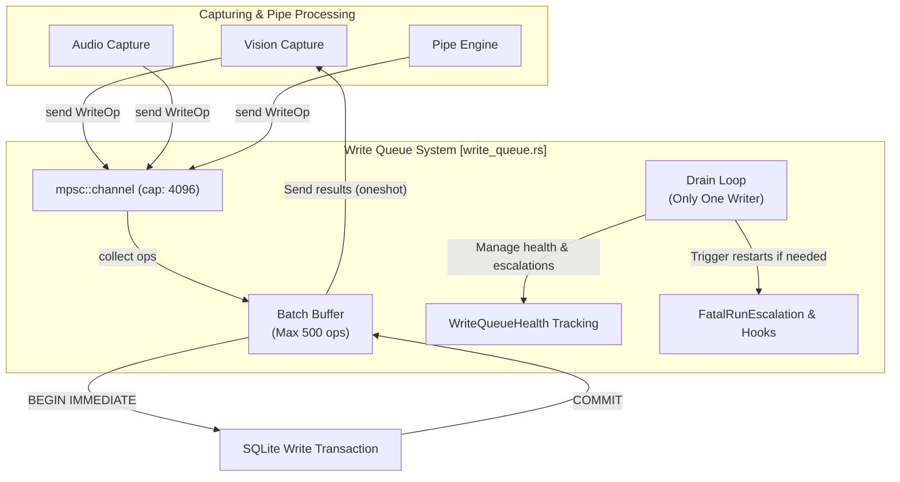
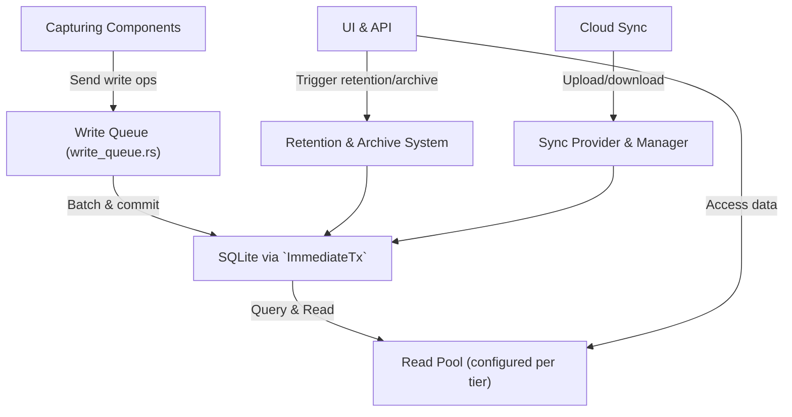

<!-- source: DeepWiki mcp.deepwiki.com · repo screenpipe/screenpipe · page 2.4 Storage & Database · fetched 2026-10-26 -->

# Storage & Database

<details>
<summary>Relevant source files</summary>

The following files were used as context for generating this wiki page:

- [apps/screenpipe-app-tauri/components/settings/__tests__/compact-markdown.test.tsx](apps/screenpipe-app-tauri/components/settings/__tests__/compact-markdown.test.tsx)
- [apps/screenpipe-app-tauri/components/settings/retention-settings.tsx](apps/screenpipe-app-tauri/components/settings/retention-settings.tsx)
- [apps/screenpipe-app-tauri/src-tauri/src/chatgpt_oauth.rs](apps/screenpipe-app-tauri/src-tauri/src/chatgpt_oauth.rs)
- [apps/screenpipe-app-tauri/src-tauri/src/e2e/seeds.rs](apps/screenpipe-app-tauri/src-tauri/src/e2e/seeds.rs)
- [apps/screenpipe-app-tauri/src-tauri/src/secrets.rs](apps/screenpipe-app-tauri/src-tauri/src/secrets.rs)
- [apps/screenpipe-app-tauri/src-tauri/src/sync.rs](apps/screenpipe-app-tauri/src-tauri/src/sync.rs)
- [crates/screenpipe-audio-eval/src/bin/pipeline_replay.rs](crates/screenpipe-audio-eval/src/bin/pipeline_replay.rs)
- [crates/screenpipe-audio/src/core/engine.rs](crates/screenpipe-audio/src/core/engine.rs)
- [crates/screenpipe-audio/src/core/source_buffer.rs](crates/screenpipe-audio/src/core/source_buffer.rs)
- [crates/screenpipe-audio/tests/bluetooth_gap_hallucination_test.rs](crates/screenpipe-audio/tests/bluetooth_gap_hallucination_test.rs)
- [crates/screenpipe-config/src/defaults.rs](crates/screenpipe-config/src/defaults.rs)
- [crates/screenpipe-db/Cargo.toml](crates/screenpipe-db/Cargo.toml)
- [crates/screenpipe-db/benches/search_accuracy.rs](crates/screenpipe-db/benches/search_accuracy.rs)
- [crates/screenpipe-db/src/db/maintenance.rs](crates/screenpipe-db/src/db/maintenance.rs)
- [crates/screenpipe-db/src/db/mod.rs](crates/screenpipe-db/src/db/mod.rs)
- [crates/screenpipe-db/src/db/setup.rs](crates/screenpipe-db/src/db/setup.rs)
- [crates/screenpipe-db/src/failpoint_vfs.rs](crates/screenpipe-db/src/failpoint_vfs.rs)
- [crates/screenpipe-db/src/lib.rs](crates/screenpipe-db/src/lib.rs)
- [crates/screenpipe-db/src/migrations/20260415000000_frames_fts_external_content.sql](crates/screenpipe-db/src/migrations/20260415000000_frames_fts_external_content.sql)
- [crates/screenpipe-db/src/migrations/20260702000000_add_frames_snapshot_pending_index.sql](crates/screenpipe-db/src/migrations/20260702000000_add_frames_snapshot_pending_index.sql)
- [crates/screenpipe-db/src/text_normalizer.rs](crates/screenpipe-db/src/text_normalizer.rs)
- [crates/screenpipe-db/src/write_queue.rs](crates/screenpipe-db/src/write_queue.rs)
- [crates/screenpipe-db/tests/close_severs_connections_test.rs](crates/screenpipe-db/tests/close_severs_connections_test.rs)
- [crates/screenpipe-db/tests/db.rs](crates/screenpipe-db/tests/db.rs)
- [crates/screenpipe-db/tests/evict_media_null_chunk_test.rs](crates/screenpipe-db/tests/evict_media_null_chunk_test.rs)
- [crates/screenpipe-db/tests/fts_contention_test.rs](crates/screenpipe-db/tests/fts_contention_test.rs)
- [crates/screenpipe-db/tests/fts_dots_test.rs](crates/screenpipe-db/tests/fts_dots_test.rs)
- [crates/screenpipe-db/tests/heavy_read_test.rs](crates/screenpipe-db/tests/heavy_read_test.rs)
- [crates/screenpipe-db/tests/keyword_search_accessibility_test.rs](crates/screenpipe-db/tests/keyword_search_accessibility_test.rs)
- [crates/screenpipe-db/tests/multi_pool_wal_parity_test.rs](crates/screenpipe-db/tests/multi_pool_wal_parity_test.rs)
- [crates/screenpipe-db/tests/orphan_chunk_null_poisoning_test.rs](crates/screenpipe-db/tests/orphan_chunk_null_poisoning_test.rs)
- [crates/screenpipe-db/tests/query_plan_test.rs](crates/screenpipe-db/tests/query_plan_test.rs)
- [crates/screenpipe-db/tests/search_ocr_snapshot_test.rs](crates/screenpipe-db/tests/search_ocr_snapshot_test.rs)
- [crates/screenpipe-db/tests/sqlite_architecture_invariants_test.rs](crates/screenpipe-db/tests/sqlite_architecture_invariants_test.rs)
- [crates/screenpipe-db/tests/support/writer_recovery.rs](crates/screenpipe-db/tests/support/writer_recovery.rs)
- [crates/screenpipe-db/tests/tag_filter_bench.rs](crates/screenpipe-db/tests/tag_filter_bench.rs)
- [crates/screenpipe-engine/src/archive.rs](crates/screenpipe-engine/src/archive.rs)
- [crates/screenpipe-engine/src/cli/backup.rs](crates/screenpipe-engine/src/cli/backup.rs)
- [crates/screenpipe-engine/src/cli/store_file.rs](crates/screenpipe-engine/src/cli/store_file.rs)
- [crates/screenpipe-engine/src/power/monitor.rs](crates/screenpipe-engine/src/power/monitor.rs)
- [crates/screenpipe-engine/src/retention.rs](crates/screenpipe-engine/src/retention.rs)
- [crates/screenpipe-engine/src/routes/data.rs](crates/screenpipe-engine/src/routes/data.rs)
- [crates/screenpipe-engine/src/routes/speakers.rs](crates/screenpipe-engine/src/routes/speakers.rs)
- [crates/screenpipe-engine/src/sync_api.rs](crates/screenpipe-engine/src/sync_api.rs)
- [crates/screenpipe-engine/src/sync_provider.rs](crates/screenpipe-engine/src/sync_provider.rs)
- [crates/screenpipe-engine/tests/retention_lean_test.rs](crates/screenpipe-engine/tests/retention_lean_test.rs)
- [crates/screenpipe-screen/src/browser_utils/windows.rs](crates/screenpipe-screen/src/browser_utils/windows.rs)
- [crates/screenpipe-secrets/Cargo.toml](crates/screenpipe-secrets/Cargo.toml)
- [crates/screenpipe-secrets/src/lib.rs](crates/screenpipe-secrets/src/lib.rs)
- [crates/screenpipe-secrets/src/migration.rs](crates/screenpipe-secrets/src/migration.rs)
- [crates/screenpipe-secrets/src/store.rs](crates/screenpipe-secrets/src/store.rs)
- [crates/screenpipe-secrets/src/telemetry.rs](crates/screenpipe-secrets/src/telemetry.rs)

</details>


Screenpipe leverages SQLite as its core local storage engine, using Full-Text Search 5 (FTS5) and Write-Ahead Logging (WAL) mode to achieve efficient, concurrent access with robust ACID guarantees. The database forms the backbone of all captured data: screen frames, OCR, audio transcriptions, UI events, and related metadata. Media files — video chunks, audio blobs, and snapshots — reside on the filesystem and are linked through the database schema.

Local-first design emphasizes performance, data integrity, and correctness on a broad range of hardware through careful configuration, batching, backpressure, and recovery strategies. This page gives a high-level overview of these key areas, illustrating how they fit together to power Screenpipe’s 24/7 AI memory.

For advanced functionality around payload archiving, hybrid parquet-SQLite migration, sealing, and storage reclamation, see the child page [Hybrid Storage & Migration](#2.4.1).

---

## Database Configuration

The main database engine is a SQLite instance configured for a high-throughput, multi-threaded environment optimized for read/write concurrency and crash resilience:

| Pragma               | Value    | Purpose                                                                           |
|----------------------|----------|-----------------------------------------------------------------------------------|
| `journal_mode`        | `WAL`    | Allows concurrent readers with a single writer; essential for real-time capture. |
| `synchronous`         | `NORMAL` | Trades fsync overhead for good durability in WAL mode.                           |
| `cache_size`          | varies*  | Negative value sets page cache in KiB. Hardware-tier tuned (8MB/32MB/64MB).       |
| `mmap_size`           | 0        | Memory-mapped I/O is **disabled** to avoid corruption from stray native writes.  |
| `wal_autocheckpoint`  | 0        | SQLite’s auto-checkpoint is disabled to avoid contention; manual maintenance used.|

\* Cache size and pool sizing are device-tier dependent as determined by hardware detection (RAM and CPU cores):
- **High Tier**: 64 MB cache, max 27 read connections, 8 write connections
- **Mid Tier**: 32 MB cache, max 12 read, 6 write
- **Low Tier**: 8 MB cache, max 5 read, 4 write

This dynamic tuning balances memory use and concurrency scaling on diverse machines. Memory-mapped I/O is disabled (`mmap_size=0`) due to prior corruption incidents caused by unsafe native code writing directly to SQLite pages, risking irreversible database damage.

The two-tier connection pool design separates read-only queries (which scale) from a dedicated write pool coordinated by the single-writer protocol. This is critical for SQLite to avoid write lock deadlocks.

Sources: [crates/screenpipe-db/src/db/setup.rs:130-147](), [crates/screenpipe-config/src/defaults.rs:127-147](), [crates/screenpipe-config/src/defaults.rs:153-167]()

---

## Schema Overview

Screenpipe’s database schema centers around capturing rich, timestamped screen and audio content, with FTS5-powered text search and organized metadata.

```mermaid
erDiagram
    "video_chunks" ||--o{ "frames" : "contains"
    "frames" ||--o{ "ocr_text" : "has"
    "frames" ||--o{ "elements" : "contains"
    "frames" ||--o{ "ui_events" : "correlates"
    "audio_chunks" ||--o{ "audio_transcriptions" : "has"
    "audio_transcriptions" }o--|| "speakers" : "spoken_by"
    "frames" ||--o{ "tags" : "has"
    "audio_transcriptions" ||--o{ "tags" : "has"
    "memories" ||--o{ "tags" : "has"
    "pipe_executions" ||--o{ "pipe_scheduler_state" : "tracks"

    "frames" {
        int id PK
        datetime timestamp
        string device_name
        string app_name
        string window_name
        string browser_url
        text full_text FTS5
    }
    
    "ocr_text" {
        int frame_id FK
        text text
        jsonb text_json
        string ocr_engine
        string text_source
    }
    
    "audio_transcriptions" {
        int id PK
        int audio_chunk_id FK
        text transcription
        int speaker_id FK
        float start_time
        float end_time
    }
    
    "speakers" {
        int id PK
        string name
        text metadata
    }

    "pipe_executions" {
        int id PK
        string pipe_name
        string status
        text stdout
        text stderr
    }
```

- **`frames`**: Core table capturing each sampled frame from the screen, recording metadata such as timestamp, device, active application/window names, and full-text searchable extracted text.
- **`ocr_text`**: Stores optical character recognition results per frame, supporting both OS-native accessibility extraction (labeled `"accessibility"`) and fallback OCR (`"ocr"`). 
- **`audio_transcriptions`**: Segmented audio transcriptions annotated with speaker IDs and timestamps. Supports multi-speaker diarization.
- **`speakers`**: Maintains speaker profiles and metadata to associate audio segments across time.
- **`pipe_executions`**: Persists execution records of AI automation pipes, including status and logs.

Sources: [crates/screenpipe-db/src/types.rs:70-210](), [crates/screenpipe-db/tests/db.rs:80-160](), [crates/screenpipe-engine/src/pipe_store.rs:40-110]()

---

## Write Coalescing Queue

SQLite is optimized for serialized writes, so Screenpipe employs a **write coalescing queue** to batch concurrent database mutations and minimize lock contention.

### Overview of `write_queue.rs`



- **Batching**: Collects up to 500 pending write operations before starting a single `BEGIN IMMEDIATE` transaction.
- **Semaphore Lock**: Acquires the SQLite write semaphore just once per batch.
- **Amortized fsync**: Amortizes costly fsync + commit overhead over the entire batch, improving write throughput dramatically.
- **Sleep/Wake Coordination**: Hooks `request_write_pause()` / `request_write_resume()` temporarily suspend writes during OS sleep to avoid corruption due to power events.
- **Wedge Detection and Recovery**: A health-tracking mechanism detects consecutive fatal failures or excessive contention. It triggers escalation hooks to restart the SQLite engine proactively, preventing longest-term wedging conditions.

Sources: [crates/screenpipe-db/src/write_queue.rs:1-164]()

---

## Transaction Management with ImmediateTx

To address SQLite WAL contention and deadlock conditions, Screenpipe wraps every write transaction in an `ImmediateTx` type (a wrapper over `SqliteTransaction`). This wrapper:

- Acquires an owned semaphore permit to serialize all writers.
- Issues `BEGIN IMMEDIATE` immediately upon transaction start to lock the write coordinator up front.
- Provides async-friendly rollback logic in `Drop` to prevent connection-pool hangs or poisoning.
- Ensures no long-running transactions block writer progress or degrade durability.

This upfront locking pattern avoids `SQLITE_BUSY_SNAPSHOT` errors common with default deferred transactions when readers hold snapshots.

Sources: [crates/screenpipe-db/src/db.rs:105-162]()

---

## Retention & Archiving

Screenpipe manages storage size and privacy compliance with both local retention and cloud archive modules.

### Local Retention

The local retention system enforces automatic deletion of old data after a user-configurable number of days. It supports modes to customize what is purged:

- **Media**: Deletes only large media files (e.g. `.mp4`, `.wav`), preserving text and event metadata for search continuity.
- **Lean**: Deletes media and purges heavy frame payloads such as accessibility JSON and UI event streams, reducing database size.
- **All**: Deletes all data including searchable text, effectively wiping old content completely.

This retention runs asynchronously and can be configured via API and UI. It is a local alternative to cloud archiving.

### Cloud Archive

Screenpipe’s cloud archive system encrypts and uploads data older than the retention cutoff to a cloud provider before local deletion. It maintains a single watermark (`archive_uploaded_through` timestamp) instead of per-record sync states to minimize complexity and I/O. Archive state, errors, and progress are tracked and surfaced to the UI.

Sources: [crates/screenpipe-engine/src/retention.rs:56-100](), [crates/screenpipe-engine/src/archive.rs:1-60]()

---

## Cloud Sync Provider

The cloud sync subsystem connects Screenpipe’s local storage to cloud backends for data syncing across devices. It splits data into `SyncChunk` payloads containing frames, OCR records, audio transcriptions, UI events, and accessibility info. Sync respects user tagging and gating preferences to only upload enabled data classes.

Data is encrypted client-side, uploaded in batch chunks, and downloaded/imported as needed. Sync status, errors, and progress are managed via the Tauri app’s sync commands.

Sources: [apps/screenpipe-app-tauri/src-tauri/src/sync.rs:1-150](), [crates/screenpipe-engine/src/sync_provider.rs:10-170]()

---

## Speaker Management

Screenpipe’s database supports multi-speaker diarization and identification via the `speakers` table and related audio transcription fields. Speaker profiles carry metadata and persistent audio samples for UI playback and refinement.

The desktop frontend provides a `/speakers/sample/:id` endpoint that streams stored audio clips representing speaker samples for preview purposes.

Sources: [crates/screenpipe-db/src/db/speakers.rs](), [apps/screenpipe-app-tauri/components/settings/speakers-section.tsx:40-82]()

---

## Linking Natural Language Concepts to Code Entities

```mermaid
flowchart TD
    A["AI Memory System"] --> B["SQLite DB (db.sqlite)"]
    B --> C["`DatabaseManager` (crates/screenpipe-db/src/db.rs)"]
    B --> D["`write_queue` (crates/screenpipe-db/src/write_queue.rs)"]
    B --> E["Schema: Frames, OCR, Audio, UI Events (crates/screenpipe-db/src/types.rs)"]
    B --> F["WAL & Config (crates/screenpipe-config/src/defaults.rs)"]
    B --> G["ImmediateTx for transactions (crates/screenpipe-db/src/db.rs)"]
    H["Tauri App"] --> I["Sync Commands & State (apps/screenpipe-app-tauri/src-tauri/src/sync.rs)"]
    I --> J["Cloud Sync Provider (crates/screenpipe-engine/src/sync_provider.rs)"]
    K["Retention & Archive Logic (crates/screenpipe-engine/src/retention.rs \n & archive.rs)"]
    B --> K
```

---



---

### Further Reading

- For deep dive into **Hybrid Storage & Migration** encompassing parquet archives, sealing, and desktop migration UX, see [Hybrid Storage & Migration](#2.4.1).

---

# Summary

Screenpipe’s database infrastructure centers on a carefully tuned local SQLite engine configured with FTS5 and WAL to deliver performant, consistent, and durable storage of rich multimedia and text data. The write coalescing queue abstracts all mutations into efficient batches, minimizing lock contention typical for SQLite. Local retention and cloud archiving modules handle scalable data lifecycle policy enforcement, while synchronization connects local data with the cloud.

Together, these systems form the foundation enabling Screenpipe to function as a local-first, always-on AI memory for screen text, audio, and events.

---

## Sources

- [crates/screenpipe-db/src/write_queue.rs:1-164]()
- [crates/screenpipe-db/src/db/setup.rs:130-147]()
- [crates/screenpipe-config/src/defaults.rs:127-147]()
- [crates/screenpipe-db/src/types.rs:70-210]()
- [crates/screenpipe-db/tests/db.rs:80-160]()
- [crates/screenpipe-engine/src/pipe_store.rs:40-110]()
- [crates/screenpipe-db/src/db.rs:105-162]()
- [crates/screenpipe-engine/src/retention.rs:56-100]()
- [crates/screenpipe-engine/src/archive.rs:1-60]()
- [apps/screenpipe-app-tauri/src-tauri/src/sync.rs:1-150]()
- [crates/screenpipe-engine/src/sync_provider.rs:10-170]()
- [apps/screenpipe-app-tauri/components/settings/speakers-section.tsx:40-82]()

---

