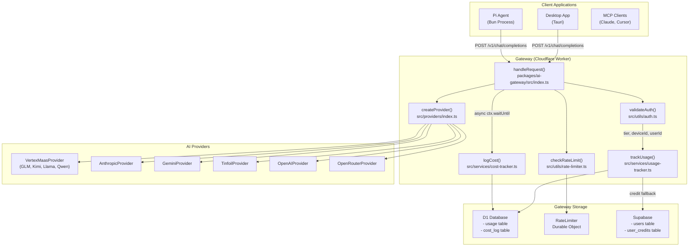
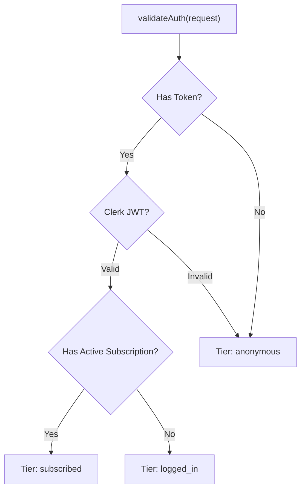
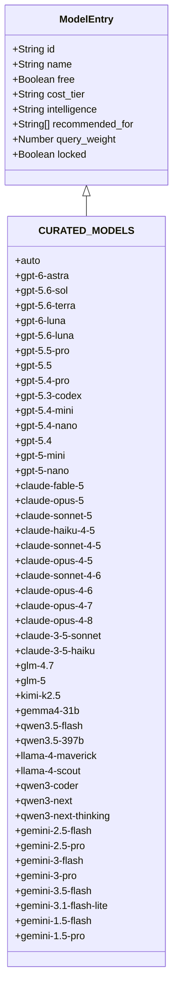

<!-- source: DeepWiki mcp.deepwiki.com · repo screenpipe/screenpipe · page 2.5 AI Gateway & Usage Tracking · fetched 2026-10-26 -->

# AI Gateway & Usage Tracking

Relevant source files

The following files were used as context for generating this wiki page:

- [apps/screenpipe-app-tauri/components/chat/standalone/chat-composer.tsx](apps/screenpipe-app-tauri/components/chat/standalone/chat-composer.tsx)
- [apps/screenpipe-app-tauri/components/chat/standalone/upgrade-quota-banner.test.tsx](apps/screenpipe-app-tauri/components/chat/standalone/upgrade-quota-banner.test.tsx)
- [apps/screenpipe-app-tauri/components/chat/standalone/upgrade-quota-banner.tsx](apps/screenpipe-app-tauri/components/chat/standalone/upgrade-quota-banner.tsx)
- [apps/screenpipe-app-tauri/components/settings/__tests__/usage-section.limits.test.tsx](apps/screenpipe-app-tauri/components/settings/__tests__/usage-section.limits.test.tsx)
- [apps/screenpipe-app-tauri/components/settings/speakers-section.tsx](apps/screenpipe-app-tauri/components/settings/speakers-section.tsx)
- [apps/screenpipe-app-tauri/components/settings/usage-section.tsx](apps/screenpipe-app-tauri/components/settings/usage-section.tsx)
- [apps/screenpipe-app-tauri/components/usage/usage-limit-row.tsx](apps/screenpipe-app-tauri/components/usage/usage-limit-row.tsx)
- [apps/screenpipe-app-tauri/components/usage/usage-limits-panel.test.tsx](apps/screenpipe-app-tauri/components/usage/usage-limits-panel.test.tsx)
- [apps/screenpipe-app-tauri/components/usage/usage-limits-panel.tsx](apps/screenpipe-app-tauri/components/usage/usage-limits-panel.tsx)
- [apps/screenpipe-app-tauri/components/usage/usage-popover.test.tsx](apps/screenpipe-app-tauri/components/usage/usage-popover.test.tsx)
- [apps/screenpipe-app-tauri/components/usage/usage-popover.tsx](apps/screenpipe-app-tauri/components/usage/usage-popover.tsx)
- [apps/screenpipe-app-tauri/e2e/specs/chat-cost-limit-upgrade.spec.ts](apps/screenpipe-app-tauri/e2e/specs/chat-cost-limit-upgrade.spec.ts)
- [apps/screenpipe-app-tauri/lib/chat/__tests__/quota-errors.test.ts](apps/screenpipe-app-tauri/lib/chat/__tests__/quota-errors.test.ts)
- [apps/screenpipe-app-tauri/lib/chat/quota-errors.ts](apps/screenpipe-app-tauri/lib/chat/quota-errors.ts)
- [apps/screenpipe-app-tauri/lib/hooks/__tests__/use-usage-status.test.tsx](apps/screenpipe-app-tauri/lib/hooks/__tests__/use-usage-status.test.tsx)
- [apps/screenpipe-app-tauri/lib/hooks/use-usage-status.tsx](apps/screenpipe-app-tauri/lib/hooks/use-usage-status.tsx)
- [docs/pr-assets/ai-limit-preset-scope/hosted-vs-cursor.png](docs/pr-assets/ai-limit-preset-scope/hosted-vs-cursor.png)
- [packages/ai-gateway-tail/src/index.test.ts](packages/ai-gateway-tail/src/index.test.ts)
- [packages/ai-gateway-tail/src/index.ts](packages/ai-gateway-tail/src/index.ts)
- [packages/ai-gateway/.dev.vars.example](packages/ai-gateway/.dev.vars.example)
- [packages/ai-gateway/migrations/0004_add_cache_token_columns.sql](packages/ai-gateway/migrations/0004_add_cache_token_columns.sql)
- [packages/ai-gateway/src/handlers/chat.ts](packages/ai-gateway/src/handlers/chat.ts)
- [packages/ai-gateway/src/handlers/difficulty-router.ts](packages/ai-gateway/src/handlers/difficulty-router.ts)
- [packages/ai-gateway/src/handlers/models.ts](packages/ai-gateway/src/handlers/models.ts)
- [packages/ai-gateway/src/index.ts](packages/ai-gateway/src/index.ts)
- [packages/ai-gateway/src/providers/anthropic-proxy.ts](packages/ai-gateway/src/providers/anthropic-proxy.ts)
- [packages/ai-gateway/src/providers/anthropic.ts](packages/ai-gateway/src/providers/anthropic.ts)
- [packages/ai-gateway/src/providers/index.ts](packages/ai-gateway/src/providers/index.ts)
- [packages/ai-gateway/src/providers/openai.ts](packages/ai-gateway/src/providers/openai.ts)
- [packages/ai-gateway/src/providers/openrouter.ts](packages/ai-gateway/src/providers/openrouter.ts)
- [packages/ai-gateway/src/providers/vertex-maas.ts](packages/ai-gateway/src/providers/vertex-maas.ts)
- [packages/ai-gateway/src/providers/vertex.ts](packages/ai-gateway/src/providers/vertex.ts)
- [packages/ai-gateway/src/services/api-audit.ts](packages/ai-gateway/src/services/api-audit.ts)
- [packages/ai-gateway/src/services/background-limit-fallback.ts](packages/ai-gateway/src/services/background-limit-fallback.ts)
- [packages/ai-gateway/src/services/cloudflare-ai-gateway-usage.ts](packages/ai-gateway/src/services/cloudflare-ai-gateway-usage.ts)
- [packages/ai-gateway/src/services/cloudflare-ai-gateway.ts](packages/ai-gateway/src/services/cloudflare-ai-gateway.ts)
- [packages/ai-gateway/src/services/cost-cap.ts](packages/ai-gateway/src/services/cost-cap.ts)
- [packages/ai-gateway/src/services/cost-tracker.ts](packages/ai-gateway/src/services/cost-tracker.ts)
- [packages/ai-gateway/src/services/free-chat-limit.integration.test.ts](packages/ai-gateway/src/services/free-chat-limit.integration.test.ts)
- [packages/ai-gateway/src/services/free-chat-limit.test.ts](packages/ai-gateway/src/services/free-chat-limit.test.ts)
- [packages/ai-gateway/src/services/free-chat-limit.ts](packages/ai-gateway/src/services/free-chat-limit.ts)
- [packages/ai-gateway/src/services/hosted-ai-policy.test.ts](packages/ai-gateway/src/services/hosted-ai-policy.test.ts)
- [packages/ai-gateway/src/services/hosted-ai-policy.ts](packages/ai-gateway/src/services/hosted-ai-policy.ts)
- [packages/ai-gateway/src/services/usage-tracker.test.ts](packages/ai-gateway/src/services/usage-tracker.test.ts)
- [packages/ai-gateway/src/services/usage-tracker.ts](packages/ai-gateway/src/services/usage-tracker.ts)
- [packages/ai-gateway/src/test/allowance-rescue-route.unit.test.ts](packages/ai-gateway/src/test/allowance-rescue-route.unit.test.ts)
- [packages/ai-gateway/src/test/anthropic-caching.unit.test.ts](packages/ai-gateway/src/test/anthropic-caching.unit.test.ts)
- [packages/ai-gateway/src/test/anthropic-proxy-caching.unit.test.ts](packages/ai-gateway/src/test/anthropic-proxy-caching.unit.test.ts)
- [packages/ai-gateway/src/test/anthropic-proxy.unit.test.ts](packages/ai-gateway/src/test/anthropic-proxy.unit.test.ts)
- [packages/ai-gateway/src/test/anthropic-route-auth.unit.test.ts](packages/ai-gateway/src/test/anthropic-route-auth.unit.test.ts)
- [packages/ai-gateway/src/test/auto-cost-attribution.unit.test.ts](packages/ai-gateway/src/test/auto-cost-attribution.unit.test.ts)
- [packages/ai-gateway/src/test/auto-route.unit.test.ts](packages/ai-gateway/src/test/auto-route.unit.test.ts)
- [packages/ai-gateway/src/test/background-limit-fallback.unit.test.ts](packages/ai-gateway/src/test/background-limit-fallback.unit.test.ts)
- [packages/ai-gateway/src/test/chat-fallback.unit.test.ts](packages/ai-gateway/src/test/chat-fallback.unit.test.ts)
- [packages/ai-gateway/src/test/clerk-standing.unit.test.ts](packages/ai-gateway/src/test/clerk-standing.unit.test.ts)
- [packages/ai-gateway/src/test/cloudflare-ai-gateway-usage.unit.test.ts](packages/ai-gateway/src/test/cloudflare-ai-gateway-usage.unit.test.ts)
- [packages/ai-gateway/src/test/cloudflare-ai-gateway.unit.test.ts](packages/ai-gateway/src/test/cloudflare-ai-gateway.unit.test.ts)
- [packages/ai-gateway/src/test/cloudflare-chat-routing.unit.test.ts](packages/ai-gateway/src/test/cloudflare-chat-routing.unit.test.ts)
- [packages/ai-gateway/src/test/cost-cap.unit.test.ts](packages/ai-gateway/src/test/cost-cap.unit.test.ts)
- [packages/ai-gateway/src/test/cost-tracker.unit.test.ts](packages/ai-gateway/src/test/cost-tracker.unit.test.ts)
- [packages/ai-gateway/src/test/difficulty-router.unit.test.ts](packages/ai-gateway/src/test/difficulty-router.unit.test.ts)
- [packages/ai-gateway/src/test/free-chat-route.unit.test.ts](packages/ai-gateway/src/test/free-chat-route.unit.test.ts)
- [packages/ai-gateway/src/test/local-gateway-harness.integration.test.ts](packages/ai-gateway/src/test/local-gateway-harness.integration.test.ts)
- [packages/ai-gateway/src/test/local-gateway-harness.ts](packages/ai-gateway/src/test/local-gateway-harness.ts)
- [packages/ai-gateway/src/test/model-alias.unit.test.ts](packages/ai-gateway/src/test/model-alias.unit.test.ts)
- [packages/ai-gateway/src/test/openai-models.unit.test.ts](packages/ai-gateway/src/test/openai-models.unit.test.ts)
- [packages/ai-gateway/src/test/provider-usage.unit.test.ts](packages/ai-gateway/src/test/provider-usage.unit.test.ts)
- [packages/ai-gateway/src/test/rate-limiter.unit.test.ts](packages/ai-gateway/src/test/rate-limiter.unit.test.ts)
- [packages/ai-gateway/src/test/vertex-maas.unit.test.ts](packages/ai-gateway/src/test/vertex-maas.unit.test.ts)
- [packages/ai-gateway/src/test/wif-retry.unit.test.ts](packages/ai-gateway/src/test/wif-retry.unit.test.ts)
- [packages/ai-gateway/src/types.ts](packages/ai-gateway/src/types.ts)
- [packages/ai-gateway/src/utils/auth.test.ts](packages/ai-gateway/src/utils/auth.test.ts)
- [packages/ai-gateway/src/utils/auth.ts](packages/ai-gateway/src/utils/auth.ts)
- [packages/ai-gateway/src/utils/clerk-standing.ts](packages/ai-gateway/src/utils/clerk-standing.ts)
- [packages/ai-gateway/src/utils/rate-limiter.ts](packages/ai-gateway/src/utils/rate-limiter.ts)
- [packages/ai-gateway/src/utils/subscription.ts](packages/ai-gateway/src/utils/subscription.ts)
- [packages/ai-gateway/wrangler.toml](packages/ai-gateway/wrangler.toml)

The AI Gateway is a Cloudflare Worker-based proxy service that provides unified access to multiple AI providers (Anthropic, Google Gemini, OpenAI, Vertex AI MaaS, Tinfoil, OpenRouter) while enforcing tiered usage limits, rate limiting, and cost tracking. It runs at `https://api.screenpi.pe` and serves as the central gateway for all AI requests from Screenpipe clients.

This page covers the gateway's architecture, usage tracking system, tier-based access control, and credit system.

## Architecture Overview

The gateway is implemented as a Cloudflare Worker with a D1 database for persistence and Durable Objects for rate limiting. It uses a provider-agnostic routing layer to translate incoming OpenAI-compatible requests to various upstream backends.

### System Topology

Title: AI Gateway Component Interaction

**Request Flow:**
1. Client sends request to gateway endpoint with `X-Device-Id` header (anonymous) or `Authorization: Bearer <token>` header (authenticated).
2. `validateAuth()` determines user tier: `anonymous`, `logged_in`, or `subscribed` [packages/ai-gateway/src/index.ts:9]().
3. `checkRateLimit()` enforces per-tier RPM limits via Durable Object [packages/ai-gateway/src/index.ts:10]().
4. `handleChatCompletions()` manages model routing, automatic fallback (cascade) logic, and model gating [packages/ai-gateway/src/index.ts:19]().
5. `logCost()` asynchronously logs estimated cost to `cost_log` table [packages/ai-gateway/src/index.ts:40]().

**Sources:** [packages/ai-gateway/src/index.ts:5-49](), [packages/ai-gateway/src/types.ts:155-221]()

## Tier System and Access Limits

The gateway implements three user tiers with different daily query limits, rate limits, and model access.

### Tier Configuration

| Tier | Daily Queries | RPM | Free RPM | Allowed Models |
|------|--------------|-----|----------|----------------|
| `anonymous` | 25 | 15 | 60 | auto, haiku, gemini-flash, glm-4.7, etc. |
| `logged_in` | 50 | 25 | 100 | + sonnet, gemini-pro, qwen3.5-397b, etc. |
| `subscribed` | 1500 | 60 | 300 | All models (`*`) |

**Default limits** are defined in `DEFAULT_TIER_CONFIG` [packages/ai-gateway/src/services/usage-tracker.ts:189-195]() and can be overridden via environment variables (`LIMIT_ANONYMOUS_DAILY`, etc.) [packages/ai-gateway/src/types.ts:155-221]().

**Model Weights:** Expensive models consume more of the daily quota. Weights are defined in `MODEL_WEIGHTS` [packages/ai-gateway/src/services/usage-tracker.ts:129-165]():
- `claude-fable-5`: 10x [packages/ai-gateway/src/services/usage-tracker.ts:156]()
- `gpt-6-astra`: 10x [packages/ai-gateway/src/services/usage-tracker.ts:135]()
- `gpt-5.5-pro`: 36x [packages/ai-gateway/src/services/usage-tracker.ts:142]()
- `claude-opus-5`: 5x [packages/ai-gateway/src/services/usage-tracker.ts:157]()
- `claude-sonnet`: 3x [packages/ai-gateway/src/services/usage-tracker.ts:161]()
- `auto`: 0x (Free/Unlimited for users) [packages/ai-gateway/src/services/usage-tracker.ts:132]()

### Tier Determination Logic

Title: Authentication & Tier Mapping

The gateway resolves identities and tiers using `validateAuth()` [packages/ai-gateway/src/utils/auth.ts:50-160](). It unifies `deviceId` and `userId` to ensure consistent tracking [packages/ai-gateway/src/utils/auth.ts:35-42]().

**Sources:** [packages/ai-gateway/src/services/usage-tracker.ts:189-195](), [packages/ai-gateway/src/utils/auth.ts:50-160]()

## Usage Tracking & Credit System

Usage is tracked per device/user in the `usage` table. When daily free queries are exhausted, the system attempts to deduct from the user's credit balance.

### Credit Deduction Flow

1. **Limit Exceeded:** If daily count exceeds the limit, `trackUsage()` calls `tryDeductCredit()` [packages/ai-gateway/src/services/usage-tracker.ts:317-326]().
2. **Identity Resolution:** `resolveClerkId()` converts UUIDs to Clerk IDs via Supabase lookup, as the `user_credits` table uses Clerk IDs [packages/ai-gateway/src/services/usage-tracker.ts:18-56]().
3. **RPC Execution:** A Supabase RPC `deduct_credits` is called to atomically decrement the balance [packages/ai-gateway/src/services/usage-tracker.ts:62-80]().
4. **Success Handling:** If deduction succeeds, the request is allowed and the remaining balance is tracked [packages/ai-gateway/src/services/usage-tracker.ts:81-84]().

### Cost Tracking & Daily Caps

The gateway enforces account-wide daily cost caps to prevent runaway expenses.
- **Cap Calculation:** `reserveDailyCostCap()` calculates a USD limit based on tier [packages/ai-gateway/src/index.ts:56]().
- **Enforcement:** `withDailyCostSettlement()` checks if the user has hit their spend limit [packages/ai-gateway/src/index.ts:57]().
- **Credits Extension:** User credit balance extends the daily cap 1:1 ($1 credit = $1 additional headroom) [packages/ai-gateway/src/services/usage-tracker.ts:102-105]().

**Sources:** [packages/ai-gateway/src/services/usage-tracker.ts:18-127](), [packages/ai-gateway/src/index.ts:56-58](), [packages/ai-gateway/src/services/cost-tracker.ts:9-119]()

## Model Routing & Resilience

Screenpipe uses a "cascade" strategy to ensure high availability. If a preferred model fails with a transient error (524 timeout, 429 rate limit), the gateway automatically tries alternatives.

### Cascade Logic

| Category | Primary Models | Fallback Chain |
|----------|----------------|----------------|
| **Auto (Interactive)** | `gpt-6-luna` | `claude-sonnet-5` → `gpt-5.4-mini` [packages/ai-gateway/src/handlers/chat.ts:38-41]() |
| **Auto (Vision)** | `gpt-6-luna` | `claude-sonnet-5` → `gpt-5.4-mini` [packages/ai-gateway/src/handlers/chat.ts:44-47]() |
| **Background** | `gpt-6-luna` | `claude-sonnet-5` → `gpt-5.4-mini` [packages/ai-gateway/src/handlers/chat.ts:52-55]() |

- **Transient Errors:** Defined in `TRANSIENT_STATUSES` (403, 404, 408, 429, 500, 502, 503, 504, 524) [packages/ai-gateway/src/handlers/chat.ts:110]().
- **Cascade Implementation:** The `handleChatCompletions` logic manages retries and fallback chains [packages/ai-gateway/src/handlers/chat.ts:210-260]().

### Provider Implementation Details

- **Vertex AI MaaS:** Routes open-source models (GLM, Kimi, Llama, Qwen) through Google Cloud. These are weighted at `0` because they consume GCP credits [packages/ai-gateway/src/providers/vertex-maas.ts:6-11]().
- **Anthropic:** Includes prompt caching logic for system prompts and agentic loops [packages/ai-gateway/src/providers/anthropic.ts:92-173]().
- **Gemini:** Routes through Vertex AI for enterprise terms, using the `global` endpoint for Gemini 3.x models [packages/ai-gateway/src/services/cost-tracker.ts:103-105](). It supports a `flex` service tier for background traffic [packages/ai-gateway/src/services/cost-tracker.ts:107-111]().
- **Tinfoil:** Provides confidential inference in secure enclaves for privacy-sensitive models [packages/ai-gateway/src/types.ts:220-221]().
- **OpenAI:** Implements explicit prompt caching for GPT-5.6 and GPT-6 Luna models to optimize cost for agentic loops [packages/ai-gateway/src/providers/openai.ts:139-188]().

**Sources:** [packages/ai-gateway/src/handlers/chat.ts:38-99](), [packages/ai-gateway/src/providers/vertex-maas.ts:99-115](), [packages/ai-gateway/src/services/cost-tracker.ts:98-111](), [packages/ai-gateway/src/providers/anthropic.ts:92-173](), [packages/ai-gateway/src/providers/openai.ts:139-188](), [packages/ai-gateway/src/types.ts:220-221]()

## Model Catalog & Metadata

The gateway serves a curated list of models via `/v1/models`, providing metadata for UI pills and recommendations.

Title: Model Catalog Entity Mapping

The `CURATED_MODELS` list [packages/ai-gateway/src/handlers/models.ts:66-433]() defines the source of truth for the desktop app's model selector, including `intelligence` levels, `speed` ratings, and `query_weight` which determines quota consumption [packages/ai-gateway/src/handlers/models.ts:13-55]().

**Sources:** [packages/ai-gateway/src/handlers/models.ts:13-433]()

---

