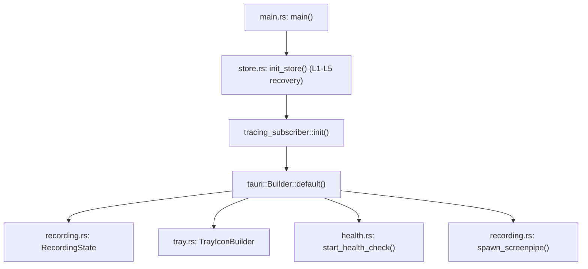
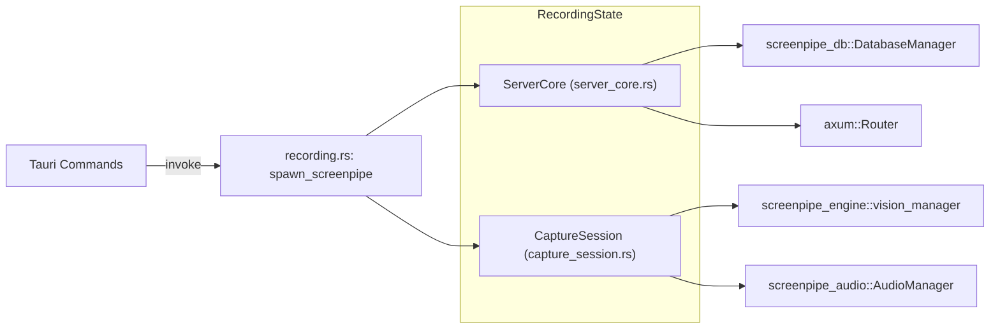
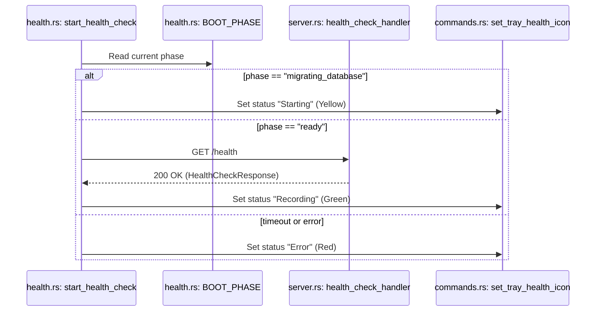

<!-- source: DeepWiki mcp.deepwiki.com · repo screenpipe/screenpipe · page 3.1 Application Lifecycle & Server · fetched 2026-10-26 -->

# Application Lifecycle & Server

<details>
<summary>Relevant source files</summary>

The following files were used as context for generating this wiki page:

- [apps/screenpipe-app-tauri/components/settings/general-settings.tsx](apps/screenpipe-app-tauri/components/settings/general-settings.tsx)
- [apps/screenpipe-app-tauri/components/settings/privacy-section.tsx](apps/screenpipe-app-tauri/components/settings/privacy-section.tsx)
- [apps/screenpipe-app-tauri/components/settings/recording-settings.tsx](apps/screenpipe-app-tauri/components/settings/recording-settings.tsx)
- [apps/screenpipe-app-tauri/components/update-banner.tsx](apps/screenpipe-app-tauri/components/update-banner.tsx)
- [apps/screenpipe-app-tauri/e2e/mock-updates/packaged-update-restart.e2e.ts](apps/screenpipe-app-tauri/e2e/mock-updates/packaged-update-restart.e2e.ts)
- [apps/screenpipe-app-tauri/e2e/specs/api.spec.ts](apps/screenpipe-app-tauri/e2e/specs/api.spec.ts)
- [apps/screenpipe-app-tauri/e2e/specs/capture-stall-stage-marker.spec.ts](apps/screenpipe-app-tauri/e2e/specs/capture-stall-stage-marker.spec.ts)
- [apps/screenpipe-app-tauri/e2e/specs/meetings-only-audio-lifecycle.spec.ts](apps/screenpipe-app-tauri/e2e/specs/meetings-only-audio-lifecycle.spec.ts)
- [apps/screenpipe-app-tauri/lib/hooks/use-settings.tsx](apps/screenpipe-app-tauri/lib/hooks/use-settings.tsx)
- [apps/screenpipe-app-tauri/lib/utils/live-capture-state.test.ts](apps/screenpipe-app-tauri/lib/utils/live-capture-state.test.ts)
- [apps/screenpipe-app-tauri/lib/utils/live-capture-state.ts](apps/screenpipe-app-tauri/lib/utils/live-capture-state.ts)
- [apps/screenpipe-app-tauri/lib/utils/tauri.ts](apps/screenpipe-app-tauri/lib/utils/tauri.ts)
- [apps/screenpipe-app-tauri/src-tauri/src/commands.rs](apps/screenpipe-app-tauri/src-tauri/src/commands.rs)
- [apps/screenpipe-app-tauri/src-tauri/src/embedded_server.rs](apps/screenpipe-app-tauri/src-tauri/src/embedded_server.rs)
- [apps/screenpipe-app-tauri/src-tauri/src/health.rs](apps/screenpipe-app-tauri/src-tauri/src/health.rs)
- [apps/screenpipe-app-tauri/src-tauri/src/main.rs](apps/screenpipe-app-tauri/src-tauri/src/main.rs)
- [apps/screenpipe-app-tauri/src-tauri/src/process_exit.rs](apps/screenpipe-app-tauri/src-tauri/src/process_exit.rs)
- [apps/screenpipe-app-tauri/src-tauri/src/recording.rs](apps/screenpipe-app-tauri/src-tauri/src/recording.rs)
- [apps/screenpipe-app-tauri/src-tauri/src/recording/db_wedge.rs](apps/screenpipe-app-tauri/src-tauri/src/recording/db_wedge.rs)
- [apps/screenpipe-app-tauri/src-tauri/src/server_core.rs](apps/screenpipe-app-tauri/src-tauri/src/server_core.rs)
- [apps/screenpipe-app-tauri/src-tauri/src/staged_update.rs](apps/screenpipe-app-tauri/src-tauri/src/staged_update.rs)
- [apps/screenpipe-app-tauri/src-tauri/src/store.rs](apps/screenpipe-app-tauri/src-tauri/src/store.rs)
- [apps/screenpipe-app-tauri/src-tauri/src/tray.rs](apps/screenpipe-app-tauri/src-tauri/src/tray.rs)
- [apps/screenpipe-app-tauri/src-tauri/src/updates.rs](apps/screenpipe-app-tauri/src-tauri/src/updates.rs)
- [crates/screenpipe-config/src/recording.rs](crates/screenpipe-config/src/recording.rs)
- [crates/screenpipe-engine/src/bin/screenpipe-engine.rs](crates/screenpipe-engine/src/bin/screenpipe-engine.rs)
- [crates/screenpipe-engine/src/cli/mod.rs](crates/screenpipe-engine/src/cli/mod.rs)
- [crates/screenpipe-engine/src/lib.rs](crates/screenpipe-engine/src/lib.rs)
- [crates/screenpipe-engine/src/recording_config.rs](crates/screenpipe-engine/src/recording_config.rs)
- [crates/screenpipe-engine/src/routes/audio.rs](crates/screenpipe-engine/src/routes/audio.rs)
- [crates/screenpipe-engine/src/routes/health.rs](crates/screenpipe-engine/src/routes/health.rs)
- [crates/screenpipe-engine/src/routes/mod.rs](crates/screenpipe-engine/src/routes/mod.rs)
- [crates/screenpipe-engine/src/server.rs](crates/screenpipe-engine/src/server.rs)
- [crates/screenpipe-screen/src/metrics.rs](crates/screenpipe-screen/src/metrics.rs)

</details>


## Purpose and Scope

This document covers the Tauri desktop application's entry point (`main.rs`), the embedded screenpipe server initialization and lifecycle, the `RecordingState` for managing capture and server components, health monitoring, and the boot phase tracking system. It details how the application transitions from a fresh boot to a fully operational 24/7 recording state, including safety mechanisms for settings recovery and server restarts.

---

## Application Entry Point

The Tauri application starts in `apps/screenpipe-app-tauri/src-tauri/src/main.rs`. The `main` function performs the following initialization sequence:

1.  **Logging Setup**: Configures `tracing-subscriber` with a `RollingFileAppender` [apps/screenpipe-app-tauri/src-tauri/src/main.rs:33-34]() and platform-specific targets like `OsLogger` for macOS [apps/screenpipe-app-tauri/src-tauri/src/main.rs:38](). The `LOG_FILTER` constant [apps/screenpipe-app-tauri/src-tauri/src/main.rs:42]() defines the default log levels for various modules.
2.  **Sentry Initialization**: Initializes crash reporting with `sentry::init` if the DSN is provided [apps/screenpipe-app-tauri/src-tauri/src/main.rs:545-560]().
3.  **Settings Recovery**: Before the Tauri store plugin opens the settings file, `init_store` [apps/screenpipe-app-tauri/src-tauri/src/store.rs:53-86]() performs "defense in depth" to prevent settings loss. It checks if `store.bin` is corrupted or empty and attempts to restore from `.last-good` or `.last-good.prev` snapshots [apps/screenpipe-app-tauri/src-tauri/src/store.rs:88-95](). On Windows, it includes retry logic for store access issues [apps/screenpipe-app-tauri/src-tauri/src/store.rs:111-133]() and permission resets [apps/screenpipe-app-tauri/src-tauri/src/store.rs:140-177]().
4.  **Tauri Builder**: Constructs the app with critical plugins:
    *   `tauri-plugin-store` for settings persistence [apps/screenpipe-app-tauri/src-tauri/Cargo.toml:49]().
    *   `tauri-plugin-updater` for application updates [apps/screenpipe-app-tauri/src-tauri/Cargo.toml:43]().
    *   `tauri-plugin-global-shortcut` for hotkeys [apps/screenpipe-app-tauri/src-tauri/Cargo.toml:171]().
5.  **State Management**: Injects `RecordingState`, which holds the long-lived server core and togglable capture sessions [apps/screenpipe-app-tauri/src-tauri/src/recording.rs:7-19]().
6.  **Setup Hook**: Executes `setup_tray` [apps/screenpipe-app-tauri/src-tauri/src/tray.rs:22](), `initialize_global_shortcuts`, and `start_health_check` [apps/screenpipe-app-tauri/src-tauri/src/health.rs:149]().

**Application Startup Flow**



Sources: [apps/screenpipe-app-tauri/src-tauri/src/main.rs:540-1038](), [apps/screenpipe-app-tauri/src-tauri/src/store.rs:49-86](), [apps/screenpipe-app-tauri/src-tauri/src/recording.rs:7-19](), [apps/screenpipe-app-tauri/src-tauri/src/main.rs:33-34](), [apps/screenpipe-app-tauri/src-tauri/src/main.rs:38](), [apps/screenpipe-app-tauri/src-tauri/src/main.rs:42](), [apps/screenpipe-app-tauri/src-tauri/src/store.rs:111-133](), [apps/screenpipe-app-tauri/src-tauri/src/store.rs:140-177]()

---

## Embedded Server & Recording State

Screenpipe manages two independent lifecycles within the `RecordingState` struct [apps/screenpipe-app-tauri/src-tauri/src/recording.rs:11-22]():

1.  **Server Core**: (DB, HTTP API, Pipes, Secrets) Started once and lives until the app quits. Managed by `ServerCore` [apps/screenpipe-app-tauri/src-tauri/src/server_core.rs]().
2.  **Capture Session**: (Vision, Audio, UI events) Can be toggled without restarting the server. Managed by `CaptureSession` [apps/screenpipe-app-tauri/src-tauri/src/capture_session.rs]().

### RecordingState Structure

```rust
pub struct RecordingState {
    pub server: Arc<Mutex<Option<ServerCore>>>,
    pub capture: Arc<Mutex<Option<CaptureSession>>>,
    pub is_starting: Arc<AtomicBool>,
    pub last_spawn_epoch: Arc<AtomicU64>,
}
```

**Key Components**

| Component | Role | Location |
| :--- | :--- | :--- |
| `ServerCore` | Manages `DatabaseManager`, Axum `Router`, and `SharedPipeManager`. | [crates/screenpipe-engine/src/server.rs:134-175]() |
| `CaptureSession` | Orchestrates `VisionManager`, `AudioManager`, and UI recording. | [apps/screenpipe-app-tauri/src-tauri/src/capture_session.rs]() |
| `spawn_screenpipe` | Validates entitlements and initializes the `ServerCore` and `CaptureSession`. | [apps/screenpipe-app-tauri/src-tauri/src/recording.rs:119]() |
| `LocalApiContext` | Holds the resolved `api_key` and `port` for frontend communication. | [apps/screenpipe-app-tauri/src-tauri/src/recording.rs:28-40]() |

**Server Component Interaction**



Sources: [apps/screenpipe-app-tauri/src-tauri/src/recording.rs:7-22](), [crates/screenpipe-engine/src/server.rs:134-175](), [apps/screenpipe-app-tauri/src-tauri/src/recording.rs:119]()

---

## Health Monitoring & Boot Phases

Because the HTTP server only binds after DB migrations and audio initialization, a standard `/health` endpoint is unreachable during startup. Screenpipe uses a "Boot Phase" system to track progress.

### Boot Phases

The system tracks the following phases in `BOOT_PHASE` [apps/screenpipe-app-tauri/src-tauri/src/health.rs:50-77]():
*   `idle`: Not starting.
*   `starting`: Initialization begun.
*   `migrating_database`: Running SQL migrations (critical for large databases).
*   `building_audio`: Initializing Whisper/Deepgram engines.
*   `starting_pipes`: Loading and executing JS pipes.
*   `ready`: HTTP server bound and listening.
*   `error`: Startup failed.

### Health Polling Loop

`start_health_check` [apps/screenpipe-app-tauri/src-tauri/src/health.rs:149]() runs a background loop that:
1.  Checks the `RecordingStatus` (Starting, Recording, Paused, Stopped, Error) [apps/screenpipe-app-tauri/src-tauri/src/health.rs:7-10]().
2.  Polls the local API context via `get_recording_status` [apps/screenpipe-app-tauri/src-tauri/src/health.rs:120]().
3.  Updates the system tray icon based on health state [apps/screenpipe-app-tauri/src-tauri/src/main.rs:115-116]().

**Health Check Logic**



Sources: [apps/screenpipe-app-tauri/src-tauri/src/health.rs:50-149](), [crates/screenpipe-engine/src/server.rs:121-127](), [apps/screenpipe-app-tauri/src-tauri/src/main.rs:115-116]()

---

## Recording State Management & Recovery

The application includes a "circuit breaker" to handle persistent database failures.

### DB Wedge Recovery

When database writes wedge persistently, the `PersistentFailureHook` [apps/screenpipe-app-tauri/src-tauri/src/recording/db_wedge.rs:193-204]() is triggered. It uses `DbWedgeState` [apps/screenpipe-app-tauri/src-tauri/src/recording/db_wedge.rs:127-136]() to manage auto-restarts:
*   **Window**: Restarts are limited within `DB_WEDGE_BREAKER_WINDOW` (600s) [apps/screenpipe-app-tauri/src-tauri/src/recording/db_wedge.rs:185]().
*   **Max Restarts**: Allows up to 3 restarts before giving up [apps/screenpipe-app-tauri/src-tauri/src/recording/db_wedge.rs:184]().
*   **Action**: If the limit is reached, it stops auto-recovery and notifies the user via the notification panel [apps/screenpipe-app-tauri/src-tauri/src/recording/db_wedge.rs:206-215]().

### Shutdown & Restart Gate

Every code path leading to `process::exit` (auto-updates, manual relaunch) must pass through the `await_restart_gate` [apps/screenpipe-app-tauri/src-tauri/src/updates.rs:175-184](). This ensures the `ServerCore` reaches a safe state before the process terminates, preventing segfaults in native libraries like `onnxruntime` [apps/screenpipe-app-tauri/src-tauri/src/updates.rs:175-184](). The `stop_before_update` function [apps/screenpipe-app-tauri/src-tauri/src/updates.rs:73-102]() handles the graceful shutdown of recording components before an update.

Sources: [apps/screenpipe-app-tauri/src-tauri/src/recording/db_wedge.rs:127-204](), [apps/screenpipe-app-tauri/src-tauri/src/updates.rs:175-184](), [apps/screenpipe-app-tauri/src-tauri/src/updates.rs:73-102]()

---

## Tray & UI Synchronization

The tray menu [apps/screenpipe-app-tauri/src-tauri/src/tray.rs]() reflects the real-time state of the server and provides quick controls.

*   **Menu Data Prefetch**: `prefetch_tray_menu_data` [apps/screenpipe-app-tauri/src-tauri/src/tray.rs:60-146]() gathers settings, shortcuts, and permission statuses off the main thread to prevent UI lag.
*   **Optimistic Status**: `set_optimistic_status` [apps/screenpipe-app-tauri/src-tauri/src/tray.rs:194-200]() provides instant visual feedback in the tray when a user toggles recording, even before the backend confirms the state change.
*   **Pause Management**: Supports manual pause and "Pause for X minutes" with an auto-resume timer [apps/screenpipe-app-tauri/src-tauri/src/tray.rs:202-206]().

Sources: [apps/screenpipe-app-tauri/src-tauri/src/tray.rs:60-146](), [apps/screenpipe-app-tauri/src-tauri/src/tray.rs:194-206]()

---

