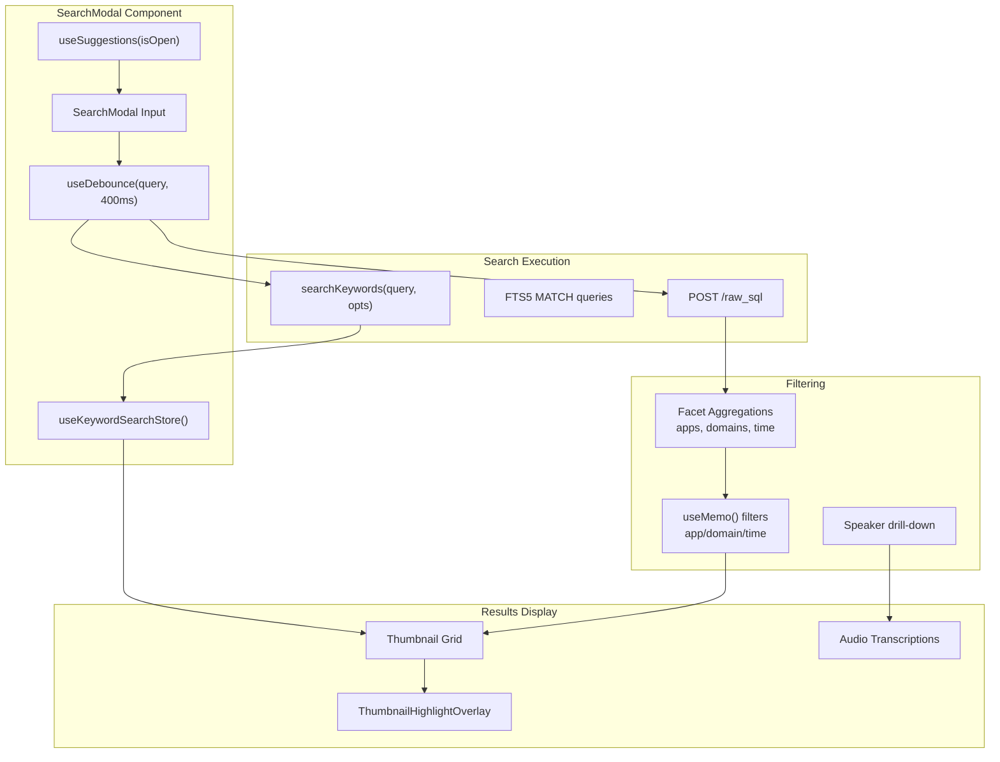
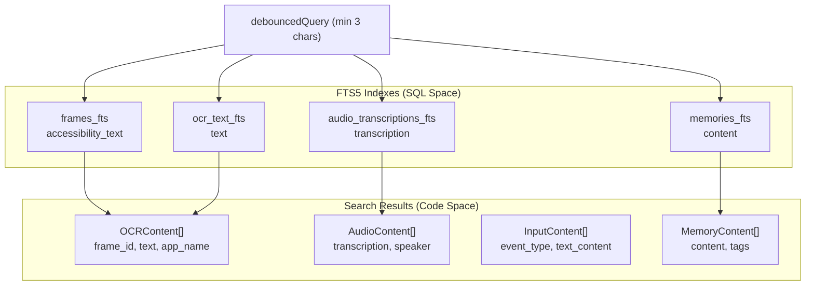
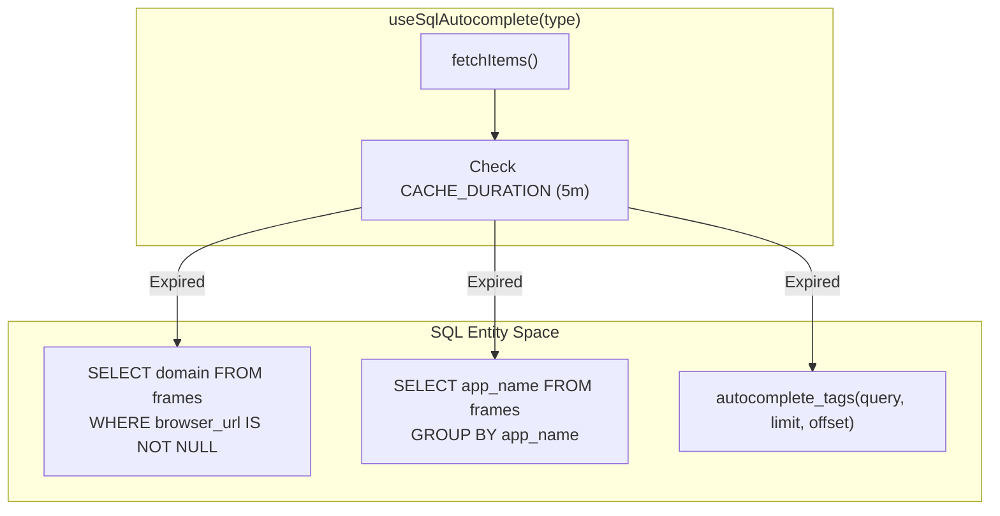

<!-- source: DeepWiki mcp.deepwiki.com · repo screenpipe/screenpipe · page 3.4 Search & Filtering · fetched 2026-10-26 -->

# Search & Filtering

Relevant source files

The following files were used as context for generating this wiki page:

- [apps/screenpipe-app-tauri/components/__tests__/text-overlay.test.tsx](apps/screenpipe-app-tauri/components/__tests__/text-overlay.test.tsx)
- [apps/screenpipe-app-tauri/components/__tests__/url-detection-benchmark-data.json](apps/screenpipe-app-tauri/components/__tests__/url-detection-benchmark-data.json)
- [apps/screenpipe-app-tauri/components/__tests__/url-detection-benchmark.test.ts](apps/screenpipe-app-tauri/components/__tests__/url-detection-benchmark.test.ts)
- [apps/screenpipe-app-tauri/components/rewind/__tests__/near-viewport.test.tsx](apps/screenpipe-app-tauri/components/rewind/__tests__/near-viewport.test.tsx)
- [apps/screenpipe-app-tauri/components/rewind/__tests__/thumbnail-highlight-overlay.test.ts](apps/screenpipe-app-tauri/components/rewind/__tests__/thumbnail-highlight-overlay.test.ts)
- [apps/screenpipe-app-tauri/components/rewind/near-viewport.tsx](apps/screenpipe-app-tauri/components/rewind/near-viewport.tsx)
- [apps/screenpipe-app-tauri/components/rewind/search-modal.tsx](apps/screenpipe-app-tauri/components/rewind/search-modal.tsx)
- [apps/screenpipe-app-tauri/components/rewind/thumbnail-highlight-overlay.tsx](apps/screenpipe-app-tauri/components/rewind/thumbnail-highlight-overlay.tsx)
- [apps/screenpipe-app-tauri/components/text-overlay.tsx](apps/screenpipe-app-tauri/components/text-overlay.tsx)
- [apps/screenpipe-app-tauri/components/ui/multi-select.tsx](apps/screenpipe-app-tauri/components/ui/multi-select.tsx)
- [apps/screenpipe-app-tauri/lib/hooks/__tests__/use-frame-text-data.test.ts](apps/screenpipe-app-tauri/lib/hooks/__tests__/use-frame-text-data.test.ts)
- [apps/screenpipe-app-tauri/lib/hooks/__tests__/use-keyword-search-store.test.ts](apps/screenpipe-app-tauri/lib/hooks/__tests__/use-keyword-search-store.test.ts)
- [apps/screenpipe-app-tauri/lib/hooks/use-frame-text-data.ts](apps/screenpipe-app-tauri/lib/hooks/use-frame-text-data.ts)
- [apps/screenpipe-app-tauri/lib/hooks/use-keyword-search-store.tsx](apps/screenpipe-app-tauri/lib/hooks/use-keyword-search-store.tsx)
- [apps/screenpipe-app-tauri/lib/hooks/use-sql-autocomplete.tsx](apps/screenpipe-app-tauri/lib/hooks/use-sql-autocomplete.tsx)
- [apps/screenpipe-app-tauri/public/CHANGELOG.md](apps/screenpipe-app-tauri/public/CHANGELOG.md)
- [apps/screenpipe-app-tauri/src-tauri/src/audio_exclusions.rs](apps/screenpipe-app-tauri/src-tauri/src/audio_exclusions.rs)
- [apps/screenpipe-app-tauri/src-tauri/src/icons.rs](apps/screenpipe-app-tauri/src-tauri/src/icons.rs)
- [apps/screenpipe-app-tauri/tsconfig.json](apps/screenpipe-app-tauri/tsconfig.json)
- [crates/screenpipe-audio/examples/exclusion_probe.rs](crates/screenpipe-audio/examples/exclusion_probe.rs)
- [crates/screenpipe-db/src/db/accessibility.rs](crates/screenpipe-db/src/db/accessibility.rs)
- [crates/screenpipe-db/src/db/elements.rs](crates/screenpipe-db/src/db/elements.rs)
- [crates/screenpipe-db/src/db/memories.rs](crates/screenpipe-db/src/db/memories.rs)
- [crates/screenpipe-db/src/db/search.rs](crates/screenpipe-db/src/db/search.rs)
- [crates/screenpipe-db/src/db/tests.rs](crates/screenpipe-db/src/db/tests.rs)
- [crates/screenpipe-db/src/db/text_positions.rs](crates/screenpipe-db/src/db/text_positions.rs)
- [crates/screenpipe-db/src/migrations/20260616120000_speaker_filter_autocomplete_indexes.sql](crates/screenpipe-db/src/migrations/20260616120000_speaker_filter_autocomplete_indexes.sql)
- [crates/screenpipe-db/tests/tag_autocomplete_query_test.rs](crates/screenpipe-db/tests/tag_autocomplete_query_test.rs)
- [crates/screenpipe-engine/src/routes/elements.rs](crates/screenpipe-engine/src/routes/elements.rs)
- [crates/screenpipe-engine/src/routes/response_format.rs](crates/screenpipe-engine/src/routes/response_format.rs)
- [crates/screenpipe-engine/tests/endpoint_test.rs](crates/screenpipe-engine/tests/endpoint_test.rs)

The search and filtering system provides multi-modal content discovery across screen (OCR + accessibility), audio transcriptions, user input events (clicks, keystrokes, clipboard), and persistent memories. The system is exposed through the `SearchModal` component, which queries SQLite FTS5 indexes and applies client-side filters for app, domain, time, speaker, and device. Results are displayed as thumbnail grids with yellow highlight overlays marking matched text positions.

For programmatic search access via HTTP API, see [HTTP API](#5.2). For database schema and FTS5 implementation, see [Storage & Database](#2.4).

---

## Search Modal Architecture

The `SearchModal` is the primary UI for search, triggered by global shortcut (Cmd+F / Ctrl+F) and exposed both in overlay mode (NSPanel) and embedded mode (settings window). To ensure performance, the search window is reused across opens; the Rust backend hides it on close to keep the webview "warm," emitting a `search-reset` event instead of reloading the page [apps/screenpipe-app-tauri/components/rewind/search-modal.tsx:76-83]().

Title: "Search UI Component Flow"

Sources: [apps/screenpipe-app-tauri/components/rewind/search-modal.tsx:76-83]()

---

## Multi-Modal Search Flow

The search system queries four content types simultaneously: OCR, Audio, Input (UI events), and Memory. Each has a dedicated FTS5 index.

Title: "Multi-Modal FTS5 Mapping"

The `searchKeywords` function in `useKeywordSearchStore` executes the multi-modal query. Key logic includes:
- **Stopword Filtering:** Minimal list `STOP_WORDS` to preserve content words while removing grammatical and code tokens [apps/screenpipe-app-tauri/components/rewind/search-modal.tsx:121-143]().
- **Query Construction:** Minimum 3 characters to avoid wasteful queries, with FTS5 sanitization to handle special characters [apps/screenpipe-app-tauri/lib/hooks/use-keyword-search-store.tsx:211-221]().
- **Exclusion Window:** A 1-minute exclusion window ensures data has been FTS-indexed before appearing in results [apps/screenpipe-app-tauri/lib/hooks/use-keyword-search-store.tsx:218-228]().

Sources: [apps/screenpipe-app-tauri/components/rewind/search-modal.tsx:121-143](), [apps/screenpipe-app-tauri/lib/hooks/use-keyword-search-store.tsx:211-221](), [apps/screenpipe-app-tauri/lib/hooks/use-keyword-search-store.tsx:218-228]()

---

## FTS5 Search Implementation

The database layer uses SQLite FTS5 (Full-Text Search). The search API allows filtering by `app_name`, `window_name`, `speaker_ids`, and even `on_screen` elements for accessibility hits. The `search_with_tags_ordered_projection` function in `DatabaseManager` is the core implementation for these searches [crates/screenpipe-db/src/db/search.rs:147-172]().

| SearchQuery Field | Role |
|-------------------|------|
| `query` | FTS5 match query string [crates/screenpipe-db/src/db/search.rs:125]() |
| `content_type` | Filter by OCR, Audio, UI, Input, or Memory [crates/screenpipe-db/src/db/search.rs:126]() |
| `speaker_ids` | Restrict audio results to specific identified speakers [crates/screenpipe-db/src/db/search.rs:134]() |
| `on_screen` | Filters accessibility tree hits to visible elements only [crates/screenpipe-db/src/db/search.rs:141]() |
| `tags` | Intersect results with specific user/AI-applied tags [crates/screenpipe-db/src/db/search.rs:143]() |

Sources: [crates/screenpipe-db/src/db/search.rs:147-172]()

---

## Faceted Filtering & SQL Autocomplete

The search UI displays filter chips for apps, domains, and tags. These are powered by hooks that perform raw SQL queries or hit dedicated autocomplete endpoints.

Title: "SQL Autocomplete Logic"

**Autocomplete Implementation:**
- **URL Domain Extraction:** Uses SQL string functions to parse domains from `browser_url` [apps/screenpipe-app-tauri/lib/hooks/use-sql-autocomplete.tsx:46-74]().
- **App/Window Ranking:** Groups by `app_name` and sorts by frequency [apps/screenpipe-app-tauri/lib/hooks/use-sql-autocomplete.tsx:76-83]().
- **Tag Autocomplete:** The `useTagAutocomplete` hook fetches distinct tags across screen, audio, and memories via the `/tags/autocomplete` endpoint [apps/screenpipe-app-tauri/lib/hooks/use-sql-autocomplete.tsx:131-176]().

Sources: [apps/screenpipe-app-tauri/lib/hooks/use-sql-autocomplete.tsx:46-74](), [apps/screenpipe-app-tauri/lib/hooks/use-sql-autocomplete.tsx:76-83](), [apps/screenpipe-app-tauri/lib/hooks/use-sql-autocomplete.tsx:131-176]()

---

## Search Highlighting

The `ThumbnailHighlightOverlay` component renders yellow boxes over matching text in frame thumbnails. It fetches text positions and applies a selection heuristic to find the most relevant visual matches [apps/screenpipe-app-tauri/components/rewind/thumbnail-highlight-overlay.tsx:28-57]().

**Highlight Heuristic:**
1. Filter text positions by matching any highlight term (case-insensitive substring match) [apps/screenpipe-app-tauri/components/rewind/thumbnail-highlight-overlay.tsx:38-40]().
2. Sort by area (`width * height`) ascending to prefer word-level OCR boxes over wide paragraph nodes [apps/screenpipe-app-tauri/components/rewind/thumbnail-highlight-overlay.tsx:51-55]().
3. Skip if the smallest match covers >15% of frame (likely a full-page text block) [apps/screenpipe-app-tauri/components/rewind/thumbnail-highlight-overlay.tsx:43-48]().
4. Take up to 3 smallest matches [apps/screenpipe-app-tauri/components/rewind/thumbnail-highlight-overlay.tsx:56]().
5. Use percentage-based positioning (`left`, `top`, `width`, `height`) to scale with any thumbnail size [apps/screenpipe-app-tauri/components/rewind/thumbnail-highlight-overlay.tsx:169-176]().

Sources: [apps/screenpipe-app-tauri/components/rewind/thumbnail-highlight-overlay.tsx:28-57](), [apps/screenpipe-app-tauri/components/rewind/thumbnail-highlight-overlay.tsx:38-40](), [apps/screenpipe-app-tauri/components/rewind/thumbnail-highlight-overlay.tsx:43-48](), [apps/screenpipe-app-tauri/components/rewind/thumbnail-highlight-overlay.tsx:56](), [apps/screenpipe-app-tauri/components/rewind/thumbnail-highlight-overlay.tsx:169-176]()

---

## Performance Optimization: Hot Frame Cache

To avoid starving the database pool with constant timeline polling, Screenpipe uses a `HotFrameCache`. This in-memory store keeps today's frames and audio transcriptions in a `BTreeMap` for O(log n) inserts and efficient time-range queries.

- **Zero-Allocation Clones:** String fields in `HotFrame` and `HotAudio` use `Arc<str>` to avoid heap allocations during broadcast sends to WebSocket handlers.
- **Day Rollover:** The cache automatically clears itself on day rollover to manage memory usage.
- **Benchmarks:** Performance is tracked via benchmarks measuring `HotFrame` clone costs and range query latency.

Sources: [crates/screenpipe-engine/src/hot_frame_cache.rs:21-80](), [crates/screenpipe-engine/src/hot_frame_cache.rs:107-120](), [crates/screenpipe-engine/benches/hot_frame_cache.rs:7-14]()

---

## Privacy & Redaction in Search

Search results are subject to a multi-layer permission and privacy system.

- **PII Redaction:** The `/search` endpoint supports a `filter_pii` parameter [crates/screenpipe-db/src/db/search.rs:144](). When enabled, text-bearing fields (OCR, audio, input, memory) are redacted before returning to the caller.
- **Pipe Permissions:** The engine extracts `OptionalPipePerms` from request extensions to enforce security policies during search execution.
- **Garbage Word Detection:** The UI filters out OCR noise using regex for consonant clusters and mixed alphanumeric tokens to prevent garbage data from appearing in suggestions [apps/screenpipe-app-tauri/components/rewind/search-modal.tsx:145-158]().

Sources: [crates/screenpipe-db/src/db/search.rs:144](), [apps/screenpipe-app-tauri/components/rewind/search-modal.tsx:145-158]()

---

## Search Suggestions

The `extractInterestingWords` function generates smart suggestions when the search modal opens by analyzing the last 24 hours of OCR data [apps/screenpipe-app-tauri/components/rewind/search-modal.tsx:160-180]().

**Analysis Logic:**
- **Word Extraction:** Splits on whitespace/punctuation and matches tokens 3-25 characters long [apps/screenpipe-app-tauri/components/rewind/search-modal.tsx:164]().
- **Proper Noun Preference:** Prefers capitalized versions of words as they are often more "interesting" entities [apps/screenpipe-app-tauri/components/rewind/search-modal.tsx:173-175]().
- **Exclusion:** Uses `STOP_WORDS` to filter out common grammatical and code tokens [apps/screenpipe-app-tauri/components/rewind/search-modal.tsx:166-167]().

Sources: [apps/screenpipe-app-tauri/components/rewind/search-modal.tsx:160-180](), [apps/screenpipe-app-tauri/components/rewind/search-modal.tsx:164](), [apps/screenpipe-app-tauri/components/rewind/search-modal.tsx:173-175](), [apps/screenpipe-app-tauri/components/rewind/search-modal.tsx:166-167]()

---

