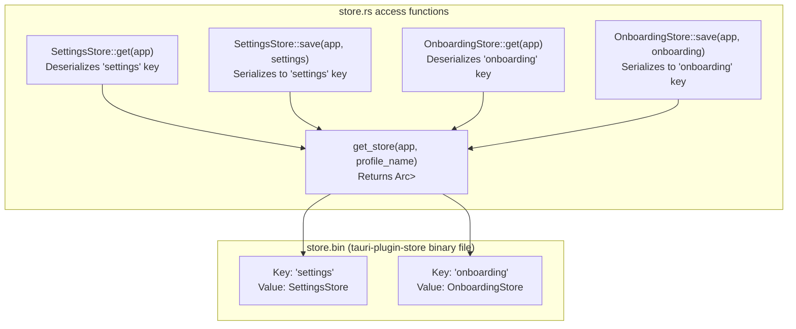
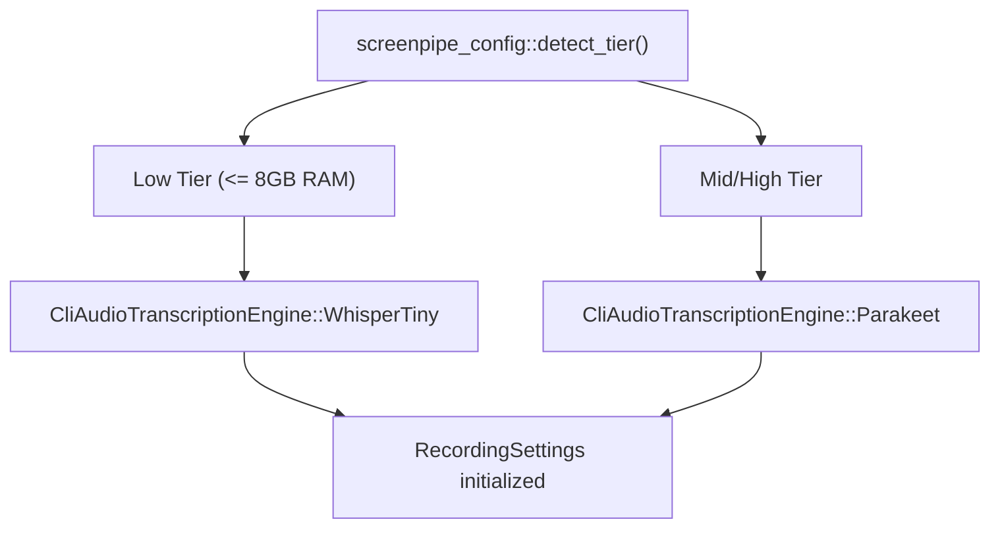
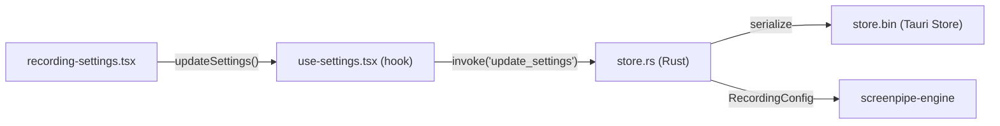

<!-- source: DeepWiki mcp.deepwiki.com · repo screenpipe/screenpipe · page 3.5 Settings & Configuration · fetched 2026-10-26 -->

# Settings & Configuration

<details>
<summary>Relevant source files</summary>

The following files were used as context for generating this wiki page:

- [apps/screenpipe-app-tauri/app/(main)/home/page.tsx](apps/screenpipe-app-tauri/app/(main)/home/page.tsx)
- [apps/screenpipe-app-tauri/app/(main)/settings/page.tsx](apps/screenpipe-app-tauri/app/(main)/settings/page.tsx)
- [apps/screenpipe-app-tauri/app/chat/page.tsx](apps/screenpipe-app-tauri/app/chat/page.tsx)
- [apps/screenpipe-app-tauri/components/__tests__/command-palette.test.tsx](apps/screenpipe-app-tauri/components/__tests__/command-palette.test.tsx)
- [apps/screenpipe-app-tauri/components/__tests__/pipes-toolbar.test.tsx](apps/screenpipe-app-tauri/components/__tests__/pipes-toolbar.test.tsx)
- [apps/screenpipe-app-tauri/components/__tests__/recording-status.test.tsx](apps/screenpipe-app-tauri/components/__tests__/recording-status.test.tsx)
- [apps/screenpipe-app-tauri/components/__tests__/shortcut-guide.test.tsx](apps/screenpipe-app-tauri/components/__tests__/shortcut-guide.test.tsx)
- [apps/screenpipe-app-tauri/components/chat/chat-tab-strip.test.tsx](apps/screenpipe-app-tauri/components/chat/chat-tab-strip.test.tsx)
- [apps/screenpipe-app-tauri/components/chat/chat-tab-strip.tsx](apps/screenpipe-app-tauri/components/chat/chat-tab-strip.tsx)
- [apps/screenpipe-app-tauri/components/chat/standalone/acp-config-selector.test.tsx](apps/screenpipe-app-tauri/components/chat/standalone/acp-config-selector.test.tsx)
- [apps/screenpipe-app-tauri/components/chat/standalone/acp-config-selector.tsx](apps/screenpipe-app-tauri/components/chat/standalone/acp-config-selector.tsx)
- [apps/screenpipe-app-tauri/components/chat/standalone/acp-permission-selector.test.tsx](apps/screenpipe-app-tauri/components/chat/standalone/acp-permission-selector.test.tsx)
- [apps/screenpipe-app-tauri/components/chat/standalone/acp-permission-selector.tsx](apps/screenpipe-app-tauri/components/chat/standalone/acp-permission-selector.tsx)
- [apps/screenpipe-app-tauri/components/chat/standalone/acp-sign-in-dialog.test.tsx](apps/screenpipe-app-tauri/components/chat/standalone/acp-sign-in-dialog.test.tsx)
- [apps/screenpipe-app-tauri/components/chat/standalone/chat-title-menu.test.tsx](apps/screenpipe-app-tauri/components/chat/standalone/chat-title-menu.test.tsx)
- [apps/screenpipe-app-tauri/components/chat/standalone/chat-title-menu.tsx](apps/screenpipe-app-tauri/components/chat/standalone/chat-title-menu.tsx)
- [apps/screenpipe-app-tauri/components/chat/standalone/composer-controls-row.test.tsx](apps/screenpipe-app-tauri/components/chat/standalone/composer-controls-row.test.tsx)
- [apps/screenpipe-app-tauri/components/chat/standalone/composer-controls-row.tsx](apps/screenpipe-app-tauri/components/chat/standalone/composer-controls-row.tsx)
- [apps/screenpipe-app-tauri/components/chat/standalone/composer-effort-slider.test.tsx](apps/screenpipe-app-tauri/components/chat/standalone/composer-effort-slider.test.tsx)
- [apps/screenpipe-app-tauri/components/chat/standalone/composer-effort-slider.tsx](apps/screenpipe-app-tauri/components/chat/standalone/composer-effort-slider.tsx)
- [apps/screenpipe-app-tauri/components/chat/standalone/composer-settings-popover.test.tsx](apps/screenpipe-app-tauri/components/chat/standalone/composer-settings-popover.test.tsx)
- [apps/screenpipe-app-tauri/components/chat/standalone/composer-settings-popover.tsx](apps/screenpipe-app-tauri/components/chat/standalone/composer-settings-popover.tsx)
- [apps/screenpipe-app-tauri/components/chat/standalone/composer-worktree-toggle.tsx](apps/screenpipe-app-tauri/components/chat/standalone/composer-worktree-toggle.tsx)
- [apps/screenpipe-app-tauri/components/chat/standalone/hooks/use-coding-workspace.test.tsx](apps/screenpipe-app-tauri/components/chat/standalone/hooks/use-coding-workspace.test.tsx)
- [apps/screenpipe-app-tauri/components/chat/standalone/hooks/use-coding-workspace.ts](apps/screenpipe-app-tauri/components/chat/standalone/hooks/use-coding-workspace.ts)
- [apps/screenpipe-app-tauri/components/command-palette.tsx](apps/screenpipe-app-tauri/components/command-palette.tsx)
- [apps/screenpipe-app-tauri/components/deeplink-handler.tsx](apps/screenpipe-app-tauri/components/deeplink-handler.tsx)
- [apps/screenpipe-app-tauri/components/recording-status.tsx](apps/screenpipe-app-tauri/components/recording-status.tsx)
- [apps/screenpipe-app-tauri/components/rewind/ai-presets-selector.test.tsx](apps/screenpipe-app-tauri/components/rewind/ai-presets-selector.test.tsx)
- [apps/screenpipe-app-tauri/components/rewind/ai-presets-selector.tsx](apps/screenpipe-app-tauri/components/rewind/ai-presets-selector.tsx)
- [apps/screenpipe-app-tauri/components/settings/__tests__/provider-automations-panel.test.tsx](apps/screenpipe-app-tauri/components/settings/__tests__/provider-automations-panel.test.tsx)
- [apps/screenpipe-app-tauri/components/settings/__tests__/shortcut-section.test.tsx](apps/screenpipe-app-tauri/components/settings/__tests__/shortcut-section.test.tsx)
- [apps/screenpipe-app-tauri/components/settings/ai-presets.tsx](apps/screenpipe-app-tauri/components/settings/ai-presets.tsx)
- [apps/screenpipe-app-tauri/components/settings/browser-url-card.tsx](apps/screenpipe-app-tauri/components/settings/browser-url-card.tsx)
- [apps/screenpipe-app-tauri/components/settings/disk-usage-section.tsx](apps/screenpipe-app-tauri/components/settings/disk-usage-section.tsx)
- [apps/screenpipe-app-tauri/components/settings/display-section.tsx](apps/screenpipe-app-tauri/components/settings/display-section.tsx)
- [apps/screenpipe-app-tauri/components/settings/feedback-section.tsx](apps/screenpipe-app-tauri/components/settings/feedback-section.tsx)
- [apps/screenpipe-app-tauri/components/settings/provider-automations-panel.tsx](apps/screenpipe-app-tauri/components/settings/provider-automations-panel.tsx)
- [apps/screenpipe-app-tauri/components/settings/shortcut-row.tsx](apps/screenpipe-app-tauri/components/settings/shortcut-row.tsx)
- [apps/screenpipe-app-tauri/components/settings/shortcut-section.tsx](apps/screenpipe-app-tauri/components/settings/shortcut-section.tsx)
- [apps/screenpipe-app-tauri/components/settings/team-section.test.tsx](apps/screenpipe-app-tauri/components/settings/team-section.test.tsx)
- [apps/screenpipe-app-tauri/components/settings/voice-memos-card.tsx](apps/screenpipe-app-tauri/components/settings/voice-memos-card.tsx)
- [apps/screenpipe-app-tauri/components/shortcut-guide.tsx](apps/screenpipe-app-tauri/components/shortcut-guide.tsx)
- [apps/screenpipe-app-tauri/components/thinking-level-selector.tsx](apps/screenpipe-app-tauri/components/thinking-level-selector.tsx)
- [apps/screenpipe-app-tauri/e2e/specs/chat-coding-worktree.spec.ts](apps/screenpipe-app-tauri/e2e/specs/chat-coding-worktree.spec.ts)
- [apps/screenpipe-app-tauri/e2e/specs/webview-shell-scope.spec.ts](apps/screenpipe-app-tauri/e2e/specs/webview-shell-scope.spec.ts)
- [apps/screenpipe-app-tauri/lib/__tests__/close-tab-shortcut.test.ts](apps/screenpipe-app-tauri/lib/__tests__/close-tab-shortcut.test.ts)
- [apps/screenpipe-app-tauri/lib/__tests__/shell-capability-scope.test.ts](apps/screenpipe-app-tauri/lib/__tests__/shell-capability-scope.test.ts)
- [apps/screenpipe-app-tauri/lib/__tests__/shortcuts.test.ts](apps/screenpipe-app-tauri/lib/__tests__/shortcuts.test.ts)
- [apps/screenpipe-app-tauri/lib/analytics/command-palette.test.ts](apps/screenpipe-app-tauri/lib/analytics/command-palette.test.ts)
- [apps/screenpipe-app-tauri/lib/analytics/command-palette.ts](apps/screenpipe-app-tauri/lib/analytics/command-palette.ts)
- [apps/screenpipe-app-tauri/lib/chat/acp-spawn-signature.ts](apps/screenpipe-app-tauri/lib/chat/acp-spawn-signature.ts)
- [apps/screenpipe-app-tauri/lib/close-tab-shortcut.ts](apps/screenpipe-app-tauri/lib/close-tab-shortcut.ts)
- [apps/screenpipe-app-tauri/lib/hooks/use-recording-storage.test.tsx](apps/screenpipe-app-tauri/lib/hooks/use-recording-storage.test.tsx)
- [apps/screenpipe-app-tauri/lib/hooks/use-recording-storage.ts](apps/screenpipe-app-tauri/lib/hooks/use-recording-storage.ts)
- [apps/screenpipe-app-tauri/lib/shortcuts.ts](apps/screenpipe-app-tauri/lib/shortcuts.ts)
- [apps/screenpipe-app-tauri/lib/stores/acp-session-config.test.ts](apps/screenpipe-app-tauri/lib/stores/acp-session-config.test.ts)
- [apps/screenpipe-app-tauri/lib/stores/acp-session-config.ts](apps/screenpipe-app-tauri/lib/stores/acp-session-config.ts)
- [apps/screenpipe-app-tauri/lib/utils/model-label.ts](apps/screenpipe-app-tauri/lib/utils/model-label.ts)
- [apps/screenpipe-app-tauri/lib/utils/select-worktree-repository.test.ts](apps/screenpipe-app-tauri/lib/utils/select-worktree-repository.test.ts)
- [apps/screenpipe-app-tauri/lib/utils/select-worktree-repository.ts](apps/screenpipe-app-tauri/lib/utils/select-worktree-repository.ts)
- [apps/screenpipe-app-tauri/src-tauri/capabilities/main.json](apps/screenpipe-app-tauri/src-tauri/capabilities/main.json)
- [apps/screenpipe-app-tauri/src-tauri/gen/schemas/capabilities.json](apps/screenpipe-app-tauri/src-tauri/gen/schemas/capabilities.json)
- [apps/screenpipe-app-tauri/src-tauri/src/provider_automations.rs](apps/screenpipe-app-tauri/src-tauri/src/provider_automations.rs)
- [crates/screenpipe-engine/src/disk_pressure.rs](crates/screenpipe-engine/src/disk_pressure.rs)
- [crates/screenpipe-events/src/custom_events/disk_pressure.rs](crates/screenpipe-events/src/custom_events/disk_pressure.rs)
- [docs/pr-assets/active-recording-volume/after.png](docs/pr-assets/active-recording-volume/after.png)
- [docs/pr-assets/active-recording-volume/before.png](docs/pr-assets/active-recording-volume/before.png)
- [docs/pr-assets/active-recording-volume/recovered.png](docs/pr-assets/active-recording-volume/recovered.png)
- [docs/pr-assets/low-storage-recovery/after.png](docs/pr-assets/low-storage-recovery/after.png)
- [docs/pr-assets/low-storage-recovery/before.png](docs/pr-assets/low-storage-recovery/before.png)
- [docs/pr-assets/low-storage-recovery/error.png](docs/pr-assets/low-storage-recovery/error.png)

</details>


This document covers the persistent configuration system used by the screenpipe desktop application. It explains the store architecture, settings categories, default values, and how configuration is accessed throughout the application.

## Store Architecture

The settings system uses `tauri-plugin-store` to persist configuration in a binary file (`store.bin`) located in the screenpipe data directory (`~/.screenpipe/` by default). The store provides a key-value interface with automatic serialization to disk.

### Store File Structure

**Diagram: store.bin — Namespaces and Rust access layer**



The `get_store()` function builds the store using `StoreBuilder::new(app, store_path).build()` [apps/screenpipe-app-tauri/src-tauri/src/store.rs:580-599](). Each settings namespace is a separate JSON key in the binary file.

### Settings-Loss Recovery
The system implements a multi-layered defense against settings loss, particularly due to `tauri-plugin-store` silently swallowing deserialization errors. This prevents the store from being reset to defaults if `store.bin` is corrupted or unreadable.

- **`store.bin.last-good` snapshots**: After every successful save, if the `store.bin` contains AI presets (indicating a healthy state), a snapshot is created as `store.bin.last-good`. The previous `last-good` is rotated to `store.bin.last-good.prev` [apps/screenpipe-app-tauri/src-tauri/src/store.rs:93-100](), [apps/screenpipe-app-tauri/src-tauri/src/store.rs:116-160]().
- **Durable Writes**: The system uses `durable_write`, which writes to a temporary file, `fsync`s it, and then atomically renames it over the target to prevent data loss during power failures [apps/screenpipe-app-tauri/src-tauri/src/store.rs:135-152]().
- **Auto-restore at boot**: If `store.bin` is degraded (e.g., parses but has no AI presets) or unreadable (e.g., encrypted but keychain key is missing), the system attempts to restore from `store.bin.last-good` or `store.bin.last-good.prev` [apps/screenpipe-app-tauri/src-tauri/src/store.rs:162-200]().
- **Refusal to overwrite healthy files**: The system prevents creating a new, empty store over a healthy on-disk file [apps/screenpipe-app-tauri/src-tauri/src/store.rs:202-204]().

### Encryption & Security
`store.bin` supports at-rest encryption using the OS keychain.
- **Opt-in**: Disabled by default due to keychain persistence issues across app updates. Users opt-in via `encryptStore` in settings [apps/screenpipe-app-tauri/src-tauri/src/store.rs:103-112]().
- **Implementation**: Uses a magic header `SPSTORE1` to identify encrypted files [apps/screenpipe-app-tauri/src-tauri/src/store.rs:44-44]().
- **UI Integration**: The `EncryptDataCard` in `privacy-section.tsx` allows users to toggle this via `commands.enableKeychainEncryption()` [apps/screenpipe-app-tauri/components/settings/privacy-section.tsx:195-212]().

Sources: [apps/screenpipe-app-tauri/src-tauri/src/store.rs:44-204](), [apps/screenpipe-app-tauri/components/settings/privacy-section.tsx:195-212]()

## `useSettings` Hook

The primary way frontend components access and modify settings is through the `useSettings` React hook [apps/screenpipe-app-tauri/lib/hooks/use-settings.tsx:11-240]().

### Key Types and Interfaces

| Export | Type | Description |
|--------|------|-------------|
| `Settings` | TypeScript type | The primary frontend settings object [apps/screenpipe-app-tauri/lib/hooks/use-settings.tsx:162-230]() |
| `AIPreset` | Type | Configuration for LLM providers (OpenAI, Anthropic, Ollama, etc.) [apps/screenpipe-app-tauri/lib/hooks/use-settings.tsx:49-82]() |
| `ChatConversation` | Interface | Persists conversations and active session state [apps/screenpipe-app-tauri/lib/hooks/use-settings.tsx:146-194]() |
| `AIProviderType` | Union | Supported AI backends [apps/screenpipe-app-tauri/lib/hooks/use-settings.tsx:27-35]() |

The hook manages the lifecycle of settings, including hydration from the `tauri-plugin-store` and synchronization across windows via event listeners [apps/screenpipe-app-tauri/lib/hooks/use-settings.tsx:10-15]().

Sources: [apps/screenpipe-app-tauri/lib/hooks/use-settings.tsx:27-230]()

## Hardware-Aware Defaults

Screenpipe automatically adjusts its default configuration based on the detected hardware tier to ensure optimal performance.

**Diagram: Hardware-Aware Default Selection**



- **Audio Engine**: Low-tier devices default to `WhisperTiny` to avoid OOM, while higher-tier devices use `Parakeet` (which auto-upgrades to MLX GPU acceleration when available) [crates/screenpipe-engine/src/cli/mod.rs:71-78]().
- **Default STT**: If no engine is specified, the system falls back to `whisper-large-v3-turbo-quantized` [apps/screenpipe-app-tauri/components/settings/recording-settings.tsx:182]().

Sources: [crates/screenpipe-engine/src/cli/mod.rs:71-78](), [apps/screenpipe-app-tauri/components/settings/recording-settings.tsx:182]()

## Recording Settings

The `RecordingSettings` struct is the single source of truth for capture configuration, shared between the CLI and Desktop app [crates/screenpipe-config/src/recording.rs:96-260]().

### Audio Configuration
- **Transcription Mode**: `"realtime"` for immediate feedback or `"batch"` for higher quality via longer chunks [crates/screenpipe-config/src/recording.rs:108-111]().
- **CoreAudio Tap**: macOS 14.4+ supports `experimental_coreaudio_system_audio`, which sidesteps ScreenCaptureKit's display-enumeration failures after sleep/wake [crates/screenpipe-config/src/recording.rs:144-162]().
- **Vocabulary**: Supports `VocabEntry` for biasing transcription toward specific words or performing text replacement [crates/screenpipe-config/src/recording.rs:9-18]().

### Vision Configuration
- **DRM Detection**: `pause_on_drm_content` automatically pauses screen capture when protected content is detected [crates/screenpipe-config/src/recording.rs:161-167]().
- **Incognito**: `ignore_incognito_windows` skips capture for private browsing sessions [crates/screenpipe-config/src/recording.rs:158-159]().
- **Video Quality**: Controls JPEG quality during frame extraction (low, balanced, high, max) [crates/screenpipe-engine/src/recording_config.rs:143-145]().

### Recording Status Component
The `RecordingStatus` component [apps/screenpipe-app-tauri/components/recording-status.tsx:81-94]() displays the current recording state and allows users to pause/resume capture for individual devices or globally. It handles optimistic UI updates for device toggles [apps/screenpipe-app-tauri/components/recording-status.tsx:147-152]() and refreshes device lists [apps/screenpipe-app-tauri/components/recording-status.tsx:171-181]().

**Diagram: Recording Status Component Interaction**

```mermaid
graph TD
    RS[RecordingStatus Component] -->|Displays| Devices[RecordingDevice[]]
    RS -->|Displays| StorageWarning[RecordingStorageWarning]
    RS -->|User Action: Toggle Device| ToggleDevice[toggleDevice(device)]
    RS -->|User Action: Pause/Resume All| ToggleAllRecording[toggleAllRecording()]
    ToggleDevice -->|Optimistic UI Update| Devices
    ToggleDevice -->|API Call| LocalFetch[localFetch("/vision/device/stop" or "/audio/device/start")]
    LocalFetch --|Success/Failure| Devices
    ToggleAllRecording -->|API Call| LocalFetch
    RS -->|User Action: Refresh Devices| RefreshDevices[refreshDevices()]
    RefreshDevices -->|Callback| OnRefreshDevices[onRefreshDevices()]
    RS -->|User Action: Open Settings| OnOpenRecordingSettings[onOpenRecordingSettings()]
```
The `RecordingStatus` component also integrates with `useRecordingStorage` [apps/screenpipe-app-tauri/lib/hooks/use-recording-storage.ts:1-84]() to display storage warnings and provides actions to refresh storage status or open storage settings.

Sources: [crates/screenpipe-config/src/recording.rs:9-167](), [crates/screenpipe-engine/src/recording_config.rs:143-145](), [apps/screenpipe-app-tauri/components/recording-status.tsx:81-94](), [apps/screenpipe-app-tauri/components/recording-status.tsx:147-152](), [apps/screenpipe-app-tauri/components/recording-status.tsx:171-181](), [apps/screenpipe-app-tauri/lib/hooks/use-recording-storage.ts:1-84]()

## AI Presets & Providers

AI configuration is managed through `AIPreset` objects, allowing users to switch between local and cloud models.

| Provider | Description |
|----------|-------------|
| `screenpipe-cloud` | Proxy to high-performance models with usage tracking [apps/screenpipe-app-tauri/lib/hooks/use-settings.tsx:66-67]() |
| `native-ollama` | Local inference via Ollama [apps/screenpipe-app-tauri/lib/hooks/use-settings.tsx:63-64]() |
| `openai-chatgpt` | Integration with ChatGPT web sessions [apps/screenpipe-app-tauri/lib/hooks/use-settings.tsx:80-81]() |
| `pi` | Native coding agent provider [apps/screenpipe-app-tauri/lib/hooks/use-settings.tsx:77-78]() |

The `AIProviderConfig` component [apps/screenpipe-app-tauri/components/rewind/ai-presets-selector.tsx:162-168]() handles the creation and editing of AI presets, including model discovery for providers like ChatGPT [apps/screenpipe-app-tauri/components/rewind/ai-presets-selector.test.tsx:137-173](). It also manages diagnostic checks for API key validity and model availability [apps/screenpipe-app-tauri/components/settings/ai-presets.tsx:188-200]().

The `AIPresetsSelector` component [apps/screenpipe-app-tauri/components/rewind/ai-presets-selector.tsx:121-122]() is used in various parts of the UI, such as the chat composer [apps/screenpipe-app-tauri/components/chat/standalone/composer-controls-row.tsx:155-158](), to allow users to select an active AI preset.

The `AcpConfigSelector` component [apps/screenpipe-app-tauri/components/chat/standalone/acp-config-selector.tsx:121-146]() provides configuration options for ACP (Agent Context Protocol) agents, allowing users to select models and modes for agents like Pi, Codex, or Claude Code. It can persist these choices as defaults for the active preset [apps/screenpipe-app-tauri/components/chat/standalone/acp-config-selector.tsx:138-140]().

The `GeneralSettings` component manages "Enhanced AI" features, such as Gemma 4 E4B analysis inside the Tinfoil enclave [apps/screenpipe-app-tauri/components/settings/general-settings.tsx:109-112]().

Sources: [apps/screenpipe-app-tauri/lib/hooks/use-settings.tsx:49-82](), [apps/screenpipe-app-tauri/components/settings/general-settings.tsx:109-112](), [apps/screenpipe-app-tauri/components/rewind/ai-presets-selector.tsx:162-168](), [apps/screenpipe-app-tauri/components/rewind/ai-presets-selector.test.tsx:137-173](), [apps/screenpipe-app-tauri/components/settings/ai-presets.tsx:188-200](), [apps/screenpipe-app-tauri/components/rewind/ai-presets-selector.tsx:121-122](), [apps/screenpipe-app-tauri/components/chat/standalone/composer-controls-row.tsx:155-158](), [apps/screenpipe-app-tauri/components/chat/standalone/acp-config-selector.tsx:121-146](), [apps/screenpipe-app-tauri/components/chat/standalone/acp-config-selector.tsx:138-140]()

## Tauri Capabilities

The Tauri application's permissions and access to system resources are defined in capability files, such as `apps/screenpipe-app-tauri/src-tauri/capabilities/main.json` [apps/screenpipe-app-tauri/src-tauri/capabilities/main.json:1-249](). These capabilities dictate what the frontend can do, including network access, file system operations, and global shortcuts.

**Diagram: Key Tauri Capabilities**

```mermaid
graph TD
    CAP[main.json Capabilities] --> Remote[Remote Access]
    Remote --> OpenAI[https://api.openai.com/*]
    Remote --> Anthropic[https://*.anthropic.com/*]
    Remote --> Ollama[https://*.ollama.ai/*]
    Remote --> ScreenpipeAPI[https://api.screenpipe.com/*]

    CAP --> Local[Local Access]
    Local --> Store[store:default]
    Local --> FS[fs:default, fs:scope]
    Local --> GlobalShortcut[global-shortcut:default]
    Local --> Shell[shell:default, shell:allow-open, shell:allow-execute]
    Local --> Window[core:window:default]
    Local --> Opener[opener:allow-open-url]

    FS --> FSScope[fs:scope paths]
    FSScope --> HomeDir[$HOME/.screenpipe/**]
    FSScope --> AppDataDir[$LOCALAPPDATA/**]
    FSScope --> ResourceDir[$RESOURCE/.screenpipe/**]

    Shell --> ShellOpen[shell:allow-open URLs]
    ShellOpen --> HTTPS[https?://.*]
    ShellOpen --> Mailto[mailto:.*]
    ShellOpen --> ScreenpipeDeepLink[screenpipe://(frame/[0-9]+|timeline?timestamp=).*]

    Opener --> OpenerOpen[opener:allow-open-url URLs]
    OpenerOpen --> Obsidian[obsidian://.*]
    OpenerOpen --> ClaudeDeepLink[claude://claude.ai/new?q=.*$]
    OpenerOpen --> CursorDeepLink[cursor://anysphere.cursor-deeplink/prompt?text=.*$]
    OpenerOpen --> CodexDeepLink[codex://threads/new?prompt=.*$]

    Shell --> ShellExecute[shell:allow-execute commands]
    ShellExecute --> ScreenpipeCLI[screenpipe (sidecar)]
    ScreenpipeCLI --> PipeList[pipe list --output json]
    ScreenpipeCLI --> PipeDownload[pipe download <id> --output json]
```

- **Remote URLs**: Specifies allowed network endpoints for API calls, including OpenAI, Anthropic, Ollama, and Screenpipe's own API [apps/screenpipe-app-tauri/src-tauri/capabilities/main.json:9-17]().
- **File System Access**: Defines read/write permissions for specific directories, including the application's data directory and user home directories [apps/screenpipe-app-tauri/src-tauri/capabilities/main.json:115-249]().
- **Shell Access**: Allows opening external URLs and executing the `screenpipe` CLI sidecar for pipe management [apps/screenpipe-app-tauri/src-tauri/capabilities/main.json:30-49](), [apps/screenpipe-app-tauri/src-tauri/capabilities/main.json:30-32](), [apps/screenpipe-app-tauri/src-tauri/capabilities/main.json:30-32]().
- **Deep Linking**: The `shell:allow-open` and `opener:allow-open-url` permissions enable the application to handle custom URI schemes for internal navigation (e.g., `screenpipe://`) and external integrations (e.g., `claude://`, `cursor://`) [apps/screenpipe-app-tauri/src-tauri/capabilities/main.json:45-47](), [apps/screenpipe-app-tauri/src-tauri/capabilities/main.json:89-98](). The `DeeplinkHandler` component [apps/screenpipe-app-tauri/components/deeplink-handler.tsx:76-84]() processes these deep links.

Sources: [apps/screenpipe-app-tauri/src-tauri/capabilities/main.json:1-249](), [apps/screenpipe-app-tauri/src-tauri/capabilities/main.json:9-17](), [apps/screenpipe-app-tauri/src-tauri/capabilities/main.json:115-249](), [apps/screenpipe-app-tauri/src-tauri/capabilities/main.json:30-49](), [apps/screenpipe-app-tauri/src-tauri/capabilities/main.json:30-32](), [apps/screenpipe-app-tauri/src-tauri/capabilities/main.json:45-47](), [apps/screenpipe-app-tauri/src-tauri/capabilities/main.json:89-98](), [apps/screenpipe-app-tauri/components/deeplink-handler.tsx:76-84]()

## Persistence and Data Flow

Settings flow from the UI to the persistent store and finally to the recording engine.

**Diagram: Configuration Data Flow**



- **Server Core**: The `ServerCore` in `server_core.rs` initializes long-lived components (DB, HTTP server, pipes) using the `RecordingConfig` [apps/screenpipe-app-tauri/src-tauri/src/server_core.rs:64-77]().
- **Local API Auth**: The `RESOLVED_API_AUTH_KEY` is a process-lifetime cache that is agreed upon by all callers during a recording session [apps/screenpipe-app-tauri/src-tauri/src/store.rs:28-41]().
- **Analytics**: Analytics are initialized based on the `analytics_enabled` setting [apps/screenpipe-app-tauri/src-tauri/src/server_core.rs:91]().

Sources: [apps/screenpipe-app-tauri/src-tauri/src/server_core.rs:64-91](), [apps/screenpipe-app-tauri/src-tauri/src/store.rs:28-41]()

---

